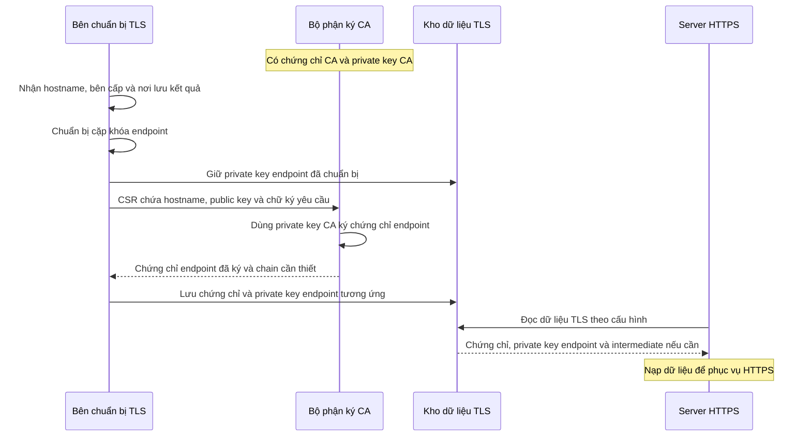
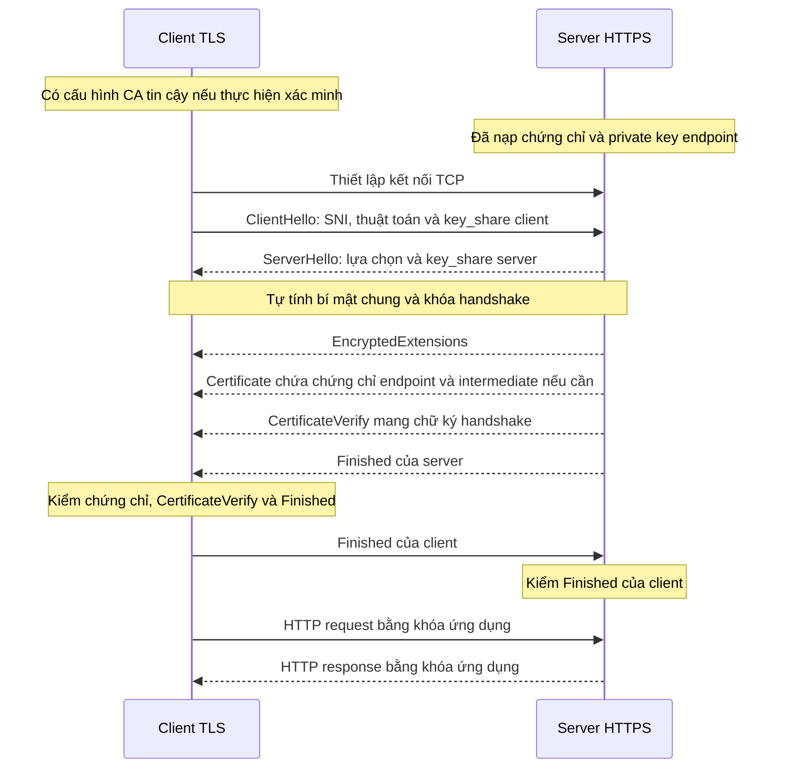

# CA, TLS và toàn bộ luồng request/response khi truy cập ứng dụng HTTPS

> Kiến thức nền cho [setup-rancher.md](setup-rancher.md) và
> [tunnel-traefik.md](tunnel-traefik.md). Ví dụ tổng quát dùng `app.example.com`;
> phần cuối áp dụng vào hostname `rancher.hieupn.site` và cấu hình lab.

Để hiểu toàn bộ quá trình, cần nối bốn việc với nhau: **tìm địa chỉ bằng DNS, thiết lập kết nối
mạng, tạo kênh bảo mật bằng TLS, rồi trao đổi request/response bằng HTTP.** CA tham gia vào việc
thiết lập niềm tin cho TLS.

Phần sau giải thích trên ví dụ `https://app.example.com/products?id=10`, rồi áp dụng vào Rancher.

## Mục lục

- [HTTP, HTTPS và TLS](#http-https-và-tls)
- [Certificate, CA và các loại khóa](#certificate-ca-và-các-loại-khóa)
  - [CA công khai và CA riêng](#ca-công-khai-và-ca-riêng)
  - [Trust store của từng client](#trust-store-của-từng-client)
  - [Các loại khóa làm những việc khác nhau](#các-loại-khóa-làm-những-việc-khác-nhau)
  - [Cấp certificate trước khi phục vụ HTTPS](#cấp-certificate-trước-khi-phục-vụ-https)
- [Terminate TLS và SNI](#terminate-tls-và-sni)
- [Ví dụ tự host web có domain, không dùng Kubernetes](#ví-dụ-tự-host-web-có-domain-không-dùng-kubernetes)
- [Luồng request/response qua TLS 1.3](#luồng-requestresponse-qua-tls-13)
  - [HIỂU TLS TRƯỚC — Từ chuẩn bị chứng chỉ đến thiết lập TLS giữa client và server](#hiểu-tls-trước)
    - [1. Phân biệt các vai trò và dữ liệu](#tls-vai-tro-du-lieu)
    - [2. Chuẩn bị chứng chỉ: từ nhu cầu đến dữ liệu server sử dụng](#tls-chuan-bi-chung-chi)
    - [3. Sơ đồ toàn bộ luồng](#so-do-toan-bo-luong)
      - [3A. Từ yêu cầu cấp đến lúc server có dữ liệu TLS](#so-do-cap-va-nap-chung-chi)
      - [3B. Client và server thiết lập TLS](#so-do-handshake-tls)
    - [4. ClientHello và ServerHello: chọn tham số, chọn endpoint và thiết lập khóa](#tls-clienthello-serverhello)
    - [5. Server gửi EncryptedExtensions](#tls-encryptedextensions)
    - [6. Server gửi bản tin TLS Certificate; client kiểm chứng chỉ](#tls-certificate)
    - [7. CertificateVerify: server chứng minh mình giữ private key endpoint](#tls-certificateverify)
    - [8. Finished và việc chuyển sang trao đổi HTTP](#tls-finished-http)
    - [9. Bảng tra cứu khóa, chứng chỉ và chữ ký](#tls-bang-tra-cuu)
    - [10. Khi sang Kubernetes, những dữ liệu trên được biểu diễn thế nào?](#tls-doi-tuong-kubernetes)
    - [11. Bảng nối trực tiếp sang bài 11 bước](#tls-doi-chieu-11-buoc)
    - [12. Đọc đúng trường hợp `noTLSVerify: true` trong lab](#tls-notlsverify)
    - [13. Ranh giới giữa chuẩn bị dữ liệu, nạp dữ liệu và dùng dữ liệu](#tls-cac-moc)
  - [Đọc URL, DNS và TCP trước handshake](#url-dns-tcp)
  - [Hostname ở DNS, SNI và HTTP Host](#hostname-dns-sni-http-host)
  - [Nhận diện lỗi xác minh certificate](#loi-xac-minh-certificate)
  - [Sau TLS — HTTP request/response và phiên đăng nhập](#http-request-response-sau-tls)
- [Áp dụng vào lab Rancher](#áp-dụng-vào-lab-rancher)
- [Origin Server Name](#origin-server-name)
- [Kiểm chứng certificate origin](#kiểm-chứng-certificate-origin)

## HTTP, HTTPS và TLS

**HTTP — HyperText Transfer Protocol** — là giao thức request/response: client gửi method,
đường dẫn, headers và có thể có body; server trả status, headers và có thể có body.
HTTP truyền trực tiếp không tự mã hóa hay xác thực server bằng certificate; bên đứng giữa có
khả năng quan sát hoặc can thiệp đường truyền có thể đọc/sửa nội dung.

**TLS — Transport Layer Security** — bảo vệ kết nối bằng mã hóa, kiểm tra tính toàn vẹn và
cơ chế xác thực. Client cần kiểm chứng certificate theo CA tin cậy và hostname để xác thực
server trong luồng HTTPS dùng certificate đang xét.

**HTTPS** là HTTP chạy trong kênh TLS. Với kết nối TCP thông thường, port mặc định là
`80` cho HTTP và `443` cho HTTPS. Một lần mở trang có thể sinh nhiều HTTP request; các
request có thể dùng chung kết nối, không phải mỗi request đều tạo một handshake mới.

Xem [HTTP Semantics — RFC 9110](https://www.rfc-editor.org/rfc/rfc9110.html) và
[TLS 1.3 — RFC 8446](https://www.rfc-editor.org/rfc/rfc8446.html).

## Certificate, CA và các loại khóa

**CA là Certificate Authority — bên cấp và ký certificate. Trong HTTPS, CA giúp client kiểm
chứng rằng một khóa công khai thực sự được cấp cho hostname mà client muốn truy cập.**

**Trước hết, certificate và CA liên quan với nhau như thế nào?**

Certificate — chứng chỉ số — có thể hiểu là một tấm giấy chứng nhận điện tử. Một certificate
của website chứa những thông tin như:

| Thông tin | Ý nghĩa |
| --- | --- |
| Hostname, thường trong trường `subjectAltName` | Certificate có giá trị cho những tên nào |
| Public key của server | Khóa công khai gắn với danh tính server |
| Issuer | Bên đã cấp certificate |
| Thời gian hiệu lực | Certificate bắt đầu và hết hạn khi nào |
| Chữ ký số của bên cấp | Cho phép kiểm tra nguồn cấp và tính nguyên vẹn |

Certificate thường theo chuẩn **X.509**. Nó có thể được gửi cho client; phần phải giữ bí mật là
**private key**, không phải certificate. Xem
[RFC 5280 — Internet X.509 Public Key Infrastructure](https://www.rfc-editor.org/rfc/rfc5280).

CA dùng private key của mình để ký certificate. Client dùng public key tương ứng của CA để kiểm
tra chữ ký.

Hình dung CA như một bên đóng dấu chứng nhận. Certificate là giấy có dấu; nhưng client còn phải
biết **có tin bên đóng dấu đó hay không**.

Browser có **trust store**: tập hợp các certificate CA gốc mà nó tin. Một certificate website
thường được cấp qua chuỗi Root CA → Intermediate CA → certificate website. Browser kiểm tra
chuỗi chữ ký để tìm về một CA gốc đã được tin cậy.

### CA công khai và CA riêng

**Public CA — CA công khai** — có chuỗi tin cậy dẫn về root CA được nhiều browser/OS tin sẵn.
Client vẫn phải kiểm tra hostname, thời gian hiệu lực và các điều kiện xác minh còn lại.

**Private CA — CA riêng** — do tổ chức hoặc người vận hành quản lý. Certificate do CA riêng
ký không tự được mọi client tin. Người vận hành phải cung cấp certificate CA cho đúng trust
store/bundle của từng client; không cung cấp private key CA cho client.

Việc tạo và ký certificate bằng CA riêng vẫn tách biệt với việc endpoint dùng certificate đó
trong handshake. Phần áp dụng vào Rancher ở dưới chỉ rõ vai trò của từng thành phần.

### Trust store của từng client

**Trust store không phải lúc nào cũng là store của hệ điều hành, và các process trên cùng máy
không nhất thiết tin cùng một tập CA.** Ví dụ:

| Client | Nguồn CA tin cậy |
| --- | --- |
| Chrome trên các nền tảng hỗ trợ Chrome Root Store | Có root store riêng; có cơ chế tích hợp CA do người dùng/quản trị viên tin ở nền tảng. Chrome trên iOS dùng cơ chế của Apple |
| Firefox | Có root store của Mozilla; còn có thể tin CA được thêm vào OS theo nền tảng và cấu hình |
| Safari | Dùng cơ chế tin cậy certificate của hệ điều hành Apple |
| curl | Phụ thuộc bản build và TLS backend: bản dùng Schannel trên Windows dùng Windows CA store; nhiều bản khác dùng CA bundle dạng file |
| Python `requests` | Bản upstream mặc định dùng bundle của `certifi`; có thể chỉ định bundle bằng `verify="/path/ca-bundle.pem"` hoặc `REQUESTS_CA_BUNDLE`. Bản đóng gói/tùy biến có thể khác |

Vì vậy, “process cần tin CA riêng” nghĩa là phải cấp CA cho **đúng trust store/bundle mà process
đó thực sự dùng**. Browser truy cập được không chứng minh một script Python hoặc Pod cũng sẽ
verify được. Không suy ra mọi bản curl trên Windows đều dùng Schannel; có thể xem TLS backend
bằng `curl -V`.

Tham khảo: [Chrome Root Store FAQ](https://chromium.googlesource.com/chromium/src/+/main/net/data/ssl/chrome_root_store/faq.md),
[Mozilla — Set up CAs in Firefox](https://support.mozilla.org/en-US/kb/setting-certificate-authorities-firefox),
[Apple — Certificate management](https://support.apple.com/guide/deployment/intro-to-certificate-management-depb5eff8914/web),
[curl — TLS Certificate Verification](https://curl.se/docs/sslcerts.html) và
[Requests — CA Certificates](https://requests.readthedocs.io/en/latest/user/advanced/#ca-certificates).

### Các loại khóa làm những việc khác nhau

| Khóa | Vai trò |
| --- | --- |
| Private key của CA | Ký certificate |
| Public key của CA | Kiểm tra chữ ký trên certificate |
| Private key của server | Chứng minh server sở hữu khóa tương ứng với certificate |
| Public key của server | Giúp client kiểm tra bằng chứng đó |
| Cặp khóa tạm thời của mỗi bên trong trao đổi (EC)DHE | Public share được gửi trong `key_share`; private key tương ứng được giữ kín để tính bí mật chung |
| Handshake traffic keys | Bảo vệ các thông điệp handshake sau `ServerHello` trong TLS 1.3 |
| Application traffic keys | Mã hóa và kiểm tra tính toàn vẹn của dữ liệu ứng dụng như HTTP |

Vì vậy, certificate giúp thiết lập danh tính; **dữ liệu request/response được bảo vệ bằng khóa
phiên TLS**.

### Cấp certificate trước khi phục vụ HTTPS

Trước khi website phục vụ HTTPS, người vận hành cần chuẩn bị certificate. Với public CA như
Let’s Encrypt, **ACME client** — chẳng hạn certbot hoặc cert-manager — làm việc với CA; nó không
nhất thiết là process đang phục vụ HTTPS. Quá trình cơ bản là:

1. ACME client tạo hoặc sử dụng khóa tài khoản ACME để xác thực các yêu cầu quản lý certificate.
2. Chứng minh quyền kiểm soát domain, chẳng hạn bằng một DNS record hoặc tài nguyên HTTP theo yêu
   cầu của CA.
3. Tạo cặp khóa cho certificate, lập CSR chứa public key và hostname, rồi xin CA cấp certificate.
4. Nhận certificate đã ký và chuỗi intermediate, rồi cấu hình chúng cùng private key tương ứng
   tại điểm phục vụ HTTPS.

**Khóa tài khoản ACME và khóa của certificate là hai cặp khóa khác nhau.** Khóa tài khoản dùng
với dịch vụ ACME; private key của certificate được điểm phục vụ HTTPS dùng để chứng minh danh
tính trong TLS. Cặp khóa tạm thời trong `key_share` lại phục vụ việc thiết lập bí mật chung.

Xem [Let’s Encrypt — How It Works](https://letsencrypt.org/how-it-works/).

**CA không phải một proxy đứng giữa browser và ứng dụng để chuyển tiếp mỗi request.** Việc cấp
certificate diễn ra trước. Khi kết nối, browser kiểm tra certificate mà server trình; các kiểm
tra trạng thái certificate bổ sung tùy chính sách của client.

## Terminate TLS và SNI

**Terminate TLS** nghĩa là một chương trình thực hiện TLS với client và đọc được dữ liệu ứng
dụng sau khi giải mã. Chương trình đó có thể là chính web server hoặc reverse proxy. Nó giữ
certificate và private key tương ứng; dữ liệu HTTP được mã hóa/giải mã bằng application
traffic keys, không phải bằng certificate.

Nếu reverse proxy terminate TLS, nó đọc hostname/path trong HTTP rồi chuyển request tới
backend bằng một kết nối khác. Kết nối backend có thể là HTTP hoặc HTTPS tùy cấu hình.
Response quay lại proxy cũng được proxy bảo vệ trong kết nối TLS với client. Hai chặng dùng
HTTPS, nếu có, vẫn là hai kết nối TLS riêng.

**SNI — Server Name Indication** — là tên server client khai trong `ClientHello`. Một IP và
port có thể phục vụ nhiều hostname; SNI giúp server chọn cấu hình TLS/certificate trước khi
trình certificate.

Server cần thông tin này sớm vì HTTP Host chỉ có khi client gửi HTTP sau handshake trong
luồng đang xét. **SNI chọn cấu hình TLS/certificate; HTTP Host hoặc `:authority` giúp chọn
website/router HTTP.** Chúng xuất hiện ở hai lớp và hai thời điểm khác nhau.

Một server có thể nạp nhiều certificate cùng các private key tương ứng trước khi có kết
nối. Với mỗi handshake, server chọn dữ liệu đã nạp để sử dụng; nó không xin CA ký lại
certificate cho từng HTTP request. Nếu không có certificate khớp SNI, hành vi phụ thuộc cấu
hình server: có thể dùng certificate mặc định hoặc từ chối handshake.

Xem [RFC 6066 §3 — SNI](https://datatracker.ietf.org/doc/html/rfc6066#section-3) và
[NGINX — Configuring HTTPS servers](https://nginx.org/en/docs/http/configuring_https_servers.html).

## Ví dụ tự host web có domain, không dùng Kubernetes

Đây là ví dụ giải thích được tách từ từ điển của `setup-rancher.md`, không phải cấu hình cần
áp dụng vào lab Rancher. Giả sử bạn có web server nginx với IP public `203.0.113.10`, muốn
phục vụ `https://vidu.com`.

Bốn phần cần chuẩn bị:

1. **DNS.** Tạo A record `vidu.com → 203.0.113.10` tại dịch vụ DNS có thẩm quyền của domain.
   Record A ánh xạ tên tới IPv4. Với URL `https://vidu.com` trong ví dụ này, browser dùng
   port mặc định `443`; nếu server nghe `8443`, URL cần ghi `https://vidu.com:8443`.
2. **Certificate.** ACME client như certbot xin certificate cho `vidu.com` từ public CA.
   CA yêu cầu chứng minh quyền kiểm soát domain: HTTP-01 dùng tài nguyên HTTP ở đường dẫn
   thử thách trên port `80`; DNS-01 dùng TXT record theo yêu cầu. Sau khi cấp, người vận
   hành cấu hình certificate, chuỗi intermediate cần thiết và private key tương ứng cho nginx.
   Xem [Let's Encrypt — Challenge Types](https://letsencrypt.org/docs/challenge-types/).
3. **Firewall/NAT.** Cho phép kết nối inbound tới nginx port `443`. Ví dụ bên dưới còn dùng
   port `80` để chuyển hướng HTTP sang HTTPS; HTTP-01 cũng cần truy cập port `80` khi chọn
   phương thức này. Nếu server sau NAT, cần ánh xạ port phù hợp.
4. **Web server.** Cấu hình chương trình nginx nghe HTTPS, đọc certificate và private key đã
   chuẩn bị. Cùng một chương trình có thể nhận HTTP ở `80` và HTTPS ở `443`.

Ví dụ cấu hình minh họa, giả định các file certificate/key đã tồn tại:

```nginx
server {
    listen 80;
    server_name vidu.com;
    return 301 https://vidu.com$request_uri;
}
server {
    listen 443 ssl;
    server_name vidu.com;
    ssl_certificate     /etc/ssl/vidu.com/fullchain.pem;
    ssl_certificate_key /etc/ssl/vidu.com/privkey.pem;
    root /var/www/vidu;
}
```

Với kết nối mới: browser phân giải `vidu.com` ra IP, mở TCP tới port `443`, rồi gửi SNI
`vidu.com` trong handshake. nginx chọn cấu hình TLS/certificate phù hợp; browser kiểm chứng
certificate và các thông điệp handshake. Sau đó browser gửi HTTP với Host `vidu.com` trong
kênh TLS. Xem [NGINX — Configuring HTTPS servers](https://nginx.org/en/docs/http/configuring_https_servers.html).

DNS giúp client tìm địa chỉ mạng; SNI giúp server chọn certificate; HTTP Host giúp chọn
website xử lý request. Biết đúng IP chưa đủ để thay thế hai bước chọn theo hostname.

Đối chiếu với Rancher: lab đưa browser tới Cloudflare Edge, dùng tunnel thay cho việc mở
inbound tới VM, và phục vụ certificate riêng tại Traefik. Cách áp dụng nằm trong
[từ điển của setup-rancher.md](setup-rancher.md#từ-điển-khái-niệm-nền) và
[chuỗi cấp certificate của lab](setup-rancher.md#controller-nào-cấp-certificate-và-ai-gửi-hai-bản-tin-tls).

## Luồng request/response qua TLS 1.3

Đọc **HIỂU TLS TRƯỚC** để theo dõi từ certificate và chain đến từng bản tin handshake,
cách hai bên kiểm chứng và thời điểm dùng khóa ứng dụng. Các mục sau đó bổ sung chi tiết
về URL/DNS/TCP, hostname, lỗi xác minh và HTTP request/response.

Đối chiếu [RFC 8446 §2 — Protocol Overview](https://www.rfc-editor.org/rfc/rfc8446.html#section-2)
và [§7.1 — Key Schedule](https://www.rfc-editor.org/rfc/rfc8446.html#section-7.1).

<a id="hiểu-tls-trước"></a>

### HIỂU TLS TRƯỚC — Từ chuẩn bị chứng chỉ đến thiết lập TLS giữa client và server

Ví dụ xuyên suốt: client kết nối tới **`https://app.example.com`**.

Bài xét một kết nối mới dùng **TLS 1.3 với certificate và ECDHE**, trong đó server trình chứng chỉ, client kiểm chứng server. Các nhánh khôi phục phiên, 0-RTT và xác thực client bằng chứng chỉ không nằm trong luồng chính.

Cần theo dõi hai giai đoạn:

| Giai đoạn | Công việc | Thời điểm |
|---|---|---|
| **Chuẩn bị dữ liệu TLS** | Tạo khóa endpoint, xin cấp chứng chỉ, ký, lưu và nạp dữ liệu vào server | Trước khi server có thể sử dụng bộ dữ liệu đó để phục vụ HTTPS |
| **Thiết lập kết nối TLS** | Client và server trao đổi các bản tin handshake, kiểm chứng và thiết lập khóa bảo vệ kết nối | Khi mở một kết nối TLS mới |

Trong bài 11 bước của `setup-rancher.md`, **bước 1–6 thuộc giai đoạn chuẩn bị và nạp dữ liệu; bước 7–11 trích phần sử dụng dữ liệu trong handshake**.

<a id="tls-vai-tro-du-lieu"></a>

**1. Phân biệt các vai trò và dữ liệu**

**1.1. Bài toán cần giải quyết**

Khi client, ví dụ browser, truy cập `https://app.example.com`, client và server phục vụ website thực hiện **bắt tay TLS**. Mục đích là giúp client kiểm chứng danh tính server và thiết lập kết nối mã hóa để bảo vệ dữ liệu gửi, nhận.

**Trước đó**, phía vận hành website đã chuẩn bị **Chứng chỉ endpoint — `certificate`** cho `app.example.com` và cấu hình server sử dụng chứng chỉ này cùng private key tương ứng.

**Trong quá trình bắt tay**, server gửi **bản tin TLS `Certificate`**, chứa **Chứng chỉ endpoint — `certificate`**, và **bản tin TLS `CertificateVerify`**, chứa **chữ ký do server tạo bằng private key tương ứng**.

Chứng chỉ endpoint chứa **public key của server**. Client dùng public key này để kiểm tra chữ ký trong `CertificateVerify`, qua đó kiểm chứng server sở hữu private key tương ứng.

Có thể hình dung `Certificate` là **phong bao chứa chứng chỉ**, còn `CertificateVerify` là **thông điệp chứa bằng chứng sở hữu private key**, gắn với cuộc bắt tay hiện tại. **Chứng chỉ endpoint — `certificate`** chứa **public key của server**. Có thể hình dung bản tin **TLS `Certificate`** là **phong bao**, còn chứng chỉ là **dữ liệu được đặt bên trong**.

Client kiểm tra chứng chỉ endpoint, rồi dùng **public key trong chứng chỉ đó** để kiểm tra **chữ ký server gửi trong bản tin `CertificateVerify`**. Chữ ký này được tạo bằng private key tương ứng và gắn với dữ liệu của cuộc bắt tay hiện tại, giúp client kiểm chứng server sở hữu private key ấy. Hai bên tiếp tục hoàn tất các bước thiết lập và xác nhận kết nối mã hóa trước khi trao đổi HTTP.

**Kịch bản cụ thể:** bạn vận hành website bằng **NGINX**, muốn phục vụ `https://app.example.com` và chọn **Let’s Encrypt** làm CA cấp **Chứng chỉ endpoint — `certificate`** cho `app.example.com`. Bạn cấu hình **Certbot**, một phần mềm quản lý chứng chỉ endpoint, để thực hiện việc xin cấp và gia hạn chứng chỉ endpoint này thay mình.

Ở mục 1.1, việc xin cấp, ký cấp và gia hạn đều nói tới **Chứng chỉ endpoint — `certificate`**, tức dữ liệu chứng chỉ thực tế. **Bản tin TLS `Certificate`** là thông điệp server dùng để gửi chứng chỉ đó cho client trong handshake.

| Câu hỏi | Vai trò liên quan | Trong kịch bản này |
|---|---|---|
| **Ai muốn được cấp chứng chỉ endpoint?** | **Người vận hành website** | Bạn cần **Chứng chỉ endpoint — `certificate`** cho website; hoặc nhà cung cấp hosting/CDN thực hiện thay bạn. |
| **Ai thực sự gửi yêu cầu?** | **Bên chuẩn bị dữ liệu TLS** | Certbot, chạy theo cấu hình của bạn: gửi yêu cầu cấp/gia hạn chứng chỉ endpoint, nhận và lưu **`certificate` đã được CA ký** để server sử dụng. Các mục sau giải thích cụ thể việc chuẩn bị khóa và lập yêu cầu. |
| **Gửi yêu cầu cho ai?** | **Bộ phận ký với danh tính CA** | Let’s Encrypt nhận yêu cầu, xác minh quyền kiểm soát domain theo quy trình của họ rồi ký cấp **Chứng chỉ endpoint — `certificate`**. |
| **Khi nào yêu cầu?** | **Thời điểm cấp chứng chỉ endpoint** | Khi thiết lập HTTPS lần đầu; sau đó khi cần gia hạn hoặc cấp lại. Không phải mỗi lần người dùng mở website. |
| **Tại sao phải yêu cầu?** | **Mục đích của việc cấp** | Để CA cấp **chứng chỉ endpoint** xác nhận sự gắn kết giữa hostname và public key của website, giúp browser kiểm chứng danh tính server. Nội dung của **`certificate`** được giải thích ở mục 1.2. |
| **Ai dùng kết quả để phục vụ HTTPS?** | **Server HTTPS** | NGINX nạp **chứng chỉ endpoint đã cấp và private key tương ứng** để thực hiện TLS với người truy cập. |
| **Ai kết nối và kiểm chứng server?** | **Client TLS** | Browser của người dùng chủ động kết nối tới website và kiểm chứng server theo cấu hình. |

Ví dụ về quy trình xin cấp được đối chiếu tại [Let’s Encrypt — How It Works](https://letsencrypt.org/how-it-works/).

Đây là các **vai trò**, không bắt buộc là những máy hoặc hệ thống riêng. Nhà cung cấp có thể lo trọn phần chuẩn bị và cấp chứng chỉ endpoint giúp bạn.

Trong lab Rancher, **cert-manager chuẩn bị và ký chứng chỉ endpoint Rancher bằng CA riêng; Traefik là server HTTPS; `cloudflared` là client TLS** trên chặng origin.

**1.2. Chứng chỉ endpoint và chứng chỉ CA**

**Endpoint HTTPS** là điểm thực sự nhận kết nối TLS và xử lý mã hóa/giải mã. Nó có thể là web server hoặc reverse proxy.

Trong ví dụ, chứng chỉ endpoint chứa thông tin tương đương:

```text
Hostname trong subjectAltName: app.example.com
Public key: public key của endpoint
Bên cấp (Issuer): CA đã cấp chứng chỉ
Thời hạn: thời điểm bắt đầu và hết hạn
Chữ ký của CA: chữ ký trên nội dung được chứng nhận
```

Chứng chỉ CA cũng là một chứng chỉ số, nhưng chủ thể của nó là **CA**:

```text
Chủ thể: tên CA
Public key: public key của CA
Thông tin thể hiện vai trò CA
Bên cấp: chính CA đó hoặc một CA cấp trên
Thời hạn: ...
Chữ ký của bên cấp: ...
```

**Không chứng chỉ nào chứa private key.**

Cần phân biệt hai cặp khóa:

| Cặp khóa | Private key làm gì? | Public key làm gì? |
|---|---|---|
| **Cặp khóa CA** | Ký chứng chỉ được cấp | Kiểm chữ ký do CA tạo |
| **Cặp khóa danh tính của endpoint** | Ký CSR khi xin cấp; ký bằng chứng trong handshake | Kiểm chữ ký tương ứng của bên giữ private key endpoint |

Hai cặp khóa này khác nhau.

**1.3. Certificate chain là gì?**

**Certificate chain — chuỗi chứng chỉ** giúp client liên kết chứng chỉ endpoint với một CA được client tin cậy.

Có hai trường hợp thường gặp:

| Trường hợp | Quan hệ cấp chứng chỉ |
|---|---|
| **CA được client tin trực tiếp ký endpoint** | Client dùng public key của CA đó để kiểm chứng chỉ endpoint |
| **Có CA trung gian** | CA trung gian ký endpoint; chứng chỉ CA trung gian được CA cấp trên ký; chuỗi dẫn về một điểm tin cậy của client |

Nếu có CA trung gian, server thường cần gửi các chứng chỉ trung gian cần thiết cùng chứng chỉ endpoint.

Root CA tin cậy thường đã nằm trong **trust store hoặc CA bundle của client**. Server gửi một root certificate không tự làm client tin root đó.

Để nối với bài 11 bước, trước hết theo dõi **CA trong `tls-rancher` ký chứng chỉ endpoint Rancher**. Khi cần đọc cấu hình có CA trung gian, áp dụng thêm quan hệ chain ở trên.

**Về certificate chain:** 11 bước có mô tả **quan hệ cấp chứng chỉ**: CA riêng trong `tls-rancher` ký chứng chỉ endpoint trong `tls-rancher-ingress`. Nó không mô tả thêm tầng CA trung gian hay liệt kê đầy đủ chuỗi chứng chỉ Traefik gửi. Vì vậy, không nên hiểu rằng **“không kiểm chain” đồng nghĩa với “chứng chỉ không có nguồn cấp hoặc không có chữ ký CA”**.

Điểm quyết định ở đây là: **dù server gửi các chứng chỉ cần thiết, `cloudflared` vẫn bỏ việc xác minh nguồn gốc khi `noTLSVerify: true`.**

Nếu muốn kiểm chứng nguồn gốc trên chặng này thì cần:

1. **Bật xác minh:** đặt `noTLSVerify: false`.
2. **Cho `cloudflared` tin CA riêng:** cung cấp **chứng chỉ CA**, chẳng hạn qua `caPool`. Client chỉ cần chứng chỉ chứa public key CA; không cần private key CA.
3. Giữ **`originServerName: rancher.hieupn.site`** để kiểm tra tên mong đợi trên chứng chỉ. [Cloudflare Docs](https://developers.cloudflare.com/tunnel/reference/origin-parameters/?utm_source=chatgpt.com)

Khi đó, nếu CA được tin cậy ký trực tiếp chứng chỉ endpoint, `cloudflared` sẽ dùng **public key của CA** để kiểm tra **chữ ký CA trên chứng chỉ endpoint**, đồng thời kiểm tra các điều kiện hợp lệ. Nếu có CA trung gian, nó kiểm tra qua các mắt xích tới CA được tin cậy. [www.rfc-editor.org](https://www.rfc-editor.org/rfc/rfc5280.html?utm_source=chatgpt.com)

Việc này **bổ sung cho bước 11**: kiểm nguồn cấp dùng **public key CA**; kiểm `CertificateVerify` dùng **public key endpoint**.

<a id="tls-chuan-bi-chung-chi"></a>

**2. Chuẩn bị chứng chỉ: từ nhu cầu đến dữ liệu server sử dụng**

**2.1. Bộ phận ký phải có dữ liệu CA**

Để cấp **Chứng chỉ endpoint — `certificate`** bằng một CA đã được thiết lập, bộ phận ký cần truy cập:

- **Chứng chỉ của CA**: chứa **public key của CA** và thông tin danh tính CA.
- **Private key của CA tương ứng**: dùng để tạo chữ ký CA trên **chứng chỉ endpoint được cấp**.

Chứng chỉ CA cung cấp thông tin về bên cấp; **private key CA mới là khóa thực hiện thao tác ký**.

CA có thể là CA gốc tự ký hoặc CA trung gian được CA cấp trên ký. Việc thiết lập CA diễn ra trước công việc cấp chứng chỉ endpoint đang xét.

Trong lab, dữ liệu CA được lưu tại **Secret `tls-rancher`**. Controller được giao việc ký đọc dữ liệu đó theo cấu hình của `Issuer/rancher`.

**Traefik không cần private key CA để thực hiện handshake.**

**2.2. Ghi lại nhu cầu cấp chứng chỉ**

Trước khi có chứng chỉ endpoint, cần biết:

- Cấp cho hostname nào?
- Dùng CA hoặc phương thức cấp nào?
- Chứng chỉ được dùng cho mục đích gì?
- Lưu kết quả ở đâu?

Ví dụ:

```text
Cần chứng chỉ cho: app.example.com
Dùng bên cấp: CA đã chọn
Lưu kết quả: nơi server HTTPS sẽ đọc
```

Đây mới là **nhu cầu cấp chứng chỉ**, chưa phải chứng chỉ đã được ký.

Trong Kubernetes, object cert-manager **`Certificate`** ghi lại nhu cầu tương tự. Ý nghĩa cụ thể của object này được đối chiếu ở mục 10.

**2.3. Chuẩn bị cặp khóa endpoint**

Bên chuẩn bị TLS tạo hoặc sử dụng một cặp khóa endpoint:

- **Private key endpoint** được giữ kín.
- **Public key endpoint** được đưa vào yêu cầu xin cấp chứng chỉ.

Cặp khóa này được chuẩn bị **trước khi CA ký chứng chỉ endpoint**.

Chứng chỉ được cấp sau đó phải chứa public key tương ứng với private key đã chuẩn bị. Nếu chứng chỉ và private key không khớp, server không có bộ dữ liệu đúng để chứng minh việc sở hữu khóa.

**2.4. Tạo CSR — yêu cầu xin ký chứng chỉ**

**CSR — Certificate Signing Request** là yêu cầu xin cấp chứng chỉ, chứa thông tin tương đương:

```text
Hostname xin cấp: app.example.com
Public key: public key của endpoint
Các thuộc tính đề nghị cấp
Chữ ký của yêu cầu: tạo bằng private key endpoint
```

CSR được ký bằng private key tương ứng với public key trong yêu cầu. Bên xử lý có thể kiểm chữ ký đó để kiểm chứng việc sở hữu khóa và tính toàn vẹn của yêu cầu. **Private key endpoint không nằm trong CSR.** [RFC 2986 — Chữ ký trên yêu cầu cấp chứng chỉ](https://www.rfc-editor.org/rfc/rfc2986.html#section-4.2)

Chữ ký CSR không tự chứng minh người xin có quyền với hostname. Quyền được cấp chứng chỉ còn phụ thuộc chính sách và quy trình của bên cấp.

Trong bài 11 bước, object **`CertificateRequest`** mang CSR và thông tin chọn Issuer cho một lần xin cấp cụ thể.

**2.5. Bộ phận ký cấp chứng chỉ endpoint**

Bộ phận ký xử lý yêu cầu theo phương thức và chính sách được cấu hình, rồi:

1. Lấy thông tin cần chứng nhận, trong đó có hostname và public key endpoint.
2. Tạo nội dung chứng chỉ, gồm bên cấp, thời hạn và các thuộc tính liên quan.
3. Dùng **private key CA** tạo chữ ký trên nội dung chứng chỉ.
4. Trả về chứng chỉ endpoint đã ký, cùng dữ liệu chain cần thiết nếu có.

Kết quả chứa **public key endpoint**, không chứa private key endpoint hay private key CA.

Bên ký không cần nhận private key endpoint từ CSR để cấp chứng chỉ.

**2.6. Lưu và nạp dữ liệu vào server HTTPS**

Bên chuẩn bị kết hợp:

- **Chứng chỉ endpoint đã được CA ký**.
- **Private key endpoint đã chuẩn bị từ trước**.
- Các chứng chỉ CA trung gian cần gửi nếu cấu hình cần chúng.

Các dữ liệu này được lưu tại nơi server có quyền đọc, chẳng hạn file hoặc Kubernetes Secret.

Server sau đó **nạp dữ liệu** để sử dụng khi thực hiện TLS.

Private key endpoint có thể được bàn giao nội bộ cho chương trình phục vụ HTTPS bằng cơ chế được kiểm soát. Nó **không được đưa vào CSR hoặc các bản tin handshake gửi cho client**.

Trong lab:

- Dữ liệu endpoint được lưu vào **Secret `tls-rancher-ingress`**.
- Traefik đọc Secret qua Kubernetes API.
- Traefik nạp chứng chỉ endpoint và private key HTTPS tương ứng.

**2.7. Client cần được cấu hình niềm tin riêng**

Server đã có chứng chỉ hợp lệ không đồng nghĩa mọi client đều tin chứng chỉ đó.

Nếu client thực hiện kiểm chứng, client cần có điểm tin cậy phù hợp:

- Với CA công khai: thường dẫn về CA gốc có sẵn trong trust store.
- Với CA riêng: phải cấu hình chứng chỉ CA phù hợp cho trust store/CA bundle mà client thực sự dùng.

**Chỉ cung cấp chứng chỉ CA công khai cho client, không cung cấp private key CA.**

Việc chuẩn bị, cấp và gia hạn chứng chỉ chạy độc lập với từng kết nối. Server có thể dùng cùng bộ dữ liệu còn hợp lệ để phục vụ nhiều kết nối TLS.

<a id="so-do-toan-bo-luong"></a>

**3. Sơ đồ toàn bộ luồng**

Hai sơ đồ dưới đây nối tiếp nhau:

- **3A:** chuẩn bị, cấp và nạp dữ liệu.
- **3B:** sử dụng dữ liệu ấy trong một kết nối TLS mới.

<a id="so-do-cap-va-nap-chung-chi"></a>

**3A. Từ yêu cầu cấp đến lúc server có dữ liệu TLS**



Đây là sơ đồ **vai trò tổng quát**. Khi sang bài 11 bước, các công việc được phân cho controller, object và Secret cụ thể.

<a id="so-do-handshake-tls"></a>

**3B. Client và server thiết lập TLS**



Từ `EncryptedExtensions` đến `Finished`, các thông điệp handshake được bảo vệ bằng khóa handshake tương ứng từng chiều.

Các mũi tên biểu diễn thông điệp, không quy định mỗi thông điệp phải nằm trong một gói TCP riêng. Server có thể gửi liên tiếp nhiều thông điệp mà không chờ client trả lời sau từng thông điệp.

<a id="tls-clienthello-serverhello"></a>

**4. ClientHello và ServerHello: chọn tham số, chọn endpoint và thiết lập khóa**

**4.1. Client gửi ClientHello**

Sau khi tìm được IP và thiết lập TCP, client gửi:

| Thông tin | Mục đích |
|---|---|
| Các phiên bản TLS hỗ trợ | Thương lượng phiên bản |
| Các cipher suite hỗ trợ | Chọn thuật toán mã hóa đối xứng và hàm băm |
| Các thuật toán chữ ký hỗ trợ | Cho server chọn cách ký mà client kiểm tra được |
| **SNI** | Khai hostname muốn kết nối, giúp server chọn cấu hình TLS/chứng chỉ |
| **ALPN** | Đề xuất giao thức ứng dụng, chẳng hạn HTTP/2 hoặc HTTP/1.1 |
| **`key_share`** | Gửi phần công khai của khóa tạm thời để thiết lập bí mật chung |
| Giá trị ngẫu nhiên | Góp phần tạo dữ liệu riêng cho cuộc bắt tay |

Với ví dụ đang xét, SNI là **`app.example.com`**.

Một điểm HTTPS có thể phục vụ nhiều hostname. Server dùng SNI để chọn bộ chứng chỉ và private key phù hợp **đã nạp từ trước**.

SNI không khiến server xin CA ký lại chứng chỉ cho từng kết nối.

Trong lab, `originServerName: rancher.hieupn.site` khiến `cloudflared` khai SNI tương ứng khi kết nối origin.

**4.2. Server trả ServerHello**

Server thông báo lựa chọn phiên bản, cipher suite và trao đổi khóa, kèm **`key_share` phía server**.

Client kiểm tra các lựa chọn có hợp lệ với đề xuất của mình không.

Phần công khai trong hai `key_share` thuộc **các cặp khóa tạm thời của cuộc trao đổi ECDHE**. Chúng khác public key danh tính trong chứng chỉ endpoint.

Hai bên tính bí mật chung bằng:

| Bên tính | Dữ liệu sử dụng |
|---|---|
| Client | Private key tạm thời của client + phần công khai tạm thời của server |
| Server | Private key tạm thời của server + phần công khai tạm thời của client |

Hai bên tự tính cùng bí mật chung rồi dẫn xuất các khóa handshake. Private key tạm thời và bí mật chung không được gửi trực tiếp cho nhau.

**Đã có khóa để mã hóa handshake chưa có nghĩa client đã xác thực xong server.**

Các khóa tạm thời và khóa bảo vệ kết nối được thư viện TLS của client/server xử lý. Chúng không phải cặp khóa endpoint mà cert-manager chuẩn bị và lưu trong Secret.

<a id="tls-encryptedextensions"></a>

**5. Server gửi EncryptedExtensions**

**Nội dung:** các tham số bổ sung được thương lượng, chẳng hạn ALPN chọn HTTP/2.

**Mục đích:** hoàn tất những lựa chọn không cần gửi công khai trong ServerHello để thiết lập khóa.

**Client xử lý:** giải mã, kiểm tính toàn vẹn của bản ghi TLS, kiểm các extension có hợp lệ rồi ghi nhận lựa chọn.

Bản tin này không chứa chứng chỉ và chưa chứng minh server giữ private key danh tính.

<a id="tls-certificate"></a>

**6. Server gửi bản tin TLS Certificate; client kiểm chứng chỉ**

**6.1. Bản tin chứa gì?**

Server gửi **chứng chỉ endpoint đã chọn theo SNI**, cùng các chứng chỉ trung gian cần thiết.

Cần phân biệt:

> **Bản tin TLS `Certificate` là thông điệp chứa danh sách chứng chỉ. Chứng chỉ endpoint là một phần dữ liệu nằm bên trong thông điệp đó.**

Chứng chỉ endpoint:

- Đã có chữ ký CA từ giai đoạn cấp.
- Chứa public key endpoint.
- Không chứa private key endpoint.

Server không tạo lại chữ ký CA ở bước gửi này.

**6.2. Client kiểm chữ ký CA và chuỗi tin cậy**

Nếu CA được client tin trực tiếp ký chứng chỉ endpoint, client dùng public key của CA đó để kiểm chữ ký trên chứng chỉ endpoint.

Nếu có CA trung gian:

| Chữ ký cần kiểm | Public key dùng để kiểm |
|---|---|
| Chữ ký trên chứng chỉ endpoint | Public key trong chứng chỉ CA trung gian cấp nó |
| Chữ ký trên chứng chỉ CA trung gian | Public key của CA cấp trên tương ứng |

Client kiểm chuỗi dẫn về điểm tin cậy đã cấu hình, cùng các ràng buộc liên quan.

Một chứng chỉ CA do server gửi chưa tự trở thành đáng tin. Root CA được tin cậy vì cấu hình niềm tin của client, không phải chỉ vì nó tự ký hoặc được server gửi sang.

**6.3. Client kiểm hostname, thời hạn và điều kiện sử dụng**

Client kiểm:

- Hostname muốn truy cập có khớp định danh trong `subjectAltName` không.
- Chứng chỉ còn trong thời gian hiệu lực không.
- Mục đích sử dụng, thuật toán và các ràng buộc có phù hợp không.
- Những điều kiện kiểm chứng khác theo chính sách client, gồm cơ chế kiểm trạng thái thu hồi nếu áp dụng.

Nếu một kiểm tra bắt buộc thất bại, client dừng kết nối.

**Kiểm chứng chỉ thành công chưa tự chứng minh bên đang bắt tay giữ private key endpoint.** Chứng chỉ là dữ liệu công khai có thể sao chép; bước kế tiếp kiểm bằng chứng sở hữu private key.

<a id="tls-certificateverify"></a>

**7. CertificateVerify: server chứng minh mình giữ private key endpoint**

**7.1. Server ký dữ liệu gì?**

Đến đây, cuộc bắt tay đã có:

```text
ClientHello
ServerHello
EncryptedExtensions
Certificate
```

Nội dung các thông điệp theo thứ tự gọi là **handshake transcript**.

Transcript bao gồm những lựa chọn và dữ liệu đã trao đổi, trong đó có các `key_share` và danh sách chứng chỉ trong bản tin Certificate.

Server tính **bản băm — hash** của transcript. Chính xác hơn, server ký một cấu trúc chứa hash đến hết bản tin Certificate cùng thông tin ngữ cảnh quy định cho server CertificateVerify của TLS 1.3.

Khóa dùng ký là **private key endpoint tương ứng với chứng chỉ vừa trình**.

Chữ ký được gửi trong bản tin **`CertificateVerify`**. [RFC 8446 — CertificateVerify](https://www.rfc-editor.org/rfc/rfc8446.html#section-4.4.3)

**7.2. Client kiểm như thế nào?**

Client:

1. Lấy public key endpoint từ chứng chỉ đã nhận.
2. Tự tính transcript hash từ các thông điệp mình đã gửi/nhận.
3. Dựng dữ liệu kiểm chữ ký tương ứng.
4. Dùng public key endpoint để kiểm chữ ký trong CertificateVerify.

**Mục đích:** chứng minh bên đang bắt tay giữ private key tương ứng, đồng thời gắn bằng chứng với đúng cuộc trao đổi hiện tại.

Người sao chép chứng chỉ nhưng không có private key endpoint không thể tạo chữ ký hợp lệ cho transcript của cuộc bắt tay mới.

**Server gửi chữ ký, không gửi private key.**

Bản tin CertificateVerify không phải một chứng chỉ khác và cũng không phải chữ ký CA trên chứng chỉ.

<a id="tls-finished-http"></a>

**8. Finished và việc chuyển sang trao đổi HTTP**

**8.1. Server gửi Finished**

Finished chứa giá trị kiểm chứng tính bằng **HMAC** trên transcript đến hết CertificateVerify.

HMAC là mã kiểm chứng được tính từ dữ liệu và một khóa bí mật. Khóa Finished của server được dẫn xuất từ bí mật handshake phía server.

Client tự dẫn xuất khóa tương ứng, tính giá trị dự kiến rồi kiểm tra giá trị nhận được.

**Mục đích:** xác nhận phía server có bí mật/khóa handshake tương ứng và nội dung handshake hai bên theo dõi khớp nhau.

Finished không phải chữ ký số bằng private key CA hoặc private key endpoint.

**8.2. Client gửi Finished**

Sau các kiểm tra cần thiết, client gửi Finished của mình bằng khóa dành cho phía client. Transcript lúc này đã gồm Finished của server.

Server tự tính giá trị dự kiến rồi kiểm Finished của client.

Trong ví dụ không yêu cầu chứng chỉ client, việc này không xác thực danh tính người dùng bằng chứng chỉ. Đăng nhập ứng dụng vẫn thuộc lớp ứng dụng.

**8.3. HTTP dùng khóa ứng dụng**

Hai bên dùng **application traffic keys** để mã hóa và bảo vệ tính toàn vẹn của HTTP. Khóa ứng dụng khác khóa bảo vệ handshake và có khóa riêng cho mỗi chiều.

Trong luồng request/response thông thường:

- Client gửi Finished rồi gửi HTTP request được bảo vệ.
- Server giải mã, kiểm tính toàn vẹn và xử lý request.
- Server bảo vệ HTTP response; client giải mã, kiểm tính toàn vẹn rồi xử lý nội dung.

Application traffic secrets có thể được dẫn xuất sau Finished của server. TLS 1.3 cũng cho phép server gửi application data sau Finished của nó, trước khi nhận Finished của client. [RFC 8446 — Finished](https://www.rfc-editor.org/rfc/rfc8446.html#section-4.4.4)

**Chứng chỉ và private key danh tính không trực tiếp mã hóa HTTP trong luồng TLS 1.3 này.**

Nhiều HTTP request có thể dùng chung kết nối TLS đã thiết lập.

<a id="tls-bang-tra-cuu"></a>

**9. Bảng tra cứu khóa, chứng chỉ và chữ ký**

**9.1. Khóa nào làm việc gì?**

| Dữ liệu/khóa | Ai giữ hoặc nhận? | Công việc |
|---|---|---|
| **Chứng chỉ CA** | Bộ phận ký; client cần thông tin CA phù hợp để kiểm chứng | Cung cấp danh tính và public key CA |
| **Private key CA** | Bộ phận được quyền ký với danh tính CA | Ký chứng chỉ được cấp |
| **Private key endpoint** | Bên chuẩn bị giữ và bàn giao có kiểm soát cho server HTTPS | Ký CSR; ký CertificateVerify khi handshake |
| **Chứng chỉ endpoint** | Server nạp và gửi cho client | Chứng nhận hostname và public key endpoint |
| **Public key endpoint** | Nằm trong CSR và chứng chỉ endpoint | Kiểm chữ ký tương ứng của bên giữ private key endpoint |
| **Khóa tạm thời ECDHE** | Client và server giữ private riêng, trao đổi phần công khai qua key_share | Thiết lập bí mật chung |
| **Khóa handshake/Finished** | Hai bên tự dẫn xuất | Bảo vệ handshake và kiểm Finished |
| **Khóa ứng dụng** | Hai bên tự dẫn xuất | Bảo vệ HTTP |

**9.2. Ba chữ ký xuất hiện ở ba công việc khác nhau**

| Chữ ký | Ai tạo, bằng khóa nào? | Ký nội dung gì? | Ai kiểm? |
|---|---|---|---|
| **Chữ ký CSR** | Bên lập CSR, bằng private key endpoint | Yêu cầu xin cấp chứng chỉ | Bên xử lý yêu cầu dùng public key trong CSR |
| **Chữ ký CA trên chứng chỉ** | Bộ phận ký, bằng private key CA | Nội dung chứng chỉ được cấp | Client dùng public key của CA cấp, trong chuỗi tin cậy |
| **Chữ ký CertificateVerify** | Server HTTPS, bằng private key endpoint | Dữ liệu gắn với transcript handshake hiện tại | Client dùng public key endpoint trong chứng chỉ |

Finished dùng HMAC nên không nằm trong bảng chữ ký số này.

<a id="tls-doi-tuong-kubernetes"></a>

**10. Khi sang Kubernetes, những dữ liệu trên được biểu diễn thế nào?**

Một **object Kubernetes** là bản ghi cấu hình hoặc trạng thái lưu trong Kubernetes. Một **controller** là chương trình quan sát các bản ghi đó và thực hiện công việc.

Các tên dưới đây không thể dùng thay thế cho nhau:

| Tên trong bài 11 bước | Ý nghĩa |
|---|---|
| **Ingress Rancher** | Khai hostname, nơi định tuyến và tên Secret TLS; annotation chỉ cách yêu cầu cấp |
| **Object cert-manager `Certificate`** | Bản khai nhu cầu cấp/duy trì chứng chỉ: tên nào, dùng Issuer nào, lưu Secret nào |
| **Object `CertificateRequest`** | Một yêu cầu cấp cụ thể, mang CSR và tham chiếu Issuer |
| **Object `Issuer`** | Cấu hình bên cấp hoặc phương thức cấp; không phải chương trình tự chạy việc ký |
| **Secret** | Object chứa dữ liệu; trong bài này dùng lưu chứng chỉ và private key |
| **Chứng chỉ endpoint** | Dữ liệu chứng chỉ thực tế đã được cấp |
| **Bản tin TLS `Certificate`** | Thông điệp handshake mà Traefik gửi cho client, chứa chứng chỉ |
| **Bản tin TLS `CertificateVerify`** | Thông điệp mang chữ ký handshake do Traefik tạo |

Object Certificate có thể tồn tại khi chứng chỉ endpoint chưa được cấp. Object Issuer tồn tại cũng chưa tự chứng minh dữ liệu CA đã sẵn sàng để ký.

**Hai Secret của lab có cùng tên trường nhưng chứa dữ liệu của hai chủ thể khác nhau:**

| Secret | `tls.crt` | `tls.key` | Công việc |
|---|---|---|---|
| **`tls-rancher`** | Chứng chỉ CA | Private key CA | Dữ liệu cho bộ phận ký |
| **`tls-rancher-ingress`** | Chứng chỉ endpoint đã ký, cùng chain cần thiết nếu có | Private key HTTPS của endpoint | Dữ liệu Traefik nạp để phục vụ TLS |

CA Issuer tham chiếu Secret chứa cặp chứng chỉ/khóa CA; cấu hình này khác với Secret đầu ra của chứng chỉ endpoint. [cert-manager — CA Issuer](https://cert-manager.io/docs/configuration/ca/)

Traefik cần đọc Secret đầu ra. Traefik không cần private key CA để thực hiện handshake.

<a id="tls-doi-chieu-11-buoc"></a>

**11. Bảng nối trực tiếp sang bài 11 bước**

Trong lab, thay các vai trò tổng quát bằng:

| Trong bài nền | Trong lab |
|---|---|
| Hostname endpoint | `rancher.hieupn.site` |
| Bên chuẩn bị và cấp dữ liệu | Các controller cert-manager |
| Nguồn dữ liệu CA | Secret `tls-rancher` |
| Cấu hình chọn CA | `Issuer/rancher` |
| Nơi lưu dữ liệu endpoint | Secret `tls-rancher-ingress` |
| Server HTTPS | Traefik |
| Client TLS trên chặng origin | `cloudflared` |

Khi đọc từng bước, dùng bảng sau để quay lại đúng kiến thức:

| Bước trong `setup-rancher.md` | Công việc cụ thể | Kiến thức tham chiếu trong bài này |
|---|---|---|
| **1** | ingress-shim tạo object Certificate | **2.2:** nhu cầu cấp khác kết quả đã cấp; **10:** ý nghĩa object Certificate |
| **2** | Chuẩn bị khóa endpoint, tạo CSR và CertificateRequest | **2.3–2.4:** tạo khóa trước, CSR mang public key và thông tin xin cấp; private key không nằm trong CSR |
| **3** | Đọc CA theo Issuer, dùng private key CA ký chứng chỉ | **2.1 và 2.5:** chứng chỉ CA/private key CA thuộc bên ký; kết quả là chứng chỉ endpoint |
| **4** | Ghi chứng chỉ đã ký và private key endpoint vào Secret đích | **2.6:** kết hợp kết quả cấp với khóa đã chuẩn bị; **10:** phân biệt hai Secret |
| **5** | Traefik yêu cầu đọc Secret endpoint | **2.6:** chương trình HTTPS phải lấy được dữ liệu TLS đã lưu |
| **6** | Traefik nạp chứng chỉ và private key endpoint | **2.6:** server dùng bộ dữ liệu đã chuẩn bị; không nạp private key CA |
| **7** | cloudflared khai SNI; Traefik chọn bộ dữ liệu phù hợp | **4.1:** SNI có trong ClientHello và giúp chọn cấu hình TLS/chứng chỉ |
| **8** | Traefik gửi bản tin TLS Certificate | **6.1:** bản tin chứa chứng chỉ đã ký từ trước, không chứa private key |
| **9** | Traefik dùng private key HTTPS tạo chữ ký handshake | **7.1:** ký dữ liệu gắn với transcript hiện tại |
| **10** | Traefik gửi CertificateVerify | **7:** bản tin mang chữ ký mới, không phải chứng chỉ mới |
| **11** | cloudflared dùng public key endpoint kiểm chữ ký | **7.2:** kiểm bằng chứng sở hữu private key; đọc thêm mục 12 về noTLSVerify |

`CertificateRequest` là yêu cầu cấp cụ thể mang CSR; khi cấp thành công, kết quả là chứng chỉ được ký dựa trên yêu cầu đó. [cert-manager — CertificateRequest](https://cert-manager.io/docs/usage/certificaterequest/)

<a id="tls-notlsverify"></a>

**12. Đọc đúng trường hợp `noTLSVerify: true` trong lab**

Luồng TLS chuẩn ở trên mô tả client thực hiện đầy đủ việc xác minh chứng chỉ server.

Trong lab, cấu hình:

```yaml
originServerName: rancher.hieupn.site
noTLSVerify: true
```

có hai tác dụng riêng:

- **`originServerName`** đặt tên TLS để `cloudflared` khai SNI và Traefik chọn cấu hình phù hợp.
- **`noTLSVerify: true`** bỏ việc xác minh chứng chỉ server theo chuỗi CA tin cậy và hostname trên chặng này.

Việc bỏ xác minh chứng chỉ không làm client bỏ các kiểm chứng mật mã của handshake như CertificateVerify và Finished. Phân biệt việc kiểm chain/hostname với các kiểm chứng handshake là điều cần thiết khi đọc bước 11. [Go crypto/tls — InsecureSkipVerify](https://pkg.go.dev/crypto/tls#Config)

| Kết quả ở bước 11 | Có thể kết luận |
|---|---|
| Chữ ký CertificateVerify hợp lệ | Bên đang bắt tay giữ private key tương ứng với public key trong chứng chỉ vừa trình |
| Kết nối thành công khi `noTLSVerify: true` | Có thể thiết lập kênh mã hóa với bên đó; chưa đủ chứng minh đã xác minh đúng endpoint Rancher theo CA tin cậy và hostname |

HTTP Host được gửi ở lớp HTTP sau đó, phục vụ định tuyến request. Nó không thay thế SNI hoặc việc kiểm chứng chứng chỉ.

<a id="tls-cac-moc"></a>

**13. Ranh giới giữa chuẩn bị dữ liệu, nạp dữ liệu và dùng dữ liệu**

| Mốc | Chứng minh điều gì? |
|---|---|
| Object Certificate được tạo | Nhu cầu cấp đã được ghi lại |
| Một CertificateRequest được tạo | Đã có yêu cầu cấp cụ thể mang CSR |
| Chứng chỉ được ký | Đã có kết quả cấp cho public key/định danh tương ứng |
| Secret endpoint có dữ liệu | Đã có nơi lưu chứng chỉ và private key endpoint |
| Traefik đã nạp đúng bộ dữ liệu | Server có dữ liệu để sử dụng khi phục vụ TLS |
| Handshake thành công | Kết nối cụ thể đạt các điều kiện và kiểm chứng theo cấu hình client/server |

Các công việc này có thể tiến triển bất đồng bộ. Chỉ thấy object xuất hiện chưa tự chứng minh các mốc phía sau đã hoàn tất.

Cấp/gia hạn chứng chỉ và nạp lại dữ liệu là công việc nền. Một chứng chỉ đã nạp có thể phục vụ nhiều kết nối. Trong từng kết nối TLS mới, client/server thực hiện trao đổi khóa và tạo bằng chứng handshake phù hợp với kết nối đó.

<a id="url-dns-tcp"></a>

### Đọc URL, DNS và TCP trước handshake

Phần này bổ sung chi tiết tìm địa chỉ và mở TCP trước **mục 4.1. Client gửi ClientHello** ở trên.

1. **Browser đọc URL để biết bạn muốn gọi cái gì.**

   Với `https://app.example.com/products?id=10`:

   | Phần | Giá trị | Ý nghĩa |
   | --- | --- | --- |
   | Scheme | `https` | Sử dụng HTTPS |
   | Hostname | `app.example.com` | Tên server cần truy cập |
   | Port | `443` mặc định | Cổng kết nối khi URL không ghi port riêng |
   | Path | `/products` | Tài nguyên hoặc endpoint cần gọi |
   | Query | `id=10` | Tham số gửi cho ứng dụng |

   Nếu URL có phần `#details`, phần fragment này được browser xử lý và không gửi trong HTTP
   request tới server. Xem
   [RFC 3986 — Uniform Resource Identifier](https://www.rfc-editor.org/rfc/rfc3986.html).

2. **DNS tìm địa chỉ IP cho hostname.**

   Browser sử dụng cơ chế phân giải tên, thường qua resolver của hệ điều hành hoặc DNS được
   browser cấu hình.

   Resolver có thể dùng kết quả cache. Nếu chưa có, nó tìm câu trả lời từ hệ thống DNS.

   Các record thường gặp:

   | Record | Chức năng |
   | --- | --- |
   | `A` | Ánh xạ tên tới IPv4 |
   | `AAAA` | Ánh xạ tên tới IPv6 |
   | `CNAME` | Ánh xạ tên tới một tên khác |

   DNS trả thông tin để client tìm được địa chỉ. **DNS không chuyển tiếp HTTP request tới ứng
   dụng.** Xem [RFC 1034 — Domain Names: Concepts and Facilities](https://www.rfc-editor.org/rfc/rfc1034.html).

   Ví dụ minh họa, hostname phân giải thành `203.0.113.10`. Browser chuẩn bị kết nối tới IP đó
   trên port `443`, nhưng vẫn giữ hostname để sử dụng ở những bước tiếp theo.

   **Riêng lab `rancher.hieupn.site` qua Cloudflare Tunnel:** DNS public được cấu hình bằng
   CNAME proxied tới `<TUNNEL-UUID>.cfargotunnel.com`. Client nhận địa chỉ IP của Cloudflare
   qua câu trả lời A/AAAA, **không phải IP máy lab**. Edge chuyển request qua tunnel sau đó;
   DNS không trỏ browser thẳng vào Traefik nội bộ. Xem
   [Cloudflare — DNS records for Tunnel](https://developers.cloudflare.com/cloudflare-one/networks/connectors/cloudflare-tunnel/routing-to-tunnel/dns/).

3. **Hệ thống mạng đưa dữ liệu tới địa chỉ đích; TCP thiết lập kết nối.**

   Dữ liệu đi qua mạng của máy, gateway và các router tới server. Firewall phải cho phép kết
   nối; NAT có thể xuất hiện nếu máy nằm sau router.

   Với HTTPS dùng HTTP/1.1 hoặc HTTP/2, client thường thiết lập TCP trước:

   - Client gửi `SYN`.
   - Server trả `SYN-ACK`.
   - Client gửi `ACK`.

   TCP cung cấp luồng byte có thứ tự, xử lý việc truyền lại dữ liệu bị mất và điều tiết truyền
   dữ liệu. **TCP handshake chứng minh kết nối TCP được thiết lập; nó chưa xác thực danh tính
   website bằng certificate.** Xem
   [RFC 9293 — Transmission Control Protocol](https://www.rfc-editor.org/rfc/rfc9293.html).

<a id="hostname-dns-sni-http-host"></a>

### Hostname ở DNS, SNI và HTTP Host

Cùng một hostname có ba vai trò, xuất hiện ở các thời điểm khác nhau:

| Nơi sử dụng | Mục đích |
| --- | --- |
| DNS, trước kết nối | Tìm địa chỉ IP |
| TLS SNI trong `ClientHello` | Giúp server chọn cấu hình TLS/certificate |
| HTTP Host hoặc `:authority`, sau khi client hoàn tất handshake | Cho server biết request thuộc website nào |

SNI và HTTP Host thuộc hai lớp khác nhau. Đây là lý do runbook có cả `originServerName`
và `httpHostHeader`; chỉ sửa HTTP Host không tự sửa SNI khi chưa bật `matchSNItoHost`.
Xem [Origin Server Name](#origin-server-name) để phân biệt địa chỉ Service, tên TLS và Host
trong cấu hình lab.

**Giới hạn của tính bí mật:** người quan sát vẫn thấy IP, port, kích thước và thời điểm
gửi gói tin. Khi không dùng **ECH — Encrypted ClientHello**, họ còn thấy SNI plaintext
trong `ClientHello`, dù certificate và HTTP sau đó được mã hóa. Khi client và server dùng
ECH thành công, hostname thật được bảo vệ trong ClientHello bên trong; ECH không che IP,
port hay toàn bộ metadata lưu lượng. Không mặc định mọi kết nối TLS 1.3 đều có ECH. Xem
[RFC 8446 Appendix E.3 — Traffic Analysis](https://www.rfc-editor.org/rfc/rfc8446.html#appendix-E.3)
và [Cloudflare — ECH](https://developers.cloudflare.com/ssl/edge-certificates/ech/).

<a id="loi-xac-minh-certificate"></a>

### Nhận diện lỗi xác minh certificate

Phần này bổ sung cách đọc lỗi cho **mục 6. Server gửi bản tin TLS Certificate; client kiểm chứng chỉ**.

Lỗi chain trust và lỗi hostname khác nhau; thông báo cụ thể còn tùy client/TLS backend:

| Lỗi | Ý nghĩa |
| --- | --- |
| Go, như `cloudflared`: `x509: certificate signed by unknown authority` | Không xây dựng được chuỗi tới CA được tin |
| Chrome: `NET::ERR_CERT_AUTHORITY_INVALID` | Lỗi về độ tin cậy của certificate/chuỗi cấp |
| curl với OpenSSL: `unable to get local issuer certificate` | Thiếu issuer cần thiết để xây dựng chuỗi tin cậy |
| Hostname mismatch | Certificate không chứng nhận đúng tên client đang gọi |

Không chỉ CA riêng chưa được tin mới gây lỗi chain: **server quên gửi intermediate** cũng
là một nguyên nhân thường gặp, kể cả khi root CA đã được tin. Điểm HTTPS cần gửi leaf
certificate và các intermediate cần thiết; thường không cần gửi root. Sửa chain thiếu ở
server, và cấu hình CA tin cậy đúng ở client; không giải quyết bằng cách tắt verification.
Xem [RFC 8446 §4.4.2 — Certificate](https://www.rfc-editor.org/rfc/rfc8446.html#section-4.4.2).

Có đúng địa chỉ IP chưa đủ để vượt qua những kiểm tra này. Nếu một kiểm tra bắt buộc thất
bại, client ngắt handshake thay vì gửi HTTP.

<a id="http-request-response-sau-tls"></a>

### Sau TLS — HTTP request/response và phiên đăng nhập

Sau **mục 8.3. HTTP dùng khóa ứng dụng**, nội dung HTTP được ứng dụng
và browser xử lý như sau. Đây là lớp HTTP/ứng dụng chạy trên kết nối đã được TLS bảo vệ.

1. **Browser gửi HTTP request trong kênh TLS.**

   HTTP quy định cách client yêu cầu tài nguyên và server trả kết quả.

   Một request có method, tài nguyên cần gọi, headers và có thể có body. Ví dụ minh họa theo
   HTTP/1.1:

   ```http
   GET /products?id=10 HTTP/1.1
   Host: app.example.com
   Accept: text/html

   ```

   - `GET`: yêu cầu lấy tài nguyên.
   - `/products?id=10`: tài nguyên và tham số.
   - `Host`: website cần phục vụ.
   - `Accept`: loại nội dung client muốn nhận.

   Khi gửi dữ liệu, request có thể dùng `POST` và body chứa JSON hoặc dữ liệu form. HTTP/2 và
   HTTP/3 biểu diễn thông điệp theo cách khác, nhưng vẫn giữ những khái niệm method, headers,
   nội dung và status. Xem
   [RFC 9110 — HTTP Semantics](https://www.rfc-editor.org/rfc/rfc9110.html).

   Đoạn trên là nội dung dễ đọc để giải thích. Khi dùng HTTPS, dữ liệu HTTP được bảo vệ trong
   kênh TLS trên đường truyền.

2. **Điểm nhận HTTPS xử lý TLS rồi đưa request tới ứng dụng.**

   Điểm này có thể là chính server ứng dụng, hoặc một reverse proxy như NGINX, Traefik,
   load balancer hay Cloudflare Edge.

   **Terminate TLS** nghĩa là thành phần đó thực hiện TLS với client và có thể đọc HTTP sau
   khi giải mã.

   Nếu có reverse proxy, proxy tiếp tục chọn backend theo hostname/path rồi chuyển request
   bằng một kết nối khác. Kết nối tới backend có thể là HTTP hoặc HTTPS theo kiến trúc đã chọn.

   Ứng dụng xử lý endpoint: đọc tham số, kiểm tra quyền, chạy logic, truy vấn database hoặc gọi
   dịch vụ khác nếu cần. Với FastAPI, đây là lúc logic của endpoint thực hiện công việc.

3. **Server trả HTTP response; browser xử lý nội dung.**

   Response chứa status, headers và có thể có body:

   ```http
   HTTP/1.1 200 OK
   Content-Type: text/html; charset=utf-8

   <html>...</html>
   ```

   Browser nhận dữ liệu qua kết nối bảo mật, rồi xử lý theo loại nội dung. Với trang web, nó
   phân tích HTML, tải thêm CSS, JavaScript và ảnh, tính bố cục rồi vẽ lên màn hình. JavaScript
   có thể tiếp tục gọi API để lấy dữ liệu. Vì vậy, một lần mở trang thường tạo nhiều request.
   Xem [MDN — How browsers work](https://developer.mozilla.org/en-US/docs/Web/Performance/Guides/How_browsers_work).

4. **Ứng dụng xác thực người dùng và duy trì phiên.**

    TLS kiểm chứng server và bảo vệ kết nối. Việc ứng dụng biết **bạn là ai và được phép làm
    gì** thuộc lớp xác thực, phân quyền của ứng dụng.

    Sau đăng nhập, ứng dụng có thể trả cookie phiên bằng `Set-Cookie`. Browser lưu cookie và
    gửi lại trong các request phù hợp, để server nhận biết phiên đăng nhập. Một số API sử dụng
    token trong header `Authorization`. Xem
    [MDN — Using HTTP cookies](https://developer.mozilla.org/en-US/docs/Web/HTTP/Guides/Cookies).

    Trong lab Rancher, Access kiểm tra quyền tiếp cận đường public; Rancher tiếp tục kiểm tra
    tài khoản và quyền quản trị của bạn.

Ví dụ trên dùng TCP. **HTTP/3 dùng QUIC trên UDP**, với TLS 1.3 được tích hợp vào việc
thiết lập kết nối QUIC; HTTP/3 không dùng TCP handshake đã mô tả trong mục
[Đọc URL, DNS và TCP trước handshake](#url-dns-tcp).

Xem [RFC 9114 — HTTP/3](https://www.rfc-editor.org/rfc/rfc9114).

## Áp dụng vào lab Rancher

**“CA riêng của Rancher” trong lab của bạn là một CA nội bộ dùng để ký certificate
cho Rancher**, thay vì sử dụng một public CA đã được browser tin sẵn.

Trong mô hình CA issuer của cert-manager, certificate và private key của CA được lưu trong
Secret để thực hiện việc ký. Những certificate được cấp không tự trở thành public-trusted;
các client cần được cấu hình tin CA phù hợp. Xem
[cert-manager — CA issuer](https://cert-manager.io/docs/configuration/ca/).

Áp dụng vào những đường đã học: **đường public có ba đoạn TLS riêng biệt**, mỗi đoạn có đầu
cuối và khóa riêng. Không có một phiên TLS xuyên suốt từ browser tới Traefik.

| Đoạn | Client và kết nối | Certificate phía server trình | Ai kiểm chứng? |
| --- | --- | --- | --- |
| TLS 1 — public | Browser → Cloudflare Edge | Certificate public cho hostname Rancher tại Edge | Browser dùng trust store của nó |
| TLS 2 — tunnel | `cloudflared` → Cloudflare; tunnel truyền dữ liệu hai chiều | Certificate của endpoint tunnel Cloudflare, không phải certificate Rancher | `cloudflared` kiểm tra certificate của Cloudflare khi thiết lập tunnel |
| TLS 3 — origin | `cloudflared` → Traefik | Certificate Rancher do CA riêng ký **khi SNI là `rancher.hieupn.site` và Traefik đã nạp certificate đó**; nếu khác có thể nhận certificate mặc định | Trong cấu hình lab hiện tại, `noTLSVerify: true` bỏ verification của certificate origin; cấu hình kiểm chứng đầy đủ được nêu bên dưới |
| Đường nội bộ riêng | Process nội bộ → Traefik | Certificate Rancher nếu gửi đúng SNI và Traefik đã nạp certificate; nếu khác có thể nhận certificate mặc định | Process cần tin CA riêng trong đúng trust store/bundle của nó và kiểm tra hostname |

**Tunnel do `cloudflared` chủ động mở outbound tới Cloudflare**, dùng QUIC trên UDP với TLS
1.3 tích hợp, hoặc HTTP/2 trên TCP được TLS bảo vệ, tới port `7844`. Request từ Edge về lab và
response về Edge đi trên kết nối đã mở này; không phải Edge khởi tạo kết nối inbound trực tiếp
tới máy lab. Xem [Cloudflare Tunnel](https://developers.cloudflare.com/cloudflare-one/networks/connectors/cloudflare-tunnel/)
và [Tunnel with firewall](https://developers.cloudflare.com/cloudflare-one/networks/connectors/cloudflare-tunnel/configure-tunnels/tunnel-with-firewall/).

Cloudflare Edge **terminate TLS của browser nên Cloudflare đọc được HTTP** và áp dụng Access,
WAF hoặc các tính năng proxy. Dữ liệu tiếp tục được bảo vệ trên tunnel và kết nối HTTPS từ
connector tới Traefik bằng các khóa khác. Đây không phải mã hóa end-to-end giữa browser và
Traefik. Sau khi Traefik terminate TLS, kết nối tới Pod Rancher dùng HTTP theo runbook.

Traefik đọc certificate và private key trong Secret `tls-rancher-ingress` để phục vụ TLS.
cert-manager quản lý việc cấp certificate; **Traefik mới là thành phần thực hiện TLS handshake
với client trên đường này**.

Một client nội bộ được cung cấp CA đúng có thể kiểm tra đầy đủ: chữ ký dẫn về CA đó, hostname
khớp `rancher.hieupn.site`, certificate còn hiệu lực và server chứng minh sở hữu private key.

## Origin Server Name

**Origin Server Name** (trong file cấu hình là `originServerName`) là hostname mà
`cloudflared` dùng làm tên TLS của origin HTTPS. Nó có hai vai trò: **khai SNI để origin chọn
certificate**, và **làm tên đối chiếu với certificate khi bật verification**. Giá trị là
hostname, ví dụ `rancher.hieupn.site`, không kèm `https://`, port hoặc path.

Trong lab, origin mà connector gọi là Traefik. Địa chỉ kết nối tới Traefik và tên được ghi
trên certificate Rancher khác nhau; bảng dưới phân biệt từng chỗ cấu hình:

| Chỗ cấu hình | Giá trị của route Rancher | Vai trò |
| --- | --- | --- |
| Public hostname | `rancher.hieupn.site` | Chọn published application route khi request tới Cloudflare |
| Service URL | `https://traefik.traefik.svc.cluster.local:443` | Chọn giao thức, địa chỉ cần phân giải và port để connector kết nối tới origin |
| Origin Server Name | `rancher.hieupn.site` | Khai SNI và, khi verify, kiểm tra certificate có chứng nhận tên này |
| HTTP Host Header | `rancher.hieupn.site` | Đặt Host trong HTTP để Traefik chọn router của Ingress sau handshake |

**Vì sao không đặt Origin Server Name bằng tên Service?** Tên
`traefik.traefik.svc.cluster.local` giúp tìm tới Traefik trong Kubernetes, nhưng certificate
Rancher được cấp cho `rancher.hieupn.site`. Biết đúng nơi kết nối chưa đồng nghĩa đang dùng
đúng tên TLS. Setting này cho phép giữ địa chỉ Service nội bộ mà vẫn khai và kiểm tra danh
tính Rancher.

Với một kết nối origin mới, trình tự sử dụng các giá trị trên là:

1. Connector lấy hostname từ **Service URL**, hỏi CoreDNS về
   `traefik.traefik.svc.cluster.local`, rồi kết nối TCP tới ClusterIP Traefik, port `443`.
2. Trong TLS `ClientHello`, connector gửi **SNI = `rancher.hieupn.site`** theo
   `originServerName`. Setting này không khiến connector phân giải hostname public để tìm
   địa chỉ origin, nên không tự tạo đường vòng qua Cloudflare Edge.
3. Traefik dùng SNI để chọn cấu hình TLS/certificate, rồi trả `ServerHello` có `key_share`.
   Trong TLS 1.3, hai bên dẫn xuất handshake keys trước khi Traefik gửi certificate Rancher
   từ `tls-rancher-ingress` trong thông điệp `Certificate` đã mã hóa.
4. Nếu verification bật, connector kiểm tra chain trust, thời hạn và tên
   `rancher.hieupn.site` trong SAN, cùng các kiểm tra TLS còn lại. CA riêng phải được connector
   tin, chẳng hạn qua `caPool`. Nếu `noTLSVerify: true`, kiểm tra certificate chain/hostname
   bị bỏ qua; SNI vẫn được gửi và TLS vẫn phải hoàn tất handshake.
5. Sau handshake, connector gửi HTTP với **Host = `rancher.hieupn.site`** theo
   `httpHostHeader`. Đây là lúc Traefik chọn router HTTP; Host không quay ngược thời gian để
   thay certificate đã chọn trong handshake.

Do đó, **đặt Origin Server Name không tự làm CA riêng trở thành đáng tin**. Nó chọn/đối chiếu
tên; `caPool` cung cấp CA tin cậy, còn `noTLSVerify` quyết định có kiểm tra certificate origin
hay không. Khi `noTLSVerify: true`, vai trò chọn certificate bằng SNI vẫn có ý nghĩa, nhưng
connector không xác thực certificate đó thuộc Rancher mong muốn.

**Nếu để trống thì sao?**

Mặc định `originServerName` là chuỗi rỗng `""`. Với origin HTTPS và
`matchSNItoHost: false` mặc định, connector lấy tên TLS từ hostname trong Service URL.
Trong ví dụ Rancher, tên đó sẽ là `traefik.traefik.svc.cluster.local`; Traefik có thể trả
certificate mặc định nếu không có certificate khớp SNI này. Khi bật verification, kết nối có
thể thất bại vì chain không được tin hoặc tên không khớp. Khi `noTLSVerify: true`, request có
thể vẫn chạy dù connector nhận nhầm certificate.

Nếu bật `matchSNItoHost: true`, connector lấy SNI theo Host gửi tới origin, dùng
`httpHostHeader` nếu đã đặt, và ghi đè lựa chọn từ `originServerName` cho từng request.
Với route Rancher cố định trong ví dụ này, dùng `originServerName: rancher.hieupn.site` và để
`matchSNItoHost: false` giúp thấy rõ tên TLS đang được cấu hình.

**Vì sao route app demo không cần đặt Origin Server Name?**

Route `app.hieupn.site` trong [tunnel-traefik.md](tunnel-traefik.md) dùng origin
`http://traefik.traefik.svc.cluster.local:80`. Đoạn connector → Traefik này là HTTP, không có
TLS handshake, SNI hay certificate origin để chọn/verify. Vì vậy Origin Server Name để trống
không tham gia vào kết nối đó. Browser → Cloudflare Edge vẫn dùng HTTPS; tunnel giữa
Cloudflare và connector vẫn được mã hóa.

Với route Rancher dùng origin HTTPS, đặt giá trị trong **Edit → Additional application
settings → TLS → Origin Server Name** của published application route. Setting này áp dụng
cho `cloudflared` → origin, không thay certificate public tại Edge và không cấu hình hộ SNI
cho process nội bộ gọi trực tiếp Traefik.

Tham khảo: [Cloudflare — Origin Server Name](https://developers.cloudflare.com/cloudflare-one/networks/connectors/cloudflare-tunnel/configure-tunnels/origin-parameters/#originservername)
và [Match SNI to host](https://developers.cloudflare.com/cloudflare-one/networks/connectors/cloudflare-tunnel/configure-tunnels/origin-parameters/#matchsnitohost).

## Kiểm chứng certificate origin

Trình certificate và kiểm chứng certificate là hai việc của hai phía: server trình dữ liệu,
client quyết định có tin danh tính trong certificate hay không.

| Cách client xử lý certificate | Kết quả trong luồng đang xét |
| --- | --- |
| Kiểm chứng thành công | Certificate xác nhận đúng danh tính server theo chính sách tin cậy của client; handshake còn phải vượt qua các kiểm chứng mật mã khác |
| Kiểm chứng thất bại | Client ngắt handshake, không gửi HTTP trên kết nối đó |
| Chủ động bỏ kiểm chứng certificate | Handshake vẫn cần các kiểm chứng mật mã như `CertificateVerify` và `Finished`, nhưng client không xác thực danh tính origin theo CA tin cậy và hostname |

**`curl -k` / `noTLSVerify: true`: mã hóa còn, xác thực server mất.** Client vẫn mã hóa tới bên
trả lời handshake và có private key khớp certificate mà bên đó tự trình. Nhưng vì không kiểm
chứng certificate có thuộc server mong muốn, bên trả lời có thể là kẻ giả mạo. Kẻ MITM chủ động
có thể lập hai kết nối TLS, giải mã, đọc/sửa rồi mã hóa lại dữ liệu. Vì vậy “vẫn mã hóa” chỉ mô
tả khả năng chống nghe lén thụ động trên đoạn đó, **không bảo đảm chống MITM chủ động**.

`noTLSVerify` trong origin parameters chỉ bỏ kiểm chứng certificate trên đoạn
`cloudflared` → Traefik; nó không tắt verification trên tunnel tới Cloudflare, và không thay
đổi trust store của browser hay process nội bộ.

**Cách cấu hình để xác thực origin bằng CA riêng:**

1. Cung cấp certificate CA gốc tin cậy dạng PEM/bundle cho Pod `cloudflared`, ví dụ mount tại
   `/etc/cloudflared/certs/rancher-ca.pem`. Lấy CA từ nguồn quản trị đáng tin; không cần đưa
   private key của CA hay private key của server sang connector.
2. Đặt `caPool` trỏ tới file đó và `originServerName: rancher.hieupn.site`; giữ HTTP Host khớp
   Ingress bằng `httpHostHeader`.
3. **Bỏ `noTLSVerify: true`**; mặc định `noTLSVerify` là `false`. Traefik phải gửi chain đủ,
   certificate còn hạn và có SAN khớp hostname.

Ví dụ **một ingress rule** trong file cấu hình tunnel quản lý cục bộ; đây không phải toàn bộ
file cấu hình:

```yaml
ingress:
  - hostname: rancher.hieupn.site
    service: https://traefik.traefik.svc.cluster.local:443
    originRequest:
      originServerName: rancher.hieupn.site
      httpHostHeader: rancher.hieupn.site
      caPool: /etc/cloudflared/certs/rancher-ca.pem
  - service: http_status:404
```

Với tunnel quản lý từ dashboard như lab, đặt các giá trị tương ứng trong TLS/HTTP origin
parameters của published application route, tắt **Disable TLS certificate verification**,
và vẫn mount file CA tại đúng đường dẫn trên **mọi replica connector**. Đường dẫn `caPool` là
file trong container `cloudflared`, không phải đường dẫn file trên máy đang mở dashboard.
Kiểm tra cả cấu hình cấp tunnel và cấp route để không còn giá trị `noTLSVerify: true` được
kế thừa. Đây là cấu hình đề xuất trong tài liệu, không phải xác nhận lab đã được thay đổi.

Client nội bộ dùng curl có thể chỉ định `--cacert /path/rancher-ca.pem` thay cho `-k`;
Python `requests` có thể dùng `verify="/path/rancher-ca.pem"`. Cả hai vẫn cần gọi bằng hostname
đúng và có đường phân giải nội bộ tới Traefik nếu muốn kiểm tra đường nội bộ. Khi gọi hostname
qua DNS public Cloudflare, client đang kiểm tra certificate của Edge.
