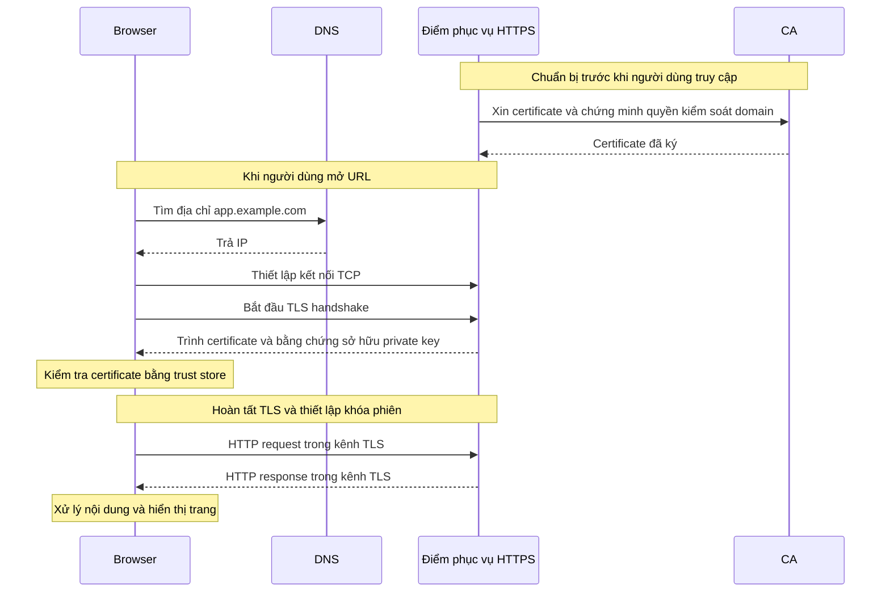

# CA, TLS và toàn bộ luồng request/response khi truy cập ứng dụng HTTPS

> Kiến thức nền cho [setup-rancher.md](setup-rancher.md) và
> [tunnel-traefik.md](tunnel-traefik.md). Ví dụ tổng quát dùng `app.example.com`;
> phần cuối áp dụng vào hostname `rancher.hieupn.site` và cấu hình lab.

**CA là Certificate Authority — bên cấp và ký certificate. Trong HTTPS, CA giúp client kiểm
chứng rằng một khóa công khai thực sự được cấp cho hostname mà client muốn truy cập.**

Để hiểu toàn bộ quá trình, cần nối bốn việc với nhau: **tìm địa chỉ bằng DNS, thiết lập kết nối
mạng, tạo kênh bảo mật bằng TLS, rồi trao đổi request/response bằng HTTP.** CA tham gia vào việc
thiết lập niềm tin cho TLS.

Phần sau giải thích trên ví dụ `https://app.example.com/products?id=10`, rồi áp dụng vào Rancher.

**Trước hết, certificate và CA liên quan với nhau như thế nào?**

Certificate — chứng chỉ số — có thể hiểu là một tấm giấy chứng nhận điện tử. Một certificate
của website chứa những thông tin như:

| Thông tin | Ý nghĩa |
| --- | --- |
| Hostname, thường trong trường `subjectAltName` | Certificate có giá trị cho những tên nào |
| Public key của server | Khóa công khai gắn với danh tính server |
| Issuer | Bên đã cấp certificate |
| Thời gian hiệu lực | Certificate bắt đầu và hết hạn khi nào |
| Chữ ký số của bên cấp | Cho phép kiểm tra nguồn cấp và tính nguyên vẹn |

Certificate thường theo chuẩn **X.509**. Nó có thể được gửi cho client; phần phải giữ bí mật là
**private key**, không phải certificate. Xem
[RFC 5280 — Internet X.509 Public Key Infrastructure](https://www.rfc-editor.org/rfc/rfc5280).

CA dùng private key của mình để ký certificate. Client dùng public key tương ứng của CA để kiểm
tra chữ ký.

Hình dung CA như một bên đóng dấu chứng nhận. Certificate là giấy có dấu; nhưng client còn phải
biết **có tin bên đóng dấu đó hay không**.

Browser có **trust store**: tập hợp các certificate CA gốc mà nó tin. Một certificate website
thường được cấp qua chuỗi Root CA → Intermediate CA → certificate website. Browser kiểm tra
chuỗi chữ ký để tìm về một CA gốc đã được tin cậy. Xem
[MDN — Certificate authority](https://developer.mozilla.org/en-US/docs/Glossary/Certificate_authority).

Các loại khóa làm những việc khác nhau:

| Khóa | Vai trò |
| --- | --- |
| Private key của CA | Ký certificate |
| Public key của CA | Kiểm tra chữ ký trên certificate |
| Private key của server | Chứng minh server sở hữu khóa tương ứng với certificate |
| Public key của server | Giúp client kiểm tra bằng chứng đó |
| Khóa phiên TLS | Mã hóa và kiểm tra tính toàn vẹn của dữ liệu trao đổi trong phiên |

Vì vậy, certificate giúp thiết lập danh tính; **dữ liệu request/response được bảo vệ bằng khóa
phiên TLS**.

Trước khi website phục vụ HTTPS, người vận hành cần chuẩn bị certificate. Với một public CA
như Let’s Encrypt, quá trình cơ bản là:

1. Tạo cặp public/private key cho server.
2. Chứng minh quyền kiểm soát domain, chẳng hạn bằng một DNS record hoặc tài nguyên HTTP theo yêu
   cầu của CA.
3. Gửi yêu cầu cấp certificate cho public key và hostname đó.
4. Nhận certificate đã ký, rồi cấu hình certificate cùng private key tại điểm phục vụ HTTPS.

Xem [Let’s Encrypt — How It Works](https://letsencrypt.org/how-it-works/).

**CA không phải một proxy đứng giữa browser và ứng dụng để chuyển tiếp mỗi request.** Việc cấp
certificate diễn ra trước. Khi kết nối, browser kiểm tra certificate mà server trình; các kiểm
tra trạng thái certificate bổ sung tùy chính sách của client.

Sơ đồ dưới đây thể hiện một lần kết nối HTTPS mới dùng TCP:



Bây giờ theo lần lượt từ lúc nhập URL đến khi nhìn thấy ứng dụng.

1. **Browser đọc URL để biết bạn muốn gọi cái gì.**

   Với `https://app.example.com/products?id=10`:

   | Phần | Giá trị | Ý nghĩa |
   | --- | --- | --- |
   | Scheme | `https` | Sử dụng HTTPS |
   | Hostname | `app.example.com` | Tên server cần truy cập |
   | Port | `443` mặc định | Cổng kết nối khi URL không ghi port riêng |
   | Path | `/products` | Tài nguyên hoặc endpoint cần gọi |
   | Query | `id=10` | Tham số gửi cho ứng dụng |

   Nếu URL có phần `#details`, phần fragment này được browser xử lý và không gửi trong HTTP
   request tới server. Xem
   [RFC 3986 — Uniform Resource Identifier](https://www.rfc-editor.org/rfc/rfc3986.html).

2. **DNS tìm địa chỉ IP cho hostname.**

   Browser sử dụng cơ chế phân giải tên, thường qua resolver của hệ điều hành hoặc DNS được
   browser cấu hình.

   Resolver có thể dùng kết quả cache. Nếu chưa có, nó tìm câu trả lời từ hệ thống DNS.

   Các record thường gặp:

   | Record | Chức năng |
   | --- | --- |
   | `A` | Ánh xạ tên tới IPv4 |
   | `AAAA` | Ánh xạ tên tới IPv6 |
   | `CNAME` | Ánh xạ tên tới một tên khác |

   DNS trả thông tin để client tìm được địa chỉ. **DNS không chuyển tiếp HTTP request tới ứng
   dụng.** Xem [RFC 1034 — Domain Names: Concepts and Facilities](https://www.rfc-editor.org/rfc/rfc1034.html).

   Ví dụ minh họa, hostname phân giải thành `203.0.113.10`. Browser chuẩn bị kết nối tới IP đó
   trên port `443`, nhưng vẫn giữ hostname để sử dụng ở những bước tiếp theo.

3. **Hệ thống mạng đưa dữ liệu tới địa chỉ đích; TCP thiết lập kết nối.**

   Dữ liệu đi qua mạng của máy, gateway và các router tới server. Firewall phải cho phép kết
   nối; NAT có thể xuất hiện nếu máy nằm sau router.

   Với HTTPS dùng HTTP/1.1 hoặc HTTP/2, client thường thiết lập TCP trước:

   - Client gửi `SYN`.
   - Server trả `SYN-ACK`.
   - Client gửi `ACK`.

   TCP cung cấp luồng byte có thứ tự, xử lý việc truyền lại dữ liệu bị mất và điều tiết truyền
   dữ liệu. **TCP handshake chứng minh kết nối TCP được thiết lập; nó chưa xác thực danh tính
   website bằng certificate.** Xem
   [RFC 9293 — Transmission Control Protocol](https://www.rfc-editor.org/rfc/rfc9293.html).

4. **TLS tạo kênh bảo mật trên kết nối đó.**

   **TLS — Transport Layer Security** — cung cấp ba đặc tính:

   | Đặc tính | Ý nghĩa |
   | --- | --- |
   | Mã hóa | Người ở giữa không đọc được nội dung trao đổi |
   | Toàn vẹn | Việc sửa dữ liệu trên đường truyền bị phát hiện |
   | Xác thực | Client kiểm chứng danh tính đầu bên kia |

   **HTTPS là HTTP chạy trong kênh được TLS bảo vệ.** “SSL” là tên của công nghệ tiền thân;
   cách gọi “SSL certificate” vẫn thường được dùng cho certificate phục vụ TLS. Xem
   [MDN — Transport Layer Security](https://developer.mozilla.org/en-US/docs/Web/Security/Defenses/Transport_Layer_Security).

   Trong một TLS handshake đầy đủ dùng certificate, có những công việc chính:

   - Client gửi `ClientHello`, khai các phiên bản và tham số bảo mật hỗ trợ.
   - Server chọn tham số phù hợp, trình certificate và bằng chứng sở hữu private key.
   - Client kiểm tra certificate và bằng chứng của server.
   - Hai bên thực hiện trao đổi khóa, tạo các khóa phiên và xác nhận handshake.
   - Dữ liệu ứng dụng được trao đổi bằng những khóa đó.

   Client không cần nhận private key của server. Trong TLS 1.3, server dùng chữ ký trong
   `CertificateVerify` để chứng minh sở hữu khóa; các bên thiết lập khóa bảo vệ traffic qua cơ
   chế trao đổi và dẫn xuất khóa. Xem
   [RFC 8446 — The Transport Layer Security Protocol Version 1.3](https://www.rfc-editor.org/rfc/rfc8446).

5. **Client kiểm tra certificate có hợp lệ cho server muốn gọi không.**

   Những kiểm tra quan trọng gồm:

   - Chuỗi certificate có dẫn về CA được client tin không?
   - Certificate có đang trong thời gian hiệu lực không?
   - Hostname trong URL có khớp tên được chứng nhận không?
   - Certificate và thuật toán có phù hợp với chính sách của client không?

   Khi gọi `https://app.example.com`, client kiểm tra tên `app.example.com`, dù kết nối mạng
   thực tế được mở tới một IP. Việc đối chiếu tên domain sử dụng các định danh phù hợp trong
   `subjectAltName`. Xem
   [RFC 9525 — Service Identity in TLS](https://www.rfc-editor.org/rfc/rfc9525.html).

   Hai lỗi khác nhau thường gặp:

   | Lỗi | Ý nghĩa |
   | --- | --- |
   | `unknown authority` | Client không xây dựng được chuỗi tin cậy tới CA mà nó tin |
   | Hostname mismatch | Certificate không chứng nhận đúng tên client đang gọi |

   Có đúng địa chỉ IP chưa đủ để vượt qua những kiểm tra này.

6. **SNI giúp server chọn certificate trước khi đọc HTTP.**

   Một IP và port `443` có thể phục vụ nhiều hostname, mỗi hostname dùng certificate riêng.

   **SNI — Server Name Indication** — cho client khai tên server trong TLS handshake. Ví dụ,
   client khai `app.example.com` để server chọn certificate phù hợp.

   HTTP chưa được trao đổi ở thời điểm lựa chọn certificate, nên server cần thông tin tên ở
   lớp TLS này. Xem
   [RFC 6066 — TLS Extensions](https://datatracker.ietf.org/doc/html/rfc6066).

   Cùng một hostname có ba vai trò:

   | Nơi sử dụng | Mục đích |
   | --- | --- |
   | DNS | Tìm địa chỉ IP |
   | TLS SNI | Giúp server chọn cấu hình TLS/certificate |
   | HTTP Host hoặc `:authority` | Cho server biết request thuộc website nào |

   SNI và HTTP Host thuộc hai lớp khác nhau. Đây chính là lý do runbook có cả
   `originServerName` và `httpHostHeader`.

7. **Browser gửi HTTP request trong kênh TLS.**

   HTTP quy định cách client yêu cầu tài nguyên và server trả kết quả.

   Một request có method, tài nguyên cần gọi, headers và có thể có body. Ví dụ minh họa theo
   HTTP/1.1:

   ```http
   GET /products?id=10 HTTP/1.1
   Host: app.example.com
   Accept: text/html

   ```

   - `GET`: yêu cầu lấy tài nguyên.
   - `/products?id=10`: tài nguyên và tham số.
   - `Host`: website cần phục vụ.
   - `Accept`: loại nội dung client muốn nhận.

   Khi gửi dữ liệu, request có thể dùng `POST` và body chứa JSON hoặc dữ liệu form. HTTP/2 và
   HTTP/3 biểu diễn thông điệp theo cách khác, nhưng vẫn giữ những khái niệm method, headers,
   nội dung và status. Xem
   [RFC 9110 — HTTP Semantics](https://www.rfc-editor.org/rfc/rfc9110.html).

   Đoạn trên là nội dung dễ đọc để giải thích. Khi dùng HTTPS, dữ liệu HTTP được bảo vệ trong
   kênh TLS trên đường truyền.

8. **Điểm nhận HTTPS xử lý TLS rồi đưa request tới ứng dụng.**

   Điểm này có thể là chính server ứng dụng, hoặc một reverse proxy như NGINX, Traefik,
   load balancer hay Cloudflare Edge.

   **Terminate TLS** nghĩa là thành phần đó thực hiện TLS với client và có thể đọc HTTP sau
   khi giải mã.

   Nếu có reverse proxy, proxy tiếp tục chọn backend theo hostname/path rồi chuyển request
   bằng một kết nối khác. Kết nối tới backend có thể là HTTP hoặc HTTPS theo kiến trúc đã chọn.

   Ứng dụng xử lý endpoint: đọc tham số, kiểm tra quyền, chạy logic, truy vấn database hoặc gọi
   dịch vụ khác nếu cần. Với FastAPI, đây là lúc logic của endpoint thực hiện công việc.

9. **Server trả HTTP response; browser xử lý nội dung.**

   Response chứa status, headers và có thể có body:

   ```http
   HTTP/1.1 200 OK
   Content-Type: text/html; charset=utf-8

   <html>...</html>
   ```

   Browser nhận dữ liệu qua kết nối bảo mật, rồi xử lý theo loại nội dung. Với trang web, nó
   phân tích HTML, tải thêm CSS, JavaScript và ảnh, tính bố cục rồi vẽ lên màn hình. JavaScript
   có thể tiếp tục gọi API để lấy dữ liệu. Vì vậy, một lần mở trang thường tạo nhiều request.
   Xem [MDN — How browsers work](https://developer.mozilla.org/en-US/docs/Web/Performance/Guides/How_browsers_work).

10. **Ứng dụng xác thực người dùng và duy trì phiên.**

    TLS kiểm chứng server và bảo vệ kết nối. Việc ứng dụng biết **bạn là ai và được phép làm
    gì** thuộc lớp xác thực, phân quyền của ứng dụng.

    Sau đăng nhập, ứng dụng có thể trả cookie phiên bằng `Set-Cookie`. Browser lưu cookie và
    gửi lại trong các request phù hợp, để server nhận biết phiên đăng nhập. Một số API sử dụng
    token trong header `Authorization`. Xem
    [MDN — Using HTTP cookies](https://developer.mozilla.org/en-US/docs/Web/HTTP/Guides/Cookies).

    Trong lab Rancher, Access kiểm tra quyền tiếp cận đường public; Rancher tiếp tục kiểm tra
    tài khoản và quyền quản trị của bạn.

Quá trình vừa mô tả là mô hình một kết nối mới dùng TCP. Có hai điều thực tế cần biết:

- **Kết nối có thể được tái sử dụng:** nhiều request dùng chung kết nối, nên không phải mỗi
  request đều lặp lại DNS, TCP và toàn bộ TLS handshake.
- **HTTP/3 dùng QUIC trên UDP**, với TLS 1.3 được tích hợp vào việc thiết lập kết nối QUIC; nó
  không dùng TCP handshake ở bước 3.

Xem [RFC 9114 — HTTP/3](https://www.rfc-editor.org/rfc/rfc9114).

Cuối cùng, **“CA riêng của Rancher” trong lab của bạn là một CA nội bộ dùng để ký certificate
cho Rancher**, thay vì sử dụng một public CA đã được browser tin sẵn.

Trong mô hình CA issuer của cert-manager, certificate và private key của CA được lưu trong
Secret để thực hiện việc ký. Những certificate được cấp không tự trở thành public-trusted;
các client cần được cấu hình tin CA phù hợp. Xem
[cert-manager — CA issuer](https://cert-manager.io/docs/configuration/ca/).

Áp dụng vào những đường đã học:

| Client và kết nối | Certificate nhìn thấy | Cách kiểm chứng trong cấu hình lab |
| --- | --- | --- |
| Browser → Cloudflare Edge | Certificate public tại Edge | Browser kiểm tra bằng trust store của nó |
| `cloudflared` → Traefik | Certificate Rancher do CA riêng ký | `noTLSVerify: true` bỏ verification ở connector |
| Process nội bộ → Traefik | Cùng certificate Rancher | Process cần tin CA riêng để verify thành công |

Traefik đọc certificate và private key trong Secret `tls-rancher-ingress` để phục vụ TLS.
cert-manager quản lý việc cấp certificate; **Traefik mới là thành phần thực hiện TLS handshake
với client trên đường này**.

Một client nội bộ được cung cấp CA đúng có thể kiểm tra đầy đủ: chữ ký dẫn về CA đó, hostname
khớp `rancher.hieupn.site`, certificate còn hiệu lực và server chứng minh sở hữu private key.
Nếu client dùng `-k` hoặc connector dùng `noTLSVerify`, kênh vẫn mã hóa nhưng client bỏ phần
kiểm chứng danh tính server tương ứng.
