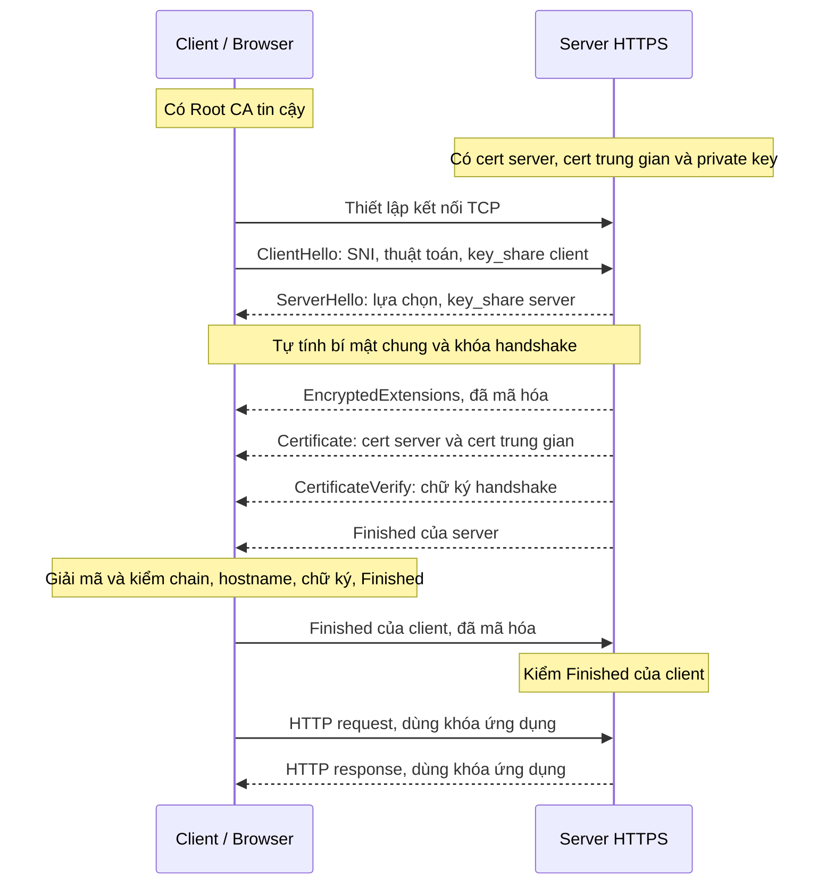

# CA, TLS và toàn bộ luồng request/response khi truy cập ứng dụng HTTPS

> Kiến thức nền cho [setup-rancher.md](setup-rancher.md) và
> [tunnel-traefik.md](tunnel-traefik.md). Ví dụ tổng quát dùng `app.example.com`;
> phần cuối áp dụng vào hostname `rancher.hieupn.site` và cấu hình lab.

Để hiểu toàn bộ quá trình, cần nối bốn việc với nhau: **tìm địa chỉ bằng DNS, thiết lập kết nối
mạng, tạo kênh bảo mật bằng TLS, rồi trao đổi request/response bằng HTTP.** CA tham gia vào việc
thiết lập niềm tin cho TLS.

Phần sau giải thích trên ví dụ `https://app.example.com/products?id=10`, rồi áp dụng vào Rancher.

## Mục lục

- [HTTP, HTTPS và TLS](#http-https-và-tls)
- [Certificate, CA và các loại khóa](#certificate-ca-và-các-loại-khóa)
  - [CA công khai và CA riêng](#ca-công-khai-và-ca-riêng)
  - [Trust store của từng client](#trust-store-của-từng-client)
  - [Các loại khóa làm những việc khác nhau](#các-loại-khóa-làm-những-việc-khác-nhau)
  - [Cấp certificate trước khi phục vụ HTTPS](#cấp-certificate-trước-khi-phục-vụ-https)
- [Terminate TLS và SNI](#terminate-tls-và-sni)
- [Ví dụ tự host web có domain, không dùng Kubernetes](#ví-dụ-tự-host-web-có-domain-không-dùng-kubernetes)
- [Luồng request/response qua TLS 1.3](#luồng-requestresponse-qua-tls-13)
  - [HIỂU TLS TRƯỚC — Thiết lập TLS 1.3 giữa client và server](#hiểu-tls-trước)
    - [3. Sơ đồ toàn bộ luồng](#so-do-toan-bo-luong)
  - [Đọc URL, DNS và TCP trước handshake](#url-dns-tcp)
  - [Hostname ở DNS, SNI và HTTP Host](#hostname-dns-sni-http-host)
  - [Nhận diện lỗi xác minh certificate](#loi-xac-minh-certificate)
  - [Sau TLS — HTTP request/response và phiên đăng nhập](#http-request-response-sau-tls)
- [Áp dụng vào lab Rancher](#áp-dụng-vào-lab-rancher)
- [Origin Server Name](#origin-server-name)
- [Kiểm chứng certificate origin](#kiểm-chứng-certificate-origin)

## HTTP, HTTPS và TLS

**HTTP — HyperText Transfer Protocol** — là giao thức request/response: client gửi method,
đường dẫn, headers và có thể có body; server trả status, headers và có thể có body.
HTTP truyền trực tiếp không tự mã hóa hay xác thực server bằng certificate; bên đứng giữa có
khả năng quan sát hoặc can thiệp đường truyền có thể đọc/sửa nội dung.

**TLS — Transport Layer Security** — bảo vệ kết nối bằng mã hóa, kiểm tra tính toàn vẹn và
cơ chế xác thực. Client cần kiểm chứng certificate theo CA tin cậy và hostname để xác thực
server trong luồng HTTPS dùng certificate đang xét.

**HTTPS** là HTTP chạy trong kênh TLS. Với kết nối TCP thông thường, port mặc định là
`80` cho HTTP và `443` cho HTTPS. Một lần mở trang có thể sinh nhiều HTTP request; các
request có thể dùng chung kết nối, không phải mỗi request đều tạo một handshake mới.

Xem [HTTP Semantics — RFC 9110](https://www.rfc-editor.org/rfc/rfc9110.html) và
[TLS 1.3 — RFC 8446](https://www.rfc-editor.org/rfc/rfc8446.html).

## Certificate, CA và các loại khóa

**CA là Certificate Authority — bên cấp và ký certificate. Trong HTTPS, CA giúp client kiểm
chứng rằng một khóa công khai thực sự được cấp cho hostname mà client muốn truy cập.**

**Trước hết, certificate và CA liên quan với nhau như thế nào?**

Certificate — chứng chỉ số — có thể hiểu là một tấm giấy chứng nhận điện tử. Một certificate
của website chứa những thông tin như:

| Thông tin | Ý nghĩa |
| --- | --- |
| Hostname, thường trong trường `subjectAltName` | Certificate có giá trị cho những tên nào |
| Public key của server | Khóa công khai gắn với danh tính server |
| Issuer | Bên đã cấp certificate |
| Thời gian hiệu lực | Certificate bắt đầu và hết hạn khi nào |
| Chữ ký số của bên cấp | Cho phép kiểm tra nguồn cấp và tính nguyên vẹn |

Certificate thường theo chuẩn **X.509**. Nó có thể được gửi cho client; phần phải giữ bí mật là
**private key**, không phải certificate. Xem
[RFC 5280 — Internet X.509 Public Key Infrastructure](https://www.rfc-editor.org/rfc/rfc5280).

CA dùng private key của mình để ký certificate. Client dùng public key tương ứng của CA để kiểm
tra chữ ký.

Hình dung CA như một bên đóng dấu chứng nhận. Certificate là giấy có dấu; nhưng client còn phải
biết **có tin bên đóng dấu đó hay không**.

Browser có **trust store**: tập hợp các certificate CA gốc mà nó tin. Một certificate website
thường được cấp qua chuỗi Root CA → Intermediate CA → certificate website. Browser kiểm tra
chuỗi chữ ký để tìm về một CA gốc đã được tin cậy.

### CA công khai và CA riêng

**Public CA — CA công khai** — có chuỗi tin cậy dẫn về root CA được nhiều browser/OS tin sẵn.
Client vẫn phải kiểm tra hostname, thời gian hiệu lực và các điều kiện xác minh còn lại.

**Private CA — CA riêng** — do tổ chức hoặc người vận hành quản lý. Certificate do CA riêng
ký không tự được mọi client tin. Người vận hành phải cung cấp certificate CA cho đúng trust
store/bundle của từng client; không cung cấp private key CA cho client.

Việc tạo và ký certificate bằng CA riêng vẫn tách biệt với việc endpoint dùng certificate đó
trong handshake. Phần áp dụng vào Rancher ở dưới chỉ rõ vai trò của từng thành phần.

### Trust store của từng client

**Trust store không phải lúc nào cũng là store của hệ điều hành, và các process trên cùng máy
không nhất thiết tin cùng một tập CA.** Ví dụ:

| Client | Nguồn CA tin cậy |
| --- | --- |
| Chrome trên các nền tảng hỗ trợ Chrome Root Store | Có root store riêng; có cơ chế tích hợp CA do người dùng/quản trị viên tin ở nền tảng. Chrome trên iOS dùng cơ chế của Apple |
| Firefox | Có root store của Mozilla; còn có thể tin CA được thêm vào OS theo nền tảng và cấu hình |
| Safari | Dùng cơ chế tin cậy certificate của hệ điều hành Apple |
| curl | Phụ thuộc bản build và TLS backend: bản dùng Schannel trên Windows dùng Windows CA store; nhiều bản khác dùng CA bundle dạng file |
| Python `requests` | Bản upstream mặc định dùng bundle của `certifi`; có thể chỉ định bundle bằng `verify="/path/ca-bundle.pem"` hoặc `REQUESTS_CA_BUNDLE`. Bản đóng gói/tùy biến có thể khác |

Vì vậy, “process cần tin CA riêng” nghĩa là phải cấp CA cho **đúng trust store/bundle mà process
đó thực sự dùng**. Browser truy cập được không chứng minh một script Python hoặc Pod cũng sẽ
verify được. Không suy ra mọi bản curl trên Windows đều dùng Schannel; có thể xem TLS backend
bằng `curl -V`.

Tham khảo: [Chrome Root Store FAQ](https://chromium.googlesource.com/chromium/src/+/main/net/data/ssl/chrome_root_store/faq.md),
[Mozilla — Set up CAs in Firefox](https://support.mozilla.org/en-US/kb/setting-certificate-authorities-firefox),
[Apple — Certificate management](https://support.apple.com/guide/deployment/intro-to-certificate-management-depb5eff8914/web),
[curl — TLS Certificate Verification](https://curl.se/docs/sslcerts.html) và
[Requests — CA Certificates](https://requests.readthedocs.io/en/latest/user/advanced/#ca-certificates).

### Các loại khóa làm những việc khác nhau

| Khóa | Vai trò |
| --- | --- |
| Private key của CA | Ký certificate |
| Public key của CA | Kiểm tra chữ ký trên certificate |
| Private key của server | Chứng minh server sở hữu khóa tương ứng với certificate |
| Public key của server | Giúp client kiểm tra bằng chứng đó |
| Cặp khóa tạm thời của mỗi bên trong trao đổi (EC)DHE | Public share được gửi trong `key_share`; private key tương ứng được giữ kín để tính bí mật chung |
| Handshake traffic keys | Bảo vệ các thông điệp handshake sau `ServerHello` trong TLS 1.3 |
| Application traffic keys | Mã hóa và kiểm tra tính toàn vẹn của dữ liệu ứng dụng như HTTP |

Vì vậy, certificate giúp thiết lập danh tính; **dữ liệu request/response được bảo vệ bằng khóa
phiên TLS**.

### Cấp certificate trước khi phục vụ HTTPS

Trước khi website phục vụ HTTPS, người vận hành cần chuẩn bị certificate. Với public CA như
Let’s Encrypt, **ACME client** — chẳng hạn certbot hoặc cert-manager — làm việc với CA; nó không
nhất thiết là process đang phục vụ HTTPS. Quá trình cơ bản là:

1. ACME client tạo hoặc sử dụng khóa tài khoản ACME để xác thực các yêu cầu quản lý certificate.
2. Chứng minh quyền kiểm soát domain, chẳng hạn bằng một DNS record hoặc tài nguyên HTTP theo yêu
   cầu của CA.
3. Tạo cặp khóa cho certificate, lập CSR chứa public key và hostname, rồi xin CA cấp certificate.
4. Nhận certificate đã ký và chuỗi intermediate, rồi cấu hình chúng cùng private key tương ứng
   tại điểm phục vụ HTTPS.

**Khóa tài khoản ACME và khóa của certificate là hai cặp khóa khác nhau.** Khóa tài khoản dùng
với dịch vụ ACME; private key của certificate được điểm phục vụ HTTPS dùng để chứng minh danh
tính trong TLS. Cặp khóa tạm thời trong `key_share` lại phục vụ việc thiết lập bí mật chung.

Xem [Let’s Encrypt — How It Works](https://letsencrypt.org/how-it-works/).

**CA không phải một proxy đứng giữa browser và ứng dụng để chuyển tiếp mỗi request.** Việc cấp
certificate diễn ra trước. Khi kết nối, browser kiểm tra certificate mà server trình; các kiểm
tra trạng thái certificate bổ sung tùy chính sách của client.

## Terminate TLS và SNI

**Terminate TLS** nghĩa là một chương trình thực hiện TLS với client và đọc được dữ liệu ứng
dụng sau khi giải mã. Chương trình đó có thể là chính web server hoặc reverse proxy. Nó giữ
certificate và private key tương ứng; dữ liệu HTTP được mã hóa/giải mã bằng application
traffic keys, không phải bằng certificate.

Nếu reverse proxy terminate TLS, nó đọc hostname/path trong HTTP rồi chuyển request tới
backend bằng một kết nối khác. Kết nối backend có thể là HTTP hoặc HTTPS tùy cấu hình.
Response quay lại proxy cũng được proxy bảo vệ trong kết nối TLS với client. Hai chặng dùng
HTTPS, nếu có, vẫn là hai kết nối TLS riêng.

**SNI — Server Name Indication** — là tên server client khai trong `ClientHello`. Một IP và
port có thể phục vụ nhiều hostname; SNI giúp server chọn cấu hình TLS/certificate trước khi
trình certificate.

Server cần thông tin này sớm vì HTTP Host chỉ có khi client gửi HTTP sau handshake trong
luồng đang xét. **SNI chọn cấu hình TLS/certificate; HTTP Host hoặc `:authority` giúp chọn
website/router HTTP.** Chúng xuất hiện ở hai lớp và hai thời điểm khác nhau.

Một server có thể nạp nhiều certificate cùng các private key tương ứng trước khi có kết
nối. Với mỗi handshake, server chọn dữ liệu đã nạp để sử dụng; nó không xin CA ký lại
certificate cho từng HTTP request. Nếu không có certificate khớp SNI, hành vi phụ thuộc cấu
hình server: có thể dùng certificate mặc định hoặc từ chối handshake.

Xem [RFC 6066 §3 — SNI](https://datatracker.ietf.org/doc/html/rfc6066#section-3) và
[NGINX — Configuring HTTPS servers](https://nginx.org/en/docs/http/configuring_https_servers.html).

## Ví dụ tự host web có domain, không dùng Kubernetes

Đây là ví dụ giải thích được tách từ từ điển của `setup-rancher.md`, không phải cấu hình cần
áp dụng vào lab Rancher. Giả sử bạn có web server nginx với IP public `203.0.113.10`, muốn
phục vụ `https://vidu.com`.

Bốn phần cần chuẩn bị:

1. **DNS.** Tạo A record `vidu.com → 203.0.113.10` tại dịch vụ DNS có thẩm quyền của domain.
   Record A ánh xạ tên tới IPv4. Với URL `https://vidu.com` trong ví dụ này, browser dùng
   port mặc định `443`; nếu server nghe `8443`, URL cần ghi `https://vidu.com:8443`.
2. **Certificate.** ACME client như certbot xin certificate cho `vidu.com` từ public CA.
   CA yêu cầu chứng minh quyền kiểm soát domain: HTTP-01 dùng tài nguyên HTTP ở đường dẫn
   thử thách trên port `80`; DNS-01 dùng TXT record theo yêu cầu. Sau khi cấp, người vận
   hành cấu hình certificate, chuỗi intermediate cần thiết và private key tương ứng cho nginx.
   Xem [Let's Encrypt — Challenge Types](https://letsencrypt.org/docs/challenge-types/).
3. **Firewall/NAT.** Cho phép kết nối inbound tới nginx port `443`. Ví dụ bên dưới còn dùng
   port `80` để chuyển hướng HTTP sang HTTPS; HTTP-01 cũng cần truy cập port `80` khi chọn
   phương thức này. Nếu server sau NAT, cần ánh xạ port phù hợp.
4. **Web server.** Cấu hình chương trình nginx nghe HTTPS, đọc certificate và private key đã
   chuẩn bị. Cùng một chương trình có thể nhận HTTP ở `80` và HTTPS ở `443`.

Ví dụ cấu hình minh họa, giả định các file certificate/key đã tồn tại:

```nginx
server {
    listen 80;
    server_name vidu.com;
    return 301 https://vidu.com$request_uri;
}
server {
    listen 443 ssl;
    server_name vidu.com;
    ssl_certificate     /etc/ssl/vidu.com/fullchain.pem;
    ssl_certificate_key /etc/ssl/vidu.com/privkey.pem;
    root /var/www/vidu;
}
```

Với kết nối mới: browser phân giải `vidu.com` ra IP, mở TCP tới port `443`, rồi gửi SNI
`vidu.com` trong handshake. nginx chọn cấu hình TLS/certificate phù hợp; browser kiểm chứng
certificate và các thông điệp handshake. Sau đó browser gửi HTTP với Host `vidu.com` trong
kênh TLS. Xem [NGINX — Configuring HTTPS servers](https://nginx.org/en/docs/http/configuring_https_servers.html).

DNS giúp client tìm địa chỉ mạng; SNI giúp server chọn certificate; HTTP Host giúp chọn
website xử lý request. Biết đúng IP chưa đủ để thay thế hai bước chọn theo hostname.

Đối chiếu với Rancher: lab đưa browser tới Cloudflare Edge, dùng tunnel thay cho việc mở
inbound tới VM, và phục vụ certificate riêng tại Traefik. Cách áp dụng nằm trong
[từ điển của setup-rancher.md](setup-rancher.md#từ-điển-khái-niệm-nền) và
[chuỗi cấp certificate của lab](setup-rancher.md#controller-nào-cấp-certificate-và-ai-gửi-hai-bản-tin-tls).

## Luồng request/response qua TLS 1.3

Đọc **HIỂU TLS TRƯỚC** để theo dõi từ certificate và chain đến từng bản tin handshake,
cách hai bên kiểm chứng và thời điểm dùng khóa ứng dụng. Các mục sau đó bổ sung chi tiết
về URL/DNS/TCP, hostname, lỗi xác minh và HTTP request/response.

Đối chiếu [RFC 8446 §2 — Protocol Overview](https://www.rfc-editor.org/rfc/rfc8446.html#section-2)
và [§7.1 — Key Schedule](https://www.rfc-editor.org/rfc/rfc8446.html#section-7.1).

<a id="hiểu-tls-trước"></a>

### HIỂU TLS TRƯỚC — Thiết lập TLS 1.3 giữa client và server

Dưới đây là bản hoàn chỉnh cho ví dụ **browser truy cập `https://app.example.com` bằng một kết nối mới dùng TCP và TLS 1.3**.

Server xác thực bằng certificate, hai bên thiết lập bí mật chung bằng **ECDHE — cơ chế trao đổi khóa tạm thời**. Client bật đầy đủ việc kiểm chứng server. Ví dụ này không yêu cầu certificate của client và không dùng nhánh khôi phục phiên hoặc 0-RTT.

**1. Trước khi kết nối: server và client đã chuẩn bị gì?**

Phía server đã có:

- **Certificate của server**, chứng nhận hostname và public key.
- **Private key tương ứng với public key trong certificate**.
- Các **certificate CA trung gian** cần thiết.

Certificate của server chứa thông tin tương đương:

```text
Hostname trong subjectAltName: app.example.com
Public key: public key thuộc cặp khóa danh tính của server
Bên cấp (Issuer): CA cấp certificate
Thời hạn: thời điểm bắt đầu và hết hạn
Chữ ký của CA: chữ ký trên nội dung được chứng nhận
```

**Private key của server không nằm trong certificate.**

Trước đó, khi cấp certificate, CA đã dùng **private key của CA** để ký nội dung được chứng nhận, gồm hostname và public key của server.

Private key của CA và private key của server thuộc **hai cặp khóa khác nhau**.

Phía client có các **CA gốc được tin cậy** trong trust store hoặc CA bundle mà chương trình đó sử dụng.

**2. `Certificate chain` là gì?**

**Certificate chain — chuỗi certificate** giúp client liên kết certificate của server với một CA mà client đã tin cậy.

Mỗi certificate có public key của chủ thể được cấp certificate, cùng chữ ký của bên cấp nó.

Giả sử có **một CA trung gian**:

| Certificate | Public key nằm trong đó | Ai ký certificate này? | Client lấy từ đâu? |
|---|---|---|---|
| **Certificate server**, còn gọi là leaf certificate | Public key của server; kèm hostname `app.example.com` | CA trung gian dùng private key của CA trung gian | Server gửi |
| **Certificate CA trung gian**, intermediate certificate | Public key của CA trung gian | Root CA dùng private key của Root CA | Server gửi |
| **Certificate Root CA** | Public key của Root CA | Thường được Root CA tự ký | Đã được cấu hình trong trust store của client |

Trong ví dụ này, **server gửi certificate server và certificate CA trung gian bên trong bản tin TLS `Certificate`**.

Đó là phần chain server cung cấp. Client kết hợp chúng với Root CA đã tin cậy để kiểm chứng chuỗi.

**Chain không phải một bản tin TLS riêng được gửi thêm sau `Certificate`.**

Root CA thường không cần được server gửi. Client tin Root CA vì nó đã được cấu hình làm điểm tin cậy; việc server gửi một root certificate hoặc root certificate có chữ ký tự ký không tự tạo ra niềm tin. [RFC 5280 — Chuỗi tin cậy](https://www.rfc-editor.org/rfc/rfc5280.html#section-6)

Nếu CA được client tin trực tiếp ký certificate server thì không cần tầng CA trung gian. Ví dụ dưới đây dùng một tầng trung gian để thấy rõ vai trò chain.

<a id="so-do-toan-bo-luong"></a>

**3. Sơ đồ toàn bộ luồng**

Các mũi tên biểu diễn thông điệp. Một thông điệp không bắt buộc tương ứng với một gói TCP riêng; server có thể gửi liên tiếp nhiều thông điệp.



**Tất cả thông điệp handshake từ `EncryptedExtensions` trở đi trong sơ đồ đều được mã hóa bằng khóa handshake**, bao gồm cả `Certificate`, `CertificateVerify` và `Finished`.

**4. Client tìm IP và mở kết nối TCP**

Browser lấy hostname `app.example.com` từ URL, phân giải DNS để có IP rồi mở kết nối TCP tới port `443`.

TCP thiết lập đường truyền byte giữa hai bên. **TCP chưa xác thực website bằng certificate.** TLS bắt đầu trên kết nối TCP đó.

**5. Client gửi `ClientHello`**

Đây là bản tin mở đầu của TLS handshake.

| Nội dung client gửi | Mục đích |
|---|---|
| Các phiên bản TLS hỗ trợ | Cho server chọn phiên bản phù hợp |
| Các cipher suite hỗ trợ | Đề xuất thuật toán mã hóa đối xứng và hàm băm |
| Các thuật toán chữ ký hỗ trợ | Cho server chọn cách ký mà client kiểm tra được |
| **SNI = `app.example.com`** | Giúp server chọn cấu hình TLS và certificate cho hostname này |
| **ALPN**, chẳng hạn `h2`, `http/1.1` | Đề xuất giao thức ứng dụng như HTTP/2 hoặc HTTP/1.1 |
| **`key_share` của client** | Gửi phần công khai của khóa tạm thời phục vụ ECDHE |
| Giá trị ngẫu nhiên của `ClientHello` | Góp phần tạo dữ liệu riêng cho cuộc bắt tay hiện tại |

Trước khi gửi `key_share`, client đã tạo **cặp khóa tạm thời**:

- Phần công khai được gửi cho server.
- Phần private được client giữ kín.

Cặp khóa tạm thời này phục vụ thiết lập bí mật chung. Nó khác với cặp khóa danh tính của server được gắn với certificate.

**Server xử lý:** đọc các khả năng client đề xuất, chọn tham số phù hợp và dùng SNI để chọn cấu hình TLS/certificate. HTTP request chưa được gửi ở bước này.

**6. Server gửi `ServerHello`; hai bên tính khóa handshake**

**Server gửi gì?**

Server thông báo:

- Phiên bản TLS được chọn.
- Cipher suite được chọn.
- Lựa chọn trao đổi khóa và **`key_share` của server**.

`key_share` này chứa phần công khai thuộc **cặp khóa tạm thời phía server**. Nó khác public key danh tính nằm trong certificate.

**Mục đích:** chốt các tham số cần thiết và cung cấp phần công khai để hai bên tính bí mật chung.

**Client xử lý như thế nào?**

Client kiểm tra những lựa chọn của server có hợp lệ với đề xuất của mình không, rồi lấy `key_share` của server.

Hai bên tính bí mật chung bằng:

| Bên tính | Dữ liệu sử dụng |
|---|---|
| Client | Private key tạm thời của client + phần công khai tạm thời của server |
| Server | Private key tạm thời của server + phần công khai tạm thời của client |

ECDHE cho phép hai bên tính được **cùng một bí mật chung**. Không bên nào phải gửi private key tạm thời hoặc gửi trực tiếp bí mật chung cho bên kia.

Từ bí mật chung và dữ liệu handshake, hai bên tự dẫn xuất **handshake traffic keys** — các khóa đối xứng bảo vệ phần handshake tiếp theo. Mỗi chiều truyền có khóa riêng.

**Đến đây đã có khóa mã hóa handshake, nhưng client chưa xác thực xong danh tính server.**

Client dùng khóa tương ứng để giải mã và kiểm tra tính toàn vẹn của các bản ghi handshake server gửi tiếp theo.

**7. Server gửi `EncryptedExtensions`**

**Server gửi gì?**

Các tham số bổ sung được thương lượng, chẳng hạn kết quả ALPN chọn HTTP/2.

**Mục đích:** hoàn tất những lựa chọn không cần gửi công khai trong `ServerHello` để thiết lập khóa.

**Client xử lý như thế nào?**

Client giải mã bản tin, kiểm tra các extension có hợp lệ và phù hợp với đề xuất của mình, rồi ghi nhận lựa chọn.

Ví dụ, client ghi nhận rằng dữ liệu ứng dụng sau handshake sẽ dùng HTTP/2.

Bản tin này không chứa certificate và chưa chứng minh server sở hữu private key danh tính.

**8. Server gửi `Certificate`: certificate server và chain**

**Server gửi gì?**

Trong ví dụ có một CA trung gian, bản tin `Certificate` chứa danh sách:

1. **Certificate của `app.example.com`**.
2. **Certificate của CA trung gian cấp certificate đó**.

Public key danh tính của server nằm trong certificate thứ nhất. Public key của CA trung gian nằm trong certificate thứ hai.

**Không certificate nào trong danh sách chứa private key.**

**Mục đích:** cung cấp danh tính được chứng nhận, public key của server và dữ liệu giúp client dựng chuỗi tin cậy.

**Client xử lý như thế nào?**

Client kiểm tra các phần sau.

**Kiểm chữ ký CA và chuỗi tin cậy**

Hai quan hệ chữ ký cần được kiểm chứng trong ví dụ:

| Chữ ký cần kiểm | Public key client sử dụng |
|---|---|
| Chữ ký trên **certificate server** | Public key lấy từ **certificate CA trung gian** |
| Chữ ký trên **certificate CA trung gian** | Public key của **Root CA đã được client tin cậy** |

Client kiểm cả chuỗi và các ràng buộc liên quan để xác lập rằng CA trung gian được phép cấp certificate đó.

Một public key lấy từ certificate do server gửi **chưa tự trở thành đáng tin**. Việc kiểm chuỗi mới nối public key đó về điểm tin cậy đã cấu hình ở client.

Khi chữ ký hợp lệ, nội dung được ký chưa bị sửa và chữ ký tương ứng với private key của bên cấp. Khi chuỗi được xác thực hợp lệ, client có cơ sở tin vào sự gắn kết giữa **hostname và public key trong certificate**. [RFC 5280 — Kiểm chữ ký certificate](https://www.rfc-editor.org/rfc/rfc5280.html#section-6.1.3)

Client không cần private key của bất kỳ CA nào để thực hiện việc này.

**Kiểm hostname**

Client đang gọi `app.example.com`, nên kiểm tên này có khớp định danh được chứng nhận trong **`subjectAltName`** không.

Một certificate được CA tin cậy ký cho một tên hoàn toàn khác vẫn không đáp ứng yêu cầu. [RFC 9525 — Kiểm chứng hostname](https://www.rfc-editor.org/rfc/rfc9525.html)

**Kiểm thời hạn và điều kiện sử dụng**

Client kiểm certificate còn hiệu lực, mục đích sử dụng và thuật toán phù hợp, cùng các ràng buộc của chuỗi CA và chính sách kiểm chứng đang áp dụng. Cách kiểm trạng thái thu hồi phụ thuộc cơ chế và chính sách của client.

Nếu một kiểm tra bắt buộc thất bại, client dừng kết nối.

**Certificate hợp lệ vẫn chưa tự chứng minh bên đang bắt tay giữ private key tương ứng.** Certificate là dữ liệu công khai có thể bị sao chép. Bước tiếp theo kiểm việc sở hữu private key.

**9. Server gửi `CertificateVerify`**

**Server gửi gì?**

Một **chữ ký số mới**, được tạo bằng private key tương ứng với certificate server vừa gửi.

Chữ ký này gắn với **cuộc bắt tay hiện tại**.

Đến thời điểm này đã có:

```text
ClientHello
ServerHello
EncryptedExtensions
Certificate
```

Nội dung những bản tin theo đúng thứ tự gọi là **handshake transcript** — bản ghi những gì đã trao đổi trong handshake.

Trong đó, bản tin `Certificate` bao gồm danh sách certificate server đã gửi, tức cả certificate server và certificate trung gian trong ví dụ này.

Server tính **bản băm — hash** của transcript. Đây là giá trị được tính từ nội dung các thông điệp để gắn bằng chứng với đúng cuộc trao đổi.

Chính xác hơn, server ký một cấu trúc chứa **hash của transcript đến hết `Certificate`**, cùng thông tin ngữ cảnh dành cho server `CertificateVerify` trong TLS 1.3. Chữ ký được gửi trong `CertificateVerify`. [RFC 8446 — CertificateVerify](https://www.rfc-editor.org/rfc/rfc8446.html#section-4.4.3)

**Mục đích:** chứng minh server giữ private key tương ứng với public key đã được chứng nhận, đồng thời gắn bằng chứng ấy với các tham số và `key_share` của handshake hiện tại.

**Client xử lý như thế nào?**

1. Lấy **public key của server từ certificate server**.
2. Tự tính transcript hash từ những bản tin mình đã gửi/nhận và dựng dữ liệu kiểm chữ ký tương ứng.
3. Dùng public key của server để kiểm chữ ký nhận được trong `CertificateVerify`.

Người khác có thể sao chép certificate, nhưng thiếu private key tương ứng thì không tạo được chữ ký hợp lệ cho transcript của cuộc bắt tay mới.

**Server gửi chữ ký; private key vẫn được giữ kín.**

Cần phân biệt rõ:

| Chữ ký | Ai tạo? | Thời điểm tạo | Client dùng gì để kiểm? |
|---|---|---|---|
| Trên certificate server | CA cấp certificate | Khi cấp certificate | Public key của CA cấp |
| Trên certificate CA trung gian | CA cấp trên | Khi cấp certificate trung gian | Public key của CA cấp trên |
| Trong `CertificateVerify` | Server | Trong handshake hiện tại | Public key của server |

**10. Server gửi `Finished`**

**Server gửi gì?**

Một giá trị kiểm chứng gọi là **`verify_data`**, được tính bằng **HMAC** trên transcript đến hết `CertificateVerify`.

HMAC là mã kiểm chứng được tính từ **dữ liệu và một khóa bí mật**. Khóa dành cho `Finished` của server được dẫn xuất từ bí mật handshake phía server.

`Finished` không phải chữ ký số bằng private key của CA hay private key danh tính của server.

**Mục đích:** xác nhận bên gửi tính được bí mật/khóa handshake tương ứng và nội dung handshake hai bên đang theo dõi khớp nhau.

**Client xử lý như thế nào?**

1. Dùng dữ liệu và bí mật handshake mình tự tính được để dẫn xuất khóa kiểm `Finished` của server.
2. Tự tính giá trị `verify_data` dự kiến từ transcript tương ứng.
3. So sánh với giá trị nhận được. Nếu không hợp lệ, dừng handshake.

Sau khi kiểm thành công **certificate/chain, `CertificateVerify` và `Finished`**, client đã kiểm chứng danh tính server và tính nhất quán của handshake trong luồng đang xét.

**11. Client gửi `Finished`; server kiểm chứng lại**

Client tạo `Finished` của mình bằng **khóa Finished dành cho phía client**. Transcript lúc này đã gồm cả `Finished` của server.

Client gửi bản tin này trong bản ghi được bảo vệ bằng handshake traffic key phía client.

Server tự tính giá trị dự kiến rồi kiểm `Finished` của client. Thành công cho thấy client cũng tính được bí mật/khóa tương ứng và transcript khớp.

Ví dụ này không yêu cầu certificate của client, nên bước này chưa xác thực tài khoản người dùng hoặc danh tính client bằng certificate. Đăng nhập ứng dụng là công việc ở lớp ứng dụng.

**12. Hai bên trao đổi HTTP bằng khóa ứng dụng**

Hai bên dùng **application traffic keys** để bảo vệ dữ liệu HTTP. Đây là các khóa đối xứng riêng với khóa bảo vệ handshake, có khóa riêng cho từng chiều truyền.

Trong luồng request/response của ví dụ:

1. Client gửi `Finished`, rồi gửi HTTP request được mã hóa và bảo vệ tính toàn vẹn.
2. Server giải mã, kiểm tính toàn vẹn rồi xử lý request.
3. Server gửi HTTP response được bảo vệ.
4. Client giải mã, kiểm tính toàn vẹn rồi xử lý nội dung.

**Certificate và cặp khóa danh tính của server không trực tiếp mã hóa HTTP trong luồng TLS 1.3 này.** HTTP được bảo vệ bằng application traffic keys.

Application traffic secrets đã có thể được dẫn xuất sau `Finished` của server. TLS 1.3 cũng cho phép server gửi application data sau `Finished` của nó, trước khi nhận `Finished` của client; sơ đồ chọn luồng HTTP request/response thông thường. [RFC 8446 — Finished](https://www.rfc-editor.org/rfc/rfc8446.html#section-4.4.4)

Nhiều HTTP request có thể dùng chung kết nối TLS đã thiết lập. Không phải mỗi request đều bắt tay hoặc xin cấp certificate mới.

**13. Các mốc kiểm chứng chính**

| Mốc | Bên kiểm | Nội dung kiểm | Mục đích |
|---|---|---|---|
| **1** | Client | Certificate/chain: chữ ký CA, điểm tin cậy, hostname, thời hạn… | Xác thực sự gắn kết giữa hostname và public key |
| **2** | Client | Chữ ký `CertificateVerify` | Kiểm server giữ private key tương ứng, gắn với handshake hiện tại |
| **3** | Client | `Finished` của server | Xác nhận khóa và transcript phía server |
| **4** | Server | `Finished` của client | Xác nhận khóa và transcript phía client |

Đây là **bốn nhóm kiểm chứng chính để học**. Mỗi nhóm có nhiều phép kiểm tra; các bản ghi mã hóa cũng được kiểm tính toàn vẹn khi nhận.

**14. Khóa nào được gửi và vào lúc nào?**

| Khóa hoặc dữ liệu | Nằm ở đâu / gửi lúc nào? | Công việc |
|---|---|---|
| **Private key của CA** | Giữ ở phía CA | Ký certificate khi cấp |
| **Public key của Root CA** | Có trong điểm tin cậy đã cấu hình ở client | Kiểm chứng certificate do Root CA cấp |
| **Public key của CA trung gian** | Trong certificate trung gian, server gửi trong bản tin `Certificate` | Kiểm chữ ký trên certificate server |
| **Private key danh tính của server** | Giữ ở phía phục vụ HTTPS | Ký `CertificateVerify` |
| **Public key danh tính của server** | Trong certificate server, gửi ở bản tin `Certificate` | Client kiểm chữ ký `CertificateVerify` |
| **Private key tạm thời của mỗi bên** | Giữ riêng tại bên tạo | Tính bí mật chung ECDHE |
| **Phần công khai tạm thời của mỗi bên** | Gửi qua `key_share` trong hai bản tin Hello | Cho bên kia tính bí mật chung |
| **Khóa handshake và khóa Finished** | Hai bên tự dẫn xuất, không gửi trực tiếp | Bảo vệ handshake và tạo/kiểm `Finished` |
| **Khóa ứng dụng** | Hai bên tự dẫn xuất, không gửi trực tiếp | Bảo vệ HTTP |

Sau handshake, server còn có thể gửi **`NewSessionTicket`** dưới dạng được bảo vệ. Client lưu thông tin thích hợp để có thể khôi phục phiên ở lần kết nối sau. Nó không phải certificate mới và không chứa private key danh tính của server; nhánh khôi phục phiên nằm ngoài ví dụ kết nối mới trên.

<a id="url-dns-tcp"></a>

### Đọc URL, DNS và TCP trước handshake

Phần này đào sâu bước **4. Client tìm IP và mở kết nối TCP** ở trên.

1. **Browser đọc URL để biết bạn muốn gọi cái gì.**

   Với `https://app.example.com/products?id=10`:

   | Phần | Giá trị | Ý nghĩa |
   | --- | --- | --- |
   | Scheme | `https` | Sử dụng HTTPS |
   | Hostname | `app.example.com` | Tên server cần truy cập |
   | Port | `443` mặc định | Cổng kết nối khi URL không ghi port riêng |
   | Path | `/products` | Tài nguyên hoặc endpoint cần gọi |
   | Query | `id=10` | Tham số gửi cho ứng dụng |

   Nếu URL có phần `#details`, phần fragment này được browser xử lý và không gửi trong HTTP
   request tới server. Xem
   [RFC 3986 — Uniform Resource Identifier](https://www.rfc-editor.org/rfc/rfc3986.html).

2. **DNS tìm địa chỉ IP cho hostname.**

   Browser sử dụng cơ chế phân giải tên, thường qua resolver của hệ điều hành hoặc DNS được
   browser cấu hình.

   Resolver có thể dùng kết quả cache. Nếu chưa có, nó tìm câu trả lời từ hệ thống DNS.

   Các record thường gặp:

   | Record | Chức năng |
   | --- | --- |
   | `A` | Ánh xạ tên tới IPv4 |
   | `AAAA` | Ánh xạ tên tới IPv6 |
   | `CNAME` | Ánh xạ tên tới một tên khác |

   DNS trả thông tin để client tìm được địa chỉ. **DNS không chuyển tiếp HTTP request tới ứng
   dụng.** Xem [RFC 1034 — Domain Names: Concepts and Facilities](https://www.rfc-editor.org/rfc/rfc1034.html).

   Ví dụ minh họa, hostname phân giải thành `203.0.113.10`. Browser chuẩn bị kết nối tới IP đó
   trên port `443`, nhưng vẫn giữ hostname để sử dụng ở những bước tiếp theo.

   **Riêng lab `rancher.hieupn.site` qua Cloudflare Tunnel:** DNS public được cấu hình bằng
   CNAME proxied tới `<TUNNEL-UUID>.cfargotunnel.com`. Client nhận địa chỉ IP của Cloudflare
   qua câu trả lời A/AAAA, **không phải IP máy lab**. Edge chuyển request qua tunnel sau đó;
   DNS không trỏ browser thẳng vào Traefik nội bộ. Xem
   [Cloudflare — DNS records for Tunnel](https://developers.cloudflare.com/cloudflare-one/networks/connectors/cloudflare-tunnel/routing-to-tunnel/dns/).

3. **Hệ thống mạng đưa dữ liệu tới địa chỉ đích; TCP thiết lập kết nối.**

   Dữ liệu đi qua mạng của máy, gateway và các router tới server. Firewall phải cho phép kết
   nối; NAT có thể xuất hiện nếu máy nằm sau router.

   Với HTTPS dùng HTTP/1.1 hoặc HTTP/2, client thường thiết lập TCP trước:

   - Client gửi `SYN`.
   - Server trả `SYN-ACK`.
   - Client gửi `ACK`.

   TCP cung cấp luồng byte có thứ tự, xử lý việc truyền lại dữ liệu bị mất và điều tiết truyền
   dữ liệu. **TCP handshake chứng minh kết nối TCP được thiết lập; nó chưa xác thực danh tính
   website bằng certificate.** Xem
   [RFC 9293 — Transmission Control Protocol](https://www.rfc-editor.org/rfc/rfc9293.html).

<a id="hostname-dns-sni-http-host"></a>

### Hostname ở DNS, SNI và HTTP Host

Cùng một hostname có ba vai trò, xuất hiện ở các thời điểm khác nhau:

| Nơi sử dụng | Mục đích |
| --- | --- |
| DNS, trước kết nối | Tìm địa chỉ IP |
| TLS SNI trong `ClientHello` | Giúp server chọn cấu hình TLS/certificate |
| HTTP Host hoặc `:authority`, sau khi client hoàn tất handshake | Cho server biết request thuộc website nào |

SNI và HTTP Host thuộc hai lớp khác nhau. Đây là lý do runbook có cả `originServerName`
và `httpHostHeader`; chỉ sửa HTTP Host không tự sửa SNI khi chưa bật `matchSNItoHost`.
Xem [Origin Server Name](#origin-server-name) để phân biệt địa chỉ Service, tên TLS và Host
trong cấu hình lab.

**Giới hạn của tính bí mật:** người quan sát vẫn thấy IP, port, kích thước và thời điểm
gửi gói tin. Khi không dùng **ECH — Encrypted ClientHello**, họ còn thấy SNI plaintext
trong `ClientHello`, dù certificate và HTTP sau đó được mã hóa. Khi client và server dùng
ECH thành công, hostname thật được bảo vệ trong ClientHello bên trong; ECH không che IP,
port hay toàn bộ metadata lưu lượng. Không mặc định mọi kết nối TLS 1.3 đều có ECH. Xem
[RFC 8446 Appendix E.3 — Traffic Analysis](https://www.rfc-editor.org/rfc/rfc8446.html#appendix-E.3)
và [Cloudflare — ECH](https://developers.cloudflare.com/ssl/edge-certificates/ech/).

<a id="loi-xac-minh-certificate"></a>

### Nhận diện lỗi xác minh certificate

Phần này bổ sung cách đọc lỗi cho bước **8. Server gửi `Certificate`: certificate server và chain**.

Lỗi chain trust và lỗi hostname khác nhau; thông báo cụ thể còn tùy client/TLS backend:

| Lỗi | Ý nghĩa |
| --- | --- |
| Go, như `cloudflared`: `x509: certificate signed by unknown authority` | Không xây dựng được chuỗi tới CA được tin |
| Chrome: `NET::ERR_CERT_AUTHORITY_INVALID` | Lỗi về độ tin cậy của certificate/chuỗi cấp |
| curl với OpenSSL: `unable to get local issuer certificate` | Thiếu issuer cần thiết để xây dựng chuỗi tin cậy |
| Hostname mismatch | Certificate không chứng nhận đúng tên client đang gọi |

Không chỉ CA riêng chưa được tin mới gây lỗi chain: **server quên gửi intermediate** cũng
là một nguyên nhân thường gặp, kể cả khi root CA đã được tin. Điểm HTTPS cần gửi leaf
certificate và các intermediate cần thiết; thường không cần gửi root. Sửa chain thiếu ở
server, và cấu hình CA tin cậy đúng ở client; không giải quyết bằng cách tắt verification.
Xem [RFC 8446 §4.4.2 — Certificate](https://www.rfc-editor.org/rfc/rfc8446.html#section-4.4.2).

Có đúng địa chỉ IP chưa đủ để vượt qua những kiểm tra này. Nếu một kiểm tra bắt buộc thất
bại, client ngắt handshake thay vì gửi HTTP.

<a id="http-request-response-sau-tls"></a>

### Sau TLS — HTTP request/response và phiên đăng nhập

Sau bước **12. Hai bên trao đổi HTTP bằng khóa ứng dụng**, nội dung HTTP được ứng dụng
và browser xử lý như sau. Đây là lớp HTTP/ứng dụng chạy trên kết nối đã được TLS bảo vệ.

1. **Browser gửi HTTP request trong kênh TLS.**

   HTTP quy định cách client yêu cầu tài nguyên và server trả kết quả.

   Một request có method, tài nguyên cần gọi, headers và có thể có body. Ví dụ minh họa theo
   HTTP/1.1:

   ```http
   GET /products?id=10 HTTP/1.1
   Host: app.example.com
   Accept: text/html

   ```

   - `GET`: yêu cầu lấy tài nguyên.
   - `/products?id=10`: tài nguyên và tham số.
   - `Host`: website cần phục vụ.
   - `Accept`: loại nội dung client muốn nhận.

   Khi gửi dữ liệu, request có thể dùng `POST` và body chứa JSON hoặc dữ liệu form. HTTP/2 và
   HTTP/3 biểu diễn thông điệp theo cách khác, nhưng vẫn giữ những khái niệm method, headers,
   nội dung và status. Xem
   [RFC 9110 — HTTP Semantics](https://www.rfc-editor.org/rfc/rfc9110.html).

   Đoạn trên là nội dung dễ đọc để giải thích. Khi dùng HTTPS, dữ liệu HTTP được bảo vệ trong
   kênh TLS trên đường truyền.

2. **Điểm nhận HTTPS xử lý TLS rồi đưa request tới ứng dụng.**

   Điểm này có thể là chính server ứng dụng, hoặc một reverse proxy như NGINX, Traefik,
   load balancer hay Cloudflare Edge.

   **Terminate TLS** nghĩa là thành phần đó thực hiện TLS với client và có thể đọc HTTP sau
   khi giải mã.

   Nếu có reverse proxy, proxy tiếp tục chọn backend theo hostname/path rồi chuyển request
   bằng một kết nối khác. Kết nối tới backend có thể là HTTP hoặc HTTPS theo kiến trúc đã chọn.

   Ứng dụng xử lý endpoint: đọc tham số, kiểm tra quyền, chạy logic, truy vấn database hoặc gọi
   dịch vụ khác nếu cần. Với FastAPI, đây là lúc logic của endpoint thực hiện công việc.

3. **Server trả HTTP response; browser xử lý nội dung.**

   Response chứa status, headers và có thể có body:

   ```http
   HTTP/1.1 200 OK
   Content-Type: text/html; charset=utf-8

   <html>...</html>
   ```

   Browser nhận dữ liệu qua kết nối bảo mật, rồi xử lý theo loại nội dung. Với trang web, nó
   phân tích HTML, tải thêm CSS, JavaScript và ảnh, tính bố cục rồi vẽ lên màn hình. JavaScript
   có thể tiếp tục gọi API để lấy dữ liệu. Vì vậy, một lần mở trang thường tạo nhiều request.
   Xem [MDN — How browsers work](https://developer.mozilla.org/en-US/docs/Web/Performance/Guides/How_browsers_work).

4. **Ứng dụng xác thực người dùng và duy trì phiên.**

    TLS kiểm chứng server và bảo vệ kết nối. Việc ứng dụng biết **bạn là ai và được phép làm
    gì** thuộc lớp xác thực, phân quyền của ứng dụng.

    Sau đăng nhập, ứng dụng có thể trả cookie phiên bằng `Set-Cookie`. Browser lưu cookie và
    gửi lại trong các request phù hợp, để server nhận biết phiên đăng nhập. Một số API sử dụng
    token trong header `Authorization`. Xem
    [MDN — Using HTTP cookies](https://developer.mozilla.org/en-US/docs/Web/HTTP/Guides/Cookies).

    Trong lab Rancher, Access kiểm tra quyền tiếp cận đường public; Rancher tiếp tục kiểm tra
    tài khoản và quyền quản trị của bạn.

Ví dụ trên dùng TCP. **HTTP/3 dùng QUIC trên UDP**, với TLS 1.3 được tích hợp vào việc
thiết lập kết nối QUIC; HTTP/3 không dùng TCP handshake đã mô tả trong mục
[Đọc URL, DNS và TCP trước handshake](#url-dns-tcp).

Xem [RFC 9114 — HTTP/3](https://www.rfc-editor.org/rfc/rfc9114).

## Áp dụng vào lab Rancher

**“CA riêng của Rancher” trong lab của bạn là một CA nội bộ dùng để ký certificate
cho Rancher**, thay vì sử dụng một public CA đã được browser tin sẵn.

Trong mô hình CA issuer của cert-manager, certificate và private key của CA được lưu trong
Secret để thực hiện việc ký. Những certificate được cấp không tự trở thành public-trusted;
các client cần được cấu hình tin CA phù hợp. Xem
[cert-manager — CA issuer](https://cert-manager.io/docs/configuration/ca/).

Áp dụng vào những đường đã học: **đường public có ba đoạn TLS riêng biệt**, mỗi đoạn có đầu
cuối và khóa riêng. Không có một phiên TLS xuyên suốt từ browser tới Traefik.

| Đoạn | Client và kết nối | Certificate phía server trình | Ai kiểm chứng? |
| --- | --- | --- | --- |
| TLS 1 — public | Browser → Cloudflare Edge | Certificate public cho hostname Rancher tại Edge | Browser dùng trust store của nó |
| TLS 2 — tunnel | `cloudflared` → Cloudflare; tunnel truyền dữ liệu hai chiều | Certificate của endpoint tunnel Cloudflare, không phải certificate Rancher | `cloudflared` kiểm tra certificate của Cloudflare khi thiết lập tunnel |
| TLS 3 — origin | `cloudflared` → Traefik | Certificate Rancher do CA riêng ký **khi SNI là `rancher.hieupn.site` và Traefik đã nạp certificate đó**; nếu khác có thể nhận certificate mặc định | Trong cấu hình lab hiện tại, `noTLSVerify: true` bỏ verification của certificate origin; cấu hình kiểm chứng đầy đủ được nêu bên dưới |
| Đường nội bộ riêng | Process nội bộ → Traefik | Certificate Rancher nếu gửi đúng SNI và Traefik đã nạp certificate; nếu khác có thể nhận certificate mặc định | Process cần tin CA riêng trong đúng trust store/bundle của nó và kiểm tra hostname |

**Tunnel do `cloudflared` chủ động mở outbound tới Cloudflare**, dùng QUIC trên UDP với TLS
1.3 tích hợp, hoặc HTTP/2 trên TCP được TLS bảo vệ, tới port `7844`. Request từ Edge về lab và
response về Edge đi trên kết nối đã mở này; không phải Edge khởi tạo kết nối inbound trực tiếp
tới máy lab. Xem [Cloudflare Tunnel](https://developers.cloudflare.com/cloudflare-one/networks/connectors/cloudflare-tunnel/)
và [Tunnel with firewall](https://developers.cloudflare.com/cloudflare-one/networks/connectors/cloudflare-tunnel/configure-tunnels/tunnel-with-firewall/).

Cloudflare Edge **terminate TLS của browser nên Cloudflare đọc được HTTP** và áp dụng Access,
WAF hoặc các tính năng proxy. Dữ liệu tiếp tục được bảo vệ trên tunnel và kết nối HTTPS từ
connector tới Traefik bằng các khóa khác. Đây không phải mã hóa end-to-end giữa browser và
Traefik. Sau khi Traefik terminate TLS, kết nối tới Pod Rancher dùng HTTP theo runbook.

Traefik đọc certificate và private key trong Secret `tls-rancher-ingress` để phục vụ TLS.
cert-manager quản lý việc cấp certificate; **Traefik mới là thành phần thực hiện TLS handshake
với client trên đường này**.

Một client nội bộ được cung cấp CA đúng có thể kiểm tra đầy đủ: chữ ký dẫn về CA đó, hostname
khớp `rancher.hieupn.site`, certificate còn hiệu lực và server chứng minh sở hữu private key.

## Origin Server Name

**Origin Server Name** (trong file cấu hình là `originServerName`) là hostname mà
`cloudflared` dùng làm tên TLS của origin HTTPS. Nó có hai vai trò: **khai SNI để origin chọn
certificate**, và **làm tên đối chiếu với certificate khi bật verification**. Giá trị là
hostname, ví dụ `rancher.hieupn.site`, không kèm `https://`, port hoặc path.

Trong lab, origin mà connector gọi là Traefik. Địa chỉ kết nối tới Traefik và tên được ghi
trên certificate Rancher khác nhau; bảng dưới phân biệt từng chỗ cấu hình:

| Chỗ cấu hình | Giá trị của route Rancher | Vai trò |
| --- | --- | --- |
| Public hostname | `rancher.hieupn.site` | Chọn published application route khi request tới Cloudflare |
| Service URL | `https://traefik.traefik.svc.cluster.local:443` | Chọn giao thức, địa chỉ cần phân giải và port để connector kết nối tới origin |
| Origin Server Name | `rancher.hieupn.site` | Khai SNI và, khi verify, kiểm tra certificate có chứng nhận tên này |
| HTTP Host Header | `rancher.hieupn.site` | Đặt Host trong HTTP để Traefik chọn router của Ingress sau handshake |

**Vì sao không đặt Origin Server Name bằng tên Service?** Tên
`traefik.traefik.svc.cluster.local` giúp tìm tới Traefik trong Kubernetes, nhưng certificate
Rancher được cấp cho `rancher.hieupn.site`. Biết đúng nơi kết nối chưa đồng nghĩa đang dùng
đúng tên TLS. Setting này cho phép giữ địa chỉ Service nội bộ mà vẫn khai và kiểm tra danh
tính Rancher.

Với một kết nối origin mới, trình tự sử dụng các giá trị trên là:

1. Connector lấy hostname từ **Service URL**, hỏi CoreDNS về
   `traefik.traefik.svc.cluster.local`, rồi kết nối TCP tới ClusterIP Traefik, port `443`.
2. Trong TLS `ClientHello`, connector gửi **SNI = `rancher.hieupn.site`** theo
   `originServerName`. Setting này không khiến connector phân giải hostname public để tìm
   địa chỉ origin, nên không tự tạo đường vòng qua Cloudflare Edge.
3. Traefik dùng SNI để chọn cấu hình TLS/certificate, rồi trả `ServerHello` có `key_share`.
   Trong TLS 1.3, hai bên dẫn xuất handshake keys trước khi Traefik gửi certificate Rancher
   từ `tls-rancher-ingress` trong thông điệp `Certificate` đã mã hóa.
4. Nếu verification bật, connector kiểm tra chain trust, thời hạn và tên
   `rancher.hieupn.site` trong SAN, cùng các kiểm tra TLS còn lại. CA riêng phải được connector
   tin, chẳng hạn qua `caPool`. Nếu `noTLSVerify: true`, kiểm tra certificate chain/hostname
   bị bỏ qua; SNI vẫn được gửi và TLS vẫn phải hoàn tất handshake.
5. Sau handshake, connector gửi HTTP với **Host = `rancher.hieupn.site`** theo
   `httpHostHeader`. Đây là lúc Traefik chọn router HTTP; Host không quay ngược thời gian để
   thay certificate đã chọn trong handshake.

Do đó, **đặt Origin Server Name không tự làm CA riêng trở thành đáng tin**. Nó chọn/đối chiếu
tên; `caPool` cung cấp CA tin cậy, còn `noTLSVerify` quyết định có kiểm tra certificate origin
hay không. Khi `noTLSVerify: true`, vai trò chọn certificate bằng SNI vẫn có ý nghĩa, nhưng
connector không xác thực certificate đó thuộc Rancher mong muốn.

**Nếu để trống thì sao?**

Mặc định `originServerName` là chuỗi rỗng `""`. Với origin HTTPS và
`matchSNItoHost: false` mặc định, connector lấy tên TLS từ hostname trong Service URL.
Trong ví dụ Rancher, tên đó sẽ là `traefik.traefik.svc.cluster.local`; Traefik có thể trả
certificate mặc định nếu không có certificate khớp SNI này. Khi bật verification, kết nối có
thể thất bại vì chain không được tin hoặc tên không khớp. Khi `noTLSVerify: true`, request có
thể vẫn chạy dù connector nhận nhầm certificate.

Nếu bật `matchSNItoHost: true`, connector lấy SNI theo Host gửi tới origin, dùng
`httpHostHeader` nếu đã đặt, và ghi đè lựa chọn từ `originServerName` cho từng request.
Với route Rancher cố định trong ví dụ này, dùng `originServerName: rancher.hieupn.site` và để
`matchSNItoHost: false` giúp thấy rõ tên TLS đang được cấu hình.

**Vì sao route app demo không cần đặt Origin Server Name?**

Route `app.hieupn.site` trong [tunnel-traefik.md](tunnel-traefik.md) dùng origin
`http://traefik.traefik.svc.cluster.local:80`. Đoạn connector → Traefik này là HTTP, không có
TLS handshake, SNI hay certificate origin để chọn/verify. Vì vậy Origin Server Name để trống
không tham gia vào kết nối đó. Browser → Cloudflare Edge vẫn dùng HTTPS; tunnel giữa
Cloudflare và connector vẫn được mã hóa.

Với route Rancher dùng origin HTTPS, đặt giá trị trong **Edit → Additional application
settings → TLS → Origin Server Name** của published application route. Setting này áp dụng
cho `cloudflared` → origin, không thay certificate public tại Edge và không cấu hình hộ SNI
cho process nội bộ gọi trực tiếp Traefik.

Tham khảo: [Cloudflare — Origin Server Name](https://developers.cloudflare.com/cloudflare-one/networks/connectors/cloudflare-tunnel/configure-tunnels/origin-parameters/#originservername)
và [Match SNI to host](https://developers.cloudflare.com/cloudflare-one/networks/connectors/cloudflare-tunnel/configure-tunnels/origin-parameters/#matchsnitohost).

## Kiểm chứng certificate origin

Trình certificate và kiểm chứng certificate là hai việc của hai phía: server trình dữ liệu,
client quyết định có tin danh tính trong certificate hay không.

| Cách client xử lý certificate | Kết quả trong luồng đang xét |
| --- | --- |
| Kiểm chứng thành công | Certificate xác nhận đúng danh tính server theo chính sách tin cậy của client; handshake còn phải vượt qua các kiểm chứng mật mã khác |
| Kiểm chứng thất bại | Client ngắt handshake, không gửi HTTP trên kết nối đó |
| Chủ động bỏ kiểm chứng certificate | Handshake vẫn cần các kiểm chứng mật mã như `CertificateVerify` và `Finished`, nhưng client không xác thực danh tính origin theo CA tin cậy và hostname |

**`curl -k` / `noTLSVerify: true`: mã hóa còn, xác thực server mất.** Client vẫn mã hóa tới bên
trả lời handshake và có private key khớp certificate mà bên đó tự trình. Nhưng vì không kiểm
chứng certificate có thuộc server mong muốn, bên trả lời có thể là kẻ giả mạo. Kẻ MITM chủ động
có thể lập hai kết nối TLS, giải mã, đọc/sửa rồi mã hóa lại dữ liệu. Vì vậy “vẫn mã hóa” chỉ mô
tả khả năng chống nghe lén thụ động trên đoạn đó, **không bảo đảm chống MITM chủ động**.

`noTLSVerify` trong origin parameters chỉ bỏ kiểm chứng certificate trên đoạn
`cloudflared` → Traefik; nó không tắt verification trên tunnel tới Cloudflare, và không thay
đổi trust store của browser hay process nội bộ.

**Cách cấu hình để xác thực origin bằng CA riêng:**

1. Cung cấp certificate CA gốc tin cậy dạng PEM/bundle cho Pod `cloudflared`, ví dụ mount tại
   `/etc/cloudflared/certs/rancher-ca.pem`. Lấy CA từ nguồn quản trị đáng tin; không cần đưa
   private key của CA hay private key của server sang connector.
2. Đặt `caPool` trỏ tới file đó và `originServerName: rancher.hieupn.site`; giữ HTTP Host khớp
   Ingress bằng `httpHostHeader`.
3. **Bỏ `noTLSVerify: true`**; mặc định `noTLSVerify` là `false`. Traefik phải gửi chain đủ,
   certificate còn hạn và có SAN khớp hostname.

Ví dụ **một ingress rule** trong file cấu hình tunnel quản lý cục bộ; đây không phải toàn bộ
file cấu hình:

```yaml
ingress:
  - hostname: rancher.hieupn.site
    service: https://traefik.traefik.svc.cluster.local:443
    originRequest:
      originServerName: rancher.hieupn.site
      httpHostHeader: rancher.hieupn.site
      caPool: /etc/cloudflared/certs/rancher-ca.pem
  - service: http_status:404
```

Với tunnel quản lý từ dashboard như lab, đặt các giá trị tương ứng trong TLS/HTTP origin
parameters của published application route, tắt **Disable TLS certificate verification**,
và vẫn mount file CA tại đúng đường dẫn trên **mọi replica connector**. Đường dẫn `caPool` là
file trong container `cloudflared`, không phải đường dẫn file trên máy đang mở dashboard.
Kiểm tra cả cấu hình cấp tunnel và cấp route để không còn giá trị `noTLSVerify: true` được
kế thừa. Đây là cấu hình đề xuất trong tài liệu, không phải xác nhận lab đã được thay đổi.

Client nội bộ dùng curl có thể chỉ định `--cacert /path/rancher-ca.pem` thay cho `-k`;
Python `requests` có thể dùng `verify="/path/rancher-ca.pem"`. Cả hai vẫn cần gọi bằng hostname
đúng và có đường phân giải nội bộ tới Traefik nếu muốn kiểm tra đường nội bộ. Khi gọi hostname
qua DNS public Cloudflare, client đang kiểm tra certificate của Edge.
