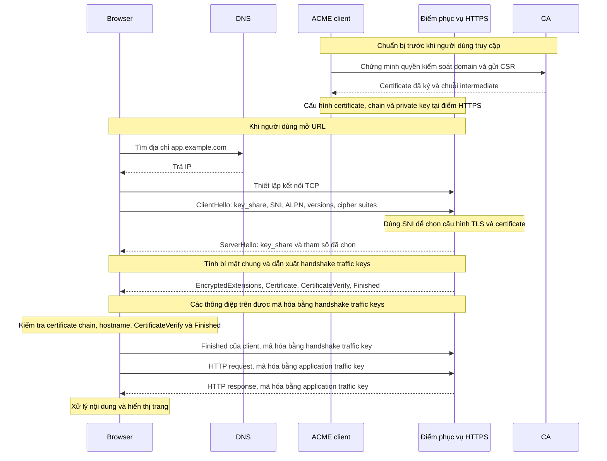

# CA, TLS và toàn bộ luồng request/response khi truy cập ứng dụng HTTPS

> Kiến thức nền cho [setup-rancher.md](setup-rancher.md) và
> [tunnel-traefik.md](tunnel-traefik.md). Ví dụ tổng quát dùng `app.example.com`;
> phần cuối áp dụng vào hostname `rancher.hieupn.site` và cấu hình lab.

**CA là Certificate Authority — bên cấp và ký certificate. Trong HTTPS, CA giúp client kiểm
chứng rằng một khóa công khai thực sự được cấp cho hostname mà client muốn truy cập.**

Để hiểu toàn bộ quá trình, cần nối bốn việc với nhau: **tìm địa chỉ bằng DNS, thiết lập kết nối
mạng, tạo kênh bảo mật bằng TLS, rồi trao đổi request/response bằng HTTP.** CA tham gia vào việc
thiết lập niềm tin cho TLS.

Phần sau giải thích trên ví dụ `https://app.example.com/products?id=10`, rồi áp dụng vào Rancher.

**Trước hết, certificate và CA liên quan với nhau như thế nào?**

Certificate — chứng chỉ số — có thể hiểu là một tấm giấy chứng nhận điện tử. Một certificate
của website chứa những thông tin như:

| Thông tin | Ý nghĩa |
| --- | --- |
| Hostname, thường trong trường `subjectAltName` | Certificate có giá trị cho những tên nào |
| Public key của server | Khóa công khai gắn với danh tính server |
| Issuer | Bên đã cấp certificate |
| Thời gian hiệu lực | Certificate bắt đầu và hết hạn khi nào |
| Chữ ký số của bên cấp | Cho phép kiểm tra nguồn cấp và tính nguyên vẹn |

Certificate thường theo chuẩn **X.509**. Nó có thể được gửi cho client; phần phải giữ bí mật là
**private key**, không phải certificate. Xem
[RFC 5280 — Internet X.509 Public Key Infrastructure](https://www.rfc-editor.org/rfc/rfc5280).

CA dùng private key của mình để ký certificate. Client dùng public key tương ứng của CA để kiểm
tra chữ ký.

Hình dung CA như một bên đóng dấu chứng nhận. Certificate là giấy có dấu; nhưng client còn phải
biết **có tin bên đóng dấu đó hay không**.

Browser có **trust store**: tập hợp các certificate CA gốc mà nó tin. Một certificate website
thường được cấp qua chuỗi Root CA → Intermediate CA → certificate website. Browser kiểm tra
chuỗi chữ ký để tìm về một CA gốc đã được tin cậy.

**Trust store không phải lúc nào cũng là store của hệ điều hành, và các process trên cùng máy
không nhất thiết tin cùng một tập CA.** Ví dụ:

| Client | Nguồn CA tin cậy |
| --- | --- |
| Chrome trên các nền tảng hỗ trợ Chrome Root Store | Có root store riêng; có cơ chế tích hợp CA do người dùng/quản trị viên tin ở nền tảng. Chrome trên iOS dùng cơ chế của Apple |
| Firefox | Có root store của Mozilla; còn có thể tin CA được thêm vào OS theo nền tảng và cấu hình |
| Safari | Dùng cơ chế tin cậy certificate của hệ điều hành Apple |
| curl | Phụ thuộc bản build và TLS backend: bản dùng Schannel trên Windows dùng Windows CA store; nhiều bản khác dùng CA bundle dạng file |
| Python `requests` | Bản upstream mặc định dùng bundle của `certifi`; có thể chỉ định bundle bằng `verify="/path/ca-bundle.pem"` hoặc `REQUESTS_CA_BUNDLE`. Bản đóng gói/tùy biến có thể khác |

Vì vậy, “process cần tin CA riêng” nghĩa là phải cấp CA cho **đúng trust store/bundle mà process
đó thực sự dùng**. Browser truy cập được không chứng minh một script Python hoặc Pod cũng sẽ
verify được. Không suy ra mọi bản curl trên Windows đều dùng Schannel; có thể xem TLS backend
bằng `curl -V`.

Tham khảo: [Chrome Root Store FAQ](https://chromium.googlesource.com/chromium/src/+/main/net/data/ssl/chrome_root_store/faq.md),
[Mozilla — Set up CAs in Firefox](https://support.mozilla.org/en-US/kb/setting-certificate-authorities-firefox),
[Apple — Certificate management](https://support.apple.com/guide/deployment/intro-to-certificate-management-depb5eff8914/web),
[curl — TLS Certificate Verification](https://curl.se/docs/sslcerts.html) và
[Requests — CA Certificates](https://requests.readthedocs.io/en/latest/user/advanced/#ca-certificates).

Các loại khóa làm những việc khác nhau:

| Khóa | Vai trò |
| --- | --- |
| Private key của CA | Ký certificate |
| Public key của CA | Kiểm tra chữ ký trên certificate |
| Private key của server | Chứng minh server sở hữu khóa tương ứng với certificate |
| Public key của server | Giúp client kiểm tra bằng chứng đó |
| Cặp khóa tạm thời của mỗi bên trong trao đổi (EC)DHE | Public share được gửi trong `key_share`; private key tương ứng được giữ kín để tính bí mật chung |
| Handshake traffic keys | Bảo vệ các thông điệp handshake sau `ServerHello` trong TLS 1.3 |
| Application traffic keys | Mã hóa và kiểm tra tính toàn vẹn của dữ liệu ứng dụng như HTTP |

Vì vậy, certificate giúp thiết lập danh tính; **dữ liệu request/response được bảo vệ bằng khóa
phiên TLS**.

Trước khi website phục vụ HTTPS, người vận hành cần chuẩn bị certificate. Với public CA như
Let’s Encrypt, **ACME client** — chẳng hạn certbot hoặc cert-manager — làm việc với CA; nó không
nhất thiết là process đang phục vụ HTTPS. Quá trình cơ bản là:

1. ACME client tạo hoặc sử dụng khóa tài khoản ACME để xác thực các yêu cầu quản lý certificate.
2. Chứng minh quyền kiểm soát domain, chẳng hạn bằng một DNS record hoặc tài nguyên HTTP theo yêu
   cầu của CA.
3. Tạo cặp khóa cho certificate, lập CSR chứa public key và hostname, rồi xin CA cấp certificate.
4. Nhận certificate đã ký và chuỗi intermediate, rồi cấu hình chúng cùng private key tương ứng
   tại điểm phục vụ HTTPS.

**Khóa tài khoản ACME và khóa của certificate là hai cặp khóa khác nhau.** Khóa tài khoản dùng
với dịch vụ ACME; private key của certificate được điểm phục vụ HTTPS dùng để chứng minh danh
tính trong TLS. Cặp khóa tạm thời trong `key_share` lại phục vụ việc thiết lập bí mật chung.

Xem [Let’s Encrypt — How It Works](https://letsencrypt.org/how-it-works/).

**CA không phải một proxy đứng giữa browser và ứng dụng để chuyển tiếp mỗi request.** Việc cấp
certificate diễn ra trước. Khi kết nối, browser kiểm tra certificate mà server trình; các kiểm
tra trạng thái certificate bổ sung tùy chính sách của client.

Sơ đồ dưới đây thể hiện một kết nối mới dùng TCP và **TLS 1.3 với certificate và (EC)DHE**;
không vẽ các nhánh resumption/PSK, 0-RTT, HelloRetryRequest hoặc xác thực client bằng certificate:



Bây giờ theo lần lượt từ lúc nhập URL đến khi nhìn thấy ứng dụng.

1. **Browser đọc URL để biết bạn muốn gọi cái gì.**

   Với `https://app.example.com/products?id=10`:

   | Phần | Giá trị | Ý nghĩa |
   | --- | --- | --- |
   | Scheme | `https` | Sử dụng HTTPS |
   | Hostname | `app.example.com` | Tên server cần truy cập |
   | Port | `443` mặc định | Cổng kết nối khi URL không ghi port riêng |
   | Path | `/products` | Tài nguyên hoặc endpoint cần gọi |
   | Query | `id=10` | Tham số gửi cho ứng dụng |

   Nếu URL có phần `#details`, phần fragment này được browser xử lý và không gửi trong HTTP
   request tới server. Xem
   [RFC 3986 — Uniform Resource Identifier](https://www.rfc-editor.org/rfc/rfc3986.html).

2. **DNS tìm địa chỉ IP cho hostname.**

   Browser sử dụng cơ chế phân giải tên, thường qua resolver của hệ điều hành hoặc DNS được
   browser cấu hình.

   Resolver có thể dùng kết quả cache. Nếu chưa có, nó tìm câu trả lời từ hệ thống DNS.

   Các record thường gặp:

   | Record | Chức năng |
   | --- | --- |
   | `A` | Ánh xạ tên tới IPv4 |
   | `AAAA` | Ánh xạ tên tới IPv6 |
   | `CNAME` | Ánh xạ tên tới một tên khác |

   DNS trả thông tin để client tìm được địa chỉ. **DNS không chuyển tiếp HTTP request tới ứng
   dụng.** Xem [RFC 1034 — Domain Names: Concepts and Facilities](https://www.rfc-editor.org/rfc/rfc1034.html).

   Ví dụ minh họa, hostname phân giải thành `203.0.113.10`. Browser chuẩn bị kết nối tới IP đó
   trên port `443`, nhưng vẫn giữ hostname để sử dụng ở những bước tiếp theo.

   **Riêng lab `rancher.hieupn.site` qua Cloudflare Tunnel:** DNS public được cấu hình bằng
   CNAME proxied tới `<TUNNEL-UUID>.cfargotunnel.com`. Client nhận địa chỉ IP của Cloudflare
   qua câu trả lời A/AAAA, **không phải IP máy lab**. Edge chuyển request qua tunnel sau đó;
   DNS không trỏ browser thẳng vào Traefik nội bộ. Xem
   [Cloudflare — DNS records for Tunnel](https://developers.cloudflare.com/cloudflare-one/networks/connectors/cloudflare-tunnel/routing-to-tunnel/dns/).

3. **Hệ thống mạng đưa dữ liệu tới địa chỉ đích; TCP thiết lập kết nối.**

   Dữ liệu đi qua mạng của máy, gateway và các router tới server. Firewall phải cho phép kết
   nối; NAT có thể xuất hiện nếu máy nằm sau router.

   Với HTTPS dùng HTTP/1.1 hoặc HTTP/2, client thường thiết lập TCP trước:

   - Client gửi `SYN`.
   - Server trả `SYN-ACK`.
   - Client gửi `ACK`.

   TCP cung cấp luồng byte có thứ tự, xử lý việc truyền lại dữ liệu bị mất và điều tiết truyền
   dữ liệu. **TCP handshake chứng minh kết nối TCP được thiết lập; nó chưa xác thực danh tính
   website bằng certificate.** Xem
   [RFC 9293 — Transmission Control Protocol](https://www.rfc-editor.org/rfc/rfc9293.html).

4. **TLS 1.3 bắt đầu bằng ClientHello có SNI và trao đổi khóa trước khi gửi certificate.**

   **TLS — Transport Layer Security** — cung cấp ba đặc tính:

   | Đặc tính | Ý nghĩa |
   | --- | --- |
   | Mã hóa | Người nghe lén thụ động trên đường truyền không đọc được nội dung HTTP |
   | Toàn vẹn | Việc sửa dữ liệu trên đường truyền bị phát hiện |
   | Xác thực | Client kiểm chứng danh tính đầu bên kia |

   **HTTPS là HTTP chạy trong kênh được TLS bảo vệ.** “SSL” là tên của công nghệ tiền thân;
   cách gọi “SSL certificate” vẫn thường được dùng cho certificate phục vụ TLS. Xem
   [MDN — Transport Layer Security](https://developer.mozilla.org/en-US/docs/Web/Security/Defenses/Transport_Layer_Security).

   Với handshake TLS 1.3 dùng certificate và (EC)DHE như sơ đồ, thứ tự là:

   - Client gửi `ClientHello` chứa `key_share`, các phiên bản hỗ trợ (`supported_versions`),
     cipher suites, cùng SNI và ALPN cho kết nối HTTPS này. `key_share` là phần công khai
     phục vụ trao đổi khóa, không chứa private key.
   - **SNI — Server Name Indication** — khai hostname `app.example.com` ngay trong
     `ClientHello`. Một IP và port `443` có thể phục vụ nhiều hostname; server dùng SNI để
     chọn cấu hình TLS/certificate **trước khi trình certificate và trước HTTP**.
   - Server trả `ServerHello`, gồm `key_share` của nó và các tham số đã chọn. Hai bên tính
     bí mật chung và dẫn xuất **handshake traffic keys** ngay sau cặp Hello này; chưa xác
     thực xong danh tính server ở thời điểm đó.
   - Server gửi `EncryptedExtensions` (trong đó có kết quả chọn ALPN), `Certificate`,
     `CertificateVerify`, rồi `Finished`, **đều được mã hóa bằng handshake traffic keys**.
     Certificate trong TLS 1.3 không được gửi dưới dạng plaintext cho người nghe lén.

   Client tiếp tục kiểm tra các thông điệp ở bước 5 và gửi `Finished` ở bước 6. Không mô tả
   thành “kiểm tra certificate xong mới trao đổi khóa”: đó không phải thứ tự TLS 1.3 ở đây.
   Xem [RFC 8446 §2 — Protocol Overview](https://www.rfc-editor.org/rfc/rfc8446.html#section-2)
   và [RFC 6066 §3 — SNI](https://datatracker.ietf.org/doc/html/rfc6066#section-3).

   Cùng một hostname có ba vai trò, xuất hiện ở các thời điểm khác nhau:

   | Nơi sử dụng | Mục đích |
   | --- | --- |
   | DNS, trước kết nối | Tìm địa chỉ IP |
   | TLS SNI trong `ClientHello` | Giúp server chọn cấu hình TLS/certificate |
   | HTTP Host hoặc `:authority`, sau khi client hoàn tất handshake | Cho server biết request thuộc website nào |

   SNI và HTTP Host thuộc hai lớp khác nhau. Đây là lý do runbook có cả `originServerName`
   và `httpHostHeader`; chỉ sửa HTTP Host không tự sửa SNI khi chưa bật `matchSNItoHost`.
   Xem [Origin Server Name](#origin-server-name) để phân biệt địa chỉ Service, tên TLS và Host
   trong cấu hình lab.

   **Giới hạn của tính bí mật:** người quan sát vẫn thấy IP, port, kích thước và thời điểm
   gửi gói tin. Khi không dùng **ECH — Encrypted ClientHello**, họ còn thấy SNI plaintext
   trong `ClientHello`, dù certificate và HTTP sau đó được mã hóa. Khi client và server dùng
   ECH thành công, hostname thật được bảo vệ trong ClientHello bên trong; ECH không che IP,
   port hay toàn bộ metadata lưu lượng. Không mặc định mọi kết nối TLS 1.3 đều có ECH. Xem
   [RFC 8446 Appendix E.3 — Traffic Analysis](https://www.rfc-editor.org/rfc/rfc8446.html#appendix-E.3)
   và [Cloudflare — ECH](https://developers.cloudflare.com/ssl/edge-certificates/ech/).

5. **Client kiểm tra certificate, CertificateVerify và Finished của server.**

   Những kiểm tra quan trọng gồm:

   - Chuỗi certificate có dẫn về CA được client tin không?
   - Certificate có đang trong thời gian hiệu lực không?
   - Hostname trong URL có khớp tên được chứng nhận không?
   - Certificate và thuật toán có phù hợp với chính sách của client không?

   Khi gọi `https://app.example.com`, client kiểm tra tên `app.example.com`, dù kết nối mạng
   thực tế được mở tới một IP. Việc đối chiếu tên domain sử dụng các định danh phù hợp trong
   `subjectAltName`. Xem
   [RFC 9525 — Service Identity in TLS](https://www.rfc-editor.org/rfc/rfc9525.html).

   Client còn dùng public key trong certificate để kiểm tra chữ ký `CertificateVerify`:
   server phải chứng minh sở hữu private key tương ứng và ràng buộc bằng chứng với nội dung
   handshake. Sau đó client kiểm tra `Finished` để xác nhận khóa và tính toàn vẹn của
   handshake. `Finished` dùng MAC từ bí mật handshake, không phải chữ ký của CA. Xem
   [RFC 8446 §4.4.3 — CertificateVerify](https://www.rfc-editor.org/rfc/rfc8446.html#section-4.4.3)
   và [§4.4.4 — Finished](https://www.rfc-editor.org/rfc/rfc8446.html#section-4.4.4).

   Lỗi chain trust và lỗi hostname khác nhau; thông báo cụ thể còn tùy client/TLS backend:

   | Lỗi | Ý nghĩa |
   | --- | --- |
   | Go, như `cloudflared`: `x509: certificate signed by unknown authority` | Không xây dựng được chuỗi tới CA được tin |
   | Chrome: `NET::ERR_CERT_AUTHORITY_INVALID` | Lỗi về độ tin cậy của certificate/chuỗi cấp |
   | curl với OpenSSL: `unable to get local issuer certificate` | Thiếu issuer cần thiết để xây dựng chuỗi tin cậy |
   | Hostname mismatch | Certificate không chứng nhận đúng tên client đang gọi |

   Không chỉ CA riêng chưa được tin mới gây lỗi chain: **server quên gửi intermediate** cũng
   là một nguyên nhân thường gặp, kể cả khi root CA đã được tin. Điểm HTTPS cần gửi leaf
   certificate và các intermediate cần thiết; thường không cần gửi root. Sửa chain thiếu ở
   server, và cấu hình CA tin cậy đúng ở client; không giải quyết bằng cách tắt verification.
   Xem [RFC 8446 §4.4.2 — Certificate](https://www.rfc-editor.org/rfc/rfc8446.html#section-4.4.2).

   Có đúng địa chỉ IP chưa đủ để vượt qua những kiểm tra này. Nếu một kiểm tra bắt buộc thất
   bại, client ngắt handshake thay vì gửi HTTP.

6. **Client gửi Finished rồi dùng application traffic keys cho HTTP.**

   Sau khi các kiểm tra ở bước 5 thành công, client gửi `Finished` của mình, vẫn được mã hóa
   bằng handshake traffic key của client. Server kiểm tra thông điệp này. Trong luồng đang
   mô tả, client chỉ bắt đầu gửi HTTP sau `Finished`, dùng **application traffic keys**;
   đây là bộ khóa khác với bộ bảo vệ handshake.

   Về lịch dẫn xuất khóa, application traffic secrets đã có thể được tính sau `Finished`
   của server; không phải chờ tới lúc gửi HTTP mới sinh. TLS 1.3 còn cho phép server gửi
   application data ngay sau `Finished` của nó, trước khi nhận `Finished` của client.
   Sơ đồ chọn luồng request/response thông thường để dễ theo dõi; 0-RTT không nằm trong ví
   dụ này. Xem [RFC 8446 §2](https://www.rfc-editor.org/rfc/rfc8446.html#section-2) và
   [§7.1 — Key Schedule](https://www.rfc-editor.org/rfc/rfc8446.html#section-7.1).

7. **Browser gửi HTTP request trong kênh TLS.**

   HTTP quy định cách client yêu cầu tài nguyên và server trả kết quả.

   Một request có method, tài nguyên cần gọi, headers và có thể có body. Ví dụ minh họa theo
   HTTP/1.1:

   ```http
   GET /products?id=10 HTTP/1.1
   Host: app.example.com
   Accept: text/html

   ```

   - `GET`: yêu cầu lấy tài nguyên.
   - `/products?id=10`: tài nguyên và tham số.
   - `Host`: website cần phục vụ.
   - `Accept`: loại nội dung client muốn nhận.

   Khi gửi dữ liệu, request có thể dùng `POST` và body chứa JSON hoặc dữ liệu form. HTTP/2 và
   HTTP/3 biểu diễn thông điệp theo cách khác, nhưng vẫn giữ những khái niệm method, headers,
   nội dung và status. Xem
   [RFC 9110 — HTTP Semantics](https://www.rfc-editor.org/rfc/rfc9110.html).

   Đoạn trên là nội dung dễ đọc để giải thích. Khi dùng HTTPS, dữ liệu HTTP được bảo vệ trong
   kênh TLS trên đường truyền.

8. **Điểm nhận HTTPS xử lý TLS rồi đưa request tới ứng dụng.**

   Điểm này có thể là chính server ứng dụng, hoặc một reverse proxy như NGINX, Traefik,
   load balancer hay Cloudflare Edge.

   **Terminate TLS** nghĩa là thành phần đó thực hiện TLS với client và có thể đọc HTTP sau
   khi giải mã.

   Nếu có reverse proxy, proxy tiếp tục chọn backend theo hostname/path rồi chuyển request
   bằng một kết nối khác. Kết nối tới backend có thể là HTTP hoặc HTTPS theo kiến trúc đã chọn.

   Ứng dụng xử lý endpoint: đọc tham số, kiểm tra quyền, chạy logic, truy vấn database hoặc gọi
   dịch vụ khác nếu cần. Với FastAPI, đây là lúc logic của endpoint thực hiện công việc.

9. **Server trả HTTP response; browser xử lý nội dung.**

   Response chứa status, headers và có thể có body:

   ```http
   HTTP/1.1 200 OK
   Content-Type: text/html; charset=utf-8

   <html>...</html>
   ```

   Browser nhận dữ liệu qua kết nối bảo mật, rồi xử lý theo loại nội dung. Với trang web, nó
   phân tích HTML, tải thêm CSS, JavaScript và ảnh, tính bố cục rồi vẽ lên màn hình. JavaScript
   có thể tiếp tục gọi API để lấy dữ liệu. Vì vậy, một lần mở trang thường tạo nhiều request.
   Xem [MDN — How browsers work](https://developer.mozilla.org/en-US/docs/Web/Performance/Guides/How_browsers_work).

10. **Ứng dụng xác thực người dùng và duy trì phiên.**

    TLS kiểm chứng server và bảo vệ kết nối. Việc ứng dụng biết **bạn là ai và được phép làm
    gì** thuộc lớp xác thực, phân quyền của ứng dụng.

    Sau đăng nhập, ứng dụng có thể trả cookie phiên bằng `Set-Cookie`. Browser lưu cookie và
    gửi lại trong các request phù hợp, để server nhận biết phiên đăng nhập. Một số API sử dụng
    token trong header `Authorization`. Xem
    [MDN — Using HTTP cookies](https://developer.mozilla.org/en-US/docs/Web/HTTP/Guides/Cookies).

    Trong lab Rancher, Access kiểm tra quyền tiếp cận đường public; Rancher tiếp tục kiểm tra
    tài khoản và quyền quản trị của bạn.

Quá trình vừa mô tả là mô hình một kết nối mới dùng TCP. Có hai điều thực tế cần biết:

- **Kết nối có thể được tái sử dụng:** nhiều request dùng chung kết nối, nên không phải mỗi
  request đều lặp lại DNS, TCP và toàn bộ TLS handshake.
- **HTTP/3 dùng QUIC trên UDP**, với TLS 1.3 được tích hợp vào việc thiết lập kết nối QUIC; nó
  không dùng TCP handshake ở bước 3.

Xem [RFC 9114 — HTTP/3](https://www.rfc-editor.org/rfc/rfc9114).

Cuối cùng, **“CA riêng của Rancher” trong lab của bạn là một CA nội bộ dùng để ký certificate
cho Rancher**, thay vì sử dụng một public CA đã được browser tin sẵn.

Trong mô hình CA issuer của cert-manager, certificate và private key của CA được lưu trong
Secret để thực hiện việc ký. Những certificate được cấp không tự trở thành public-trusted;
các client cần được cấu hình tin CA phù hợp. Xem
[cert-manager — CA issuer](https://cert-manager.io/docs/configuration/ca/).

Áp dụng vào những đường đã học: **đường public có ba đoạn TLS riêng biệt**, mỗi đoạn có đầu
cuối và khóa riêng. Không có một phiên TLS xuyên suốt từ browser tới Traefik.

| Đoạn | Client và kết nối | Certificate phía server trình | Ai kiểm chứng? |
| --- | --- | --- | --- |
| TLS 1 — public | Browser → Cloudflare Edge | Certificate public cho hostname Rancher tại Edge | Browser dùng trust store của nó |
| TLS 2 — tunnel | `cloudflared` → Cloudflare; tunnel truyền dữ liệu hai chiều | Certificate của endpoint tunnel Cloudflare, không phải certificate Rancher | `cloudflared` kiểm tra certificate của Cloudflare khi thiết lập tunnel |
| TLS 3 — origin | `cloudflared` → Traefik | Certificate Rancher do CA riêng ký **khi SNI là `rancher.hieupn.site` và Traefik đã nạp certificate đó**; nếu khác có thể nhận certificate mặc định | Trong cấu hình lab hiện tại, `noTLSVerify: true` bỏ verification của certificate origin; cấu hình kiểm chứng đầy đủ được nêu bên dưới |
| Đường nội bộ riêng | Process nội bộ → Traefik | Certificate Rancher nếu gửi đúng SNI và Traefik đã nạp certificate; nếu khác có thể nhận certificate mặc định | Process cần tin CA riêng trong đúng trust store/bundle của nó và kiểm tra hostname |

**Tunnel do `cloudflared` chủ động mở outbound tới Cloudflare**, dùng QUIC trên UDP với TLS
1.3 tích hợp, hoặc HTTP/2 trên TCP được TLS bảo vệ, tới port `7844`. Request từ Edge về lab và
response về Edge đi trên kết nối đã mở này; không phải Edge khởi tạo kết nối inbound trực tiếp
tới máy lab. Xem [Cloudflare Tunnel](https://developers.cloudflare.com/cloudflare-one/networks/connectors/cloudflare-tunnel/)
và [Tunnel with firewall](https://developers.cloudflare.com/cloudflare-one/networks/connectors/cloudflare-tunnel/configure-tunnels/tunnel-with-firewall/).

Cloudflare Edge **terminate TLS của browser nên Cloudflare đọc được HTTP** và áp dụng Access,
WAF hoặc các tính năng proxy. Dữ liệu tiếp tục được bảo vệ trên tunnel và kết nối HTTPS từ
connector tới Traefik bằng các khóa khác. Đây không phải mã hóa end-to-end giữa browser và
Traefik. Sau khi Traefik terminate TLS, kết nối tới Pod Rancher dùng HTTP theo runbook.

Traefik đọc certificate và private key trong Secret `tls-rancher-ingress` để phục vụ TLS.
cert-manager quản lý việc cấp certificate; **Traefik mới là thành phần thực hiện TLS handshake
với client trên đường này**.

Một client nội bộ được cung cấp CA đúng có thể kiểm tra đầy đủ: chữ ký dẫn về CA đó, hostname
khớp `rancher.hieupn.site`, certificate còn hiệu lực và server chứng minh sở hữu private key.

## Origin Server Name

**Origin Server Name** (trong file cấu hình là `originServerName`) là hostname mà
`cloudflared` dùng làm tên TLS của origin HTTPS. Nó có hai vai trò: **khai SNI để origin chọn
certificate**, và **làm tên đối chiếu với certificate khi bật verification**. Giá trị là
hostname, ví dụ `rancher.hieupn.site`, không kèm `https://`, port hoặc path.

Trong lab, origin mà connector gọi là Traefik. Địa chỉ kết nối tới Traefik và tên được ghi
trên certificate Rancher khác nhau; bảng dưới phân biệt từng chỗ cấu hình:

| Chỗ cấu hình | Giá trị của route Rancher | Vai trò |
| --- | --- | --- |
| Public hostname | `rancher.hieupn.site` | Chọn published application route khi request tới Cloudflare |
| Service URL | `https://traefik.traefik.svc.cluster.local:443` | Chọn giao thức, địa chỉ cần phân giải và port để connector kết nối tới origin |
| Origin Server Name | `rancher.hieupn.site` | Khai SNI và, khi verify, kiểm tra certificate có chứng nhận tên này |
| HTTP Host Header | `rancher.hieupn.site` | Đặt Host trong HTTP để Traefik chọn router của Ingress sau handshake |

**Vì sao không đặt Origin Server Name bằng tên Service?** Tên
`traefik.traefik.svc.cluster.local` giúp tìm tới Traefik trong Kubernetes, nhưng certificate
Rancher được cấp cho `rancher.hieupn.site`. Biết đúng nơi kết nối chưa đồng nghĩa đang dùng
đúng tên TLS. Setting này cho phép giữ địa chỉ Service nội bộ mà vẫn khai và kiểm tra danh
tính Rancher.

Với một kết nối origin mới, trình tự sử dụng các giá trị trên là:

1. Connector lấy hostname từ **Service URL**, hỏi CoreDNS về
   `traefik.traefik.svc.cluster.local`, rồi kết nối TCP tới ClusterIP Traefik, port `443`.
2. Trong TLS `ClientHello`, connector gửi **SNI = `rancher.hieupn.site`** theo
   `originServerName`. Setting này không khiến connector phân giải hostname public để tìm
   địa chỉ origin, nên không tự tạo đường vòng qua Cloudflare Edge.
3. Traefik dùng SNI để chọn cấu hình TLS/certificate, rồi trả `ServerHello` có `key_share`.
   Trong TLS 1.3, hai bên dẫn xuất handshake keys trước khi Traefik gửi certificate Rancher
   từ `tls-rancher-ingress` trong thông điệp `Certificate` đã mã hóa.
4. Nếu verification bật, connector kiểm tra chain trust, thời hạn và tên
   `rancher.hieupn.site` trong SAN, cùng các kiểm tra TLS còn lại. CA riêng phải được connector
   tin, chẳng hạn qua `caPool`. Nếu `noTLSVerify: true`, kiểm tra certificate chain/hostname
   bị bỏ qua; SNI vẫn được gửi và TLS vẫn phải hoàn tất handshake.
5. Sau handshake, connector gửi HTTP với **Host = `rancher.hieupn.site`** theo
   `httpHostHeader`. Đây là lúc Traefik chọn router HTTP; Host không quay ngược thời gian để
   thay certificate đã chọn trong handshake.

Do đó, **đặt Origin Server Name không tự làm CA riêng trở thành đáng tin**. Nó chọn/đối chiếu
tên; `caPool` cung cấp CA tin cậy, còn `noTLSVerify` quyết định có kiểm tra certificate origin
hay không. Khi `noTLSVerify: true`, vai trò chọn certificate bằng SNI vẫn có ý nghĩa, nhưng
connector không xác thực certificate đó thuộc Rancher mong muốn.

**Nếu để trống thì sao?**

Mặc định `originServerName` là chuỗi rỗng `""`. Với origin HTTPS và
`matchSNItoHost: false` mặc định, connector lấy tên TLS từ hostname trong Service URL.
Trong ví dụ Rancher, tên đó sẽ là `traefik.traefik.svc.cluster.local`; Traefik có thể trả
certificate mặc định nếu không có certificate khớp SNI này. Khi bật verification, kết nối có
thể thất bại vì chain không được tin hoặc tên không khớp. Khi `noTLSVerify: true`, request có
thể vẫn chạy dù connector nhận nhầm certificate.

Nếu bật `matchSNItoHost: true`, connector lấy SNI theo Host gửi tới origin, dùng
`httpHostHeader` nếu đã đặt, và ghi đè lựa chọn từ `originServerName` cho từng request.
Với route Rancher cố định trong ví dụ này, dùng `originServerName: rancher.hieupn.site` và để
`matchSNItoHost: false` giúp thấy rõ tên TLS đang được cấu hình.

**Vì sao route app demo không cần đặt Origin Server Name?**

Route `app.hieupn.site` trong [tunnel-traefik.md](tunnel-traefik.md) dùng origin
`http://traefik.traefik.svc.cluster.local:80`. Đoạn connector → Traefik này là HTTP, không có
TLS handshake, SNI hay certificate origin để chọn/verify. Vì vậy Origin Server Name để trống
không tham gia vào kết nối đó. Browser → Cloudflare Edge vẫn dùng HTTPS; tunnel giữa
Cloudflare và connector vẫn được mã hóa.

Với route Rancher dùng origin HTTPS, đặt giá trị trong **Edit → Additional application
settings → TLS → Origin Server Name** của published application route. Setting này áp dụng
cho `cloudflared` → origin, không thay certificate public tại Edge và không cấu hình hộ SNI
cho process nội bộ gọi trực tiếp Traefik.

Tham khảo: [Cloudflare — Origin Server Name](https://developers.cloudflare.com/cloudflare-one/networks/connectors/cloudflare-tunnel/configure-tunnels/origin-parameters/#originservername)
và [Match SNI to host](https://developers.cloudflare.com/cloudflare-one/networks/connectors/cloudflare-tunnel/configure-tunnels/origin-parameters/#matchsnitohost).

## Kiểm chứng certificate origin

**`curl -k` / `noTLSVerify: true`: mã hóa còn, xác thực server mất.** Client vẫn mã hóa tới bên
trả lời handshake và có private key khớp certificate mà bên đó tự trình. Nhưng vì không kiểm
chứng certificate có thuộc server mong muốn, bên trả lời có thể là kẻ giả mạo. Kẻ MITM chủ động
có thể lập hai kết nối TLS, giải mã, đọc/sửa rồi mã hóa lại dữ liệu. Vì vậy “vẫn mã hóa” chỉ mô
tả khả năng chống nghe lén thụ động trên đoạn đó, **không bảo đảm chống MITM chủ động**.

`noTLSVerify` trong origin parameters chỉ bỏ kiểm chứng certificate trên đoạn
`cloudflared` → Traefik; nó không tắt verification trên tunnel tới Cloudflare, và không thay
đổi trust store của browser hay process nội bộ.

**Cách cấu hình để xác thực origin bằng CA riêng:**

1. Cung cấp certificate CA gốc tin cậy dạng PEM/bundle cho Pod `cloudflared`, ví dụ mount tại
   `/etc/cloudflared/certs/rancher-ca.pem`. Lấy CA từ nguồn quản trị đáng tin; không cần đưa
   private key của CA hay private key của server sang connector.
2. Đặt `caPool` trỏ tới file đó và `originServerName: rancher.hieupn.site`; giữ HTTP Host khớp
   Ingress bằng `httpHostHeader`.
3. **Bỏ `noTLSVerify: true`**; mặc định `noTLSVerify` là `false`. Traefik phải gửi chain đủ,
   certificate còn hạn và có SAN khớp hostname.

Ví dụ **một ingress rule** trong file cấu hình tunnel quản lý cục bộ; đây không phải toàn bộ
file cấu hình:

```yaml
ingress:
  - hostname: rancher.hieupn.site
    service: https://traefik.traefik.svc.cluster.local:443
    originRequest:
      originServerName: rancher.hieupn.site
      httpHostHeader: rancher.hieupn.site
      caPool: /etc/cloudflared/certs/rancher-ca.pem
  - service: http_status:404
```

Với tunnel quản lý từ dashboard như lab, đặt các giá trị tương ứng trong TLS/HTTP origin
parameters của published application route, tắt **Disable TLS certificate verification**,
và vẫn mount file CA tại đúng đường dẫn trên **mọi replica connector**. Đường dẫn `caPool` là
file trong container `cloudflared`, không phải đường dẫn file trên máy đang mở dashboard.
Kiểm tra cả cấu hình cấp tunnel và cấp route để không còn giá trị `noTLSVerify: true` được
kế thừa. Đây là cấu hình đề xuất trong tài liệu, không phải xác nhận lab đã được thay đổi.

Client nội bộ dùng curl có thể chỉ định `--cacert /path/rancher-ca.pem` thay cho `-k`;
Python `requests` có thể dùng `verify="/path/rancher-ca.pem"`. Cả hai vẫn cần gọi bằng hostname
đúng và có đường phân giải nội bộ tới Traefik nếu muốn kiểm tra đường nội bộ. Khi gọi hostname
qua DNS public Cloudflare, client đang kiểm tra certificate của Edge.
