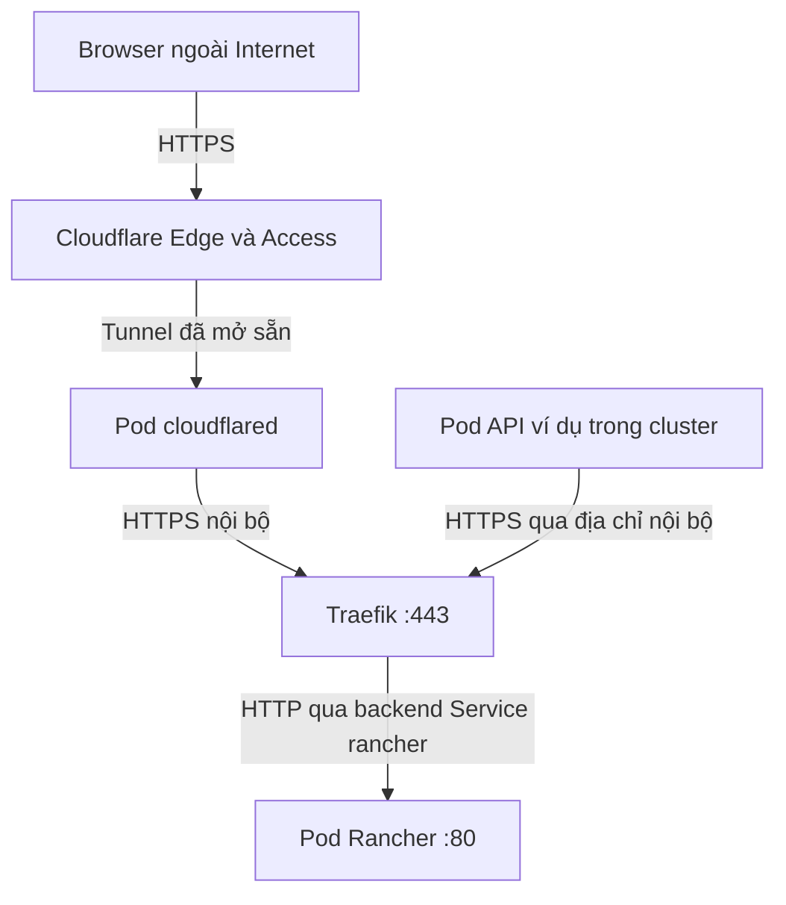
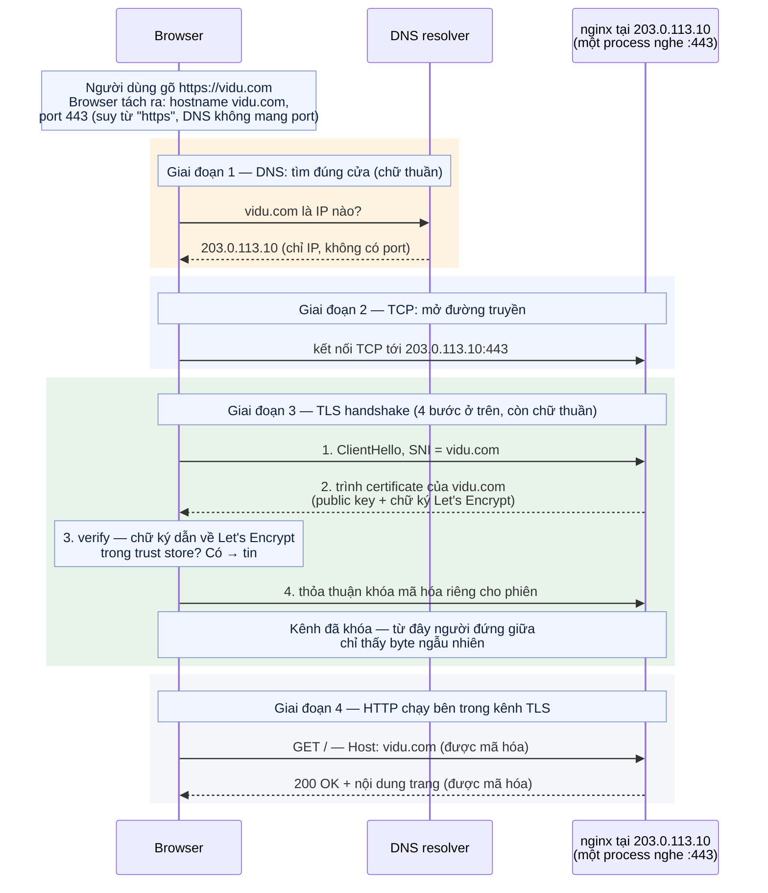
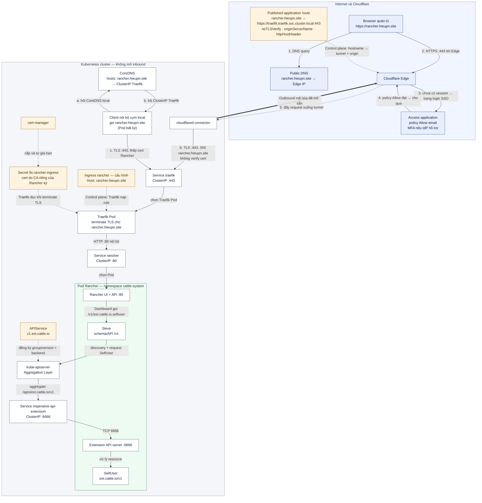
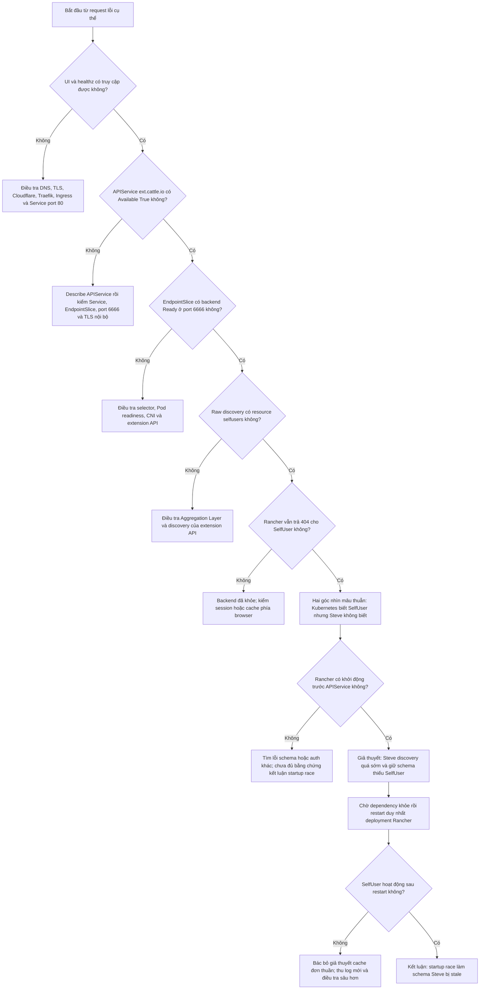
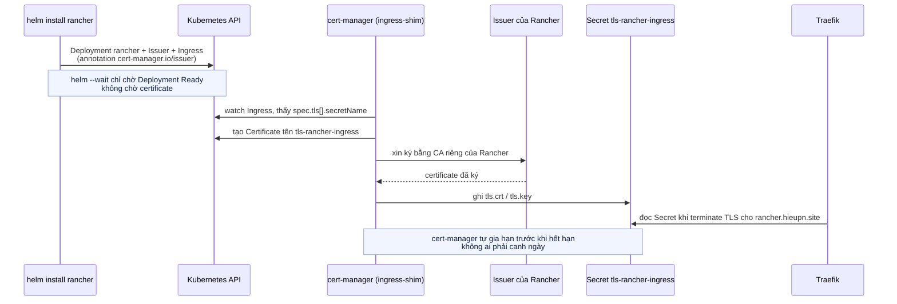
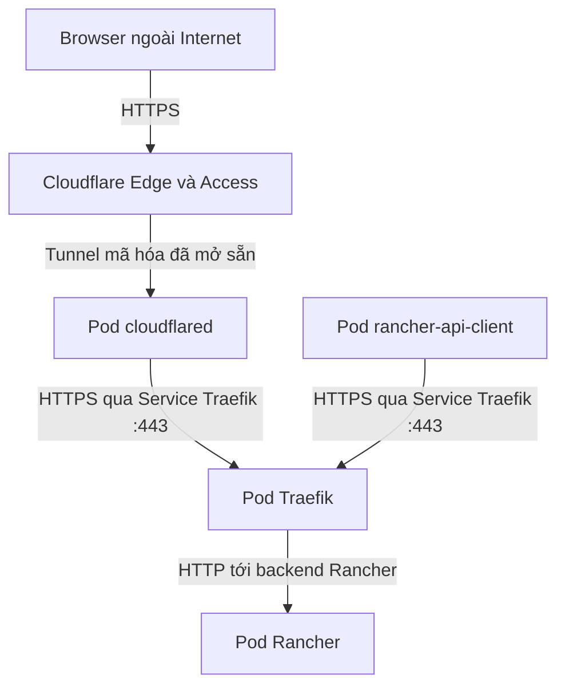

# Cơ chế cài Rancher vào cụm kubeadm — toàn cảnh §14

> Tài liệu này tách ra từ [§14 của runbook-k8s-vmware.md](../runbook-k8s-vmware.md#14-cài-rancher-2143--quản-lý-cụm)
> để giữ runbook ở độ dài đọc được. Đây là phần **giải thích cơ chế**, không chứa bước thao tác:
> mọi lệnh, gate `PASS:` và thứ tự triển khai vẫn nằm trong runbook.
>
> Tham chiếu dạng `§14.1`, `§14.5` trong bài trỏ về mục cùng số của runbook. Tên gọi lấy đúng theo
> lab: hostname `rancher.hieupn.site`, tunnel `homelab-k8s`, Traefik ở namespace `traefik`,
> `cloudflared` ở namespace `cloudflare`, Rancher ở namespace `cattle-system`.
>
> Luồng tunnel chung — Edge, connector outbound, Published application route, bốn lớp "route" —
> đã phân tích ở [`tunnel-traefik.md`](tunnel-traefik.md) cho app demo `app.hieupn.site`. Bài này
> không lặp lại phần đó; nó tập trung vào những gì Rancher **thêm vào** chuỗi: TLS nội bộ,
> hai đường vào cùng một hostname, và lớp Cloudflare Access.

Bố cục: nhìn nhanh §14 cài gì và để làm gì → có thể setup đơn giản như app demo không
(chuỗi domino từ một quyết định an ninh) → **cách đọc toàn bộ §14 theo ngôn ngữ đơn giản**
(cài đặt, diagram, đường browser, đường client nội bộ, SelfUser và gate hoàn thành) →
từ điển khái niệm nền → sơ đồ toàn cảnh hai đường vào → sơ đồ sự cố sau reboot và luồng
điều tra → sơ đồ tuần tự chuỗi cấp certificate → nền tảng ba công cụ Helm / cert-manager /
Rancher → giải thích từng mục §14.0 → §14.7 (mỗi lệnh, mỗi flag, mỗi key trong values) →
15 mục đào sâu từng cơ chế → tự kiểm tra (câu hỏi, đáp án và nhận xét lượt trả lời).

## Nhìn nhanh — §14 cài gì và để làm gì

§14 làm đúng một việc: **đưa Rancher — giao diện web quản trị Kubernetes — vào chạy ngay trong
cluster của lab, rồi mở đường truy cập tới nó một cách an toàn**. Kết quả cuối: từ browser gõ
`https://rancher.hieupn.site`, vượt qua trang đăng nhập SSO của Cloudflare, vào được UI Rancher
và thấy cluster của lab hiện tên `local` ở trạng thái Active.

Từng mục của §14 đóng góp vào kết quả đó như sau:

| Mục | Cài / tạo gì | Phục vụ điều gì |
| --- | --- | --- |
| §14.0 | Không cài gì — kiểm tra cluster rồi backup etcd + `/etc/kubernetes` | Chắc chắn cluster đủ khỏe để nhận Rancher, và có đường lui nếu §14 hỏng giữa chừng |
| §14.1 | **cert-manager** (Helm chart) | "Nhà máy" tự cấp và tự gia hạn certificate TLS — Rancher ở §14.3 sẽ giao việc cấp TLS cho nó |
| §14.2 | Một entry `hosts` trong ConfigMap CoreDNS (**split DNS**) | Client trong cluster gọi `rancher.hieupn.site` đi thẳng nội bộ, không vòng ra Internet |
| §14.3 | **Rancher** (Helm chart) | Bản thân ứng dụng quản trị: UI + API + bộ controller, chạy trong namespace `cattle-system` |
| §14.4 | Không cài gì — test HTTPS từ trong cluster | Chứng minh chuỗi nội bộ Traefik → TLS → Rancher đã thông trước khi mở ra Internet |
| §14.5 | **Access application** + **Published application route** trên Cloudflare | Mở đường từ Internet vào Rancher, với cổng gác SSO đứng chắn trước |
| §14.6 | Không cài thêm gì — đăng nhập lần đầu | Lấy bootstrap password từ trong cluster, đặt mật khẩu admin, chốt Server URL |
| §14.7 | Không cài gì — gate hoàn thành | Kiểm kê mọi thứ đúng như đã khai báo trước khi coi §14 là xong |

Vì sao "cài một web app" mà tốn tám mục? Vì Rancher là giao diện quản trị nắm quyền cao nhất
trên cluster, nên nó cần ba thứ mà app demo của §13 không cần: **HTTPS thật ngay tại origin**
(sinh ra cert-manager và CA riêng), **đường gọi nội bộ không phụ thuộc Internet** (sinh ra split
DNS), và **cổng gác danh tính trước khi lộ ra Internet** (sinh ra Cloudflare Access). Ba nhu cầu
đó đẻ ra gần hết thuật ngữ của bài; phần từ điển định nghĩa từng cái trước khi đi vào
cơ chế — mở đầu bằng chính cụm khó nhất vừa nêu: HTTP/HTTPS/TLS là gì, origin là gì, và
"HTTPS thật ngay tại origin" nghĩa là sao.

### Có thể setup Rancher đơn giản như app demo không?

**Câu trả lời thẳng: được, và nó sẽ chạy.** Cấu hình đó tồn tại thật (Rancher gọi là
`tls=external`): route `http://…:80`, không cert trong cluster, không Access, không split DNS.
Khi đó mọi luồng đều hoạt động:

| Luồng | Kết quả |
| --- | --- |
| Browser mở `https://rancher.hieupn.site` | ✅ Chạy — HTTPS do Edge lo bằng cert public, y như app demo |
| Đăng nhập, dùng UI | ✅ Chạy |
| Pod nội bộ gọi Server URL | ✅ Chạy — đi vòng qua Edge, cert public hợp lệ nên verify OK |
| Import downstream cluster, `cattle-cluster-agent` gọi về | ✅ Chạy — với `agentTLSMode: system-store`, agent này tin cert public của Cloudflare |

Không có gì gãy — tức là **không có yêu cầu kỹ thuật nào ép buộc cách setup của §14 cả**.

**Lý do thật sự chỉ có một, và nó không phải kỹ thuật.** So sánh hai thứ đứng sau hai hostname:
kẻ lạ trên Internet mở `app.hieupn.site` thấy trang "hello" của nginx — hết, không có gì để
đăng nhập, không có gì để đánh cắp; phơi nó ra Internet là vô hại vì nó không cầm gì cả. Kẻ lạ
mở `rancher.hieupn.site` (bản setup đơn giản) thấy **form đăng nhập + toàn bộ API** của công cụ
đang cầm quyền `cluster-admin` — giữa kẻ đó và toàn bộ cluster chỉ còn **một lớp: mật khẩu
Rancher**. Bot quét Internet sẽ tìm ra trang này trong vài giờ, thử mật khẩu vô hạn lần, và chờ
CVE tiếp theo của Rancher (Rancher từng có lỗ hổng auth nghiêm trọng — không phải giả định).
Quyết định duy nhất của §14 là: **không chấp nhận để cả Internet nói chuyện trực tiếp với thứ
cầm chìa khóa tổng.** App demo không phải đưa ra quyết định này vì nó chẳng cầm chìa khóa nào.

**Toàn bộ phức tạp còn lại là domino đổ từ quyết định đó:**

```text
QUYẾT ĐỊNH: chặn người lạ TRƯỚC KHI họ chạm được Rancher
   ↓ hệ quả 1
Phải đặt Access ở Edge — kiểm danh tính bằng SSO (§14.5)
   ↓ hệ quả 2 (tác dụng phụ)
Access chặn luôn client dạng máy (máy không đăng nhập SSO được)
→ máy trong cụm cần một cửa riêng không đi qua Access → SPLIT DNS (§14.2)
   ↓ hệ quả 3
Cửa riêng đó phải phục vụ đúng URL https://rancher.hieupn.site
(https là yêu cầu cứng duy nhất của Rancher — Server URL không nhận http://)
→ cửa nội bộ phải tự trình cert cho tên này → CERT-MANAGER + CA RIÊNG (§14.1, §14.3)
   ↓ tùy chọn gia cố thêm
agentTLSMode: strict — chính sách xác minh CA cho agent được hỗ trợ; không cài agent (§14.3)
```

Đọc ngược cũng đúng: **bỏ quyết định đầu tiên đi thì cả chuỗi domino biến mất** — không cần
Access thì không cần split DNS, không cần split DNS thì client đi vòng qua Edge dùng cert
public, không cần cert nội bộ, không cần cert-manager. Và đó *chính xác* là cấu hình của app
demo.

> Rancher không phức tạp hơn app vì kỹ thuật đòi hỏi — nó phức tạp hơn vì lab **chọn trả thêm
> bốn bước cài đặt để đổi lấy việc kẻ tấn công không bao giờ được nhìn thấy trang login của thứ
> cầm `cluster-admin`**. App demo không có gì để bảo vệ nên không phải trả gì. Chọn ngược lại
> (chạy Rancher public như app, dựa vào mật khẩu mạnh + MFA + vá nhanh) là một lựa chọn có thật
> ngoài đời — chỉ là lab này không chọn thế.

## Cách đọc toàn bộ §14 theo ngôn ngữ đơn giản

**Mục tiêu của §14 là đưa Rancher vào chính cluster Kubernetes của bạn, rồi tạo hai đường truy cập cùng hostname `rancher.hieupn.site`: một đường dành cho người quản trị từ Internet và một đường dành cho client trong cluster.**

Có thể hình dung các nhân vật như sau: **Rancher Server** là ứng dụng quản trị chạy như một Pod
bình thường trong `cattle-system`; **cụm `local`** là chính cluster đang host nó — Rancher quản
nó trực tiếp, không qua `cattle-cluster-agent` trung gian; **cert-manager** là nhà máy cấp và gia hạn
certificate; **CA riêng của Rancher** là con dấu mà client phải chủ động tin; **Traefik** là lễ tân
đọc hostname và terminate TLS; **khối `hosts` trong CoreDNS** là bảng chỉ đường nội bộ;
**Cloudflare Access** là cổng gác trên đường public; **Published application route** khai đường từ
Edge vào cluster. `cattle-cluster-agent` chỉ xuất hiện ở downstream cluster trong tình huống đăng ký/import cluster đó, xem mục đào sâu 14. Không đồng nhất nó với `fleet-agent` có thể được tạo tự động cho `local`; bảng trong mục §14.1 bên dưới tách rõ các loại agent.

Sơ đồ này chỉ thể hiện đường chuyển tiếp request. DNS giúp tìm địa chỉ trước khi kết nối; Ingress
cung cấp cấu hình để Traefik chọn backend.



Tại điểm bắt đầu, bạn đã có cluster kubeadm hoạt động, CoreDNS phục vụ DNS trong cluster, Traefik
tiếp nhận request và `cloudflared` duy trì kết nối với tunnel `homelab-k8s`. §14 sử dụng những
thành phần này để phục vụ Rancher.

### Trước khi truy cập — §14 chuẩn bị những gì

1. **Bạn kiểm tra cluster và chuẩn bị đường phục hồi — §14.0.**

   Rancher cần CPU, RAM, quyền truy cập Kubernetes API và một hệ thống mạng đang hoạt động. Vì vậy,
   bạn kiểm tra node, tài nguyên, quyền của tài khoản đang dùng, Traefik và connector trước khi cài.

   Sau đó, bạn chụp snapshot etcd và sao lưu `/etc/kubernetes`, rồi đưa bản sao ra ngoài VM và đối
   chiếu checksum.

   Hiểu đơn giản: bạn giữ lại **trạng thái Kubernetes trước khi cài Rancher**, cùng certificate và
   cấu hình cần thiết để phục hồi. Việc này quan trọng vì Rancher và cert-manager sẽ thêm nhiều
   loại object, webhook và dữ liệu quản lý vào cluster. Snapshot etcd bảo vệ dữ liệu lưu trong
   etcd; dữ liệu ứng dụng nằm trên disk hoặc PVC cần cơ chế backup riêng.

2. **Bạn cài bộ máy cấp certificate — §14.1.**

   Trong cấu hình của runbook, Traefik sẽ phục vụ HTTPS cho Rancher bằng certificate ký bởi CA
   riêng. Bạn cài cert-manager để tự động cấp và gia hạn certificate đó.

   **HTTPS nội bộ kết thúc ở Traefik; backend Rancher dùng HTTP**

   Trong mô hình của runbook, browser ngoài Internet kết nối HTTPS tới Cloudflare Edge và nhận
   certificate public của Edge. Certificate đó độc lập với certificate origin do cert-manager quản lý.

   Bên trong cluster, **endpoint `https://rancher.hieupn.site` được Traefik phục vụ HTTPS ở
   cổng `443`**. Với `ingress.tls.source: rancher`, Rancher tạo CA riêng; cert-manager cấp và
   gia hạn certificate cho hostname Rancher, lưu certificate/private key vào Secret
   `tls-rancher-ingress`. **Traefik đọc Secret này, trình certificate và kết thúc TLS**.

   | Chặng của luồng đang xét | Giao thức |
   | --- | --- |
   | `cloudflared` → Service Traefik `:443` → Pod Traefik | HTTPS |
   | Pod tích hợp API giả định → Service Traefik `:443` → Pod Traefik | HTTPS |
   | Pod Traefik → backend Rancher qua Service Rancher `:80` | HTTP |

   ```mermaid
   flowchart TB
       C["cloudflared"] -->|"HTTPS :443"| T["Pod Traefik"]
       P["Pod API ví dụ"] -->|"HTTPS :443"| T
       S["Secret tls-rancher-ingress"] -.->|"Certificate và private key"| T
       T -->|"HTTP qua Service Rancher :80"| R["Pod Rancher"]
   ```

   “Cấp certificate cho Rancher” nghĩa là cấp cho **danh tính `rancher.hieupn.site`** để
   Traefik sử dụng; không có nghĩa request trên chặng Traefik → Pod Rancher phải dùng HTTPS.
   Traefik giải mã request nhận từ phiên TLS rồi mở hoặc tái sử dụng một kết nối backend khác.
   Runbook chọn backend HTTP bằng `ingress.servicePort: 80`. Vì vậy “HTTPS thật bên trong
   cluster” chỉ rõ chặng client → Traefik, không khẳng định mọi chặng nội bộ đều có TLS.

   **Phạm vi của `agentTLSMode: strict` và từng loại agent.**

   Đây là chính sách xác minh certificate cho các agent được Rancher hỗ trợ; **đặt setting này
   không cài thêm agent**. Phân biệt ba loại:

   | Loại agent | Nơi chạy và công việc | Phạm vi của runbook hiện tại |
   | --- | --- | --- |
   | `cattle-cluster-agent` | Deployment trong namespace `cattle-system` của **downstream cluster**, kết nối cluster đó về Rancher khi đăng ký/import | §14 chưa import cluster khác. Cụm `local` được Rancher quản trực tiếp qua Kubernetes API bằng ServiceAccount, không cần agent này |
   | `fleet-agent` | Phục vụ triển khai bằng Fleet/GitOps; agent của cụm `local` chạy trong `cattle-fleet-local-system` | Fleet mặc định triển khai agent cho `local`, nên có thể được tạo tự động dù không có lệnh cài agent riêng. Phải xem inventory thực tế; gate §14.7 chỉ xem `cattle-system`, chưa xác nhận trạng thái hoặc hành vi TLS của Fleet agent |
   | `rancher-system-agent` | Daemon trên hệ điều hành node của cluster RKE2/K3s do Rancher provision, thực hiện kế hoạch quản lý vòng đời node/cluster | Runbook dựng cluster bằng kubeadm; cài Rancher Server ở §14 không phải bước cài daemon này lên các VM |

   Tên `cluster-agent` và `system-agent` trong tài liệu chính sách TLS lần lượt chỉ
   `cattle-cluster-agent` và `rancher-system-agent`; không được gộp chúng với `fleet-agent`
   để suy ra tất cả đều hiện diện. `cloudflared` là connector của Cloudflare, **không phải
   Rancher agent**.

   **Ví dụ áp dụng sau này:** khi import một downstream cluster, `cattle-cluster-agent` trong
   cluster đó chủ động gọi Server URL. Nó là TLS client và xác minh certificate do **đầu bên kia
   phiên TLS của chính nó** trình. Nếu đường riêng đã được thiết kế để kết thúc TLS tại Traefik,
   nó thấy certificate của Traefik; nếu đi qua Cloudflare Edge, nó thấy certificate của Edge.
   Chế độ `strict` yêu cầu certificate đó xác minh được bằng CA trong setting `cacerts`.
   Đường này chưa được triển khai trong §14 và không tự kế thừa ClusterIP/split DNS của `local`.

   Việc xác minh trên diễn ra trong kết nối do agent khởi tạo; agent không phải một hop sau
   Traefik và không kiểm tra certificate trên chặng Traefik → Rancher HTTP. Setting này cũng
   không tự cấu hình trust cho `cloudflared` hoặc chương trình Python và không đổi backend
   thành HTTPS. Trong sơ đồ trên, “Pod API ví dụ” là workload giả định do người dùng tự triển
   khai sau này, không phải một agent được §14 cài thêm. Chặng origin `cloudflared` → Traefik
   dùng HTTPS vì route được cấu hình `https://…:443`; không cần giả định có
   `cattle-cluster-agent` trong cụm để giải thích certificate của chặng này.

   Đối chiếu loại agent và Fleet:
   [Rancher — Rancher agents](https://ranchermanager.docs.rancher.com/v2.14/how-to-guides/new-user-guides/launch-kubernetes-with-rancher/about-rancher-agents),
   [Fleet — Local cluster agent](https://fleet.rancher.io/how-tos-for-operators/installation#disabling-the-local-cluster-agent) và
   [Fleet — Agent log namespaces](https://fleet.rancher.io/troubleshooting).

   **Vì đã chọn `ingress.tls.source: rancher`**, runbook cần cert-manager trước khi cài Rancher:
   đó là lý do §14.1 đứng trước §14.3 và là nghĩa của “cấp TLS nội bộ” trong tiêu đề.
   Không phải mọi cách cài Rancher đều cần cert-manager; dùng certificate có sẵn với
   `ingress.tls.source: secret` hoặc TLS termination bên ngoài có quy trình khác.

   Đối chiếu:
   [Rancher — TLS settings](https://ranchermanager.docs.rancher.com/v2.14/getting-started/installation-and-upgrade/installation-references/tls-settings),
   [Rancher — Helm chart options](https://ranchermanager.docs.rancher.com/v2.14/getting-started/installation-and-upgrade/installation-references/helm-chart-options) và
   [Rancher — Certificate options](https://ranchermanager.docs.rancher.com/v2.14/getting-started/installation-and-upgrade/install-upgrade-on-a-kubernetes-cluster/).

   cert-manager bổ sung các loại object như `Issuer`, `Certificate` và `CertificateRequest` vào
   Kubernetes. Có thể hiểu:

   | Object | Ý nghĩa đơn giản |
   | --- | --- |
   | `Issuer` | Certificate sẽ được cấp bằng nguồn hoặc CA nào |
   | `Certificate` | Muốn certificate cho hostname nào, lưu kết quả ở đâu |
   | `CertificateRequest` | Một lần yêu cầu cấp certificate cụ thể |
   | Secret TLS | Nơi giữ certificate và private key để Traefik sử dụng |

   cert-manager cũng có webhook để kiểm tra các object liên quan. Bạn phải chờ những thành phần
   này sẵn sàng trước khi giao việc cấp certificate cho chúng.

   **Hai đường certificate khi gọi `https://rancher.hieupn.site`**

   Với **`https://rancher.hieupn.site`**, hai đường nhìn thấy certificate khác nhau:

   - **Browser bên ngoài** thấy certificate public tại Cloudflare Edge.
   - **Client trong cluster** thấy certificate Rancher do CA riêng ký, được Traefik trình trực tiếp.
   - Trên đường browser, **`cloudflared`** là client nhìn thấy certificate Rancher ở chặng bên trong.

   Trước khi có request, certificate Rancher và private key tương ứng đã được lưu trong Secret
   `tls-rancher-ingress`; Traefik đã nạp chúng để phục vụ HTTPS.

   Phần này giả sử các kết nối cần được mở mới, sử dụng **TLS 1.3 handshake đầy đủ**, và Access
   cho phép request đi tiếp. Trong TLS 1.3, hai bên trao đổi `key_share` và tính khóa bảo vệ
   handshake **trước khi server gửi certificate**; các thông điệp certificate được bảo vệ bằng
   những khóa này. Xem
   [RFC 8446 — TLS 1.3, Protocol Overview](https://datatracker.ietf.org/doc/html/rfc8446#section-2).

   Khi **browser bên ngoài gọi URL**, luồng diễn ra như sau:

   1. **Browser hỏi DNS public**, nhận IP Cloudflare Edge.

   2. **Browser thiết lập TLS với Edge.** Browser khai SNI `rancher.hieupn.site`. Edge trình
      certificate public chứng nhận hostname đó.

   3. **Browser kiểm tra certificate public:** chuỗi CA tin cậy, hostname, thời hạn, cùng bằng
      chứng xác thực trong handshake. Nếu đạt, phiên TLS giữa browser và Edge hoàn tất.

      **Browser chưa nhìn thấy certificate do CA riêng của Rancher ký.** Phiên TLS của browser
      kết thúc tại Edge.

   4. **Sau khi Access cho phép**, Edge chuyển request xuống tunnel đã được `cloudflared` mở sẵn.
      Tunnel là một kênh bảo mật riêng, đã tồn tại từ trước.

   5. **`cloudflared` tìm origin và mở một phiên TLS khác.** Route Rancher khai:

      `https://traefik.traefik.svc.cluster.local:443`

      Connector hỏi CoreDNS, nhận ClusterIP Traefik rồi kết nối tới port `443`. Setting
      `originServerName: rancher.hieupn.site` đặt tên cho TLS để Traefik chọn đúng certificate
      Rancher.

   6. **Traefik trình certificate từ `tls-rancher-ingress` cho connector.** Trong lab, connector
      dùng `noTLSVerify: true`, nên bỏ kiểm tra độ tin cậy của certificate origin. TLS vẫn thực
      hiện các bước mật mã còn lại và thiết lập kênh mã hóa. Xem
      [Cloudflare — Origin parameters](https://developers.cloudflare.com/tunnel/reference/origin-parameters/).

   **Dừng tại đây:** phiên TLS giữa `cloudflared` và Traefik đã hoàn tất. Đường browser có **hai
   phiên HTTPS riêng**, được nối qua tunnel.

   ```mermaid
   sequenceDiagram
       participant B as Browser ngoài Internet
       participant D as DNS public
       participant E as Cloudflare Edge
       participant C as cloudflared
       participant T as Traefik :443

       B->>D: Resolve rancher.hieupn.site
       D-->>B: Cloudflare Edge IP

       B->>E: ClientHello, SNI và key_share
       E-->>B: ServerHello và key_share
       Note over B,E: Tính khóa bảo vệ handshake
       E-->>B: Mã hóa: certificate public và bằng chứng xác thực
       Note over B: Kiểm tra certificate và thông điệp handshake
       B->>E: Finished
       Note over B,E: TLS public hoàn tất

       Note over E: Access cho phép request tiếp tục
       E->>C: Chuyển request qua tunnel đã mở sẵn
       Note over C: CoreDNS trả ClusterIP Service Traefik

       C->>T: ClientHello, SNI rancher.hieupn.site và key_share
       T-->>C: ServerHello và key_share
       Note over C,T: Tính khóa bảo vệ handshake
       T-->>C: Mã hóa: certificate Rancher và bằng chứng xác thực
       Note over C: noTLSVerify bỏ kiểm tra certificate origin
       C->>T: Finished
       Note over C,T: Dừng: TLS tới Traefik hoàn tất
   ```

   Khi **client trong Pod gọi cùng URL**, luồng ngắn hơn:

   1. **Pod hỏi CoreDNS** về `rancher.hieupn.site`.

   2. **Split DNS trả ClusterIP Traefik.** Pod kết nối thẳng tới Traefik `:443`, giữ nguyên
      hostname trong URL. Nó không đi qua Cloudflare Edge, Access hoặc Tunnel.

   3. **Pod bắt đầu TLS handshake**, khai SNI `rancher.hieupn.site`. Traefik chọn cùng certificate
      đã nạp từ `tls-rancher-ingress`.

   4. **Traefik trình certificate Rancher cho client.** Việc kiểm tra thuộc về chính chương trình
      trong Pod:

      - Nếu đã được cấu hình tin CA riêng, nó có thể xác minh chữ ký, hostname, thời hạn và bằng
        chứng sở hữu private key của server.
      - Nếu chưa tin CA riêng, verification có thể dừng với lỗi `unknown authority`.
      - Nếu chương trình chủ động tắt verification, nó có thể tiếp tục nhưng bỏ kiểm chứng
        certificate.

      **`noTLSVerify` của `cloudflared` không tác động tới Pod này.**

   5. Nếu verification đạt và các bước handshake hoàn tất, phiên TLS giữa Pod và Traefik được
      thiết lập.

   **Dừng tại đây:** client nội bộ đã hoàn tất phần certificate và TLS với Traefik. Diagram dưới
   đây minh họa client nội bộ **bật verification**.

   ```mermaid
   sequenceDiagram
       participant P as Client trong Pod
       participant D as CoreDNS
       participant T as Traefik :443

       Note over T: Đã nạp certificate từ tls-rancher-ingress
       P->>D: Resolve rancher.hieupn.site
       D-->>P: ClusterIP Service Traefik

       P->>T: ClientHello, SNI rancher.hieupn.site và key_share
       T-->>P: ServerHello và key_share
       Note over P,T: Tính khóa bảo vệ handshake
       T-->>P: Mã hóa: certificate Rancher và bằng chứng xác thực

       alt Verification đạt
           P->>T: Finished
           Note over P,T: Dừng: TLS tới Traefik hoàn tất
       else Client chưa tin CA riêng
           Note over P: Dừng: lỗi unknown authority
       end
   ```

   **Certificate được trình ở Traefik là cùng một certificate trong cả hai đường.** Điểm khác
   là bên nhận: `cloudflared` bỏ kiểm tra certificate theo cấu hình lab, còn client nội bộ tự
   kiểm tra bằng trust store của nó.

   **Đối chiếu bước “Mã hóa: certificate Rancher và bằng chứng xác thực” trong hai diagram**

   Dòng này tương ứng với cả hai bước Traefik trình certificate đã mô tả:

   | Luồng | Traefik trình certificate cho ai? |
   | --- | --- |
   | Browser bên ngoài → Cloudflare → tunnel | Connector **`cloudflared`** |
   | Client trong Pod → Traefik trực tiếp | **Client trong Pod** |

   Cả hai đều nhận **cùng certificate từ Secret `tls-rancher-ingress`**. “Bằng chứng xác thực”
   là phần Traefik chứng minh sở hữu private key tương ứng trong TLS handshake.

   Khác biệt nằm ở bước tiếp theo:

   - `cloudflared` **bỏ kiểm tra certificate** theo `noTLSVerify: true`.
   - Client trong Pod **tự kiểm tra certificate**; nhánh **“Verification đạt”** trong diagram là
     trường hợp kiểm tra thành công.

   Browser bên ngoài chỉ thấy certificate public của Cloudflare Edge; connector nhận certificate
   Rancher cho chặng kết nối nội bộ.

3. **Bạn chuẩn bị câu trả lời DNS riêng cho client trong cluster — §14.2.**

   Ngoài Internet, `rancher.hieupn.site` sẽ dẫn browser đến Cloudflare Edge.

   Nhưng khi một Pod trong cluster gọi cùng hostname đó, bạn muốn nó đi thẳng đến Traefik trong
   cluster. Vì vậy, bạn thêm vào CoreDNS ánh xạ:

   **`rancher.hieupn.site` → ClusterIP của Service Traefik.**

   Đây là split DNS: **cùng một tên, nhưng nhận địa chỉ khác nhau tùy nơi hỏi**.

   Việc này giúp client nội bộ gọi Rancher mà không phải vòng ra Internet, qua Cloudflare Access
   rồi quay lại cluster. Với policy đăng nhập tương tác của runbook, một process thông thường
   không tự hoàn thành màn hình đăng nhập như browser của người quản trị.

   Entry này chỉ áp dụng trong phạm vi DNS của cluster đã cấu hình. Các tên khác vẫn cần được xử
   lý bình thường; dòng `fallthrough` giúp những query không khớp tiếp tục sang plugin tiếp theo.

4. **Bạn khai báo cách Rancher sẽ chạy — §14.3.**

   Trong Helm values, bạn chọn hostname `rancher.hieupn.site`, số replica phù hợp với lab, Ingress
   class `traefik`, mô hình TLS tại Ingress và nguồn certificate `rancher`. Values cũng ghim
   `networkExposure.type: ingress`, tên Secret `tls-rancher-ingress` và `agentTLSMode: strict`.

   Bạn render chart trước để xem các manifest sắp được tạo. Bước này kiểm tra rằng chart tạo đúng
   Ingress, hostname, class và tên Secret TLS, không đi nhầm sang Gateway API. Khi mô phỏng phiên
   bản Kubernetes lúc render, `--kube-version` phải khớp môi trường thực tế.

   Sau đó, `helm install` gửi các manifest tới Kubernetes API. Kubernetes tạo Deployment,
   Service, Ingress và những tài nguyên khác của chart, rồi chạy Pod Rancher trong namespace
   `cattle-system`.

   **Rancher lúc này là một ứng dụng chạy trong cluster.** Nó sử dụng Kubernetes hiện có để quản
   lý và hiển thị thông tin về cluster.

5. **Chuỗi cấp certificate chạy ở phía sau.**

   Ingress của Rancher khai báo hostname và Secret TLS cần dùng. Thành phần `ingress-shim` của
   cert-manager quan sát Ingress đó và tạo object `Certificate`. cert-manager xử lý yêu cầu cấp
   certificate bằng `Issuer`, rồi ghi certificate cùng private key vào Secret
   `tls-rancher-ingress`. Traefik đọc Secret để phục vụ HTTPS.
   Xem [cert-manager — Securing Ingress resources](https://cert-manager.io/docs/usage/ingress/).

   Vì các controller xử lý công việc theo thời gian, những thứ này không nhất thiết hoàn thành
   cùng lúc với lệnh Helm.

   Có thể xảy ra trạng thái: **Pod Rancher đã Ready, nhưng certificate vẫn đang được cấp**. Do
   đó, Helm báo thành công vẫn cần kiểm tra riêng phần certificate.

6. **Bạn thử đường HTTPS nội bộ trước khi publish — §14.4.**

   Sau khi Certificate Ready và Secret TLS tồn tại, bạn thử gọi `/healthz` qua Traefik bằng
   hostname thật.

   Lệnh `curl --resolve` giữ URL là `https://rancher.hieupn.site`, nhưng ép kết nối đến ClusterIP
   Traefik. Nhờ vậy, client vẫn gửi đúng tên trong TLS handshake và HTTP request, dù không dùng
   DNS public.

   Cờ `-k` trong bài test cho phép `curl` bỏ qua kiểm tra certificate do máy chạy lệnh chưa tin
   CA riêng.

   Nếu nhận `200`, bạn có bằng chứng rằng từ vị trí chạy test, chuỗi **Traefik → routing Rancher
   → Pod Rancher** đang hoạt động. Kết quả đó chưa chứng minh client tin CA, đường Cloudflare đã
   thông hoặc mọi API bên trong Rancher đã sẵn sàng.

7. **Bạn đặt Access trước, rồi mới mở route public — §14.5.**

   Bạn tạo Access application cho `rancher.hieupn.site` và policy cho phép danh tính mong muốn
   truy cập; MFA được áp dụng theo cấu hình xác thực.

   Sau đó, bạn tạo Published application route trong tunnel `homelab-k8s`, trỏ tới:

   `https://traefik.traefik.svc.cluster.local:443`

   Hai cấu hình này làm hai việc khác nhau:

   | Cấu hình | Câu hỏi nó trả lời |
   | --- | --- |
   | Access application và policy | Ai được phép truy cập hostname này? |
   | Published application route | Request của hostname này đi vào tunnel và origin nào? |

   Bạn đặt Access trước để hostname được bảo vệ ngay khi đường public bắt đầu hoạt động.

   Đối với chặng `cloudflared` gọi Traefik, runbook ghim thêm:

   | Tham số | Giá trị | Tác dụng |
   | --- | --- | --- |
   | `originServerName` | `rancher.hieupn.site` | Đặt tên origin cho TLS, giúp Traefik trình đúng certificate |
   | `httpHostHeader` | `rancher.hieupn.site` | Gửi HTTP Host khớp Ingress Rancher |
   | `noTLSVerify` | `true` | Cho `cloudflared` chấp nhận certificate origin mà không kiểm chứng nó |

   **`noTLSVerify: true` vẫn giữ mã hóa TLS, nhưng bỏ kiểm chứng danh tính origin.** Cloudflare
   cũng hỗ trợ `caPool` để cung cấp CA riêng cho connector khi muốn bật verification. Xem
   [Cloudflare — Origin parameters](https://developers.cloudflare.com/tunnel/reference/origin-parameters/).

### Khi browser ngoài Internet mở Rancher

Đến đây, các thành phần đã được lắp đặt và nối với nhau. Khi bạn mở
`https://rancher.hieupn.site` từ browser ngoài Internet, luồng thực tế diễn ra như sau.

1. **Browser tìm địa chỉ của hostname.**

   Browser sử dụng DNS để phân giải `rancher.hieupn.site`. Với hostname được proxy qua
   Cloudflare, nó nhận IP của Cloudflare Edge.

   Browser dùng IP đó để kết nối. Hostname vẫn được giữ lại để sử dụng trong TLS và HTTP; DNS
   không thay hostname trong URL thành tên Service Kubernetes.

2. **Browser thiết lập HTTPS với Cloudflare Edge.**

   Cloudflare trình certificate public hợp lệ cho hostname. Browser kiểm tra certificate, rồi
   trao đổi HTTP bên trong kết nối TLS này.

   **Certificate browser nhìn thấy là certificate tại Cloudflare Edge.** Certificate nội bộ
   trong Secret `tls-rancher-ingress` phục vụ một kết nối khác ở phía sau.

3. **Access kiểm tra người truy cập.**

   Nếu chưa có phiên Access hợp lệ, browser được đưa tới luồng đăng nhập đã cấu hình. Sau khi
   danh tính đáp ứng policy, Access cho request đi tiếp.

   Đây là lớp kiểm soát trước Rancher. Nó quyết định người dùng có được tiếp cận ứng dụng hay
   không; tài khoản và quyền trong Rancher vẫn được Rancher kiểm tra riêng.

4. **Cloudflare chuyển request xuống tunnel.**

   Route đã lưu cho biết hostname này thuộc tunnel `homelab-k8s`. Cloudflare chuyển request
   xuống một connector khả dụng của tunnel.

   Kết nối giữa connector và Cloudflare đã được Pod `cloudflared` chủ động mở từ trước.
   Request đi xuống qua kết nối đó, nên router của lab không cần nhận một kết nối inbound mới
   từ Internet.

   “Mở outbound” nói về bên khởi tạo kết nối. Sau khi được thiết lập, kết nối vẫn truyền dữ liệu
   theo cả hai chiều.

5. **Connector tìm địa chỉ Traefik.**

   `cloudflared` sử dụng origin URL đã khai trong route. Nó phân giải tên:

   `traefik.traefik.svc.cluster.local`

   CoreDNS trả ClusterIP của Service `traefik` trong namespace `traefik`. Connector sau đó kết
   nối đến địa chỉ này trên port `443`.

   Có hai tên đang được dùng với hai mục đích:

   | Tên | Dùng để làm gì? |
   | --- | --- |
   | `traefik.traefik.svc.cluster.local` | Tìm địa chỉ Service origin để kết nối |
   | `rancher.hieupn.site` | Chọn certificate và khớp website Rancher |

6. **Connector thiết lập một phiên TLS riêng với Traefik.**

   Traefik sử dụng tên trong TLS handshake để chọn certificate Rancher, rồi trình certificate
   đó cho connector.

   Theo cấu hình hiện tại, `cloudflared` chấp nhận certificate mà không verify. Hai bên vẫn thiết
   lập khóa phiên và mã hóa dữ liệu trên chặng này.

   Vì vậy, đường browser có những kênh riêng: HTTPS giữa browser và Edge, tunnel mã hóa giữa Edge
   và connector, rồi HTTPS giữa connector và Traefik.

7. **Traefik đọc request và chọn Rancher.**

   Sau khi nhận và giải mã HTTP, Traefik đọc Host `rancher.hieupn.site` cùng path để khớp rule đã
   nạp từ Ingress Rancher.

   Ingress là object cấu hình mà Traefik đọc từ Kubernetes API. Request được Traefik xử lý dựa
   trên rule đó.

   Traefik chọn backend của Service `rancher` và chuyển request tới Pod Rancher bằng HTTP port
   `80`. Header `X-Forwarded-Proto: https` giúp Rancher biết rằng request đã đi qua proxy phục
   vụ HTTPS.

   **HTTPS kết thúc tại Traefik trên chặng này; phía sau Traefik là HTTP theo cấu hình của lab.**

8. **Rancher xử lý và response quay trở lại.**

   Pod Rancher trả response cho Traefik. Traefik gửi response trong phiên TLS với connector;
   connector chuyển nó qua tunnel tới Edge; Edge trả cho browser qua phiên HTTPS public.

   Response quay về qua các thành phần proxy tương ứng. DNS đã làm nhiệm vụ tìm địa chỉ và không
   chuyển tiếp response HTTP.

### Đăng nhập lần đầu — §14.6

Ở lần đăng nhập đầu tiên, bạn vượt qua Access trước, sau đó đăng nhập Rancher bằng bootstrap
password. Trong cấu hình của runbook, values không đặt `bootstrapPassword`; Rancher tự sinh
mật khẩu và lưu vào `bootstrap-secret` khi khởi động. Vì vậy, phải chờ Secret xuất hiện rồi mới
đọc; gặp `NotFound` quá sớm chưa đủ để kết luận cài đặt hỏng.

Bạn đặt mật khẩu admin và xác nhận Server URL là `https://rancher.hieupn.site`. Địa chỉ này
được Rancher dùng trong các link, redirect và cấu hình cấp cho client.

### Khi client trong cluster gọi cùng Server URL

Cùng URL đó, **một client trong cluster đi theo đường khác**:

1. **Client hỏi CoreDNS.** Entry đã thêm ở §14.2 trả ClusterIP Traefik cho
   `rancher.hieupn.site`.
2. **Client kết nối thẳng tới Traefik bằng HTTPS.** Hostname trong URL vẫn là
   `rancher.hieupn.site`, nên tên TLS và HTTP Host vẫn đúng.
3. **Client tự kiểm tra certificate.** Nếu tin CA riêng và certificate hợp lệ, verification
   thành công. Nếu chưa tin CA, nó có thể báo `unknown authority`. Cấu hình `noTLSVerify` của
   connector không tác động đến client này.
4. **Traefik chuyển tới Rancher như trước.** Response quay về trực tiếp qua Traefik tới client,
   không đi qua Edge, Access hoặc Tunnel.

**Split DNS giải quyết đường đi; nó không tự cấp quyền gọi API và không tự phân phối CA cho mọi
Pod.** Client nội bộ vẫn cần thông tin xác thực phù hợp và cấu hình trust phù hợp.

Setting `agentTLSMode: strict` đặt chính sách xác minh CA trong `cacerts` cho `cattle-cluster-agent`,
`fleet-agent` và `rancher-system-agent` trong tình huống tương ứng. Nó không cài agent và không
áp dụng tự động cho mọi script/Pod. Client tích hợp API vừa mô tả là một ví dụ do người dùng
triển khai thêm; §14 không cài sẵn Pod đó. Phân biệt nơi chạy và tình huống của ba loại agent
ở bảng trong phần “Bạn cài bộ máy cấp certificate — §14.1” và mục đào sâu 5. Xem
[Rancher — Agent TLS Enforcement](https://ranchermanager.docs.rancher.com/getting-started/installation-and-upgrade/installation-references/tls-settings).

Hai đường vào cùng một hostname được đối chiếu như sau:

| Câu hỏi | Đường người — browser ngoài Internet | Đường máy — client trong cluster |
| --- | --- | --- |
| DNS trả địa chỉ nào? | Public DNS trả Cloudflare Edge IP | CoreDNS trả ClusterIP Traefik |
| Có qua Access không? | Có; session phải đáp ứng policy | Không; Rancher vẫn kiểm xác thực và quyền API |
| Có qua tunnel không? | Có | Không |
| Client đầu đường nhìn thấy cert nào? | Browser thấy cert public của Cloudflare | Client nội bộ thấy cert Rancher tại Traefik |
| Ai verify cert ở Traefik? | `cloudflared` bỏ verify theo `noTLSVerify` | Client nội bộ tự quyết định theo trust store/cấu hình của nó |
| Điểm cuối | Traefik `:443` chọn backend Rancher | Cùng backend đó |

Các chặng bảo mật của cả hai đường:

| Chặng | Giao thức và certificate |
| --- | --- |
| Browser ⇄ Cloudflare Edge | HTTPS; certificate public tại Cloudflare |
| Cloudflare Edge ⇄ `cloudflared` | Tunnel mã hóa đã được connector chủ động mở |
| `cloudflared` ⇄ Traefik | HTTPS; certificate Rancher; connector bỏ verification trong cấu hình lab |
| Client nội bộ ⇄ Traefik | HTTPS; certificate Rancher; verification do client quyết định |
| Traefik ⇄ Pod Rancher | HTTP `:80` theo cấu hình lab |

### Khi bạn sử dụng Dashboard để quản lý cluster

Khi bạn đã vào Dashboard và thao tác với cluster, Rancher tiếp tục gọi Kubernetes API để đọc hoặc
thay đổi tài nguyên. Với cụm `local`, Rancher đang chạy ngay trong cluster đó và sử dụng danh
tính service account cùng quyền được cấp.

Ví dụ, khi bạn đổi số replica của Deployment trong UI, Rancher gửi thay đổi tới Kubernetes API.
Kubernetes lưu trạng thái mong muốn và các controller thực hiện việc tạo hoặc giảm Pod. Đây là
lý do Rancher cần quyền cao và runbook bảo vệ đường truy cập quản trị.

Tên **`local`** có nghĩa là “cluster đang host Rancher”, dù các node của nó chạy trên VM. Trong
mô hình này, không thấy `cattle-cluster-agent` trong `cattle-system` là kết quả dự kiến. Agent
đó phục vụ việc kết nối với downstream cluster.

### Luồng SelfUser và sự cố sau reboot

Bên trong Rancher còn một luồng quan trọng mà việc “tải được trang web” chưa kiểm chứng hết:
**Dashboard cần lấy thông tin người dùng hiện đang đăng nhập qua `SelfUser`.** Resource này phục
vụ chính mục đích đó. Xem
[Rancher — Get a Current User’s Information](https://ranchermanager.docs.rancher.com/api/workflows/users).

Trong case được mô tả trong tài liệu:

1. Dashboard gọi `/v1/ext.cattle.io.selfuser`.
2. Lớp API Steve của Rancher cần biết schema tương ứng.
3. Kubernetes API sử dụng Aggregation Layer và `APIService/v1.ext.cattle.io` để kết nối tới
   extension API.
4. Backend là Service `imperative-api-extension:6666`, dẫn tới extension API server trong Pod
   Rancher.

Rancher đăng ký extension API thông qua Kubernetes Aggregation Layer. Đây là một phần phụ thuộc
riêng cần hoạt động đúng. Xem
[Rancher — Extension API Server](https://ranchermanager.docs.rancher.com/api/extension-apiserver).

Do đó, Pod Ready hoặc `/healthz` trả `200` chưa đảm bảo luồng `SelfUser` đã hoàn chỉnh. Trong
sự cố sau reboot được ghi trong file, dependency bên dưới đã hồi phục nhưng Steve vẫn giữ schema
thiếu `SelfUser`; restart Rancher sau khi kiểm tra dependency sẵn sàng đã giúp đăng nhập hoạt
động trở lại.

Nếu sau đó các node khỏe nhưng card `local` vẫn báo `Unavailable`, cần kiểm tra condition quản
lý cluster và controller cập nhật nó. Trạng thái node, trạng thái Deployment Rancher và trạng
thái cluster trong Rancher đến từ những nguồn khác nhau. Sơ đồ sự cố và phần điều tra phía sau
bài ghi rõ bằng chứng, gate trước restart và ranh giới giữa kết luận với giả thuyết.

### Xác nhận hoàn thành — §14.7

Việc hoàn thành được xác nhận bằng nhiều kiểm tra, vì mỗi kiểm tra chỉ trả lời một phần của bài
toán:

| Kiểm tra | Điều nó xác nhận |
| --- | --- |
| Render chart đúng | Các manifest dự kiến khớp cấu hình |
| Deployment Rancher Ready | Workload đã đạt readiness được khai báo |
| Certificate Ready và Secret tồn tại | Certificate nội bộ đã được cấp |
| `/healthz` qua Traefik trả `200` | Đường origin hoạt động từ nơi chạy test |
| Request chưa đăng nhập bị Access chặn | Lớp Access đang kiểm soát truy cập public; chưa chứng minh tunnel → origin thông |
| Đăng nhập và sử dụng UI thành công | Đường browser hoạt động tới ứng dụng |
| Inventory và settings đúng | Thành phần runtime, `server-url` và `agent-tls-mode` khớp thiết kế |
| Cluster `local` Active | Rancher đang báo cụm host ở trạng thái quản lý mong muốn |

Sau khi server chạy, Rancher tự sinh thêm các thành phần runtime như `rancher-webhook`; inventory
`cattle-system` cần được kiểm theo thực tế. Setting đúng chưa tự chứng minh hành vi TLS thật của
`fleet-agent` nếu được tạo tự động; `cattle-cluster-agent` chỉ được kiểm tra khi có downstream
cluster, còn `rancher-system-agent` thuộc luồng provision RKE2/K3s ngoài lab kubeadm này.

### Nếu sau này import downstream cluster

Với **downstream cluster**, còn phải thiết kế đường kết nối riêng trước khi import. Cluster đó
dùng DNS và network của chính nó, nên không tự nhận entry CoreDNS hoặc truy cập ClusterIP Traefik
của cụm `local`. `cattle-cluster-agent` được triển khai khi đăng ký/import downstream cluster
cần gọi được Server URL, vượt qua cơ chế kiểm soát dành cho máy
và nhìn thấy certificate phù hợp với trust của nó. Việc browser đăng nhập thành công và cụm
`local` Active chưa chứng minh những điều kiện này.

Phần còn lại của bài đào sâu những mảnh vừa đi qua: từ điển khái niệm, sơ đồ hai đường vào và sự
cố, chuỗi cấp certificate, nền tảng Helm/cert-manager/Rancher, từng mục §14 và 15 cơ chế riêng.

## Từ điển khái niệm nền

Mục này gom các khái niệm mà phần còn lại của bài dùng như từ đã biết, xếp theo bốn lớp:
TLS → Kubernetes → Rancher → Cloudflare, khép lại bằng split DNS (thứ nối hai thế giới), một
bảng từ nhanh và chỉ dẫn tra những từ thuộc tài liệu khác. Đọc hết một lượt trước; các phần sau
không dừng lại định nghĩa nữa.

### HTTP, HTTPS và TLS — từ kênh chữ thuần tới kênh có khóa

**HTTP (HyperText Transfer Protocol)** là giao thức hỏi–đáp giữa client và server: client gửi
request (method như `GET`/`POST`, đường dẫn, các header như `Host`), server trả response (mã
trạng thái như `200`/`404`/`502`, header, nội dung). Toàn bộ trao đổi là **chữ thuần** truyền
thẳng trên mạng: mọi thiết bị đứng giữa — WiFi, router, ISP, proxy — đều đọc được và sửa được
từng byte, và server **không phải chứng minh nó là ai** — HTTP không có khái niệm certificate.
Cổng quy ước là `:80`.

**TLS (Transport Layer Security)** là lớp bọc sửa cả hai điểm yếu đó. Trước khi byte HTTP đầu
tiên được gửi, client và server phải xong màn chào hỏi gọi là **handshake** (kể đơn giản):

1. Client chào server, khai hostname nó muốn gặp (chính là SNI — xem mục "Terminate TLS và
   SNI" bên dưới).
2. Server **trình certificate** — tấm thẻ chứa public key của server và chữ ký của CA (mục kế
   tiếp định nghĩa kỹ). Cert được trình cho *mọi* client kết nối tới, nó không phải bí mật.
3. Client đối chiếu chữ ký trên cert với danh sách CA nó tin — bước **verify**.
4. Hai bên thỏa thuận khóa mã hóa dùng riêng cho phiên này; từ đây mọi byte đi qua đều được mã
   hóa và chống sửa trộm.

**HTTPS** đơn giản là **HTTP chạy bên trong kênh TLS đó**, cổng quy ước `:443`. Nội dung
request/response không đổi; chỉ khác là người đứng giữa giờ chỉ thấy các byte ngẫu nhiên.

Toàn bộ đường đi, mô phỏng trên ví dụ tự host `https://vidu.com` (server và cấu hình của ví dụ
này được dựng đầy đủ ở mục "Ghép tất cả lại" bên dưới):



Đọc sơ đồ này cần để ý hai điều. Thứ nhất, **thứ tự là bắt buộc**: DNS phải xong mới có IP để
mở TCP, TCP phải xong mới handshake được, handshake phải xong thì byte HTTP đầu tiên mới được
gửi — vì vậy mọi thứ dùng để *chọn cert* phải nằm trong giai đoạn 3 (SNI), không thể dựa vào
thứ nằm ở giai đoạn 4 (`Host` header). Thứ hai, **ranh giới mã hóa nằm giữa giai đoạn 3 và 4**:
DNS query và ClientHello là chữ thuần, nên người đứng giữa vẫn biết bạn *kết nối tới* `vidu.com`
— nhưng không đọc được đường dẫn, nội dung trang hay dữ liệu form, vì toàn bộ HTTP đã nằm trong
kênh khóa.

Điểm hay nhầm nhất — và là chìa khóa của cả bài: **trình cert và verify cert là hai việc khác
nhau, ở hai phía khác nhau**. Server nào phục vụ HTTPS cũng trình cert (bước 2 luôn diễn ra);
khác biệt nằm ở bước 3, do client quyết định:

| Client làm gì ở bước verify | Kết quả | Ví dụ trong bài |
| --- | --- | --- |
| Verify, chữ ký dẫn về CA nó tin | Kênh vừa mã hóa vừa **biết chắc đang nói với ai** | Browser ⇄ Cloudflare Edge; ví dụ `cattle-cluster-agent` sau này ở downstream, xác minh thành công với `strict` |
| Verify, FAIL (unknown authority) | Ngắt kết nối / báo lỗi | `cloudflared` nếu để `noTLSVerify: false` với CA riêng — lỗi `x509`, browser nhận `502` |
| Chủ động bỏ verify (`curl -k`, `noTLSVerify: true`) | Vẫn mã hóa nhưng **không biết đang nói với ai** — chống nghe lén, không chống giả mạo | Gate §14.4 và hop `cloudflared` → Traefik |

Từ đó đọc được cụm "**HTTPS thật ngay tại origin**" ở phần Nhìn nhanh. **Origin** là server
thật đứng sau Cloudflare — nơi request cuối cùng phải tới; ở lab là Traefik (định nghĩa đầy đủ
ở mục "Origin và origin parameter" bên dưới). Với app demo của §13, HTTPS chỉ tồn tại ở đoạn
browser ⇄ Cloudflare Edge; hop cuối vào cluster chạy HTTP thường — không TLS, không cert nào
được trình. Với Rancher thì khác: chính origin cũng phục vụ HTTPS với certificate riêng — client
bên trong cluster mở kết nối là được trình cert thật, và verify được nếu được phát CA. Nhu cầu
"origin phải có cert để trình" đó là thứ kéo cert-manager và CA riêng vào §14, điều app demo
không cần.

### Certificate, CA và "ký" — nền của mọi kết nối TLS

Khi client mở kết nối HTTPS, server phải trình một **certificate** (bước 2 của handshake ở mục
trên) — một file nhỏ gồm ba phần chính: tên server (hostname), public key của server, và
**chữ ký** của bên phát hành. Certificate tồn tại để trả lời câu hỏi: "server đang nói chuyện
với mình có đúng là `rancher.hieupn.site` không, hay là kẻ giả mạo đứng giữa?".

**CA (Certificate Authority — nhà phát hành certificate)** là bên giữ một private key gốc chuyên
dùng để **ký** certificate cho người khác. "Ký" là tạo chữ ký số: bất kỳ ai cầm certificate gốc
của CA (chứa public key của CA) đều tự kiểm tra được một certificate có thật do CA đó phát hành
và chưa bị sửa hay không — nhưng không ai làm giả được chữ ký nếu không có private key của CA.
Hình dung đơn giản: CA là **con dấu** — private key là con dấu thật (thứ đóng được dấu),
certificate gốc của CA là mẫu con dấu công bố cho mọi người đối chiếu.

Mỗi client (browser, `curl`, `cloudflared`, hoặc ví dụ `cattle-cluster-agent` ở downstream…) có cấu hình **trust store** — danh sách mẫu con
dấu mà nó công nhận. Luật duy nhất của trò chơi: client chỉ chấp nhận certificate mà chữ ký dẫn
về được một CA trong trust store **của chính nó**. OS và browser xuất xưởng với sẵn hàng trăm
**public CA** (Let's Encrypt, DigiCert…) — vì thế cert do public CA ký được "cả thế giới" tin
sẵn. Ngược lại, ai cũng tự tạo được một **private CA** (một cặp key + certificate gốc tự ký):
cert do nó ký chỉ được tin bởi client nào được chủ động phát mẫu con dấu, còn mọi client khác
đều báo "unknown authority".

### Terminate TLS và SNI — ai giữ cert, ai khai tên

**Terminate TLS** (kết thúc TLS) là điểm mà kênh mã hóa dừng lại: server tại điểm đó giữ
certificate + private key, thực hiện handshake và giải mã traffic; phía sau nó có thể là một
kênh khác. Trong lab, Traefik terminate TLS cho `rancher.hieupn.site` — cert nằm trong Secret
`tls-rancher-ingress` mà Traefik đọc, **không** nằm trong Pod Rancher — rồi nói chuyện với Pod
Rancher bằng HTTP `:80` (`ingress.servicePort: 80`). Vì thế "client thấy HTTPS" và "Rancher nghe
HTTP" không mâu thuẫn: đoạn được mã hóa kết thúc ở Traefik.

Ba chi tiết làm mô tả trên chính xác hẳn:

**1. Cert không phải thứ trực tiếp "giải mã traffic" — nó phục vụ handshake.** Trình tự chính
xác, khớp với 4 bước handshake trong mục HTTP/HTTPS/TLS ở trên:

```text
(từ trước)  Traefik đã watch Ingress/Secret và nạp sẵn cert + private key vào bộ nhớ
1. Kết nối TLS tới :443 → client khai SNI = rancher.hieupn.site
2. Traefik tra SNI, rút đúng cert (từ tls-rancher-ingress) ra trình          ← cert dùng ở ĐÂY
3. Client xử lý cert (verify hoặc bỏ qua tùy client)
4. Hai bên thỏa thuận KHÓA PHIÊN                                             ← thứ giải mã là ĐÂY
→  Từ đó mọi byte được mã hóa/giải mã bằng khóa phiên, không phải bằng cert
```

Tức là: cert + private key là "căn cước + chữ ký" để lập kênh; còn việc mã hóa/giải mã dữ liệu
chạy bằng khóa phiên sinh ra ở bước 4. Nói "lấy cert rồi giải mã" là cách nói gọn chấp nhận
được, nhưng cơ chế thật là "dùng cert để lập kênh, dùng khóa phiên để giải mã".

**2. Sau khi giải mã, Traefik không chuyển mù xuống Pod.** Nó là lễ tân, không phải ống nước:
đọc HTTP trần vừa giải mã → lấy `Host` header + path → khớp với router đã nạp từ Ingress
`rancher` → gắn thêm header như `X-Forwarded-Proto: https` (để Rancher biết client gốc dùng
HTTPS, tránh redirect-loop — mục đào sâu 10) → rồi mới mở kết nối HTTP `:80` tới Service
`rancher`, và Service chọn Pod. Nếu `Host` không khớp router nào thì trả `404` ngay tại
Traefik, Pod Rancher không bao giờ thấy request.

**3. "Kết thúc TLS" là điểm hai chiều, không chỉ giải mã chiều vào.** Response từ Pod Rancher
quay về Traefik dạng HTTP trần, và chính Traefik mã hóa nó vào cùng phiên TLS để trả cho
client. Nên chính xác hơn là: Traefik là điểm mà kênh mã hóa **bắt đầu và kết thúc về phía
cluster** — bóc phong bì chiều vào, dán phong bì chiều ra.

Lưu ý về phạm vi: cơ chế trên không chỉ áp dụng cho traffic từ tunnel gửi đến — cùng cơ chế đó
áp dụng cho **cả hai đường**: client nội bộ trong cụm gọi thẳng ClusterIP `:443` cũng được
Traefik terminate y hệt, cùng cert, cùng khóa phiên riêng của nó. Đó chính là ý "hai đường gặp
nhau tại Traefik `:443`" trong sơ đồ toàn cảnh.

**Vậy `noTLSVerify: true` tác dụng ở đâu trong trình tự này?** Đúng một chỗ duy nhất — bước 3,
dòng "Client xử lý cert":

```text
1. Client khai SNI                              ← noTLSVerify không liên quan
2. Traefik trình cert                           ← vẫn diễn ra nguyên vẹn, không bị ảnh hưởng
3. Client xử lý cert                            ← noTLSVerify: true tác dụng Ở ĐÂY:
                                                   cloudflared chọn nhánh "bỏ qua" — không
                                                   đối chiếu chữ ký về CA nào cả
4. Thỏa thuận khóa phiên                        ← vẫn diễn ra → kênh vẫn mã hóa
```

Cụ thể: khi `cloudflared` nhận cert của Traefik ở bước 2, thay vì tra chữ ký về trust store
(nơi CA riêng của Rancher không có mặt — nếu verify sẽ ra `x509: certificate signed by unknown
authority` và ngắt ngay tại đây, browser nhận `502`), nó nhảy thẳng qua bước 4. Handshake vẫn
hoàn tất, khóa phiên vẫn được thỏa thuận, kênh vẫn mã hóa — chỉ thiếu mất phần "biết chắc đang
nói với ai". Đó chính là câu "mã hóa nhưng không xác thực" của mục đào sâu 12.

Các phần còn lại hoàn toàn nằm ngoài tầm với của `noTLSVerify`:

- **Chi tiết 1, các bước 1, 2, 4** — SNI vẫn được khai (do `originServerName` quyết định),
  Traefik vẫn trình cert, khóa phiên vẫn sinh. `noTLSVerify` không làm cert "biến mất" khỏi
  handshake.
- **Chi tiết 2** — routing sau giải mã (`Host` header khớp router, `X-Forwarded-Proto`) là
  chuyện của Traefik với HTTP trần, diễn ra *sau khi* TLS đã xong, không dính gì tới verify.
- **Chi tiết 3** — chiều mã hóa response dùng khóa phiên đã thỏa thuận, cũng không liên quan.

Và giới hạn phạm vi: bước 3 đó chỉ bị `noTLSVerify` chi phối trong các phiên TLS do
`cloudflared` khởi tạo. Client nội bộ bắt tay với cùng Traefik ấy có bước 3 của riêng nó —
verify hay bỏ qua là do trust store hoặc cờ (`curl -k`) của chính client đó quyết định.

**SNI (Server Name Indication)** là trường trong bước chào của TLS handshake: client khai
hostname nó muốn nói chuyện **trước khi** có bất kỳ byte HTTP nào.

Vì sao phải khai sớm như vậy? Một server thường phục vụ **nhiều hostname trên cùng một IP và
cổng** — chính Traefik của lab là ví dụ: mọi Ingress đều đổ về một Service ClusterIP duy nhất,
cổng `:443`. Mỗi hostname có certificate riêng, và server phải chọn đúng cert để trình ngay ở
bước 2 của handshake. Nhưng tại thời điểm đó server chưa có cách nào biết client muốn gặp ai:
header `Host` — thứ vẫn dùng để phân biệt hostname — là dữ liệu HTTP, mà HTTP chỉ chạy **sau
khi** handshake xong. Thành vòng con gà – quả trứng: muốn lập kênh phải trình cert → muốn chọn
cert phải biết hostname → muốn biết hostname phải đọc HTTP → muốn đọc HTTP phải lập kênh xong.
SNI phá vòng đó bằng cách cho client khai hostname dạng chữ thuần ngay trong gói chào đầu tiên.

Ví dụ ngay trên Traefik của lab — cùng một địa chỉ, hai câu trả lời:

```text
Client A ── ClientHello, SNI = rancher.hieupn.site ──> Traefik :443
Client A <── cert của rancher.hieupn.site (Secret tls-rancher-ingress) ──

Client B ── ClientHello, không có SNI (gọi bằng IP trần) ──> cùng Traefik :443 đó
Client B <── cert default tự ký "TRAEFIK DEFAULT CERT" ──
```

Client A khai SNI nên Traefik tra được đúng cert trong Secret `tls-rancher-ingress`. Client B
gọi thẳng `https://<ClusterIP>` — kiểu gọi bằng IP không gửi SNI — nên Traefik không biết chọn
cert nào, đành trả cert default tự ký của nó. Nếu mai này cluster có thêm `grafana.hieupn.site`
với cert riêng, vẫn chỉ một cổng `:443` đó phục vụ tất cả: SNI là thứ quyết định cert nào được
rút ra trình.

Hiểu SNI thì đọc được hai chi tiết của runbook: `curl --resolve` ở §14.4 ép kết nối tới thẳng
ClusterIP nhưng **giữ nguyên hostname** để SNI vẫn đúng (gọi bằng IP trần thì chỉ nhận cert
default như Client B); và `originServerName` của route §14.5 chính là chỗ đặt SNI cho hop
`cloudflared` → Traefik (mục đào sâu 12).

### Ghép tất cả lại — ví dụ tự host một web server có domain, không K8s

Tạm quên K8s và Cloudflare. Bạn có một server với IP public `203.0.113.10`, muốn phục vụ
`https://vidu.com` bằng nginx. Bốn chỗ phải cấu hình:

1. **DNS — chỗ "config domain".** Trong trang quản lý DNS của domain (ở registrar nơi mua
   domain, hoặc dịch vụ DNS riêng), tạo **A record** `vidu.com → 203.0.113.10`. Đó là *toàn bộ*
   phần cấu hình domain: một bảng **tên → IP**, không hơn. DNS **không mang thông tin port** —
   port do browser tự suy từ scheme (`https://` → `:443`, `http://` → `:80`). Hệ quả: muốn
   người dùng chỉ gõ domain là vào được thì server phải nghe `:443`; nghe port khác vẫn chạy
   nhưng URL phải kèm `:port` tường minh (`https://vidu.com:8443`).
2. **Firewall/NAT.** Mở inbound `:80` + `:443` vào server (firewall của máy, security group,
   port-forward trên router nếu sau NAT).
3. **Web server.** Một process nginx nghe cả hai cổng — không có "service TLS" riêng nào:

   ```nginx
   server { listen 80;  server_name vidu.com; return 301 https://vidu.com$request_uri; }
   server {
       listen 443 ssl;
       server_name vidu.com;                 # khớp với SNI/Host mà client gửi
       ssl_certificate     /etc/ssl/vidu.com/fullchain.pem;
       ssl_certificate_key /etc/ssl/vidu.com/privkey.pem;
       root /var/www/vidu;
   }
   ```

4. **Certificate.** Xin từ một public CA — phổ biến là Let's Encrypt qua `certbot`. CA bắt
   chứng minh quyền sở hữu domain trước khi ký: đặt file thử thách lên `http://vidu.com`
   (HTTP-01) hoặc tạo TXT record trong DNS (DNS-01). Cert cấp **cho tên miền**, không cho IP
   hay port — vì thứ browser đối chiếu là hostname trong URL với tên trong cert.

Luồng một request sau khi xong: browser tách URL (`vidu.com`, port `:443` suy từ `https`) →
hỏi DNS, nhận `203.0.113.10` → mở TCP tới `:443` → handshake TLS với SNI `vidu.com`, nginx tra
`server_name` khớp và trình cert, browser verify chữ ký về Let's Encrypt trong trust store →
HTTP chạy bên trong kênh. Hai bảng ánh xạ **độc lập** cùng phải đúng: DNS đưa client tới
**đúng cửa** (tên → IP), còn `server_name`/SNI chọn **đúng nhà sau cửa đó** (tên → site + cert).

Lab của runbook khác ví dụ này ở đúng bước 2: VM nằm sau NAT, không có IP public, không mở
inbound — nên bước đó được thay bằng Cloudflare Tunnel (mục "Vì sao cluster không mở port nào"
bên dưới), và cert public ở bước 4 tách làm hai hệ: cert Cloudflare ở Edge + CA riêng ở origin
(mục đào sâu 4). Còn DNS, SNI và vai trò `server_name` (trong lab là rule `Host` của Ingress) —
bản chất giữ nguyên.

### "Cert do CA riêng của Rancher ký" nghĩa là gì

Values `ingress.tls.source: rancher` ở §14.3 bảo Rancher: đừng xin cert từ bên ngoài, hãy **tự
tạo một private CA ngay trong cluster**, rồi để cert-manager dùng CA đó ký certificate cho
`rancher.hieupn.site`.

Câu "cert-manager dùng CA đó ký" hiểu theo nghĩa: **người thư ký cầm con dấu của công ty để
đóng**. CA là con dấu — danh tính mà chữ ký dẫn về; cert-manager chỉ là bộ máy được giao con
dấu để thực hiện thao tác ký (qua object `Issuer` — tờ khai "con dấu nào, lấy ở đâu"). Chữ ký
có giá trị vì con dấu, không phải vì người thư ký — client verify cert chỉ thấy "CA riêng của
Rancher", hoàn toàn không biết cert-manager tồn tại.

Hệ quả chia hai phía rõ rệt:

- **Client không được phát mẫu con dấu** — browser, `curl` trên master, `cloudflared` — thấy một
  cert hợp lệ về hình thức nhưng "unknown authority": vì vậy §14.4 phải `curl -k`, và route
  §14.5 phải `noTLSVerify: true`.
- **Ví dụ `cattle-cluster-agent` của downstream sau này**: quá trình đăng ký cung cấp thông tin
  CA phục vụ xác minh bằng `cacerts` khi dùng `strict`. Nó chỉ kết nối thành công nếu đường tới
  Server URL hoạt động và certificate nhận được xác minh được bằng CA đó, đúng hostname và còn
  hạn. Đây không phải agent đang được §14 cài vào `local`; `fleet-agent` và
  `rancher-system-agent` có tình huống riêng, xem bảng §14.1 và mục đào sâu 5.

Cùng một tấm cert này, Traefik trình cho **mọi** client kết nối `:443` với SNI
`rancher.hieupn.site` — nhưng mỗi client chỉ dùng một phần giá trị của nó:

| | Nửa "lập kênh mã hóa" | Nửa "chứng minh danh tính" |
| --- | --- | --- |
| Ai hưởng? | **Mọi** client — kể cả `cloudflared` | Chỉ client có verify (Pod được cấu hình CA; ví dụ `cattle-cluster-agent` downstream dùng `strict`) |
| Cert rác thay được không? | Được — handshake không cần cert "xịn", cert default của Traefik cũng lập kênh được | Không — verify FAIL nếu chữ ký không dẫn về đúng CA |
| Là lý do cài cert-manager + CA? | Không | **Có** — đây là lý do tồn tại của §14.1 và CA riêng |

Ẩn dụ: cert như hợp đồng có dấu công chứng — ai nhận cũng nhận cùng một bản có dấu, nhưng lý do
phải công chứng thật (thay vì vẽ dấu bằng tay) là vì có người sẽ mang đi kiểm; với người không
bao giờ kiểm (`cloudflared` + `noTLSVerify`), dấu thật hay dấu vẽ không khác gì nhau.

Vì sao không dùng cert public cho origin? Vì đường browser đã có cert public của Cloudflare ở
Edge (mục đào sâu 4). Cert tại origin được Traefik trình cho `cloudflared` và client thực sự
kết nối trực tiếp tới Traefik; runbook chọn CA riêng và `ingress.tls.source: rancher` cho
endpoint này. Cấp/gia hạn bằng CA đó không cần xác thực tên miền với một public CA qua Internet.
Đây là lựa chọn cấu hình origin, không phải bằng chứng rằng có `cattle-cluster-agent` trong
`local`; chỉ client được cấu hình tin CA và thực hiện verification mới xác minh danh tính.

### CRD và webhook — cách cert-manager và Rancher "cắm thêm" vào Kubernetes

**CRD (CustomResourceDefinition)** là cơ chế dạy API server những kind mới ngoài bộ chuẩn: cài
CRD xong thì `Certificate`, `Issuer` (của cert-manager) hay `settings.management.cattle.io` (của
Rancher) được `kubectl get`/`apply` y như Pod hay Deployment, và controller của bên cài theo dõi
chúng để hành động. Mục đích của khái niệm này: cert-manager và Rancher không chỉ là "app chạy
trong cluster" mà là **bộ mở rộng của chính Kubernetes** — chúng ghi CRD và state vào khắp
cluster, vì thế §14.0.1 bắt buộc backup trước, và uninstall không bao giờ dọn sạch (mục đào
sâu 2).

**Webhook** (đầy đủ: admission webhook) là một service HTTP mà API server **gọi tới** trước khi
chấp nhận lưu một object, để kiểm tra hoặc sửa object đó. `cert-manager-webhook` validate mọi
`Certificate`/`Issuer` lúc tạo; `rancher-webhook` làm việc tương tự cho object của Rancher. Hệ
quả vận hành: webhook chưa Ready thì API server **từ chối tạo** các object thuộc phạm vi nó gác
— nguồn gốc của gate STOP ở §14.1 và của thứ tự "cert-manager trước, Rancher sau".

### etcd và snapshot etcd — đường lui duy nhất của §14

**etcd** là database key-value nơi API server lưu **toàn bộ** state của cluster: mọi object, mọi
Secret — và sau §14 là cả state của Rancher. **Snapshot etcd** là ảnh chụp nguyên tử toàn bộ
database tại một thời điểm; restore snapshot là quay cả cluster về đúng thời điểm đó. §14.0.1
backup snapshot etcd cộng `/etc/kubernetes` (PKI và cấu hình kubeadm) vì mọi cách rollback khác
chỉ hoàn tác được một phần rất nhỏ của những gì §14 sắp ghi; phân tích đầy đủ ở mục đào sâu 2.

### Cụm `local` và downstream cluster — vai trò, không phải loại máy

Rancher sinh ra để **một chỗ quản nhiều cluster**. Từ góc nhìn của Rancher server, mọi cluster
rơi vào một trong hai vai:

- **`local`** — chính cluster mà Rancher đang chạy bên trong. Chỉ có đúng một, tự xuất hiện
  trong UI, không cần đăng ký.
- **Downstream cluster** — mọi cluster *khác* mà Rancher quản từ xa. "Downstream" chỉ là vai trò
  trong quan hệ với Rancher; bản thân nó vẫn là một Kubernetes cluster bình thường.

Downstream lại chia theo cách nó đến với Rancher: do Rancher **dựng hộ** (provision RKE2/K3s,
hoặc tạo managed cluster qua cloud provider) hay **có sẵn rồi đăng ký vào** (nút `Import
Existing` — cluster kubeadm, EKS… đã dựng từ trước). Bảng so sánh:

| | Cụm `local` | Downstream — Rancher dựng | Downstream — import |
| --- | --- | --- | --- |
| Ai dựng cluster? | Người vận hành (kubeadm ở lab này) | Rancher | Người vận hành, độc lập với Rancher |
| Rancher điều khiển bằng gì? | Gọi thẳng API server bằng service account | Qua `cattle-cluster-agent` | Qua `cattle-cluster-agent` |
| Có `cattle-cluster-agent`? | **Không** | Có | Có |
| Cần đường mạng nào thêm? | Không — cùng cluster | Agent phải gọi ra được Server URL | Agent phải gọi ra được Server URL |
| Trong lab này? | Có — chính cụm kubeadm | Chưa có | Chưa có; §14 chưa mở đường cho nó |

Hai cột downstream giống nhau ở điểm quyết định: đều cần agent gọi ra Server URL. Đó là lý do
§14 chỉ hoàn tất cho cụm `local` — Server URL hiện bị Cloudflare Access chặn client dạng process
(mục đào sâu 14), nên muốn có downstream phải thiết kế thêm đường riêng.

### `cattle-cluster-agent` — đại diện của Rancher trong downstream cluster

`cattle-cluster-agent` là một Deployment mà Rancher server **tự cài vào downstream cluster** ở
bước đăng ký. Nhiệm vụ: từ trong downstream **chủ động mở kết nối outbound** về Server URL của
Rancher rồi giữ kết nối đó dài hạn; mọi lệnh quản trị của server đi ngược xuống qua chính kết
nối này. Nhờ vậy downstream không phải mở bất kỳ port inbound nào — đúng mô hình `cloudflared`
với Cloudflare Edge ở [`tunnel-traefik.md`](tunnel-traefik.md): bên trong gọi ra, không ai gọi
vào.

Cụm `local` **không có** agent này: Rancher chạy ngay trong cluster nên gọi API server trực
tiếp, không cần trung gian. Vì thế sau §14, không thấy `cattle-cluster-agent` trong
`cattle-system` là **kết quả đúng**, không phải cài thiếu (mục đào sâu 14). Còn tiền tố `cattle`
— tên mã của engine điều phối Rancher thời 1.x — nay vẫn còn lại trong tên namespace
`cattle-system` và tên các agent.

### Server URL — một địa chỉ cho mọi loại client

**Server URL** là địa chỉ quy ước mà mọi client dùng để gọi về Rancher server —
`https://rancher.hieupn.site`. Nó là setting phía server (`server-url` trong
`settings.management.cattle.io`), được gợi ý sẵn từ `hostname` trong values, chốt ở màn hình
đăng nhập đầu (§14.6) và được §14.7 kiểm như một gate. Điểm phải nắm: chỉ có **một** Server URL
cho các luồng đang xét — browser của người quản trị, Pod tích hợp API ví dụ trong cụm `local`,
và `cattle-cluster-agent` của downstream cluster khi đăng ký/import sau này. Vì vậy phần lớn bài toán của §14 quy về một câu hỏi lặp đi lặp lại: *"làm sao
để loại client X gọi được đúng địa chỉ này và tin được cert nó thấy?"* — browser giải bằng
Access (mục đào sâu 13), client nội bộ giải bằng split DNS (mục đào sâu 6), còn downstream agent
là bài chưa giải (mục đào sâu 14).

Vì sao không cho mỗi loại client một địa chỉ riêng cho khỏe? Vì Server URL là một setting duy
nhất phía server và được "khắc" vào khắp nơi: Rancher đưa chính giá trị này cho agent lúc đăng
ký, in nó vào link trong UI và dùng nó trong các luồng redirect. Địa chỉ chỉ có một, nên bài
toán phải giải theo chiều ngược lại: giữ nguyên một tên và làm cho **từng môi trường trả lời
tên đó theo cách phù hợp với nó**. Hệ quả: mọi client đều phải resolve và gọi được cùng cái tên
`rancher.hieupn.site` — nhưng "resolve được" không có nghĩa là resolve ra cùng một IP hay đi
cùng một đường:

| Client | Resolve bằng | Nhận về IP | Đường đi | Cert nhìn thấy |
| --- | --- | --- | --- | --- |
| Browser (Internet) | Public DNS | IP Cloudflare Edge | Edge → Access → tunnel → Traefik | Cert public của Cloudflare |
| Pod trong cụm `local` | CoreDNS — entry `hosts` của §14.2 | ClusterIP Traefik | Thẳng trong cluster, không rời ra ngoài | Cert do CA riêng của Rancher ký |
| `cattle-cluster-agent` của downstream (sau này import) | DNS của cluster đó | Chưa giải | Chưa giải — Access chặn, cert phải khớp `strict` | Phải là cert Rancher |

Cùng một tên, ba đường tùy nơi gọi — hàng thứ hai chính là split DNS (mục dưới). “Pod trong
cụm `local`” ở ví dụ này là một workload tích hợp API do người dùng triển khai thêm; §14 không
cài riêng Pod đó. Không được từ đây suy ra rằng không có thành phần runtime nào gọi Rancher:
`fleet-agent` có thể được tạo tự động, và phải xem inventory/cấu hình của nó trước khi kết luận
đường kết nối hoặc hành vi TLS.

Cụ thể hóa cái "vai" đó — những client/Pod có thể đứng vào, và trạng thái từng loại:

| Client/Pod | Thuộc đâu | Phạm vi §14 và bằng chứng cần có |
| --- | --- | --- |
| Pod test `dns-check` (§14.2) | Không thuộc service nào — busybox tạo tạm bằng `kubectl run`, xóa ngay | Có thật, nhưng chỉ test DNS, không verify cert |
| `curl` gate §14.4 | Chạy trên master, không phải Pod | Có thật, nhưng dùng `-k` — cố tình bỏ verify |
| `fleet-agent` của cụm `local` | `cattle-fleet-local-system` | Fleet mặc định triển khai agent cho `local`; có thể được tạo tự động sau khi cài Rancher, không cần lệnh cài agent riêng. Xem inventory và cấu hình thực tế; §14.7 không kiểm namespace này hoặc chứng minh hành vi TLS của nó |
| `rancher-system-agent` | Hệ điều hành node của cluster RKE2/K3s do Rancher provision | Ngoài luồng dựng kubeadm hiện tại; §14 không cài daemon này lên các VM |
| Workload tự triển khai gọi Rancher API (CI/CD, script, operator) | Tùy người dùng đặt | Ví dụ giả định; §14 không tạo workload tích hợp API thường trực này |
| `cattle-cluster-agent` chạy `strict` | `cattle-system` — nhưng của **downstream cluster** | Tương lai, và ở cluster khác (mục đào sâu 14) |

Bằng chứng hiện có chỉ cho phép kết luận: Pod `dns-check` kiểm DNS, không thực hiện TLS;
`curl -k` của §14.4 có thực hiện TLS nhưng bỏ xác minh certificate. Các bài test này **không
chứng minh rằng không có Pod thường trực nào đang xác minh certificate**, cũng không kiểm
hành vi của `fleet-agent`. Việc có hay không có một agent và nó kết nối bằng đường nào phải
được đối chiếu inventory/cấu hình thực tế; setting `strict` không thay thế kiểm tra đó.

### Origin và origin parameter — từ vựng phía Cloudflare

Trong từ vựng Cloudflare, **origin** là server thật đứng sau Edge — nơi request cuối cùng phải
tới. Với hostname Rancher, origin là Service Traefik
(`https://traefik.traefik.svc.cluster.local:443`). **Origin parameter** là nhóm cấu hình trên
route quyết định cách `cloudflared` nói chuyện ở hop cuối với origin: có TLS không, khai SNI nào
(`originServerName`), gửi Host header nào (`httpHostHeader`), có verify cert không
(`noTLSVerify`). Tên "gate origin nội bộ" của §14.4 đọc theo nghĩa này: chứng minh origin sống
và trả lời đúng **trước khi** publish hostname; ba parameter cụ thể phân tích ở mục đào sâu 12.

Cảnh báo hai từ gần giống nhau: **Service URL** là tên *trường khai origin* trong form route của
Cloudflare (giá trị `https://traefik.traefik.svc.cluster.local:443` ở trên) — đường `cloudflared`
đi *vào* cluster. Nó khác hẳn **Server URL** của Rancher ở mục ngay trên — địa chỉ client gọi
*tới* Rancher. Bài nào nhắc "Service URL" là đang nói chuyện phía Cloudflare.

### Vì sao cluster không mở port nào mà Internet vẫn vào được

Một kết nối mạng chỉ có "chiều" ở khoảnh khắc khởi tạo; bắt tay xong thì kênh là **hai chiều
như nhau** — bên nào cũng gửi được, bên nào cũng nhận được. Router/NAT vận hành đúng theo đó:
nó chặn kết nối *khởi tạo từ ngoài vào*, nhưng ghi state cho session *từ trong gọi ra* và cho
toàn bộ dữ liệu trả về của session đó đi qua — nếu không thì duyệt web thường ngày đã không
hoạt động (browser gọi ra, cả trang web đổ về, router không cần mở port nào). Như cuộc gọi
điện thoại: ai bấm số không quyết định ai được nói; nối máy rồi thì hai bên bình đẳng.

Cloudflare Tunnel tận dụng đúng cơ chế đó, chỉ đảo vai người bấm số. `cloudflared` trong
cluster quay số **một lần lúc container khởi động**: mở mặc định bốn kết nối dài hạn tới ít
nhất hai data center Cloudflare, rồi giữ chúng sống bằng keep-alive. Nó **không** gọi ra theo
từng request — khi người dùng truy cập, Edge *ghép* (multiplex) request xuống kết nối đang mở
sẵn, nhiều request dùng chung một kết nối; `cloudflared` chỉ quay số lại khi kết nối đứt. Đổi
lại, đường public sống chết theo các kết nối này: connector chết hết là hostname mất đường về
origin dù DNS vẫn trỏ đúng. Chi tiết từng hop ở [`tunnel-traefik.md`](tunnel-traefik.md) (mục
1, 2, 6 của phần đào sâu). Mô hình "bên trong gọi ra" này cũng chính là thứ
`cattle-cluster-agent` (mục trên) vay lại cho quan hệ downstream ⇄ Rancher.

### SSO, IdP, MFA — bộ từ quanh Cloudflare Access

**SSO (single sign-on)** — đăng nhập một lần tại một nơi giữ danh tính, các ứng dụng khác tin
kết quả đó thay vì tự giữ mật khẩu riêng. **IdP (identity provider)** — chính "nơi giữ danh
tính" đó: Google, GitHub, Azure AD… hoặc mã một lần gửi qua email mà Cloudflare cung cấp sẵn.
**MFA (multi-factor authentication)** — yếu tố xác thực thứ hai ngoài mật khẩu; sơ đồ ghi "MFA
nếu IdP hỗ trợ" vì MFA diễn ra ở IdP, Access chỉ dùng kết quả. **Cloudflare Access** — cổng gác
đứng ngay tại Edge, chỉ cho request qua khi phiên SSO thỏa policy — nằm trong nhóm sản phẩm
**Zero Trust** của Cloudflare (tên nhóm menu trong dashboard ở §14.5), theo triết lý "không tin
mặc định, xác thực từng request". Mục đích với §14: lớp gác này xác thực **con người bằng danh
tính**, tách biệt hoàn toàn với đăng nhập tài khoản admin của Rancher ở §14.6 — hai lớp, hai hệ
thống, hai mật khẩu.

### Split DNS — một tên miền, hai câu trả lời

**Split DNS** (split-horizon DNS) là kỹ thuật cho cùng một hostname trả về địa chỉ khác nhau tùy
**nơi đứng hỏi**. §14.2 áp dụng nó cho `rancher.hieupn.site`:

- Hỏi từ Internet → public DNS trả IP Cloudflare Edge → đi đường tunnel, qua cổng gác Access.
- Hỏi từ Pod trong cụm `local` → CoreDNS của cluster chặn lại, trả thẳng ClusterIP Traefik →
  traffic không rời cluster.

Mục đích: client nội bộ gọi Server URL không vòng ra Internet (không phụ thuộc WAN), không đụng
trang login của Access (process không đăng nhập SSO được), và thấy đúng cert Rancher thay vì
cert Cloudflare. Cơ chế từng dòng cấu hình nằm ở mục đào sâu 6 và §14.2.1 của runbook.

### Bảng từ nhanh

Các từ xuất hiện thoáng qua trong bài, chỉ cần nghĩa ngắn và biết nó phục vụ gì:

| Từ | Nghĩa và vai trò trong §14 |
| --- | --- |
| **RBAC**, `cluster-admin` | Hệ phân quyền theo vai của Kubernetes; `cluster-admin` là vai cao nhất — §14.0 kiểm quyền này vì chart tạo CRD/RBAC toàn cụm |
| **service account** | Danh tính "máy" cấp cho process trong cluster khi gọi API server — cách Rancher điều khiển cụm `local` mà không cần `cattle-cluster-agent` trung gian |
| **static Pod** | Pod do kubelet chạy thẳng từ file manifest trên node, không qua Deployment — etcd và API server chạy kiểu này |
| **hostPath** | Volume gắn thẳng một đường dẫn trên disk của node vào container — cây cầu lấy snapshot etcd ra khỏi container ở §14.0.1 |
| **RKE2 / K3s** | Hai bản phân phối Kubernetes của SUSE/Rancher (K3s gọn nhẹ, RKE2 thiên bảo mật) — nền tảng host Rancher được chứng nhận, và là thứ Rancher provision cho downstream |
| **bootstrap password** | Mật khẩu dùng một lần do Rancher tự sinh cho lần đăng nhập đầu, đọc từ Secret trong cluster (§14.6, mục đào sâu 9) |
| **entrypoint** (Traefik) | Cổng nghe của Traefik: `web` = `:80`, `websecure` = `:443` — lý do route Rancher trỏ `https://…:443` (mục đào sâu 11) |
| **Gateway API** | Bộ API routing thế hệ mới bên cạnh Ingress; lab không cài CRD của nó — render gate §14.3 kiểm để chắc chart không đi nhầm nhánh (mục đào sâu 8) |
| **`/healthz`** | Endpoint HTTP quy ước để kiểm sống/chết của một service — §14.4 `curl` vào nó thay vì tải cả trang UI |
| **WebSocket** | Kết nối hai chiều giữ lâu trên nền HTTP — shell, log, event stream của Rancher đều chạy trên nó (mục đào sâu 10) |
| **`X-Forwarded-Proto`** | Header mà proxy gắn thêm để backend biết client gốc dùng `https` hay `http` — sai nó là Rancher rơi vào redirect-loop (mục đào sâu 10) |
| **MITM (man-in-the-middle)** | Kẻ chen giữa hai đầu kết nối để đọc/sửa traffic; TLS chỉ chống được khi client thực sự **verify** cert (mục đào sâu 5, 12) |
| **HA (high availability)** | Chạy nhiều bản sao để chịu lỗi — chart Rancher mặc định `replicas: 3`, lab hạ còn `1` |
| **idempotent** | Chạy lại bao nhiêu lần cũng cho cùng kết quả, không phá gì — tính chất mà các gate và block backup của runbook nhắm tới |

### Từ nào tra ở đâu

Ba nhóm từ bài này dùng nhưng cố ý không định nghĩa lại:

- **Luồng tunnel chung** — Edge, connector, tunnel, Published application route, record Proxied,
  "hai hệ DNS độc lập" — định nghĩa trọn trong [`tunnel-traefik.md`](tunnel-traefik.md).
- **Đối tượng Kubernetes phổ thông** — Pod, Deployment, Service, ClusterIP, Ingress,
  IngressClass, Secret, ConfigMap, namespace, CoreDNS — đã dùng suốt từ §9 → §13 của runbook;
  riêng đường đi của một request qua CoreDNS → Service → Traefik xem các bước 8–11 của
  [`tunnel-traefik.md`](tunnel-traefik.md).
- **Bộ ba công cụ của §14** — Helm (chart / repo / values / release), cert-manager
  (Issuer → Certificate → Secret, ingress-shim), Rancher (thành phần nào do ai tạo) — có riêng
  phần [Nền tảng](#nền-tảng--helm-cert-manager-và-rancher-thực-chất-là-gì) ngay dưới.

## Sơ đồ toàn cảnh — hai đường vào cùng một hostname

Điểm cốt lõi: **§14 phục vụ đồng thời hai loại client rất khác nhau trên cùng một hostname trong
phạm vi cụm `local`**. Browser của người quản trị đi từ Internet vào qua Cloudflare; client dạng
**process** chạy trong chính cụm `local` thì không đăng nhập SSO được và phải đi đường nội bộ.
Gần như toàn bộ độ phức tạp của §14 — cert-manager, CA riêng, split DNS, Cloudflare Access và ba
origin parameter được ghim tường minh — sinh ra từ việc hai loại client đó cần hai đường đi và hai
mô hình tin cậy khác nhau, nhưng gặp nhau tại cùng một Ingress và cùng một certificate.

Downstream cluster **không dùng được** CoreDNS hay ClusterIP Traefik của cụm `local`. Vì vậy §14
không tự tạo đường machine-to-machine cho `cattle-cluster-agent` về sau; trước khi `Import
Existing` phải thiết kế riêng một Server URL mà downstream truy cập được, không bị trang đăng
nhập tương tác của Access chặn, và trình đúng certificate mà `agentTLSMode: strict` tin cậy.



### Luồng nội bộ bên trong Rancher còn thiếu ở phiên bản sơ đồ cũ

Đường Cloudflare/Tunnel/Traefik kết thúc khi Service `rancher:80` chọn được Pod. Nhưng request đăng
nhập chưa kết thúc ở đó: JavaScript của Dashboard còn gọi `/v1/ext.cattle.io.selfuser` để hỏi danh
tính của user vừa xác thực. Bên trong Rancher, **Steve** phải biết schema `SelfUser`; nó discovery
schema từ kube-apiserver. Kube-apiserver lại dùng Aggregation Layer và object
`APIService/v1.ext.cattle.io` để chuyển request tới Service
`cattle-system/imperative-api-extension:6666`; Service này trỏ ngược vào extension API server nằm
trong chính Pod Rancher.

Vì vậy có hai readiness độc lập trong cùng một Pod:

- `Rancher UI + API :80` và `/healthz` đã phục vụ được request;
- extension API `:6666`, `APIService/v1.ext.cattle.io`, discovery `selfusers` và schema Steve đã
  đồng bộ đầy đủ.

Chặng đầu PASS không kéo theo chặng thứ hai PASS. Case reboot bên dưới xảy ra đúng trong khoảng
giữa hai trạng thái này; Cloudflare, tunnel, Traefik, Ingress và Service `rancher:80` đều đã làm
đúng việc nhưng Rancher vẫn trả `404` ở API nội bộ của Dashboard.

Đường **bên phải**, xuất phát từ khối "Internet và Cloudflare" theo các bước đánh số `1` → `6`,
là **đường người**: browser → public DNS → Edge → Access gác → tunnel → `cloudflared` → Traefik.
Đường **bên trái**, nằm trọn trong khối Kubernetes theo các bước đánh chữ `a` → `c`, là **đường
máy cục bộ**: client trong cụm `local` hỏi CoreDNS của chính cụm đó, nhận thẳng ClusterIP
Traefik và không rời cluster. Cụm `local` **không
có** `cattle-cluster-agent` (loại agent này thuộc downstream cluster khi đăng ký/import, xem mục
đào sâu 14). Client API trong sơ đồ là ví dụ giả định, không phải agent được §14 cài sẵn; không
suy ra từ đây rằng `fleet-agent` không tồn tại. Đường này áp dụng cho Pod local thực sự gọi hostname Rancher. Hai đường gặp nhau tại Traefik `:443`, nơi cùng một
certificate trong Secret `tls-rancher-ingress` phục vụ cả hai — `cloudflared` chấp nhận nó mà
không verify (`noTLSVerify`), còn client local thấy cert do CA riêng của Rancher ký. `Access
application`, `Published application route`, `Ingress` và `Secret` là control-plane/cấu hình,
không phải hop mạng. Sơ đồ này không mô tả đường mạng của downstream cluster.

Hai chuỗi của sơ đồ, kể bằng lời — mô tả chung nhất trước khi đi vào chi tiết:

**Chuỗi ngoài cụm (browser → `cloudflared`):**

1. Browser tách `https://rancher.hieupn.site` thành hostname + port `443`, hỏi public DNS và
   nhận IP Cloudflare Edge (record Proxied).
2. Browser mở TLS `:443` tới Edge; Edge trình cert public của Cloudflare — browser verify
   thành công bằng trust store của nó.
3. Access đứng ngay tại Edge kiểm tra session SSO: chưa có thì trả trang login; policy Allow
   đạt mới cho request đi tiếp.
4. Edge tra Published application route: hostname này thuộc tunnel `homelab-k8s`, origin
   `https://traefik.traefik.svc.cluster.local:443` — rồi đẩy request xuống kết nối tunnel mà
   `cloudflared` đã mở sẵn từ trong cluster ra.

**Chuỗi trong cụm (`cloudflared` → Pod Rancher):**

1. `cloudflared` nhận request từ tunnel và từ đây đóng vai **client**: hỏi CoreDNS để resolve
   `traefik.traefik.svc.cluster.local`, nhận ClusterIP của Service `traefik`.
2. Nó tạo kết nối TLS `:443` tới ClusterIP đó (dataplane của Service chọn một Traefik Pod),
   khai SNI = `rancher.hieupn.site` theo `originServerName`.
3. **Traefik làm terminate TLS**: tra SNI vừa nhận để chọn certificate — khớp
   `rancher.hieupn.site` thì rút cert từ Secret `tls-rancher-ingress` (cert do cert-manager cấp
   từ CA riêng của Rancher — sơ đồ tuần tự bên dưới), không khớp thì chỉ còn cert default tự
   ký — rồi trình về cho `cloudflared`; `cloudflared` **không verify** theo cấu hình
   `noTLSVerify: true`; hai bên thỏa thuận khóa phiên — kênh mã hóa hình thành.
4. `cloudflared` gửi request HTTP bên trong kênh, `Host: rancher.hieupn.site` theo
   `httpHostHeader`; Traefik giải mã bằng khóa phiên, khớp `Host` với router đã nạp từ Ingress
   `rancher`, gắn `X-Forwarded-Proto: https`, rồi mở kết nối HTTP `:80` tới Service `rancher`
   — Service chọn Pod Rancher xử lý.
5. Response đi ngược đúng chuỗi: Pod Rancher → Traefik (mã hóa vào cùng phiên TLS) →
   `cloudflared` → tunnel → Edge → browser.

**Chuỗi trong cụm — đường máy cục bộ (client nội bộ → Pod Rancher):**

1. Một Pod trong cụm gọi `https://rancher.hieupn.site` (Server URL). Nó hỏi CoreDNS; entry
   `hosts` của §14.2 chặn query, trả **ClusterIP của Service `traefik`** — không rời cluster,
   không đụng public DNS.
2. Pod tạo kết nối TLS `:443` tới ClusterIP đó (dataplane của Service chọn một Traefik Pod),
   khai SNI = `rancher.hieupn.site` — SNI lần này đến thẳng từ URL client gọi, không cần
   `originServerName` nào đặt hộ.
3. Traefik terminate TLS y hệt: tra SNI, rút cert từ Secret `tls-rancher-ingress` trình ra.
   **Bước verify thuộc về chính client**: được phát CA Rancher thì verify PASS trọn vẹn — đây
   là lúc nửa "danh tính" của cert phát huy; không có CA thì `x509: certificate signed by
   unknown authority`, hoặc client tự tắt verify bằng cờ của nó (`curl -k`). `noTLSVerify`
   không can dự — đó là cấu hình của `cloudflared`, không phải của Pod này.
4. Client gửi HTTP trong kênh, `Host: rancher.hieupn.site` (tự có từ URL); Traefik giải mã,
   khớp router từ Ingress, gắn `X-Forwarded-Proto: https`, mở kết nối HTTP `:80` tới Service
   `rancher` — Service chọn Pod Rancher.
5. Response: Pod Rancher → Traefik (mã hóa vào cùng phiên TLS) → client. Không Edge, không
   tunnel, không Access.

Hai chuỗi trong cụm chỉ khác nhau ở đầu vào (ai resolve tên gì, SNI do ai đặt) và ở bước 3
(ai quyết định verify); từ Traefik trở xuống là một.

## Sơ đồ sự cố sau reboot — `SelfUser` 404 và cluster `local` `Unavailable`

Sơ đồ sau mô tả đúng incident đã quan sát: các node reboot, `/run` bị làm mới, Rancher lên trước
extension API khoảng 39 giây, lỗi đăng nhập hết sau khi rollout restart Rancher lúc dependency đã
sẵn sàng. Hậu kiểm sau đó phát hiện thêm một state lệch: card cluster `local` báo `Unavailable` dù
Kubernetes API và cả ba node đều khỏe; rollout Rancher lần nữa cũng không đổi condition
`Ready=False` của object quản lý cluster.

```mermaid
flowchart TD
    subgraph BOOT["Pha 1 — node reboot và các Pod được dựng lại"]
        A1["1. Các node reboot"]
        A2["2. Container Rancher cũ biến mất<br/>Last State: Unknown, exitCode 255"]
        A3["3. /run là tmpfs nên subnet.env bị mất"]
        A4["4. Flannel khởi động lại và lấy Pod subnet"]
        A5["5. Kubelet thử tạo sandbox Rancher quá sớm"]
        A6["6. FailedCreatePodSandbox<br/>chưa có /run/flannel/subnet.env"]
        A7["7. Flannel ghi lại subnet.env<br/>Kubelet retry thành công"]

        A1 --> A2
        A1 --> A3
        A3 --> A4
        A4 --> A5
        A5 --> A6
        A6 --> A7
    end

    subgraph RACE["Pha 2 — race giữa Rancher HTTP và extension API"]
        B1["8. Pod Rancher bắt đầu chạy"]
        B2["9. /healthz trên port 80 trả 200<br/>Pod được đánh dấu Ready"]
        B3["10. Steve discovery ext.cattle.io/v1"]
        B4["11. Extension API port 6666 chưa sẵn sàng"]
        B5["12. Steve dựng schema thiếu SelfUser"]
        B6["13. Extension API đăng ký xong sau đó"]
        B7["14. APIService v1.ext.cattle.io = Available True<br/>chậm hơn Rancher khoảng 39 giây"]

        B1 --> B2
        B2 --> B3
        B3 --> B4
        B4 --> B5
        B1 --> B6
        B6 --> B7
    end

    subgraph FAILURE["Pha 3 — dependency đã khỏe nhưng schema Steve vẫn cũ"]
        C1["15. Kubernetes raw discovery đã có selfusers"]
        C2["16. Dashboard gọi<br/>/v1/ext.cattle.io.selfuser"]
        C3["17. Steve không có schema tương ứng"]
        C4["18. Rancher trả 404<br/>UI quay lại login với timed-out"]

        C1 --> C2
        B5 --> C3
        C2 --> C3
        C3 --> C4
    end

    subgraph RECOVERY["Pha 4 — restart đúng thành phần đang giữ state cũ"]
        D1["19. Gate: node Ready, Flannel Ready,<br/>EndpointSlice có port 6666"]
        D2["20. Gate: APIService True<br/>raw discovery có selfusers"]
        D3["21. Rollout restart deployment rancher"]
        D4["22. Pod Rancher mới khởi động<br/>khi extension API đã sẵn sàng"]
        D5["23. Steve discovery lại<br/>và nhận schema SelfUser"]
        D6["24. Dashboard gọi lại SelfUser thành công<br/>Đăng nhập hoàn tất"]

        D1 --> D2
        D2 --> D3
        D3 --> D4
        D4 --> D5
        D5 --> D6
    end

    subgraph POSTCHECK["Pha 5 — hậu kiểm phát hiện management state chưa hồi phục"]
        E1["25. Login và SelfUser đã hoạt động"]
        E2["26. Card cluster local vẫn báo Unavailable"]
        E3["27. Trang Nodes vẫn có 3 node Active<br/>Kubernetes readyz đều ok"]
        E4["28. Cluster local: internal true, Connected True<br/>nhưng Ready False không có Reason hoặc Message"]
        E5["29. Rollout Rancher lần nữa hoàn tất<br/>Ready vẫn False và timestamp không đổi"]
        E6["30. Dừng restart lặp lại<br/>điều tra HealthSyncer và controller leader"]

        E1 --> E2
        E2 --> E3
        E3 --> E4
        E4 --> E5
        E5 --> E6
    end

    A2 --> A5
    A7 --> B1
    B7 --> C1
    C4 --> D1
    D6 --> E1

    classDef boot fill:#f4f6f9,stroke:#667281,stroke-width:1px,color:#1f2933
    classDef race fill:#fff7db,stroke:#a8791f,stroke-width:1px,color:#3d2c07
    classDef failure fill:#fdecec,stroke:#a94442,stroke-width:1px,color:#4a1717
    classDef recovery fill:#eefbf3,stroke:#48845f,stroke-width:1px,color:#183c25
    classDef postcheck fill:#f3edff,stroke:#7253a6,stroke-width:1px,color:#2c174d
    class A1,A2,A3,A4,A5,A6,A7 boot
    class B1,B2,B3,B4,B5,B6,B7 race
    class C1,C2,C3,C4 failure
    class D1,D2,D3,D4,D5,D6 recovery
    class E1,E2,E3,E4,E5,E6 postcheck
```



Điểm sửa thật sự **cho lỗi đăng nhập `SelfUser`** là
`kubectl -n cattle-system rollout restart deployment/rancher`: Pod mới chạy Steve discovery lại từ
đầu khi `ext.cattle.io/v1` đã sẵn sàng. Nó không đồng nghĩa mọi management condition của cluster
`local` đã được reconcile. Các lệnh kiểm node, Flannel, EndpointSlice, APIService và raw discovery
chỉ là **gate trước khi restart**; Incognito/Private chỉ loại session `?timed-out` cũ ở browser.
Không xóa một APIService đang `Available=True`, và không sửa Flannel nếu các event thiếu
`subnet.env` chỉ xuất hiện ngắn lúc boot rồi toàn bộ DaemonSet đã Ready.

### Luồng suy luận điều tra — từ triệu chứng đến đúng hung thủ

Mục tiêu của điều tra không phải là tìm dòng log màu đỏ đầu tiên, mà là xác định **tầng nào đang trả
lời sai trong chuỗi dependency**. Với case này, hãy luôn tách các khái niệm:

- **trigger**: sự kiện khởi đầu chuỗi lỗi — các node reboot;
- **điều kiện tạo race**: Rancher HTTP sẵn sàng trước extension API khoảng 39 giây;
- **hung thủ giữ lỗi login tồn tại**: schema cache của Steve được dựng thiếu `SelfUser` và không
  refresh sau khi extension API đã khỏe;
- **hậu quả quản lý còn lại**: condition `Ready=False` của cluster `local` chưa được reconcile; phạm
  vi đã thu hẹp tới local cluster controller/HealthSyncer nhưng chưa đủ bằng chứng chốt nhánh con.

Flannel xuất hiện trong event vì nó đang khôi phục mạng sau reboot. Nó làm Pod Rancher khởi động
chậm vài lần, nhưng **không phải thành phần tiếp tục trả 404** sau khi DaemonSet, EndpointSlice,
APIService và raw discovery đều đã khỏe.

#### Bản đồ quyết định dùng lại cho những lỗi tương tự



#### Bước 0 — đóng băng hiện trường trước khi sửa

Trước khi restart bất cứ thứ gì, ghi lại thời gian và trạng thái hiện tại. Nếu restart ngay, ta có
thể làm mất `--previous` log, event và timestamp cần để dựng lại nguyên nhân.

```bash
date -Is
kubectl get nodes -o wide
kubectl -n cattle-system get pods -l app=rancher -o wide
kubectl get apiservice v1.ext.cattle.io -o wide
kubectl get --raw /apis/ext.cattle.io/v1
```

**Câu hỏi cần trả lời:** lỗi đang còn tồn tại ở Kubernetes backend, hay backend đã tự hồi phục nhưng
một process phía trên vẫn giữ state cũ? Đây là câu hỏi xuyên suốt toàn bộ điều tra.

#### Bước 1 — bắt đầu tại request hỏng và phân loại mã lỗi

Triệu chứng chính xác là Dashboard tải được nhưng request
`/v1/ext.cattle.io.selfuser` trả `404`, sau đó UI quay về trang login có `?timed-out`.

Lý do bắt đầu ở đây: mỗi loại lỗi thu hẹp một nhóm tầng khác nhau.

| Quan sát | Hướng suy luận đầu tiên |
|---|---|
| Không resolve được hostname | DNS |
| Lỗi certificate/TLS | SNI, certificate, trust chain |
| Timeout hoặc `502`/`503` | Tunnel, Traefik, Service hoặc Pod không reachable/ready |
| UI và `/healthz` hoạt động, chỉ resource `/v1/...` trả `404` | Request đã qua đường mạng; tập trung vào routing/schema bên trong Rancher |

Trong incident này, UI đã tải được và server trả một `404` có cấu trúc cho đúng API nội bộ. Vì vậy
Cloudflare, tunnel, TLS, Traefik, Ingress và Service `rancher:80` **không phải nghi phạm chính**.
Chúng vẫn có thể được kiểm tra xác nhận, nhưng không nên dành phần lớn thời gian ở đó.

**Bước tiếp theo:** lần theo dependency riêng của resource `SelfUser`, không lần lại toàn bộ đường
HTTPS từ Internet.

#### Bước 2 — vẽ ngược dependency của resource đang lỗi

`SelfUser` không chỉ do HTTP server port `80` xử lý. Chuỗi thực tế là:

```text
Dashboard
  -> Rancher /v1 (Steve)
  -> kube-apiserver Aggregation Layer
  -> APIService/v1.ext.cattle.io
  -> Service/cattle-system/imperative-api-extension:6666
  -> extension API server trong Pod Rancher
  -> resource selfusers
```

Lý do phải vẽ chuỗi này: `/healthz` chỉ chứng minh đầu chuỗi Rancher HTTP đã sống; nó không chứng
minh port `6666`, APIService, discovery và schema Steve đã đồng bộ. Đây là chỗ dễ suy luận sai nhất.

**Bước tiếp theo:** kiểm tra chuỗi từ Kubernetes Aggregation Layer xuống backend trước, vì đây là
nguồn schema mà Steve phụ thuộc.

#### Bước 3 — kiểm tra trạng thái thật của extension API ở thời điểm hiện tại

```bash
kubectl get apiservice v1.ext.cattle.io -o wide
kubectl describe apiservice v1.ext.cattle.io

kubectl -n cattle-system get svc imperative-api-extension -o wide
kubectl -n cattle-system get endpointslice \
  -l kubernetes.io/service-name=imperative-api-extension -o wide

kubectl get --raw /apis/ext.cattle.io/v1
```

Cách đọc kết quả theo thứ tự:

1. `APIService Available=False` → đọc `Reason`/`Message`, rồi kiểm Service, EndpointSlice, port
   `6666`, certificate và khả năng kube-apiserver kết nối backend.
2. APIService `True` nhưng EndpointSlice không có endpoint Ready → kiểm selector, Pod, readiness và
   CNI; trạng thái `True` có thể chưa phản ánh kịp thay đổi vừa xảy ra.
3. APIService và endpoint đều khỏe nhưng raw discovery không có `selfusers` → extension API hoặc
   Aggregation Layer chưa phục vụ đúng resource/version.
4. APIService `True`, endpoint Ready và raw discovery **có** `"name":"selfusers"` → Kubernetes đã
   biết resource. Nếu Rancher `/v1/ext.cattle.io.selfuser` vẫn `404`, lỗi nằm phía trên Kubernetes
   discovery, nghi mạnh vào schema/state của Steve.

Incident này rơi đúng nhánh 4. Đây là bằng chứng quan trọng hơn các dòng `watcher channel closed`:
**cùng lúc Kubernetes nhìn thấy `selfusers`, còn API `/v1` của Rancher lại không nhìn thấy nó**.

**Bước tiếp theo:** tìm sự kiện lịch sử giải thích vì sao hai góc nhìn lệch nhau.

#### Bước 4 — phân biệt trạng thái hiện tại với nguyên nhân lịch sử

Một hệ thống có thể đã tự hồi phục nhưng process khác vẫn giữ kết quả discovery cũ. Vì vậy cần xem
container trước đó, event Pod và dấu vết reboot, thay vì chỉ nhìn Pod hiện tại đang `Running`.

```bash
RANCHER_POD=$(kubectl -n cattle-system get pod \
  -l app=rancher -o jsonpath='{.items[0].metadata.name}')

kubectl -n cattle-system get pod "$RANCHER_POD" \
  -o jsonpath='{range .status.containerStatuses[*]}{.name}{"\trestarts="}{.restartCount}{"\tlastReason="}{.lastState.terminated.reason}{"\texitCode="}{.lastState.terminated.exitCode}{"\tfinishedAt="}{.lastState.terminated.finishedAt}{"\n"}{end}'

kubectl -n cattle-system logs "$RANCHER_POD" --previous --tail=1000
kubectl -n cattle-system describe pod "$RANCHER_POD"
kubectl -n kube-flannel get pods -o wide
```

Cách loại trừ:

- `exitCode=137`, `Reason=OOMKilled` → điều tra memory/OOM;
- exit code `1` kèm `FATAL`/panic ở cuối log → Rancher tự crash vì lỗi ứng dụng;
- `Reason=Unknown`, `exitCode=255`, log dừng đột ngột, đồng thời nhiều system Pod trên cùng node có
  restart age gần nhau → nghi node hoặc container runtime bị gián đoạn;
- event `FailedCreatePodSandbox` vì thiếu `/run/flannel/subnet.env` ngay sau đó, rồi Flannel và các
  Pod đều Ready → phù hợp trình tự node boot lại, không chứng minh một lỗi CNI còn kéo dài.

Không nên kết luận reboot chỉ từ riêng số `255`. Trong incident này, kết luận đến từ **tổ hợp**:
Last State `Unknown`, log cũ kết thúc đột ngột, các Flannel Pod restart cùng đợt, file dưới `/run`
bị thiếu trong lúc dựng sandbox, và thực tế các VM vừa reboot.

Nếu cần xác nhận ở hệ điều hành, chạy trên từng node liên quan:

```bash
uptime -s
last -x reboot | head
journalctl --list-boots
```

**Bước tiếp theo:** khi đã biết có reboot, dựng timeline startup để kiểm tra giả thuyết race.

#### Bước 5 — dựng timeline thay vì đọc log rời rạc

Lấy hai mốc có thể so sánh trực tiếp:

```bash
kubectl -n cattle-system get pod "$RANCHER_POD" \
  -o jsonpath='{.status.containerStatuses[0].state.running.startedAt}{"\n"}'

kubectl get apiservice v1.ext.cattle.io \
  -o jsonpath='{range .status.conditions[?(@.type=="Available")]}{.lastTransitionTime}{"\t"}{.status}{"\n"}{end}'
```

Timeline quan sát được trong incident:

```text
03:01:37  Rancher container bắt đầu chạy
03:02:16  APIService v1.ext.cattle.io chuyển Available=True
---------
   39 s   cửa sổ Rancher/Steve có thể discovery khi extension API chưa sẵn sàng
```

Đây chưa phải bằng chứng cuối cùng rằng Steve giữ cache sai, nhưng nó tạo một giả thuyết kiểm chứng
được: **Steve khởi động trong cửa sổ 39 giây, dựng schema khi chưa có `SelfUser`, rồi không refresh
schema sau khi APIService trở thành Available**.

**Bước tiếp theo:** tìm phép thử chỉ thay đổi đúng process được nghi là đang giữ state cũ.

#### Bước 6 — dùng mâu thuẫn trạng thái để khoanh đúng process

Tại thời điểm này ta đã có bốn sự thật:

1. đường HTTP tới Rancher hoạt động;
2. Service/EndpointSlice port `6666` có backend;
3. kube-apiserver raw discovery có `selfusers`;
4. Steve vẫn trả `404` cho `/v1/ext.cattle.io.selfuser`.

Do ba tầng dưới đã khỏe mà tầng Steve vẫn sai, object Kubernetes không còn là nơi giữ lỗi. State
stale phải nằm trong process Rancher/Steve hoặc một cache gắn với process đó. Xóa browser cache hay
dùng Incognito chỉ tác động phía client, nên không thể làm Steve học lại schema.

Đây là nguyên tắc tổng quát có thể dùng lại: **khi hai API nhìn cùng một dependency nhưng trả hai
sự thật khác nhau, tìm cache/process nằm giữa hai API; đừng tiếp tục sửa dependency đã chứng minh
khỏe**.

#### Bước 7 — chỉ restart sau gate, rồi coi restart như một thí nghiệm

Trước hết phải bảo đảm dependency đã ổn định. Nếu restart Rancher khi extension API vẫn chưa sẵn
sàng, ta có thể tái tạo đúng race một lần nữa.

Gate trước restart:

- toàn bộ node `Ready`;
- DaemonSet Flannel rollout thành công;
- Pod Rancher hiện tại `Ready`;
- EndpointSlice của `imperative-api-extension` có endpoint Ready ở port `6666`;
- APIService `Available=True`;
- raw discovery trả về `selfusers`.

```bash
kubectl wait --for=condition=Ready node --all --timeout=180s
kubectl -n kube-flannel rollout status daemonset/kube-flannel-ds --timeout=180s
kubectl -n cattle-system get pods -l app=rancher -o wide
kubectl -n cattle-system get endpointslice \
  -l kubernetes.io/service-name=imperative-api-extension -o wide
kubectl get apiservice v1.ext.cattle.io -o wide
kubectl get --raw /apis/ext.cattle.io/v1 | grep -o '"name":"selfusers"'
```

Sau đó chỉ thay đổi **một biến** — process Rancher/Steve:

```bash
kubectl -n cattle-system rollout restart deployment/rancher
kubectl -n cattle-system rollout status deployment/rancher --timeout=10m

for attempt in $(seq 1 90); do
  if kubectl get --raw /apis/ext.cattle.io/v1 2>/dev/null \
    | grep -q '"name":"selfusers"'; then
    echo 'PASS: ext.cattle.io discovery đã có selfusers'
    break
  fi
  if [ "$attempt" -eq 90 ]; then
    echo 'STOP: hết 180 giây nhưng discovery chưa có selfusers' >&2
    exit 1
  fi
  sleep 2
done
```

Không nên chỉ dựa vào `/healthz` hoặc một lần `kubectl wait apiservice`: Rancher port `80` có thể
Ready trước port `6666`, còn condition APIService có thể chưa cập nhật đúng vào đúng khoảnh khắc
rollout. Poll raw discovery tới khi chính resource cần dùng xuất hiện là gate sát thực tế hơn.

Kết quả thí nghiệm: không sửa Cloudflare, Traefik, Flannel, Service hay APIService; chỉ tạo process
Rancher mới sau khi dependency khỏe. `SelfUser` xuất hiện và login thành công. Vì vậy restart không
chỉ là workaround — nó còn là phép thử xác nhận nơi giữ state lỗi chính là Rancher/Steve.

#### Bước 8 — hậu kiểm cluster `local`: node `Active` nhưng card báo `Unavailable`

Sau khi `SelfUser` và login đã hoạt động, trang danh sách cluster vẫn hiển thị `local =
Unavailable`; khi mở cluster, cả ba node lại `Active` và có CPU/RAM/Pod metrics. Đây không phải hai
kết quả mâu thuẫn, vì chúng đọc hai nguồn trạng thái khác nhau:

```text
Trang Nodes
  -> Rancher proxy tới Kubernetes API
  -> đọc Node.status.conditions
  -> ba node Ready nên hiển thị Active

Trang Clusters
  -> đọc clusters.management.cattle.io/local
  -> condition Ready=False
  -> hiển thị Unavailable
```

Các bằng chứng đã thu được:

| Bằng chứng | Kết quả | Điều được chứng minh |
|---|---|---|
| `spec.internal` của cluster `local` | `true` | Đây là cluster host Rancher, không phải downstream cần tunnel cluster-agent |
| Condition `Connected` | `True` | Rancher không coi đường kết nối tới cluster bị ngắt |
| Condition `Ready` | `False`, không `Reason`/`Message`, timestamp `2026-09-15T04:01:00Z` | Chính field này làm card hiện `Unavailable`; chưa có chẩn đoán nguyên nhân trong condition |
| `kubectl get --raw '/readyz?verbose'` | Toàn bộ check `ok` | Kubernetes API và etcd hiện khỏe từ đường kubeconfig đang dùng |
| `kubectl get nodes` | Ba node `Ready` | Không phải node-level outage |
| `APIService/v1.ext.cattle.io` và raw discovery | `True`, có `selfusers` | Nhánh extension API đã hồi phục |
| Rollout Rancher lần hai | Rollout thành công nhưng `Ready=False` và timestamp không đổi | Restart lặp lại không phải lời giải cho management condition này |

Trong Rancher v2.14.3, `HealthSyncer` của từng cluster chạy theo chu kỳ 15 giây, gọi `/readyz` qua
REST client nội bộ của Rancher rồi cập nhật `ClusterConditionReady`. Riêng cluster có
`spec.internal=true` được connectivity controller coi là kết nối nội bộ và duy trì
`Connected=True`; nó không cần một `cattle-cluster-agent` downstream. Vì vậy nhánh nghi phạm còn
lại là **local cluster controller/HealthSyncer chưa chạy, chưa giành leader, dùng một client nội bộ
đang lỗi, hoặc không reconcile lại condition** — không phải Kubernetes node hay Flannel.

Việc rollout lần hai không đổi cả status lẫn timestamp là tín hiệu phải **dừng restart lặp lại**.
Nếu HealthSyncer đã ghi một kết quả mới thì ít nhất timestamp hoặc condition phải thay đổi. Tuy
nhiên, nếu condition được đọc ngay sau rollout, cần cho controller qua vài chu kỳ 15 giây trước khi
kết luận nó bị kẹt.

Theo dõi sáu chu kỳ mà không thay đổi hệ thống:

```bash
for i in $(seq 1 6); do
  date -u
  kubectl get clusters.management.cattle.io local \
    -o jsonpath='{range .status.conditions[?(@.type=="Ready")]}Ready={.status}{" reason="}{.reason}{" message="}{.message}{" updated="}{.lastUpdateTime}{"\n"}{end}'
  sleep 15
done
```

Kiểm tra Pod mới có đang giữ controller leader lease hay không:

```bash
kubectl -n cattle-system get pods -l app=rancher -o wide

kubectl -n kube-system get lease cattle-controllers \
  -o jsonpath='holder={.spec.holderIdentity}{" renewTime="}{.spec.renewTime}{" leaseDuration="}{.spec.leaseDurationSeconds}{"\n"}'
```

Lấy log của đúng Pod Rancher mới; các pattern trước đó chỉ tập trung vào `SelfUser` nên có thể bỏ
sót lỗi khởi tạo cluster controller:

```bash
RANCHER_POD=$(kubectl -n cattle-system get pod \
  -l app=rancher -o jsonpath='{.items[0].metadata.name}')

kubectl -n cattle-system logs "$RANCHER_POD" \
  --since=30m --timestamps |
  grep -Ei 'Starting cluster controllers for local|Starting user controllers|failed to start.*controller|failed to start user controllers|failed to wait for caches|cluster health|readyz|updateClusterHealth|context deadline|ClusterUnavailable|local'
```

Gate suy luận cho nhánh này:

1. `Ready` tự chuyển `True` trong các lần lấy mẫu → controller chỉ sync chậm sau rollout; reload UI.
2. Lease còn giữ tên Pod cũ → chờ leader lease hết hạn/chuyển sang Pod mới; chưa kết luận
   HealthSyncer lỗi.
3. Lease thuộc Pod mới nhưng log không có `Starting cluster controllers for local` → local user
   controller context chưa khởi động.
4. Log có `failed to start`, `failed to wait for caches`, `readyz`, timeout hoặc connection error →
   dòng lỗi đó là đầu mối trực tiếp; điều tra dependency được nêu trong message.
5. Lease thuộc Pod mới, local controllers đã start, `/readyz` tiếp tục PASS nhưng condition không đổi
   sau nhiều chu kỳ → đủ cơ sở coi đây là state/controller stale hoặc bug reconcile; lúc đó mới mở
   rộng sang debug log level/controller-specific evidence.

Tại thời điểm ghi tài liệu, đã xác nhận phạm vi lỗi nằm ở **Rancher management state của cluster
`local`**. Chưa đủ output của leader lease và log khởi tạo controller để chọn chính xác một trong
ba hung thủ cuối: leader handover, HealthSyncer chưa start, hay HealthSyncer/client bị kẹt. Giữ ranh
giới này để không biến giả thuyết thành kết luận.

#### Bước 9 — kết luận đúng cấp độ nguyên nhân

| Vai trò | Kết luận trong incident | Vì sao |
|---|---|---|
| Sự kiện kích hoạt | Các node/VM reboot | Dấu vết runtime, Flannel, `/run` và lịch sử VM cùng khớp |
| Hiện tượng tạm thời | Kubelet chờ Flannel tạo lại `subnet.env` | Tự hết khi Flannel Ready; không còn lỗi mạng kéo dài |
| Khoảng hở readiness | `/healthz :80` PASS trước extension API `:6666` | APIService chỉ Available sau Rancher khoảng 39 giây |
| Race | Steve discovery `ext.cattle.io/v1` quá sớm | Nó khởi động trong khoảng extension API chưa sẵn sàng |
| Hung thủ giữ lỗi | Schema/state stale trong Steve thiếu `SelfUser` | Raw Kubernetes có resource nhưng Rancher `/v1` vẫn 404 |
| Bước fix lỗi login | Rollout restart `deployment/rancher` sau khi dependency PASS | Process mới discovery lại đầy đủ và login hoạt động |
| Hậu quả quản lý còn lại | `clusters.management.cattle.io/local` giữ `Ready=False` | Kubernetes và node khỏe nhưng card cluster vẫn `Unavailable` |
| Trạng thái điều tra hậu quả còn lại | Đã khoanh tới local cluster controller/HealthSyncer; chưa chốt nhánh con | Cần leader lease, chuỗi lấy mẫu 15 giây và log khởi tạo controller |

Chuỗi suy luận hoàn chỉnh:

```text
404 ở đúng resource
-> đường HTTP chung vẫn sống
-> lần dependency riêng của SelfUser
-> APIService, endpoint và raw discovery hiện đều khỏe
-> nhưng Steve vẫn không có schema
-> tìm lịch sử và thấy node reboot
-> dựng timeline thấy Rancher lên trước extension API 39 giây
-> giả thuyết startup race + schema stale
-> chờ dependency PASS, chỉ restart Rancher
-> Steve discovery lại, SelfUser hoạt động
-> xác nhận hung thủ của lỗi login là state stale của Steve do startup race sau reboot
-> hậu kiểm thấy local Ready=False dù API và node khỏe
-> rollout lần hai không đổi condition hoặc timestamp
-> dừng restart và chuyển sang điều tra leader lease + HealthSyncer
```

#### Những kết luận sai cần tránh

- **“Thấy Flannel trong event nên Flannel đang hỏng.”** Sai nếu lỗi chỉ nằm ở lúc boot và hiện tại
  DaemonSet, node, endpoint cùng raw discovery đều khỏe.
- **“APIService `True` nên toàn bộ Rancher chắc chắn khỏe.”** Sai vì Steve là consumer riêng và có
  thể đang giữ schema cũ.
- **“`/healthz` trả 200 nên login phải hoạt động.”** Sai vì probe port `80` không bao phủ extension
  API port `6666` và việc Steve đã học schema hay chưa.
- **“Incognito fix được nên lỗi do browser.”** Incognito chỉ loại session/cookie cũ; backend
  `SelfUser` phải hoạt động trước thì login mới hoàn tất.
- **“Restart là nguyên nhân.”** Restart là bước phục hồi và thí nghiệm xác nhận. Nguyên nhân gốc là
  startup race; sự kiện kích hoạt race là node reboot.
- **“Restart đã sửa `SelfUser` thì mọi trạng thái Rancher đều phải Active.”** Sai vì schema Steve và
  `ClusterConditionReady` do các controller/luồng reconcile khác nhau duy trì.
- **“Thấy rollout thành công nhưng `Ready=False` thì cứ rollout tiếp.”** Sai vì rollout chỉ chứng
  minh Deployment/Pod health; lặp lại không giải thích vì sao condition và timestamp không đổi.
- **“Xóa hoặc tạo lại APIService.”** Không có cơ sở khi object đã `Available=True` và raw discovery
  đã trả đúng resource; thao tác đó thay đổi thêm biến và làm mất bằng chứng.

Nguồn cơ chế: [Rancher — Extension API Server](https://ranchermanager.docs.rancher.com/api/extension-apiserver),
[Rancher — SelfUser](https://ranchermanager.docs.rancher.com/api/workflows/users),
[upstream bug có cùng `v1/ext.cattle.io.selfuser` 404](https://github.com/rancher/dashboard/issues/19038)
và [Flannel — quá trình tạo `/run/flannel/subnet.env`](https://github.com/flannel-io/flannel/blob/master/Documentation/running.md).
Nguồn cho nhánh `local Unavailable`:
[Rancher v2.14.3 — HealthSyncer cập nhật `ClusterConditionReady`](https://github.com/rancher/rancher/blob/v2.14.3/pkg/controllers/managementuser/healthsyncer/healthsyncer.go#L130-L195)
và [connectivity của internal cluster](https://github.com/rancher/rancher/blob/v2.14.3/pkg/controllers/management/clusterconnected/clusterconnected.go#L83-L88).

## Sơ đồ tuần tự — chuỗi cấp certificate chạy ngầm sau `helm install`



Sơ đồ này giải thích vì sao §14.4 phải có gate riêng chờ `certificate/tls-rancher-ingress`:
Certificate là resource sinh **bất đồng bộ** bởi controller khác sau khi Helm đã xong việc.

## Nền tảng — Helm, cert-manager và Rancher thực chất là gì

§14 dùng ba công cụ lồng vào nhau: Helm cài cert-manager và Rancher; cert-manager cấp TLS cho
Rancher; Rancher sau khi chạy lại tự sinh thêm thành phần mà cả Helm lẫn cert-manager đều không
biết. Nắm ba mục dưới đây thì phần lớn lệnh trong §14 trở thành hiển nhiên.

### Helm — trình quản lý gói của Kubernetes

Cài "một ứng dụng" lên Kubernetes thực chất là apply hàng chục manifest (Deployment, Service,
Ingress, ServiceAccount, RBAC…) có nội dung phải khớp nhau. Helm đóng gói việc đó bằng bốn
khái niệm:

| Khái niệm | Là gì | Trong §14 |
| --- | --- | --- |
| **Chart** | Gói template manifest + values mặc định + metadata (`Chart.yaml`) | chart `rancher` `2.14.3`, chart `cert-manager` `v1.21.1` |
| **Repo / OCI registry** | Nơi phát hành chart: repo là index HTTP, OCI là container registry | repo `rancher-stable`; `oci://quay.io/jetstack/charts/cert-manager` |
| **Values** | Tham số đè lên default của chart — chỉ ghi phần khác biệt | `rancher-values.yaml` |
| **Release** | Một lần cài chart, có tên và state được Helm lưu trong cluster | release `rancher` ở `cattle-system`, release `cert-manager` ở `cert-manager` |

Từ đó đọc được các lệnh chuẩn bị của §14.3:

- `helm repo add rancher-stable <URL> --force-update` — khai báo nguồn chart; `--force-update`
  làm lệnh idempotent: entry cùng tên đã tồn tại thì ghi đè thay vì báo lỗi.
- `helm repo update rancher-stable` — tải index mới nhất của đúng repo đó về máy; không đụng gì
  tới cluster.
- `helm show chart rancher-stable/rancher --version 2.14.3` — in `Chart.yaml` của bản pin để
  chứng minh nó tồn tại **trước khi** render/cài. Dòng PASS chứa ba con số dễ nhầm là một:
  `version: 2.14.3` là **chart version** (phiên bản của gói), `appVersion: v2.14.3` là bản
  Rancher thật bên trong (với Rancher hai số này trùng nhau, chart khác thường không trùng), còn
  `kubeVersion: < 1.36.0-0` là **ràng buộc** phiên bản Kubernetes mà chart chấp nhận.
- cert-manager không cần `repo add`: chart phát hành qua OCI registry, kéo trực tiếp bằng URL
  `oci://` + `--version`, không có bước index.

Hai cơ chế Helm còn lại mà §14 dựa vào:

- **Release state.** Helm lưu trạng thái mỗi release (values đã dùng, manifest đã render, số
  revision) trong Secret ngay tại namespace của release; `helm list`/`helm status` đọc từ đó.
  Gate §14.0 dùng chính state này để phát hiện cài đặt cũ, và "namespace tồn tại nhưng release
  không tồn tại" là trạng thái mồ côi (cài dở, xóa dở) phải điều tra thay vì cài đè.
- **`--wait` chỉ chờ được thứ chart render.** `helm install --wait --timeout 15m` theo dõi các
  resource **do chart tạo ra** tới khi Ready hoặc hết giờ. Resource mà controller khác sinh sau
  đó (Certificate của cert-manager, các thành phần runtime của Rancher) nằm ngoài tầm mắt của Helm — đây là nguồn
  gốc của gate chờ riêng ở §14.4 và cách kiểm inventory ở §14.7.

Xem [Helm — Using Helm](https://helm.sh/docs/intro/using_helm/).

### cert-manager — CRD và chuỗi cấp phát

§14.1.1 của runbook đã nói cert-manager *để làm gì*; ở đây nói *nó làm bằng cách nào*.
cert-manager mở rộng Kubernetes bằng CRD — các kind mới mà API server chấp nhận như kind chuẩn —
và một bộ controller reconcile chúng:

```text
Issuer              "CA của tôi là ai, ký bằng gì"           (khai báo, theo namespace)
  ↑ tham chiếu
Certificate         "cần cert cho tên X, lưu vào Secret Y"   (khai báo mong muốn)
  ↓ controller sinh
CertificateRequest  một lần xin ký cụ thể                    (bản ghi giao dịch)
  ↓ Issuer ký xong
Secret kubernetes.io/tls   tls.crt + tls.key                 (kết quả — thứ Traefik dùng)
```

Người dùng (hoặc chart) chỉ tạo hai tầng trên; hai tầng dưới cert-manager tự sinh và tự làm mới
trước khi cert hết hạn. Ba Deployment chia vai đúng theo chuỗi: `cert-manager` (controller —
chạy chuỗi trên), `cert-manager-webhook` (cổng validate: API server gọi nó để kiểm mọi object
`Certificate`/`Issuer` lúc tạo — nó chưa Ready thì **không ai tạo được** object nào),
`cert-manager-cainjector` (tiêm CA bundle vào cấu hình webhook để API server tin webhook).

Còn một controller con quan trọng: **ingress-shim**. Nó watch các Ingress mang annotation
`cert-manager.io/issuer` và **tự tạo** object `Certificate` theo `spec.tls[]` của Ingress. Nhờ
nó, chart Rancher không cần render Certificate — chỉ cần annotate Ingress, phần còn lại
cert-manager tự lo; chuỗi đầy đủ nằm ở sơ đồ tuần tự đầu bài. Xem
[cert-manager — Concepts](https://cert-manager.io/docs/concepts/).

### Rancher — thứ gì do chart tạo, thứ gì Rancher tự sinh

Rancher là một **management plane**: UI + API + bộ controller quản nhiều cluster từ một chỗ
(auth tập trung, RBAC, catalog app, monitoring…). Trong lab nó quản đúng một cụm — chính cụm nó
đang chạy trên đó, hiện trong UI là `local`.

Điều làm §14.6–§14.7 khó hiểu nếu không biết trước: **namespace `cattle-system` có hai đợt thành
phần, do hai "tác giả" tạo ra ở hai thời điểm khác nhau**:

| Thành phần trong `cattle-system` | Ai tạo | Khi nào |
| --- | --- | --- |
| Deployment `rancher`, Service, Ingress, `Issuer` | Helm chart | Lúc `helm install` |
| Service `imperative-api-extension` + `APIService/v1.ext.cattle.io` | Rancher Server | Lúc runtime khởi động extension API; readiness bất đồng bộ với `/healthz` |
| `Certificate` + Secret `tls-rancher-ingress` | cert-manager (ingress-shim) | Ngay sau install, bất đồng bộ |
| Secret `bootstrap-secret` | Rancher Server | Lần khởi động đầu tiên |
| Deployment `rancher-webhook` | Rancher Server | Sau khi server chạy |
| Deployment `fleet-agent` của cụm `local` | Fleet do Rancher quản lý | Có thể được bootstrap tự động trong `cattle-fleet-local-system`; kiểm inventory/cấu hình thực tế, không suy từ danh sách `cattle-system` |
| Deployment `cattle-cluster-agent` | Rancher Server | **Chỉ ở downstream cluster** khi đăng ký cluster đó — cụm `local` không có |
| `settings.management.cattle.io` (`server-url`, `agent-tls-mode`…) | Rancher Server | Runtime, chốt từ values và màn hình đăng nhập đầu |

Đợt một là thứ Helm biết và `--wait` chờ được. Đợt hai là thứ Rancher tự sinh **sau khi** Helm đã
báo xong — Helm không track, `helm uninstall` không dọn hết, và mọi gate liên quan phải chờ/kiểm
theo cách riêng (`wait --for=create`, xem inventory thật). Ranh giới hai đợt này là sợi chỉ xuyên
qua các mục đào sâu 9, 14 và 15.

Về cách Rancher "quản" một cluster, kiến trúc chia hai trường hợp. Với **downstream cluster**,
server không gọi vào cluster đó; `cattle-cluster-agent` chạy trong downstream **chủ động gọi ra
server** rồi giữ tunnel dài hạn, server đẩy lệnh xuống qua chính kết nối đó — đúng mô hình
`cloudflared` với Cloudflare Edge ở [`tunnel-traefik.md`](tunnel-traefik.md): bên trong gọi ra,
không ai gọi vào. Với cụm **`local`**, Rancher không cần `cattle-cluster-agent` trung gian: server chạy ngay trong cluster và
gọi API server trực tiếp bằng service account — vì vậy sau §14, `cattle-system` có `rancher` +
`rancher-webhook` mà **không có** `cattle-cluster-agent`, cụm `local` vẫn Active. Split DNS
(§14.2) chỉ phục vụ client trong cụm `local` gọi Server URL. `agentTLSMode: strict` (§14.3) là
setting phía server cho `cattle-cluster-agent`, `fleet-agent` và `rancher-system-agent` trong
phạm vi tương ứng, không cài các agent đó. `fleet-agent` có thể được tạo tự động cho `local`;
`rancher-system-agent` thuộc luồng provision RKE2/K3s. Đường mạng để `cattle-cluster-agent`
của downstream gọi về server thì §14 chưa triển khai. Xem
[Rancher — Architecture](https://ranchermanager.docs.rancher.com/reference-guides/rancher-manager-architecture).

## Đi qua §14 từng mục — mỗi lệnh làm gì

Phần này bám đúng thứ tự runbook. Mục nào runbook đã giải thích sâu tại chỗ (§14.1.1, §14.2.1)
hoặc đã có mục đào sâu riêng bên dưới thì chỉ tóm và trỏ, không lặp lại.

### §14.0 — gate read-only: đo trước khi đụng

Chín lệnh, không lệnh nào thay đổi cluster; mỗi lệnh loại trừ một cách hỏng trước khi cài:

| Lệnh | Loại trừ điều gì |
| --- | --- |
| `helm version --short` | Helm dưới baseline `3.18` — Rancher yêu cầu Helm 3 tương thích |
| `kubectl version` | client/server lệch baseline `v1.35.6` của §2.1 |
| `kubectl get nodes -o wide` | node chưa `Ready` — cài lên cụm ốm là chồng lỗi lên lỗi |
| `kubectl auth can-i '*' '*' --all-namespaces` | thiếu quyền `cluster-admin` — chart tạo RBAC/CRD toàn cụm |
| `kubectl top nodes` + `describe nodes \| grep Allocated` | thiếu tài nguyên — Rancher nặng; memory requests phải còn dưới ~50% |
| `get pods,svc -n traefik` + `get ingressclass traefik` | tầng ingress chưa sẵn sàng — Ingress của Rancher sẽ vô chủ |
| `get pods -n cloudflare` | tunnel chưa sẵn sàng — §14.5 sẽ không có đường publish |
| `helm list -A \| grep …` | còn release cert-manager/Rancher cũ — quy trình này là cài mới, không phải upgrade |
| `get namespace … --ignore-not-found` | namespace mồ côi (cài dở/xóa dở) — điều tra trước, không cài đè |

### §14.0.1 — backup: cơ chế từng lệnh

- `kubectl exec` vào Pod `etcd-k8s-master` vì `etcdctl` có sẵn trong image etcd — không phải cài
  thêm gì lên node. Ba flag `--cacert/--cert/--key` trỏ vào PKI của etcd vì etcd đòi client
  chứng minh danh tính bằng TLS hai chiều; endpoint là địa chỉ localhost của etcd ngay trên node
  control plane.
- File staging ghi vào `/var/lib/etcd` vì đó là **hostPath volume** của static Pod etcd: file
  ghi bên trong container hiện ra trên disk của node — cây cầu duy nhất để lấy snapshot ra khỏi
  container mà không cần thêm công cụ copy nào.
- `cp -a /etc/kubernetes` giữ nguyên cả cây PKI + static Pod manifest + kubeconfig —
  certificate và cấu hình mà một lần restore sẽ cần để cluster nhận lại chính nó.
- Chuỗi `test -s` → `cmp -s` → `tar` → `chmod`/`stat` → `sha256sum` là chuỗi **chứng minh**, không
  phải trang trí: bản copy khác rỗng, trùng từng byte với bản gốc, đóng gói thành một file,
  quyền `700/600` (backup chứa private key và Secret), và một hash cho bước 2 đối chiếu. Không
  kiểm metadata snapshot tại chỗ được vì image etcd 3.6 đã bỏ `etcdctl snapshot status`; hash
  toàn vẹn nhúng trong snapshot sẽ được `etcdutl snapshot restore` tự kiểm lúc restore.
- Bước 2 (PowerShell + `scp`) tồn tại vì snapshot nằm cùng disk với etcd thì hỏng disk là mất cả
  hai; so hash tại đích chứng minh bản copy nguyên vẹn, và block viết dạng idempotent — chạy lại
  an toàn, file đích đã đúng hash thì PASS ngay không copy lại.

### §14.1 — cài cert-manager

Khái niệm ở phần Nền tảng và §14.1.1 của runbook. Về lệnh: `oci://quay.io/jetstack/charts/…` kéo
chart thẳng từ OCI registry; `--create-namespace` tạo namespace nếu chưa có; `--version v1.21.1`
ghim patch; `--set crds.enabled=true` bảo chart cài và quản luôn các CRD — thiếu nó thì kind
`Certificate`/`Issuer` không tồn tại, mọi thứ phía sau vô nghĩa; `--wait --timeout 10m` chờ đủ
ba Deployment. Bốn lệnh verify soi đúng bốn tầng: release (`helm status`), Deployment
(`kubectl wait --for=condition=Available`), Pod (`get pods`), CRD (`get crd | grep`). Gate STOP
theo webhook vì webhook chưa Ready thì không ai tạo được object cert-manager nào — Rancher sẽ
treo ở bước xin certificate.

### §14.2 — split DNS

Cơ chế đầy đủ ở mục đào sâu 6 và §14.2.1 của runbook. Điều cần giữ trong đầu về *vị trí*: entry
`hosts` đứng trước bước cài Rancher (§14.3) để không có khoảnh khắc nào hostname trong cluster
còn trỏ ra Cloudflare đối với client nội bộ;
`fallthrough` là dòng giữ cho phần DNS còn lại của cluster sống; test phải chạy từ trong Pod vì
chỉ Pod dùng cluster DNS.

### §14.3 — cài Rancher

Ba lệnh chuẩn bị (`repo add` / `repo update` / `show chart`) đã giải thích ở phần Nền tảng.
Values file viết bằng heredoc `<<'EOF'` — dấu nháy quanh `EOF` bảo shell **không** expand biến
hay lệnh bên trong, file được ghi nguyên văn. Ý nghĩa từng key:

| Key | Vai trò |
| --- | --- |
| `hostname` | Cái tên mọi thứ xoay quanh: host của Ingress, tên trong certificate, Server URL gợi ý ở lần đăng nhập đầu |
| `replicas: 1` | Homelab đủ tài nguyên cho 1; chart mặc định 3 (HA) |
| `agentTLSMode: strict` | Chính sách xác minh CA trong `cacerts` cho `cattle-cluster-agent`, `fleet-agent`, `rancher-system-agent` theo tình huống tương ứng; không cài agent — mục đào sâu 5 |
| `networkExposure.type: ingress` | **Mode selector** của chart 2.14: chọn nhánh render Ingress, không phải nhánh Gateway API |
| `ingress.enabled: true` | Vế thứ hai của điều kiện render Ingress — chart đòi cả hai cùng đúng |
| `ingress.includeDefaultExtraAnnotations: false` | Không render bộ annotation NGINX — Traefik không đọc chúng, mục đào sâu 10 |
| `ingress.ingressClassName: traefik` | Ghim class tường minh, không dựa vào default IngressClass |
| `ingress.servicePort: 80` | Traefik nói chuyện với Pod Rancher bằng HTTP sau khi đã terminate TLS |
| `ingress.tls.source: rancher` | Rancher tự tạo CA riêng; cert-manager cấp cert từ CA đó |
| `ingress.tls.secretName: tls-rancher-ingress` | Tên Secret mà ingress-shim sẽ tạo và Traefik sẽ dùng — mọi gate phía sau bám vào tên này |

Không có `bootstrapPassword` — cố ý, xem mục đào sâu 9. Cặp `helm template`/`helm install` và
render gate ở mục đào sâu 8. Khối gate dùng subshell `( set -e … )` + biến `RENDER_RC` +
`( exit "$RENDER_RC" )` để trả đúng mã lỗi mà không đóng phiên SSH — cùng khuôn với gate backup
§14.0.1.

### §14.4 — gate origin nội bộ

Từng lệnh bám đúng chuỗi bất đồng bộ của cert-manager:

- `wait --for=create certificate/tls-rancher-ingress` — chờ ingress-shim **tạo ra** object
  Certificate (nó chưa tồn tại ngay sau `helm install`); không dùng `--all` vì khi chưa có
  Certificate nào, lệnh đó thoát ngay với `no matching resources` thay vì đợi.
- `wait --for=condition=Ready` — chờ chuỗi ký hoàn tất: Issuer ký xong, Secret đã được ghi.
- `get issuer,certificate` + `get secret tls-rancher-ingress` — nhìn tận mắt các tầng của chuỗi
  cấp phát.
- `get ingress rancher -o jsonpath=…` — in đúng hai field class/host để so với values đã pin.
- `curl -skS --resolve "rancher.hieupn.site:443:$TRAEFIK_IP" https://…/healthz` — bài test quyết
  định: `--resolve` ép kết nối tới ClusterIP Traefik nhưng vẫn gửi SNI/Host thật, mô phỏng đúng
  cách client nội bộ và `cloudflared` sẽ gọi; `-k` vì máy master cũng không tin CA riêng (mục đào sâu 4);
  `/healthz` trả `200` chứng minh chuỗi Traefik → TLS → Ingress → Pod Rancher sống; nó **chưa**
  chứng minh extension API `:6666`, `APIService/v1.ext.cattle.io` hoặc schema Steve `SelfUser`
  đã sẵn sàng.

### §14.5 — Access rồi mới publish

Cơ chế ở mục đào sâu 11, 12, 13: hai lớp Access/route, vì sao Service URL là `https://…:443`, và
ba origin parameter làm gì ở tầng nào. Điểm còn lại đáng nhớ về *quy trình*: gate §14.5.1 tồn tại
vì UI có thể hiện modal rút gọn không lưu ba parameter — verify nghĩa là mở lại **route detail**
và thấy đủ `noTLSVerify: true`, `httpHostHeader`, `originServerName`, không phải tin vào việc đã
bấm Save.

### §14.6 — đăng nhập lần đầu

- `rollout status deployment/rancher --timeout=300s` — chốt server đã Ready; trước thời điểm này
  `bootstrap-secret` chưa chắc tồn tại.
- `wait --for=create secret/bootstrap-secret` — chờ Rancher **tự sinh** Secret lúc runtime (mục
  đào sâu 9); đọc sớm gặp `NotFound` nghĩa là "chưa sinh ra", không phải cài hỏng.
- `kubectl get secret … -o go-template='{{ .data.bootstrapPassword | base64decode }}'` — Secret
  Kubernetes lưu giá trị dạng base64; go-template decode ngay trong lệnh để in plaintext đúng
  một lần, không ghi ra file.
- Đăng nhập hai lớp đúng như kiến trúc: Access xác thực **người** trước, Rancher xác thực **tài
  khoản quản trị** sau. Bảng chẩn đoán `502` trong runbook là bảng "ba origin parameter" chiếu
  sang log — mỗi dòng log ứng với một parameter sai (mục đào sâu 12).

### §14.7 — gate hoàn thành

Các lệnh soi đúng **đợt thành phần thứ hai** (bảng ở phần Nền tảng): inventory thật của
`cattle-system` (`get pods`, `get deploy` — kỳ vọng thấy `rancher-webhook`; **không** kỳ vọng
`cattle-cluster-agent`, vì loại agent này thuộc downstream cluster — mục đào sâu 14), và hai setting
`server-url`/`agent-tls-mode` đọc từ CRD `settings.management.cattle.io` — cấu hình phía server,
tồn tại độc lập với việc có agent hay không. Gate local cố ý không gọi log
`cattle-cluster-agent`; log đó chỉ có ý nghĩa khi chạy bằng kubeconfig của một downstream cluster
đã import và inventory tại đó xác nhận Pod tồn tại.

---

Các mục đánh số dưới đây đào sâu từng cơ chế độc lập; đọc theo nhu cầu, không cần tuần tự.

## 1. Rancher là workload trong chính cluster nó quản lý

Rancher không phải một "control plane thứ hai" đứng ngoài: nó là một Deployment bình thường trong
namespace `cattle-system`, chịu mọi luật của cluster — được schedule lên node, cần Service/Ingress
để có đường vào, cần Secret để có TLS. Cụm host nó tự xuất hiện trong UI dưới tên **`local`**,
không cần import thủ công.

Hệ quả quan trọng: **mọi thứ Rancher cần, chính cluster phải tự phục vụ**. Đường vào đi qua
Traefik của §9; DNS nội bộ do CoreDNS trả lời; TLS do cert-manager cấp. Không có thành phần nào
"bên ngoài" đỡ cho Rancher cả. Đây là lý do §14 phải lắp từng mảnh theo thứ tự phụ thuộc, và cũng
là lý do backup §14.0 quan trọng: Rancher hỏng kéo theo state nằm ngay trong etcd của cluster
đang chạy nó.

Lưu ý phạm vi hỗ trợ — support matrix có **hai bảng khác nhau**, đừng trộn: dải Kubernetes
`1.33–1.35` thuộc bảng *downstream/imported cluster* (các cụm mà Rancher sẽ quản); còn bảng nền
tảng **Rancher Manager host** được chứng nhận chỉ liệt kê RKE2, K3s và một số managed Kubernetes.
Cài Rancher lên kubeadm là dùng kubeadm làm host: tương thích về version và chạy được trong lab,
nhưng **không phải** nền tảng host được SUSE chứng nhận. Xem
[Rancher — Install on Kubernetes](https://ranchermanager.docs.rancher.com/getting-started/installation-and-upgrade/install-upgrade-on-a-kubernetes-cluster)
và [SUSE support matrix](https://www.suse.com/suse-rancher/support-matrix/all-supported-versions/).

## 2. Vì sao đường lui duy nhất là snapshot etcd

`coredns-before-rancher.yaml` của §14.2 chỉ rollback được đúng một ConfigMap. Nhưng cert-manager
và Rancher ghi vào cluster nhiều hơn thế rất nhiều: CRD mới (`cert-manager.io`,
`management.cattle.io`…), webhook, controller, và toàn bộ object mà các controller đó tự sinh ra
lúc runtime. Không có "uninstall sạch" nào đảo ngược được hết chuỗi đó một cách đáng tin.

etcd là nơi giữ **toàn bộ** state Kubernetes — mọi object, mọi Secret, và sau §14 là cả state
Rancher. Snapshot etcd vì vậy là ảnh chụp nguyên tử của cả cluster tại một thời điểm; restore nó
là quay về đúng thời điểm đó. Bản copy ngoài VM + đối chiếu checksum tồn tại vì snapshot nằm cùng
disk với etcd thì hỏng disk là mất cả hai. Xem
[Kubernetes — Operating etcd clusters](https://kubernetes.io/docs/tasks/administer-cluster/configure-upgrade-etcd/).

## 3. Vì sao cert-manager phải có mặt trước Rancher

Chart Rancher với `ingress.tls.source: rancher` **không tự cấp certificate**. Nó chỉ khai báo mong
muốn: render một `Issuer` (đại diện CA riêng của Rancher) và một Ingress mang annotation
`cert-manager.io/issuer`. Người thực thi mong muốn đó là cert-manager:

1. Controller `ingress-shim` của cert-manager watch các Ingress có annotation.
2. Thấy `spec.tls[].secretName: tls-rancher-ingress`, nó tạo object `Certificate` cùng tên.
3. cert-manager sinh key, xin `Issuer` ký, ghi kết quả vào Secret `tls-rancher-ingress`.
4. Từ đó cert-manager tự gia hạn trước khi hết hạn — không ai phải canh ngày.

Chuỗi này giải thích hai điều trong runbook. Thứ nhất, **thứ tự**: §14.1 đứng trước §14.3 vì thiếu
cert-manager thì annotation kia không ai đọc, Rancher không bao giờ có TLS nội bộ và gate §14.4
không bao giờ PASS. Thứ hai, **gate §14.4**: `helm install --wait` chỉ chờ Deployment Ready, còn
Certificate là resource sinh bất đồng bộ bởi controller khác — nên phải chờ riêng bằng
`kubectl wait --for=create` rồi `--for=condition=Ready`, và không dùng `--all` vì lệnh đó thoát
ngay khi chưa có Certificate nào thay vì đợi.

Ba Deployment của cert-manager chia vai: `cert-manager` cấp và gia hạn, `cert-manager-cainjector`
tiêm CA vào cấu hình webhook, `cert-manager-webhook` validate mọi object `Certificate`/`Issuer`
lúc tạo. Webhook chưa Ready thì mọi yêu cầu cấp cert treo — vì thế §14.1 bắt STOP khi nó chưa
Ready. Xem [cert-manager — Securing Ingress resources](https://cert-manager.io/docs/usage/ingress/).

## 4. Hai hệ certificate ở tầng ứng dụng không chạm nhau

Ở tầng HTTPS ứng dụng có **hai hệ certificate độc lập**, mỗi hệ phục vụ một đoạn. Kết nối tunnel
`cloudflared` ⇄ Cloudflare Edge là một kênh mã hóa riêng của connector, không phải một trong hai
certificate ứng dụng đang so sánh trong bảng:

| | Certificate public của Cloudflare | Certificate nội bộ của Rancher |
| --- | --- | --- |
| Ai ký? | CA công cộng (browser tin sẵn) | CA riêng do Rancher tạo, cert-manager cấp |
| Bảo vệ đoạn nào? | Browser ⇄ Cloudflare Edge | (cloudflared \| client nội bộ) ⇄ Traefik |
| Ai nhìn thấy nó? | Chỉ client ngoài Internet | Chỉ client bên trong cluster |

Browser không bao giờ thấy cert của Rancher — TLS của nó kết thúc ở Edge. Client nội bộ không
bao giờ thấy cert của Cloudflare — split DNS giữ nó trong cluster. Hai thế giới chỉ "gặp nhau" ở chỗ
`cloudflared`: sau khi nhận request từ tunnel, nó handshake với Traefik và **nhìn thấy** cert
Rancher, nhưng không có căn cứ để tin (CA riêng không nằm trong trust store của nó) — đó là nguồn
gốc của `noTLSVerify` ở mục đào sâu 12.

Hiểu ranh giới này thì đọc được các gate: `curl -k` ở §14.4 vì máy master cũng không tin CA riêng;
`nslookup` trả IP Cloudflare ở §14.5 là **đúng** cho client ngoài, trong khi cùng lệnh đó chạy
trong Pod ở §14.2 phải trả ClusterIP — hai kết quả ngược nhau, cả hai đều PASS, vì thuộc hai thế
giới khác nhau.

## 5. `agentTLSMode: strict` — lời hứa và cái giá

**Phạm vi trước khi đọc:** chính sách `agent-tls-mode` áp dụng cho `cattle-cluster-agent`,
`fleet-agent` và `rancher-system-agent`, nhưng không cài chúng. §14 chưa có downstream cluster
nên không cài `cattle-cluster-agent` vào `local`; Fleet có thể tự tạo `fleet-agent` cho
`local`; `rancher-system-agent` thuộc luồng provision RKE2/K3s, không phải bước cài Rancher
lên kubeadm. Bảng trong phần “Bạn cài bộ máy cấp certificate — §14.1” ghi nơi chạy và công việc
của từng loại.

`strict` yêu cầu certificate của endpoint mà agent kết nối tới xác minh được bằng CA trong
setting `cacerts`, cùng các kiểm tra TLS cần thiết như hostname. Đây là chính sách xác minh
**phía client agent**, không phải yêu cầu mã hóa chặng Traefik → Rancher.

**Ví dụ cụ thể, ngoài phạm vi cài đặt hiện tại:** sau này import một downstream cluster,
`cattle-cluster-agent` trong namespace `cattle-system` của cluster đó chủ động gọi Server
URL. Nếu đã thiết kế đường riêng để TLS kết thúc tại Traefik, agent này nhận certificate của
Traefik và xác minh trong lúc thiết lập HTTPS, rồi mới gửi HTTP request qua kênh mã hóa.
Traefik giải mã và chuyển HTTP tới backend Rancher. Agent không phải một hop đứng sau Traefik,
không đợi backend Rancher gửi thêm certificate, và không tham gia phiên connector → Traefik
của browser.

Nếu `cattle-cluster-agent` của downstream đi qua Cloudflare Edge theo cấu hình lab hiện tại,
nó thấy certificate public của Edge; CA đó khác CA riêng Rancher đang công bố, nên không đáp
ứng trust của `strict`. Access tương tác cũng là một trở ngại độc lập (mục đào sâu 7).
Không phải cứ certificate thay đổi là thất bại: certificate mới vẫn có thể hợp lệ nếu được
cấp bởi CA agent tin tưởng và khớp hostname. Đường của ví dụ này chưa được §14 triển khai.

Chính sách của từng client được tách biệt:

| TLS client | Cách kiểm tra certificate và tình huống áp dụng |
| --- | --- |
| `cloudflared` | Connector đang phục vụ đường browser; lab đặt `noTLSVerify: true` nên bỏ kiểm tra certificate origin. Đây không phải Rancher agent |
| Chương trình Python trong Pod | Workload tích hợp API giả định, không được §14 cài sẵn; verification theo thư viện/trust store của chương trình |
| `cattle-cluster-agent` của downstream | Chỉ xét khi đăng ký/import một cluster khác; dùng `strict` thì xác minh bằng CA từ `cacerts`. Không có Deployment này trong `local` của bài |
| `fleet-agent` | Có thể được tạo tự động cho `local` trong `cattle-fleet-local-system`; thuộc phạm vi `agent-tls-mode`, nhưng cần xem cấu hình và đường kết nối thực tế trước khi kết luận certificate nó nhận |
| `rancher-system-agent` | Thuộc phạm vi `agent-tls-mode` trong tình huống quản lý node RKE2/K3s do Rancher provision; không được cài lên các VM kubeadm chỉ bởi §14 |

Xem [Rancher — Agent TLS Enforcement](https://ranchermanager.docs.rancher.com/v2.14/getting-started/installation-and-upgrade/installation-references/tls-settings),
[Rancher — Rancher agents](https://ranchermanager.docs.rancher.com/v2.14/how-to-guides/new-user-guides/launch-kubernetes-with-rancher/about-rancher-agents) và
[Fleet — Agent log namespaces](https://fleet.rancher.io/troubleshooting).

§14.7 chỉ kiểm **giá trị setting** và inventory trong `cattle-system`; chưa xem namespace
`cattle-fleet-local-system` và không chứng minh hành vi TLS thực tế của Fleet agent. Với
`cattle-cluster-agent` của downstream sau này, phải kiểm riêng đường Server URL và trạng thái
`AgentTlsStrictCheck` của cluster đó trước khi kết luận sẵn sàng dùng `strict`.

## 6. Split DNS — cùng một tên, hai câu trả lời

Split DNS (split-horizon DNS) là kỹ thuật cho **cùng một hostname trả lời khác nhau tùy nơi
hỏi**. Ở đây: Internet hỏi `rancher.hieupn.site` nhận IP Cloudflare (record Proxied); Pod trong
cụm `local` hỏi thì khối `hosts` của CoreDNS local chặn query và trả thẳng ClusterIP Traefik.
Downstream cluster dùng DNS và network riêng, không nhìn thấy entry hay ClusterIP này.

Cơ chế nằm ở thứ tự plugin trong Corefile: query chạm `hosts` trước, khớp thì trả lời tại chỗ và
dừng; không khớp mới rơi xuống `forward . /etc/resolv.conf` ra resolver ngoài. Ba chi tiết sống
còn:

- `fallthrough` — thiếu nó, `hosts` trở thành người trả lời cuối cùng cho **mọi** tên, và mọi
  lookup không khớp bảng (toàn bộ DNS còn lại của cluster) nhận NXDOMAIN. Quên một dòng là hỏng
  DNS cả cluster.
- `ttl 60` — nếu ClusterIP Traefik đổi (xóa/tạo lại Service), câu trả lời cũ chỉ sống tối đa 60
  giây trong cache thay vì hàng giờ.
- Test phải chạy **từ trong một Pod** (`kubectl run dns-check`), vì chỉ Pod dùng cluster DNS;
  `nslookup` từ VM hay máy host hỏi resolver khác, không chứng minh được đường mà client trong
  cluster sẽ đi.

**Vì sao Rancher cần split DNS còn app demo thì không.** Trước hết phải đặt lại khung: split
DNS không "phục vụ cả đường browser" — đường browser chạy bằng **public DNS**, record do
Cloudflare tự tạo khi Save route, tồn tại sẵn và không liên quan tới §14.2. Split DNS chỉ là
**nửa còn lại**: thêm câu trả lời *nội bộ* cho cùng cái tên. Vậy câu hỏi đúng là: *app demo có
cần câu trả lời nội bộ không?* — không, vì ba lý do:

1. **Không Pod nào trong cluster cần gọi `app.hieupn.site`.** App demo là *đích đến cho người
   ngoài Internet*, không phải dịch vụ mà thành phần trong cụm gọi tới. Nếu một Pod thật sự
   muốn gọi app demo, cách chuẩn của Kubernetes là gọi bằng **tên Service nội bộ**
   `web.default.svc.cluster.local:80` — tên này CoreDNS trả lời sẵn, không cần cấu hình gì
   thêm. Hostname public chỉ là "biển hiệu ngoài phố"; trong nhà gọi nhau bằng tên nội bộ.
2. **Rancher thì khác — nó có Server URL.** `https://rancher.hieupn.site` là địa chỉ bị "khắc"
   vào khắp nơi (agent đăng ký, link trong UI, redirect — xem mục Server URL của từ điển), nên
   tồn tại một **vai** client nội bộ buộc phải gọi đúng cái tên public đó — không thay bằng tên
   Service nội bộ được, vì cert chỉ đúng cho `rancher.hieupn.site` và mọi cấu hình đều trỏ về
   tên đó. App demo không có gì tương đương: không config nào ép ai trong cụm phải dùng
   `app.hieupn.site`.
3. **Kể cả khi một Pod "lỡ" gọi `app.hieupn.site` — nó vẫn chạy được.** Không có split DNS, Pod
   resolve ra IP Cloudflare Edge và đi vòng: NAT → Edge → tunnel → về lại chính cluster. Đường
   vòng này **không hỏng** với app demo, vì hai rào cản của Rancher đều vắng mặt:

| Rào cản trên đường vòng | `rancher.hieupn.site` | `app.hieupn.site` |
| --- | --- | --- |
| Cloudflare Access | Có — process kẹt ở trang login SSO | Không có — app cố ý public |
| Certificate | Client thấy cert Cloudflare, không khớp CA Rancher (`strict` ngắt) | Cert Cloudflare là cert public hợp lệ — client verify bình thường, PASS |

Tức là với app demo, thiếu split DNS chỉ tốn một đường vòng xấu (phụ thuộc Internet, chậm hơn)
chứ không gãy chức năng. Với Rancher, đường vòng đó **gãy hẳn** — nên split DNS từ "nice to
have" trở thành bắt buộc, và §14.2 phải đứng trước cả bước cài Rancher.

Tóm gọn: split DNS tồn tại không phải vì "trong cụm có domain thì phải resolve nội bộ", mà vì
**Rancher tạo ra một loại client nội bộ buộc phải gọi tên public trong điều kiện tên đó đã bị
Access + CA riêng chặn đường vòng**. App demo không tạo ra loại client nào như vậy — ai trong
cụm cần nó thì gọi `web.default.svc.cluster.local`, ai ngoài Internet cần nó thì đi qua Edge.
Hai thế giới không giao nhau, nên không cần "một tên hai câu trả lời" (với app demo, câu hỏi
của mục đào sâu 7 — "vì sao không cho client nội bộ đi chung đường với browser" — không đặt ra
vì không có client nội bộ nào cả).

**Câu hỏi tự nhiên tiếp theo: Rancher cũng có Service — sao Pod không gọi thẳng tên Service như
với app?** Service đó tồn tại thật và Pod nhìn thấy nó y như service của app:

```bash
kubectl -n cattle-system get svc rancher
# tên nội bộ: rancher.cattle-system.svc.cluster.local (port 80, 443)
```

Về mặt mạng, gọi `rancher.cattle-system.svc.cluster.local` dễ y như gọi
`web.default.svc.cluster.local` — không ai giấu nó cả. Vấn đề không nằm ở *thấy được hay
không*, mà ở *gọi vào rồi thì chuyện gì xảy ra* — vấp ba thứ:

1. **Cổng 80 là HTTP trần — nhưng Rancher không phải app câm.** Rancher Pod nghe port 80 với
   giả định đứng sau một proxy đã terminate TLS và gắn `X-Forwarded-Proto: https` (việc Traefik
   làm trong chuỗi trong cụm). Client gọi thẳng port 80 không có header đó → Rancher coi là
   kết nối không an toàn và đòi HTTPS — nó redirect về địa chỉ HTTPS chính thức thay vì phục vụ
   phiên làm việc. Client bị đá ngược về `rancher.hieupn.site` — đúng cái tên đang cố né.
2. **Muốn HTTPS thì cert không khớp tên.** Cert được cấp cho tên `rancher.hieupn.site`; client
   gọi `https://rancher.cattle-system.svc.cluster.local` nhận cert mang tên khác với tên đang
   gọi → verify FAIL tất định (mismatch hostname). Muốn qua thì phải tắt verify — tự bỏ đúng
   thứ giá trị mà một client nghiêm túc cần.
3. **Client thực tế không có quyền chọn tên.** Với app demo, người viết client tự chọn URL —
   muốn gọi tên Service thì gọi. Với Rancher, client nghiêm túc dùng **artifact do Rancher
   phát ra**: kubeconfig tải từ UI ghi `server: https://rancher.hieupn.site/...`, manifest
   import agent ghi `CATTLE_SERVER=https://rancher.hieupn.site`, mọi link/redirect trong UI
   build từ `server-url`. Client cầm artifact thì quay số đúng chuỗi trong artifact — không có
   ô nào để điền "riêng tôi dùng tên Service nội bộ".

App demo thoát cả ba vấn đề vì nó **không quan tâm mình được gọi bằng tên gì**: không redirect,
không TLS, không auth, không phát artifact chứa địa chỉ — ai gọi tên nào, giao thức nào cũng
trả về cùng một trang HTML. Nó là nội dung câm; Rancher thì "name-aware" — danh tính
(`server-url`) ngấm vào giao thức (đòi HTTPS), vào cert (đúng tên) và vào mọi thứ nó phát ra.
So sánh gọn:

| | Gọi app demo trong cụm | Gọi Rancher trong cụm |
| --- | --- | --- |
| Tên Service nội bộ | `web.default.svc.cluster.local` — dùng tốt | `rancher.cattle-system.svc.cluster.local` — thấy được nhưng vấp redirect + cert sai tên |
| Ai chọn URL? | Người viết client | Artifact do Rancher phát |
| Lối đi đúng | Tên Service | Tên public + split DNS |

Ba ngõ cụt dồn về một lối thoát duy nhất: giữ nguyên tên `rancher.hieupn.site` và làm cho tên
đó resolve nội bộ — chính là split DNS.

Giải thích từng lệnh và từng dòng đầy đủ nằm ở §14.2.1 của runbook. Xem
[CoreDNS — hosts plugin](https://coredns.io/plugins/hosts/).

## 7. Hai đường vào cùng một Ingress

Bảng "hai đường vào" ở phần đầu là hệ quả trực tiếp của hai mục trên. Điểm đáng dừng lại: **vì
sao không cho client nội bộ đi chung đường với browser cho đơn giản?** Vì đường browser có hai
lớp mà process không vượt được:

1. **Access chỉ cho người qua.** Xác thực của Access là SSO tương tác trong browser; client dạng
   process nhận về trang login HTML thay vì API Rancher.
2. **Client verify nghiêm ngặt chỉ tin cert Rancher.** Qua Cloudflare, client thấy cert
   Cloudflare — mục đào sâu 5.

Và một hệ quả kiến trúc: client ⇄ server của **cùng một cluster** mà đi vòng ra WAN thì vòng gọi
nội bộ phụ thuộc Internet — đứt mạng ngoài là client mất server dù hai Pod nằm cạnh nhau.
Split DNS cắt sự phụ thuộc đó: đường máy nằm trọn trong cluster, Internet chỉ còn phục vụ
đường người.

## 8. `helm template` và `helm install` nhìn thấy hai "cluster" khác nhau

Render gate §14.3 chạy `helm template` — lệnh này render **phía client, không truy vấn API
server của cluster**; nó vẫn có thể ra mạng để kéo chart từ repo nếu cache chưa có.
Khi chart khai `kubeVersion: < 1.36.0-0`, Helm phải lấy một phiên bản Kubernetes để so sánh, và
vì không hỏi cluster, nó dùng phiên bản **giả lập gắn sẵn trong binary** (bằng bản thư viện
Kubernetes mà Helm được build cùng). Nếu Helm trên máy là bản mới, phiên bản giả lập đó có thể
là `v1.36.x` → render FAIL oan dù cluster thật `v1.35.6` thỏa constraint. Flag
`--kube-version v1.35.6` bảo Helm giả lập đúng cluster của lab.

`helm install` thì ngược lại: nó nói chuyện với API server thật, thấy version thật, nên không cần
flag. Cặp lệnh này minh họa một nguyên tắc chung: **kiểm tra offline dùng giả lập thì mọi tham số
của giả lập phải được ghim theo môi trường thật**, nếu không gate sẽ trôi theo tool thay vì theo
cluster.

Render gate soi bốn thứ trong manifest: có `kind: Ingress`; đúng `ingressClassName`/`host`/
`secretName` như values đã pin; và **không có** `Gateway`/`HTTPRoute` — vì chart 2.14 có nhánh
`networkExposure.type: gateway` render tài nguyên Gateway API mà lab không cài CRD, đi nhầm nhánh
là Helm lỗi hoặc Rancher không có route. Xem
[Helm — Built-in Objects (Capabilities)](https://helm.sh/docs/chart_template_guide/builtin_objects/).

## 9. Bootstrap password không nằm trong values

Values §14.3 cố ý **không** đặt `bootstrapPassword`. Cơ chế của chart: khi giá trị này rỗng và
Secret chưa tồn tại, template không render `bootstrap-secret`; Rancher Server tự sinh mật khẩu
ngẫu nhiên trong lần khởi động đầu tiên rồi ghi vào Secret `bootstrap-secret` **lúc runtime**.

Được hai thứ: mật khẩu không nằm trong shell history / file values / manifest đã render (ba chỗ
rất dễ bị đọc lại), và không tồn tại trước khi Rancher chạy. Đổi lại một ràng buộc về thứ tự mà
§14.6 phản ánh đúng: phải chờ Deployment Ready **rồi mới** đọc Secret
(`wait --for=create secret/bootstrap-secret`); đọc sớm gặp `NotFound` chỉ có nghĩa "chưa sinh
ra", không phải bằng chứng cài đặt hỏng.

## 10. Traefik hợp Rancher mà không cần annotation NGINX

Rancher dùng WebSocket rất nhiều (shell, log, event stream) và cần `X-Forwarded-Proto` đúng để
không rơi vào redirect-loop. Traefik đáp ứng cả hai **mặc định**: WebSocket không cần annotation,
`X-Forwarded-Proto` tự set khi terminate TLS.

Values pin `ingress.includeDefaultExtraAnnotations: false` vì bộ annotation mặc định của chart
(`nginx.ingress.kubernetes.io/proxy-*-timeout`) thuộc về ingress-nginx; Traefik provider chuẩn
của §9 không diễn giải chúng — render ra chỉ tạo cảm giác sai rằng chúng có tác dụng. Nếu
Shell/Logs rớt khi idle, chỗ cần nhìn là timeout của từng hop Cloudflare và
`transport.respondingTimeouts` của entrypoint Traefik, không phải thêm annotation NGINX.

## 11. Vì sao route Rancher dùng `https://…:443` còn app demo dùng `http://…:80`

Hai Service URL trỏ tới **cùng một Service Traefik, cùng ClusterIP** — khác nhau ở entrypoint và
cách `cloudflared` nói chuyện ở hop cuối. Nguyên tắc chọn: **theo Ingress đích có terminate TLS
tại Traefik hay không**, không phải "HTTPS an toàn hơn HTTP" chung chung.

- Ingress của app demo không có khối `tls:` → Traefik phục vụ nó dạng HTTP trên entrypoint `web`
  → route trỏ `http://…:80`, không cần cấu hình gì thêm.
- Ingress của Rancher có `tls` với Secret `tls-rancher-ingress` → Traefik giữ cert và terminate
  TLS trên entrypoint `websecure` → route trỏ `https://…:443` để hop cuối đi đúng cổng TLS đó —
  cùng cổng, cùng cert mà mọi client nội bộ nhìn thấy.

Cho Rancher đi `http://…:80` **với values hiện tại** (`tls=ingress` + `source=rancher`) là phá mô
hình đã chọn: hop cuối thành plaintext, request rơi vào router HTTP và mang `X-Forwarded-Proto`
không phải `https`. Đây không phải luật tuyệt đối: Rancher hỗ trợ mô hình khác — `tls=external`,
terminate TLS bên ngoài rồi chuyển đủ `Host`/`X-Forwarded-*` header, đúng ghi chú "không trộn hai
mô hình TLS" của §14.3 — nhưng đó là kiến trúc phải chọn trọn gói ngay từ values, không phải chỉ
đổi Service URL là xong. Cho app demo đi
`https://…:443` thì Traefik không có cert nào cho `app.hieupn.site`, phải trả cert default và kéo
theo cả bộ origin parameter — tốn ba setting cho một hop nội bộ không cần bảo vệ thêm.

## 12. Ba origin parameter của route Rancher

Chặng cuối `cloudflared → Traefik :443` là một TLS handshake thật. Runbook **chủ động ghim ba
origin parameter** để cấu hình tường minh và gate có thể kiểm tra bằng mắt; đây không phải khẳng
định rằng giao thức luôn bắt buộc đủ cả ba trong mọi topology:

| Parameter | Tầng | Việc nó làm |
| --- | --- | --- |
| `originServerName` | TLS handshake | Đặt SNI = `rancher.hieupn.site` để Traefik chọn đúng cert trong Secret `tls-rancher-ingress` thay vì cert default |
| `httpHostHeader` | HTTP sau handshake | Giữ `Host: rancher.hieupn.site` để Traefik khớp đúng router của Ingress Rancher |
| `noTLSVerify` | TLS handshake | Cho phép `cloudflared` chấp nhận cert do CA riêng ký — CA đó không nằm trong trust store của nó |

Ba tham số không ánh xạ 1-1 sang ba lỗi; bảng `502` ở §14.6 đọc theo chiều **chẩn đoán** (thấy
triệu chứng trong log → nghi tham số tương ứng), không phải chiều "thiếu X thì chắc chắn gây Y".
Ví dụ khi `noTLSVerify: true` đã tắt verification, thiếu `originServerName` thường **không** gây
lỗi thấy được: SNI lúc đó lấy theo hostname trong Service URL, Traefik trả cert default,
`cloudflared` vẫn chấp nhận, và routing vẫn đúng nhờ Host header — pin đủ ba tham số là để cấu
hình tường minh và verify được bằng mắt ở gate §14.5.1, không phải vì thiếu một cái là chắc chắn
sập. Ngược lại, để `noTLSVerify` là `false` (mặc định) với CA riêng thì chết tất định:
`x509: certificate signed by unknown authority` → browser nhận Cloudflare `502`.

`noTLSVerify: true` nghĩa là **mã hóa nhưng không xác thực**: chống nghe lén thụ động trên hop
đó, không chống MITM chủ động. Trong trình tự terminate ở mục từ điển "Terminate TLS và SNI",
nó chỉ thay đổi đúng bước 3 (client xử lý cert) của các session do `cloudflared` khởi tạo —
các bước còn lại nguyên vẹn, và bước 3 của client nội bộ không bị ảnh hưởng. `cloudflared` không có kênh **tự động** nhận CA riêng của Rancher
như trường hợp `cattle-cluster-agent` được bootstrap CA khi đăng ký downstream cluster sau này.
Đó là một luồng ngoài phạm vi cài đặt §14, không phải agent hiện có trong `local`.
Với `cloudflared`, có đường cấu hình trust thủ công: Cloudflare hỗ trợ
`caPool` — đường dẫn tới file CA bundle cục bộ — nên production có thể mount CA của Rancher vào
Pod `cloudflared` rồi khai `caPool` để verify thật thay vì tắt verify; ngoài ra có
`matchSNItoHost` để lấy SNI theo hostname của request thay vì ghim `originServerName` tĩnh. Xem
[Cloudflare — Origin parameters](https://developers.cloudflare.com/tunnel/advanced/origin-parameters/).

## 13. Access application và Published application route — hai lớp, hai câu hỏi

Sáu bước đầu §14.5 nằm trọn trong Zero Trust → Access và chỉ tạo **một** đối tượng: Access
application cho `rancher.hieupn.site` kèm policy. Bảng route ngay sau đó thuộc về **tunnel**. Hai
lớp trả lời hai câu hỏi khác nhau:

- **Published application route**: request tới hostname này đi *đường nào* vào cluster?
- **Access application**: *ai được phép* gửi request tới đó, quyết định ngay tại edge?

Bước khai báo Subdomain/Domain trong Access dễ nhầm là tạo route, nhưng nó không tạo routing nào
— chỉ gắn cổng gác vào hostname. App demo có route mà không có Access (cố ý public); về lý thuyết
một hostname cũng có thể có Access mà chưa có route (gác một cánh cửa chưa mở).

Thứ tự "Access trước, publish sau" là chủ đích: route được Save là hostname public hoạt động ngay
lập tức, nên cổng gác phải đứng đó **trước** khoảnh khắc ấy — không có giây nào Rancher phơi ra
Internet không người gác. Đây cũng là lý do gate §14.5 kỳ vọng `curl` **không** nhận `200`:
nhận `302/401/403` từ Access mới là thành công — ngược hẳn với gate của app demo ở §13. Xem
[Cloudflare — Access policies](https://developers.cloudflare.com/cloudflare-one/policies/access/).

## 14. `cattle-cluster-agent` — chỉ dành cho downstream cluster

Deployment `cattle-cluster-agent` **không nằm trong Helm chart**, và với cụm `local` nó **không
xuất hiện**. Kiến trúc Rancher đặt agent này ở **downstream cluster**: agent chạy trong cluster
được quản, mở tunnel outbound về cluster controller trong Rancher server để server điều khiển
cluster đó từ xa. Cụm `local` thì không cần trung gian — Rancher chạy ngay trong cluster và gọi
API server trực tiếp bằng service account. Vì vậy sau §14, inventory `cattle-system` gồm
`rancher` + `rancher-webhook` (Rancher tự cài lúc runtime) mà **không có** `cattle-cluster-agent`, và cụm `local`
vẫn Active — đó là kết quả đúng, không phải cài thiếu.

Hệ quả cho cách verify ở §14.7: gate của cụm `local` chỉ xem inventory (`get deploy`, `get pods`)
và không chạy `logs deploy/cattle-cluster-agent`. Log agent là bài test riêng, chỉ chạy bằng
kubeconfig của downstream cluster **khi agent thực sự hiện diện trong inventory tại đó**. Hai
setting `server-url` và `agent-tls-mode` đọc từ `settings.management.cattle.io` thì luôn kiểm
được: đó là cấu hình phía server, tồn tại độc lập với việc có agent hay không. Xem
[Rancher — Rancher agents](https://ranchermanager.docs.rancher.com/how-to-guides/new-user-guides/launch-kubernetes-with-rancher/about-rancher-agents).

**Phạm vi loại agent:** mục này chỉ nói về `cattle-cluster-agent` được triển khai khi đăng ký/import
downstream cluster. `fleet-agent` của cụm `local` có thể được Fleet tạo tự động trong
`cattle-fleet-local-system`; `rancher-system-agent` phục vụ quản lý node RKE2/K3s do Rancher
provision, không được §14 cài lên các VM kubeadm. Không suy rộng “không có cluster agent”
thành “không có bất kỳ agent nào”; xem bảng §14.1 và mục đào sâu 5.

Không được suy từ split DNS của §14.2 rằng `cattle-cluster-agent` của downstream đã có đường
về server. Agent này nằm ở downstream cluster và phải tự mở tunnel tới Server URL từ
network/DNS của cluster đó. Với cấu
hình hiện tại, hostname public bị Cloudflare Access bảo vệ bằng đăng nhập tương tác; Cloudflare
service token lại yêu cầu client gửi header xác thực riêng, trong khi runbook không cấu hình
`cattle-cluster-agent` gửi các header này. Vì vậy `Import Existing` nằm ngoài phạm vi hoàn tất của §14:
trước khi import phải thiết kế và kiểm tra riêng endpoint machine-to-machine, DNS/network reachability
và certificate khớp CA của chế độ `strict`. Xem
[Rancher — Communicating with Downstream User Clusters](https://ranchermanager.docs.rancher.com/reference-guides/rancher-manager-architecture/communicating-with-downstream-user-clusters),
[Rancher — TLS Settings](https://ranchermanager.docs.rancher.com/getting-started/installation-and-upgrade/installation-references/tls-settings) và
[Cloudflare — Service tokens](https://developers.cloudflare.com/cloudflare-one/access-controls/service-credentials/service-tokens/).

## 15. Mỗi gate chứng minh được gì — và không chứng minh được gì

§14 nhiều gate vì mỗi gate chỉ phủ một đoạn của chuỗi; PASS một gate không thay được gate khác:

| Gate | Chứng minh được | Chưa chứng minh được |
| --- | --- | --- |
| Render gate §14.3 | Manifest đúng nhánh Ingress, đúng host/class/Secret, không lạc sang Gateway | Chart chạy được trên cluster thật |
| `helm install --wait` | Deployment Rancher Ready | Certificate đã cấp (sinh bất đồng bộ); đường vào hoạt động |
| §14.4 `curl --resolve /healthz` | Chuỗi nội bộ Traefik → TLS → Ingress → Rancher HTTP `:80` sống | Đường public: tunnel, route, Access; extension API `:6666`, `APIService` và schema Steve `SelfUser` đã sẵn sàng |
| §14.5 `curl` nhận `302/401/403` | DNS public → Edge → Access hoạt động | Chặng tunnel → origin (response sinh ở Access, **trước khi** request xuống tunnel) |
| §14.6 đăng nhập UI | End-to-end **đường người**, gồm cả origin parameters | Cấu hình phía client nội bộ |
| §14.7 inventory + settings | `server-url`/`agent-tls-mode` đúng như pin; inventory `cattle-system` của `local` (không có `cattle-cluster-agent`) | Inventory/hành vi TLS của `fleet-agent` trong `cattle-fleet-local-system`; đường và TLS của `cattle-cluster-agent` downstream sau này. `rancher-system-agent` thuộc luồng provision RKE2/K3s ngoài bài này |

Đọc bảng này theo chiều ngược cũng ra sơ đồ chẩn đoán: lỗi ở gate nào thì khoanh vùng vào đúng
đoạn gate đó phủ. Ví dụ §14.5 PASS mà đăng nhập ra `502 Bad gateway` nghĩa là đoạn duy nhất chưa
được gate nào phủ — `cloudflared` → Traefik — có vấn đề, và đó chính là lúc soi ba origin
parameter theo bảng log ở §14.6.

---

## Tự kiểm tra

Các tham chiếu §14 bên dưới trỏ tới [runbook-k8s-vmware.md](../runbook-k8s-vmware.md).
Cách trình bày tương tự [phần tự kiểm tra của bài Tunnel → Traefik](tunnel-traefik.md#tự-kiểm-tra):
đọc tình huống, tự trả lời trước, sau đó mới mở đáp án. Phần nhận xét ghi lại những điểm đúng
và những nhầm lẫn cần sửa trong lượt phỏng vấn; đáp án hoàn chỉnh bên dưới đã được chuẩn hóa.

### Câu hỏi — vòng 1: toàn cảnh Rancher

#### Câu 1/6 — Hai đường truy cập cùng một Rancher

**Ngữ cảnh chung:** đã hoàn thành §14 theo đúng cấu hình của runbook, gồm split DNS tại §14.2.
Rancher dùng hostname `rancher.hieupn.site`; Ingress do Traefik xử lý. Có hai client độc lập:

- **Browser trên laptop ngoài cluster**, dùng DNS public, mở `https://rancher.hieupn.site`.
- **Pod ứng dụng giả định `rancher-api-client`**, chạy trong chính cluster host Rancher
  (cụm `local`), dùng CoreDNS. Một chương trình Python trong Pod này chủ động gọi API tại
  `https://rancher.hieupn.site`.

Pod `rancher-api-client` là một client khác với Pod `cloudflared`, Pod Traefik và Pod Rancher.
Nó không phải một bước trung gian trong đường đi của browser. Đây là tình huống giả định để
kiểm tra đường client nội bộ; runbook không khẳng định cluster đã có workload thường trực
như vậy, cũng không nói mọi Pod đều phải gọi Rancher. Không xét downstream cluster ở câu này.

Route Rancher của tunnel `homelab-k8s` giữ đúng cấu hình hiện tại:

| Tham số | Giá trị |
| --- | --- |
| Service URL | `https://traefik.traefik.svc.cluster.local:443` |
| `originServerName` | `rancher.hieupn.site` |
| `httpHostHeader` | `rancher.hieupn.site` |
| `noTLSVerify` | `true` |

Hãy trả lời:

1. **Đường browser:** browser hỏi DNS public nhận IP của thành phần nào? Sau khi có IP,
   HTTP request đi qua những thành phần nào để tới Pod Rancher? Cloudflare Access kiểm
   tra người dùng ở đâu? Phân biệt truy vấn DNS, chuyển tiếp request và cấu hình Ingress.
2. **Đường Pod ứng dụng:** khi Python trong `rancher-api-client` gọi URL trên, CoreDNS trả
   IP của thành phần nào? Sau khi phân giải DNS, request đi qua những thành phần nào để tới
   Pod Rancher? Có qua Cloudflare Edge, Access hoặc Tunnel không? Vì sao runbook chuẩn bị
   đường đi này?
3. **Certificate và ranh giới TLS:** browser, connector `cloudflared` và Python trong
   `rancher-api-client` lần lượt nhận certificate do thành phần nào trình, dành cho hostname
   nào? Các phiên TLS tương ứng kết thúc ở đâu? Vì sao client gọi HTTPS nhưng chặng
   Traefik → backend Rancher của runbook vẫn dùng HTTP?
4. **Kiểm chứng split DNS:** nêu lệnh lookup cùng hostname `rancher.hieupn.site` từ laptop
   ngoài cluster và từ một Pod dùng CoreDNS; ghi rõ nơi thực thi và kết quả mong đợi.
   Chạy `nslookup` trên VM master có đủ chứng minh DNS của Pod đúng không?
   Chỉ lookup `traefik.traefik.svc.cluster.local` trong Pod đã đủ chứng minh split DNS
   của hostname Rancher chưa?

<details>
<summary>Đáp án vòng 1 — câu 1/6: chỉ mở sau khi đã tự trả lời</summary>

**Nhận xét lượt trả lời — 2/3 điểm**

- **Đường browser:** đã nhận diện được Public DNS, Edge, tunnel, connector, Traefik và
  backend Rancher; hiểu DNS public trả Edge IP và CoreDNS trả ClusterIP Service.
  Cần sửa cách nối chuỗi: Public DNS và CoreDNS không chuyển tiếp HTTP request;
  `cloudflared` hỏi CoreDNS trước khi kết nối Service Traefik. ClusterIP là địa chỉ
  của Service, không phải một thành phần nằm sau Service. Traefik đọc Ingress để khớp
  Host/path; request không được gửi tới object Ingress.
- **Đường Pod ứng dụng:** sau khi làm rõ client là một Pod ứng dụng khác với `cloudflared`,
  đã trả lời đúng: CoreDNS trả ClusterIP Traefik, client đi thẳng nội bộ tới `:443` và
  không qua Edge/Access/Tunnel. Cần bổ sung mục đích tránh Access tương tác và đường vòng
  qua Internet.
- **TLS:** đúng về certificate Edge, certificate Traefik và việc TLS tới origin kết thúc
  tại Traefik. Điểm cần sửa là gắn Python nội bộ với Cloudflare Edge: Python ở đường nội
  bộ không bắt tay TLS với Edge. Traefik kết thúc TLS của client rồi dùng kết nối backend
  riêng; backend HTTP là lựa chọn cấu hình của runbook, không phải hệ quả bắt buộc của
  việc TLS đã kết thúc.
- **DNS:** đúng về việc thử từ Pod, hai kết quả mong đợi và giới hạn của lookup trên VM
  master. Phép so sánh split DNS phải dùng cùng tên `rancher.hieupn.site` ở hai nơi;
  lookup tên Service Traefik chỉ kiểm một bản ghi Service DNS khác.

**1. Browser: DNS tìm địa chỉ; Edge, connector và Traefik chuyển tiếp request**

Browser lấy hostname `rancher.hieupn.site` từ URL và dùng resolver DNS public để lấy
**IP Cloudflare Edge**. Browser kết nối HTTPS tới Edge IP, dùng hostname Rancher cho TLS,
kiểm tra certificate public và gửi HTTP request sau khi TLS hoàn tất.

**Cloudflare Access kiểm tra người dùng tại Edge, trước khi request được chuyển xuống
tunnel.** Khi chưa có phiên Access hợp lệ, Edge có thể trả trang đăng nhập hoặc từ chối
truy cập ngay tại đây; origin Rancher chưa nhất thiết nhận được request đó.

Khi request được phép đi tiếp, Edge chuyển nó qua tunnel mã hóa đã mở sẵn tới một connector
`cloudflared`. Connector dùng origin đã khai trong route:

```text
https://traefik.traefik.svc.cluster.local:443
```

Để mở kết nối origin theo tên đó, connector hỏi CoreDNS về
`traefik.traefik.svc.cluster.local` và nhận **ClusterIP Service Traefik**. Sau khi có địa chỉ,
nó kết nối `:443`; dataplane của Service chuyển kết nối tới một Pod Traefik.

Traefik hoàn tất TLS, đọc HTTP Host `rancher.hieupn.site` cùng path, đối chiếu router được tạo
từ Ingress Rancher rồi chuyển request tới backend Rancher. Service `rancher` ở namespace
`cattle-system` xác định nhóm backend; Traefik có thể kết nối trực tiếp Pod endpoint hoặc qua
Service IP tùy cấu hình. Một Pod Rancher xử lý request và response quay về qua các proxy
trên những kết nối tương ứng.

| Thành phần / thông tin | Vai trò |
| --- | --- |
| Public DNS | Cho browser địa chỉ Edge |
| CoreDNS | Cho connector địa chỉ Service Traefik |
| ClusterIP Traefik | IP ảo của Service Traefik; không phải một hop đứng sau Service |
| Service Traefik và dataplane | Đưa kết nối tới Pod Traefik |
| Pod Traefik | Kết thúc TLS origin, đọc Host/path và chuyển tiếp HTTP |
| Ingress Rancher | Object cấu hình để Traefik tạo router; không tự nhận/chuyển tiếp packet |
| Backend Rancher | Nhận request ứng dụng và tạo response |

Địa chỉ origin và HTTP Host là hai thông tin khác nhau. Connector kết nối tới tên Service
nội bộ nhưng gửi `Host: rancher.hieupn.site` theo `httpHostHeader`. SNI do `originServerName`
đặt được dùng ở bước TLS để chọn certificate; HTTP Host được dùng sau đó để chọn HTTP router.

**2. Pod ứng dụng: một request khác, khởi phát ngay trong cluster**

Python trong Pod `rancher-api-client` gọi **Server URL của ứng dụng Rancher**:
`https://rancher.hieupn.site`. Nó không nhận request từ tunnel và không dùng Service URL
của connector làm URL ứng dụng.

CoreDNS đã có entry split DNS của §14.2 nên trả **ClusterIP Traefik** cho hostname này.
Python kết nối tới ClusterIP đó ở `:443`, đồng thời vẫn dùng tên `rancher.hieupn.site`
cho TLS và HTTP request. Traefik xử lý TLS/Ingress rồi chuyển tới backend Rancher.

**Request này không đi qua Cloudflare Edge, Access hay Tunnel.** Mục đích là để client
trong cluster gọi được Rancher bằng cùng Server URL, tránh lớp Access tương tác dành cho
người dùng và tránh vòng gọi nội bộ phụ thuộc đường Internet. Đây là đường nội bộ được
chuẩn bị sẵn cho các chương trình tích hợp API Rancher nếu có.

Hai luồng HTTP sau khi tìm địa chỉ có thể hình dung như sau; các truy vấn DNS là những
lượt trao đổi riêng, không phải trạm chuyển tiếp HTTP trong sơ đồ:



**3. Certificate, client TLS và điểm kết thúc**

| Phiên kết nối | TLS client | Server trình certificate | Tên certificate cần hợp lệ cho | TLS kết thúc tại |
| --- | --- | --- | --- | --- |
| Browser → Edge | Browser | Cloudflare Edge, certificate public | `rancher.hieupn.site` | Edge |
| Connector → Traefik | `cloudflared` | Traefik, certificate từ `tls-rancher-ingress` | `rancher.hieupn.site` | Traefik |
| Pod ứng dụng → Traefik | Python trong `rancher-api-client` | Traefik, certificate từ `tls-rancher-ingress` | `rancher.hieupn.site` | Traefik |

Certificate origin có thể được chọn theo tên Rancher dù connector tìm địa chỉ bằng tên
Service nội bộ. Đây là tác dụng của `originServerName: rancher.hieupn.site`. Certificate
public ở Edge và certificate do CA riêng của Rancher ký là hai hệ khác nhau.

Trong lab, `noTLSVerify: true` chỉ khiến **connector** bỏ kiểm tra certificate origin;
TLS connector → Traefik vẫn được dùng. Setting này không cấu hình trust cho Python hay
bất kỳ Pod ứng dụng nào khác. Nếu Python bật xác minh TLS, client phải tin CA riêng của
Rancher và certificate phải vượt qua các kiểm tra hợp lệ, gồm hostname và thời hạn,
thì handshake mới thành công.

Cloudflare ↔ `cloudflared` còn có **kết nối tunnel mã hóa riêng**. Nó không phải sự kéo dài
của phiên TLS browser → Edge hay của phiên TLS connector → Traefik. Python trên đường
nội bộ không tham gia bất kỳ phiên TLS nào với Edge.

Sau khi kết thúc TLS, Traefik đọc được HTTP request rồi mở hoặc tái sử dụng **kết nối backend
khác**. Runbook chọn backend port `80` bằng `ingress.servicePort: 80`, nên chặng Traefik →
backend Rancher dùng HTTP. Không có một phiên TLS xuyên suốt từ browser/Python đến Pod
Rancher. Terminate TLS không bắt buộc upstream dùng HTTP; có thể cấu hình upstream HTTPS
nếu backend và cấu hình proxy hỗ trợ, nhưng đó không phải mô hình của runbook này.

**4. Kiểm chứng: cùng hostname, hai vị trí chạy test**

Trên **laptop ngoài cluster**, dùng DNS public:

```bash
nslookup rancher.hieupn.site
```

Kết quả cho hostname Rancher phải là **IP Cloudflare Edge**, không phải ClusterIP Traefik.
Đọc phần địa chỉ trả cho hostname được hỏi; địa chỉ ở mục DNS `Server` là resolver,
không phải đích ứng dụng.

Trên **VM master có kubectl/kubeconfig đúng cluster**, lấy ClusterIP để đối chiếu rồi yêu cầu
Kubernetes chạy `nslookup` trong một Pod dùng cluster DNS:

```bash
TRAEFIK_IP=$(kubectl -n traefik get svc traefik -o jsonpath='{.spec.clusterIP}')
printf 'Traefik ClusterIP: %s\n' "$TRAEFIK_IP"

kubectl run dns-check --rm -i --restart=Never --image=busybox:1.36 \
  -- nslookup rancher.hieupn.site
```

- Hai lệnh đầu đọc Service và in ClusterIP mong đợi.
- `kubectl run` được gõ trên master, nhưng **`nslookup` thực thi trong Pod `dns-check`**;
  `--rm` yêu cầu xóa Pod sau khi lệnh kết thúc. Đây là phép thử từ môi trường client Pod.
- Kết quả lookup trong Pod phải trả đúng `$TRAEFIK_IP`, không phải IP Edge. Đây là phép
  kiểm tra được dùng ở §14.2; lệnh chỉ minh họa cách kiểm chứng, không thay đổi thứ tự gate
  triển khai trong runbook.

| Nơi thực thi `nslookup rancher.hieupn.site` | Kết quả mong đợi |
| --- | --- |
| Laptop ngoài cluster, DNS public | IP Cloudflare Edge |
| Pod dùng CoreDNS đã cấu hình §14.2 | ClusterIP Service Traefik |

Chạy `nslookup` trực tiếp trên VM master kiểm resolver và đường mạng của hệ điều hành host.
Dù host có thể được cấu hình dùng cùng DNS, kết quả đó vẫn không tự chứng minh DNS policy,
resolver và đường truy cập DNS của Pod đang đúng. Phải thử từ Pod đại diện cho client cần
kiểm tra.

Lookup `traefik.traefik.svc.cluster.local` trong Pod hữu ích để kiểm DNS Service, nhưng
không chứng minh entry split DNS của **`rancher.hieupn.site`** đã hoạt động. Hai phép lookup
cần so sánh phải hỏi cùng hostname Rancher.

Hai câu trả lời DNS khác nhau đều đúng theo thiết kế. Chúng chỉ chứng minh phân giải tên
từ hai vị trí; chưa chứng minh client nội bộ đã tin CA, TLS đã thành công, Access đã cho
phép người dùng hay API Rancher đã trả response đúng.

Đọc lại: §14.2 về split DNS, §14.3–§14.4 về TLS origin, §14.5–§14.5.1 về Access và route
trong [runbook](../runbook-k8s-vmware.md);
[Cloudflare — Origin parameters](https://developers.cloudflare.com/tunnel/reference/origin-parameters/).

</details>

#### Câu 2/6 — Helm đã xong thì certificate đã sẵn sàng chưa?

Giả sử bạn cài Rancher theo §14.3, dùng mode Ingress và cấu hình:

```yaml
ingress:
  tls:
    source: rancher
    secretName: tls-rancher-ingress
```

Kết quả hiện tại:

- `helm install ... --wait` báo thành công.
- Deployment Rancher đã Ready.
- Trong namespace `cattle-system`, **Issuer và Ingress đã tồn tại**.
- Nhưng **chưa thấy Certificate và Secret `tls-rancher-ingress`**.

Đây là tình huống kiểm tra ranh giới readiness, không phải khẳng định cluster thực tế đang lỗi.
Hãy trả lời:

1. Thành phần nào có nhiệm vụ tạo **Certificate**, rồi thành phần nào cấp certificate và
   ghi vào **Secret**?
2. Vì sao `helm --wait` thành công mà các tài nguyên đó vẫn có thể chưa sẵn sàng?
3. Bạn sẽ kiểm tra hoặc chờ những tài nguyên, điều kiện nào trước khi publish route Rancher
   ra Cloudflare?

<details>
<summary>Đáp án vòng 1 — câu 2/6: chỉ mở sau khi đã tự trả lời</summary>

**Nhận xét lượt trả lời — 2/3 điểm**

- **Vai trò controller:** đã trả lời đúng ở mức tổng quát: cert-manager phụ trách cấp và gia
  hạn certificate. Cần tách rõ controller tạo object `Certificate` là **ingress-shim**, còn
  các controller cấp phát của cert-manager xử lý yêu cầu cấp và ghi certificate/private key
  vào Secret. Không đồng nhất object khai báo `Certificate` với certificate thực tế.
- **Giới hạn của Helm:** đúng khi nhận ra Certificate và các thành phần runtime được
  controller khác sinh bất đồng bộ, nên Helm hoàn tất chưa chứng minh toàn bộ hệ thống
  đã sẵn sàng. Cần hiểu `--wait` theo các điều kiện readiness mà Helm hỗ trợ, không phải
  một cơ chế chờ mọi controller và mọi custom resource trong cluster.
- **Gate trước publish:** đã chọn đúng Certificate, Issuer, Secret, Ingress và phép thử
  `curl --resolve /healthz`. Cần bổ sung điều kiện PASS: Certificate được tạo rồi
  `Ready=True`, Secret tồn tại, Ingress đúng class/host, origin health trả `HTTP 200`.
  Hai lần nhắc Certificate tương ứng với hai lần chờ khác nhau: **xuất hiện** và **Ready**.

**1. Ai tạo khai báo, ai cấp certificate, ai sử dụng kết quả?**

| Thành phần | Công việc trong cấu hình của runbook |
| --- | --- |
| Helm chart Rancher | Render Issuer và Ingress có annotation `cert-manager.io/issuer`, TLS hostname và tên Secret |
| `ingress-shim` của cert-manager | Quan sát Ingress được annotate, tạo/đồng bộ object `Certificate` trong cùng namespace |
| Các controller cấp phát của cert-manager | Xử lý chuỗi yêu cầu cấp phát theo Issuer, gồm `CertificateRequest`, rồi ghi certificate/private key vào Secret |
| Traefik | Đọc Secret TLS được Ingress tham chiếu để trình certificate và kết thúc TLS cho hostname Rancher |

Trong nhánh Ingress này, chart Rancher **không trực tiếp render object Certificate**.
Ingress-shim tạo Certificate từ cấu hình `spec.tls[]`; tên được lấy theo
`spec.tls[].secretName`, nên cả Certificate và Secret kết quả đều mang tên
`tls-rancher-ingress` nhưng là **hai kind khác nhau**.

- Object `Certificate` mô tả mong muốn: cấp certificate cho tên nào, qua Issuer nào,
  lưu kết quả vào Secret nào.
- Secret `tls-rancher-ingress` chứa kết quả TLS, gồm `tls.crt` và `tls.key`.
- Issuer là object cấu hình cơ chế ký/cấp phát, không phải một Pod mà request HTTP đi qua.
- Ingress-shim là bộ phận của cert-manager, không phải một Deployment riêng cần cài thêm.

Certificate được cấp cho danh tính `rancher.hieupn.site` và được Traefik sử dụng ở ingress.
Điều này không yêu cầu chặng **Traefik → backend Rancher** đổi sang HTTPS; runbook vẫn
chọn backend HTTP qua `ingress.servicePort: 80`.

**2. Vì sao Helm xong trước khi chuỗi cấp certificate xong?**

Helm cài các manifest do chart render và, khi có `--wait`, chờ các điều kiện sẵn sàng
được Helm hỗ trợ cho tài nguyên trong release. Đây không phải một phép kiểm tra end-to-end
của ứng dụng và cũng không tự đợi mọi custom resource đạt condition riêng của nó.

Ở cấu hình này, Helm gửi Issuer/Ingress tới API server. Controller cert-manager quan sát
Ingress rồi mới tạo Certificate và xử lý cấp certificate. Chuỗi này reconcile bất đồng bộ;
Certificate/Secret không phải manifest mà Helm trực tiếp render trong nhánh Ingress của
chart Rancher. Chúng có thể hoàn thành trước hoặc sau khi Helm báo thành công, không có
bảo đảm rằng `--wait` phải chờ đến bước cuối đó.

Deployment Rancher Ready chỉ chứng minh readiness của Deployment theo phép kiểm tra tương ứng.
Nó không chứng minh Secret TLS đã có hay client đã truy cập HTTPS tới Rancher thành công.
Cũng không suy ra các thành phần khác do Rancher tự sinh lúc runtime đều đã Ready.

**3. Gate phải kiểm tra tài nguyên và trạng thái, không chỉ đọc tên tài nguyên**

Chạy trên **VM master**, dùng kubeconfig có quyền truy cập đúng cluster. Khối dưới được
trích từ §14.4 của [runbook](../runbook-k8s-vmware.md); chỉ thực hiện sau các gate trước đó
theo đúng thứ tự triển khai trong runbook:

```bash
kubectl -n cattle-system wait --for=create \
  certificate/tls-rancher-ingress --timeout=120s
kubectl -n cattle-system wait --for=condition=Ready \
  certificate/tls-rancher-ingress --timeout=300s
kubectl -n cattle-system get issuer,certificate
kubectl -n cattle-system get secret tls-rancher-ingress
kubectl -n cattle-system get ingress rancher \
  -o jsonpath='{.spec.ingressClassName}{"\t"}{.spec.rules[0].host}{"\n"}'
# PASS: traefik    rancher.hieupn.site

TRAEFIK_IP=$(kubectl -n traefik get svc traefik -o jsonpath='{.spec.clusterIP}')
curl -skS --resolve "rancher.hieupn.site:443:$TRAEFIK_IP" \
  -o /dev/null -w 'HTTP %{http_code}\n' \
  https://rancher.hieupn.site/healthz
# PASS: HTTP 200
```

| Lệnh / phép kiểm tra | Ý nghĩa | Kết quả cần đạt |
| --- | --- | --- |
| `wait --for=create certificate/tls-rancher-ingress` | Chờ ingress-shim tạo object Certificate | Object xuất hiện trước timeout |
| `wait --for=condition=Ready certificate/tls-rancher-ingress` | Chờ cert-manager hoàn thành cấp phát | Certificate `Ready=True` |
| `get issuer,certificate` | Đọc trạng thái các khai báo cấp phát | Quan sát condition/lỗi; Certificate cần `Ready=True` như lần chờ phía trên |
| `get secret tls-rancher-ingress` | Xác nhận Secret đầu ra tồn tại | Secret được tìm thấy trong `cattle-system` |
| `get ingress rancher -o jsonpath=...` | Kiểm class và HTTP hostname của Ingress | `traefik` và `rancher.hieupn.site` |
| Đọc `.spec.clusterIP` của Service Traefik | Lấy địa chỉ origin nội bộ để test | `TRAEFIK_IP` là ClusterIP thật của Service Traefik |
| `curl --resolve ... /healthz` | Thử trực tiếp HTTPS ingress và backend health | `HTTP 200` |

Không thay hai lần chờ bằng `kubectl wait certificate --all` khi Certificate chưa xuất hiện:
lệnh có thể trả `no matching resources found` ngay, thay vì chờ ingress-shim tạo object.

**Hiểu đúng phép thử curl:**

- `--resolve "rancher.hieupn.site:443:$TRAEFIK_IP"` buộc curl kết nối tới ClusterIP Traefik
  nhưng vẫn dùng hostname `rancher.hieupn.site` cho SNI và HTTP Host.
- `-k` bỏ xác minh certificate của server; TLS vẫn diễn ra. Vì vậy `HTTP 200` từ phép thử
  này không chứng minh máy master đã tin CA riêng, cũng không thay thế việc kiểm tra
  danh tính certificate mà Traefik thực sự trình.
- `-sS` giảm output tiến trình nhưng vẫn hiện lỗi; `-o /dev/null` bỏ response body;
  `-w` in status HTTP để đối chiếu.
- HTTP response từ `/healthz` kiểm được chuỗi Traefik → router Rancher → backend health.
  Nó chưa kiểm đường public qua tunnel/Access, đăng nhập UI, extension API hay client/agent
  riêng đã tin CA.

**PASS §14.4:** Certificate `Ready=True`, Secret TLS tồn tại, Ingress đúng class/host và
`/healthz` trả `HTTP 200`. Nếu bất kỳ điều kiện nào chưa đạt, **chưa publish route Cloudflare**;
xem trạng thái/lỗi ở bước tương ứng thay vì dùng kết quả Helm để bỏ qua gate.

Đọc lại: **Sơ đồ tuần tự — chuỗi cấp certificate chạy ngầm sau `helm install`**;
**Nền tảng — Helm, cert-manager và Rancher thực chất là gì**; §14.3–§14.4 của
[runbook](../runbook-k8s-vmware.md).
Nguồn đối chiếu:
[cert-manager — Annotated Ingress resource](https://cert-manager.io/docs/usage/ingress/),
[Helm — helm install](https://helm.sh/docs/v3/helm/helm_install/) và
[Rancher — TLS settings](https://ranchermanager.docs.rancher.com/v2.14/getting-started/installation-and-upgrade/installation-references/tls-settings).

</details>
