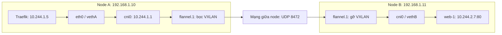

# Từ Traefik Pod tới web Pod: gói tin đi qua hai node như thế nào?

Tài liệu này bắt đầu **sau khi Traefik đã nhận HTTP request**. Nó theo dõi một
kết nối từ tiến trình Traefik tới ứng dụng web ở node khác, từ việc chọn IP
đích cho tới khi ứng dụng đọc request và trả response. Phần Cloudflare Tunnel,
DNS public và luật chọn website ở Traefik được giải thích trong
[tunnel-traefik.md](tunnel-traefik.md).

Ví dụ chính dùng **Flannel với VXLAN** như lab trong
[runbook](../runbook-k8s-vmware.md): Pod CIDR `10.244.0.0/16`, các node có
đường mạng tới nhau, VXLAN dùng UDP đích `8472`. Các IP `/24` và địa chỉ Pod
trong bảng chỉ để minh họa; xem trạng thái cụm thực tế trước khi chạy lệnh
kiểm tra. Ở cuối bài có trường hợp gọi Service ClusterIP và hai cách xây mạng
không dùng VXLAN.

| Thành phần | Địa chỉ minh họa |
| --- | --- |
| Node A chạy Traefik | Node IP `192.168.1.10`; Pod subnet `10.244.1.0/24` |
| Node B chạy web-1 | Node IP `192.168.1.11`; Pod subnet `10.244.2.0/24` |
| Traefik Pod | `10.244.1.5` |
| web-1 Pod | `10.244.2.7`, ứng dụng lắng nghe TCP port `80` |



## 0. Nền tảng đã sẵn sàng trước request

Mỗi Pod bình thường có một **Linux network namespace**: bên trong có `eth0`,
địa chỉ IP, bảng định tuyến và bảng láng giềng (ARP) riêng. `eth0` là một đầu
của cặp **veth**; đầu kia nằm trong namespace mạng của node và gắn vào Linux
bridge `cni0`. Với cấu hình ví dụ, bridge trên node A mang `10.244.1.1` và
làm gateway cho Pod tại node A. Node B bố trí tương tự với `10.244.2.1`.

Mỗi node có một dải Pod riêng. Khi tạo Pod, CNI cấp Pod IP từ dải của node,
đặt route/gateway và nối veth vào bridge. Flannel thiết lập `flannel.1` và
đường tới các dải Pod trên node khác. Nó chuẩn bị route, bảng láng giềng và
**FDB** (bảng ánh xạ MAC của đầu VXLAN từ xa tới IP node từ xa). Khi chuyển
gói, Linux kernel dùng các bảng này; tiến trình Flannel không đọc từng HTTP
request rồi gửi lại bằng một HTTP proxy. IP Pod có thể thay đổi khi Pod bị
tạo lại.

## 1. Traefik lấy IP và chọn một backend

Trong cấu hình của runbook, Traefik dùng Kubernetes Ingress provider và
`nativeLBByDefault: false`. Nó theo dõi API để cập nhật các backend của
Service web: ví dụ web-1 là `10.244.2.7:80`, web-2 có IP:port khác. Danh
sách này bắt nguồn từ các Pod phù hợp, tình trạng sẵn sàng và EndpointSlice.
Traefik chọn một địa chỉ rồi **tự mở kết nối tới Pod IP**. Service giúp tìm
backend; gói rời Traefik trong trường hợp này không mang ClusterIP của Service
web, và kube-proxy không phải bên chọn web-1 cho kết nối ấy.

Nếu Traefik đã giữ một TCP connection còn dùng được tới web-1, nó có thể gửi
request mới trên connection đó: các bước SYN/SYN-ACK/ACK dưới đây chỉ xảy ra
khi cần **mở kết nối TCP mới**. Một HTTP request không tương đương một TCP
connection.

## 2. Namespace của Traefik tạo gói TCP SYN

Tiến trình Traefik yêu cầu Linux `connect()` tới `10.244.2.7:80`. Kernel
chọn IP nguồn `10.244.1.5` và một cổng tạm, giả sử `41532`. Bảng route
trong network namespace của Traefik có thể trông như sau:

```text
10.244.1.0/24 dev eth0
default via 10.244.1.1 dev eth0
```

`10.244.2.7` nằm ngoài dải cục bộ `10.244.1.0/24`, nên Pod gửi qua gateway
`10.244.1.1`. Nếu chưa biết MAC gateway, namespace của Pod hỏi ARP và ghi
kết quả vào bảng láng giềng. Khung rời `eth0`:

```text
Ethernet: MAC eth0 của Pod Traefik → MAC gateway cni0
IP:       10.244.1.5 → 10.244.2.7
TCP:      41532 → 80, SYN
```

Đầu veth bên kia (`vethA`) nhận khung trên node A và đưa vào bridge `cni0`.
Lúc này **chưa có HTTP request**: đây mới là gói TCP dùng để mở kết nối.

## 3. Node A định tuyến rồi đóng gói VXLAN

MAC đích là MAC gateway `cni0`, nên node A nhận gói và tra **route IP**. Route
tới `10.244.2.0/24` dẫn ra `flannel.1`, thường qua một next-hop VXLAN do
Flannel lập. Node A dùng thông tin láng giềng và FDB đã có để biết đầu VXLAN
từ xa nằm tại **node IP `192.168.1.11`**. Route trên một cụm cụ thể có thể
khác ví dụ; phải xem `ip route`, `ip neigh` và `bridge fdb show` thực tế.

Kernel bọc khung bên trong thành gói VXLAN/UDP:

```text
Vỏ ngoài:  IP node A 192.168.1.10 → IP node B 192.168.1.11
           UDP đích 8472 | VXLAN
Bên trong: IP Pod 10.244.1.5 → IP Pod 10.244.2.7
           TCP 41532 → 80 | SYN
```

VXLAN bọc **khung Ethernet bên trong**, không chỉ hai địa chỉ IP. Qua bước
định tuyến, MAC bên trong có thể được viết lại và IP TTL giảm; IP nguồn/đích
của hai Pod và cổng TCP vẫn xác định cùng một kết nối. Với IPv4 Ethernet
thông thường, vỏ VXLAN thêm khoảng **50 byte**, nên MTU trong Pod hay được
đặt `1450` nếu mạng node có MTU `1500`. Cấu hình thực tế có thể khác.

Gói đi thẳng giữa hai Pod không cần DNAT qua Service. Netfilter/conntrack trên
node có thể theo dõi hoặc lọc luồng tùy cấu hình, nhưng **conntrack không phải
cơ chế tìm node B** ở đường gọi Pod IP trực tiếp. VXLAN là đóng gói, không tự
mã hóa HTTP bên trong.

## 4. Mạng giữa node chuyển lớp vỏ ngoài

Mạng VMware, switch hoặc router vận chuyển gói UDP dựa vào IP node
`192.168.1.10 → 192.168.1.11`. Nó chỉ cần biết đường tới node B, không cần
route riêng tới Pod IP `10.244.2.7`. Nếu hai node cùng LAN, việc chuyển
khung Ethernet ngoài cùng còn phụ thuộc địa chỉ MAC/ARP trên mạng LAN đó.

## 5. Node B gỡ VXLAN và đưa vào web-1

Kernel node B nhận UDP đích `8472`, gỡ vỏ VXLAN và thu lại khung chứa IP đích
`10.244.2.7`. Node B biết `10.244.2.0/24` là dải Pod cục bộ qua `cni0`.

Khi cần, **kernel node B** phân giải MAC của `10.244.2.7` qua ARP. Sau đó
**bridge `cni0`** dùng FDB để đưa khung tới đúng cổng `vethB`; đầu còn lại
của veth là `eth0` trong namespace web-1. Nói “bridge tự tra ARP” sẽ lẫn
hai việc: ARP tìm MAC tương ứng IP, còn FDB của bridge tìm cổng ứng với MAC.

## 6. Hai đầu hoàn tất TCP handshake

Kernel của web-1 nhận `SYN` tới `10.244.2.7:80`. Ứng dụng đang `listen()`
ở port 80 nên kernel trả **SYN-ACK**. Gói này có IP nguồn `10.244.2.7`,
đích `10.244.1.5`: nó đi ngược qua veth và node B, được bọc VXLAN về node A,
gỡ vỏ rồi giao lại cho Traefik. Traefik gửi **ACK**. Sau handshake, phía web
có thể lấy socket đã thiết lập qua `accept()`.

Các gói TCP có địa chỉ Pod làm nguồn/đích ở lớp trong. Trên dây mạng giữa
node A và B, ta thấy địa chỉ **node** ở lớp ngoài. Hai lớp địa chỉ này trả lời
hai câu hỏi khác nhau: *ứng dụng nào nói với ứng dụng nào* và *node nào chuyển
gói tới node nào*.

## 7. HTTP request và response đi trên TCP vừa thiết lập

Traefik ghi HTTP request vào socket backend. Đây là **request do reverse
proxy gửi trên kết nối mới hoặc kết nối tái sử dụng**, không phải chính TCP
connection đã mang request của user vào Traefik. Kernel chia luồng byte thành
các đoạn TCP để truyền; TCP đánh số, xác nhận và gửi lại dữ liệu mất. Ứng
dụng web đọc request, xử lý rồi ghi HTTP response; response đi về Traefik theo
chiều ngược lại. Traefik trả response trên kết nối phía trước của nó.

Thông thường web-1 thấy IP nguồn TCP là `10.244.1.5` của Traefik. Danh tính
client gốc có thể được mang ở HTTP headers do các proxy chuyển tiếp, ví dụ
`X-Forwarded-For`, nhưng header đó không thay đổi IP nguồn của TCP connection
Traefik → web-1. Connection backend có thể được giữ để phục vụ request sau.

## 8. Nếu Traefik gọi Service ClusterIP

Khi cấu hình Traefik dùng `nativeLB`, đích mà Traefik mở kết nối là VIP của
Service web, ví dụ `10.96.12.34:80`. Trong mô hình **kube-proxy chế độ
iptables** của runbook, gói từ Pod vào network stack của node A gặp các rule
NAT: một backend được chọn và IP/cổng đích được **DNAT** thành
`10.244.2.7:80`. Conntrack nhớ ánh xạ để xử lý chiều trả về, khiến Traefik
vẫn nhìn thấy peer là Service IP như connection mà nó đã mở. Sau DNAT, gói
đi theo đường ở mục 3–7. Service IP là địa chỉ ảo được rule mạng xử lý, không
phải một HTTP server riêng.

Đừng gộp hai đường này: khi Traefik chọn **Pod IP trực tiếp**, nó tự chọn
backend trước khi mở socket; khi Traefik gọi **ClusterIP**, dataplane của
Service chọn backend cho kết nối. Connection pool cũng có thể khiến nhiều
HTTP request dùng chung một kết nối đã chọn cùng backend.

## 9. Hai cách xây mạng khác và trường hợp cùng node

| Kiểu mạng | Phần thay đổi so với mục 3–5 |
| --- | --- |
| Traefik và web-1 cùng node | Gói đi qua veth/bridge/đường cục bộ của cùng node; không đi qua VXLAN giữa hai node. |
| Định tuyến thẳng, như Flannel `host-gw` | Node A có route tới Pod subnet node B qua IP node B và gửi gói không bọc VXLAN. `host-gw` yêu cầu hai node có thể đi tới nhau qua mạng L2 phù hợp. |
| CNI tích hợp với mạng cloud, cấp địa chỉ từ mạng đó cho Pod | Mạng cloud/provider đưa gói tới node sở hữu Pod IP; cách bố trí veth, route và bridge cụ thể tùy CNI, không mặc định có `cni0` hoặc `flannel.1`. |

Trong cả ba trường hợp, tiến trình Traefik vẫn phải có kết nối tới địa chỉ
backend, TCP vẫn phải hoạt động, rồi ứng dụng mới đọc byte HTTP. Phần thay đổi
là **cách mạng vận chuyển gói IP giữa hai đầu**.

## Tự quan sát trên một cụm đang chạy

Các lệnh sau dùng để so sánh mô hình với **trạng thái thật**; thay Pod IP,
namespace, PID và tên card mạng theo cluster của bạn. `tcpdump`, `conntrack`
hoặc `nsenter` có thể cần cài riêng trên node và cần quyền phù hợp.

```bash
# Các Pod đang ở node nào, IP nào; backend Ready nào được công bố.
kubectl -n traefik get pods -o wide
kubectl -n default get pods -l app=web -o wide
kubectl -n default get endpointslice -l kubernetes.io/service-name=web -o wide

# Bên trong network namespace của container Traefik: interface, route, ARP.
sudo nsenter -t <PID_TRAEFIK> -n ip addr show
sudo nsenter -t <PID_TRAEFIK> -n ip route
sudo nsenter -t <PID_TRAEFIK> -n ip neigh

# Trên node A: route tới web-1, VXLAN, neighbor và FDB.
ip route get 10.244.2.7
ip -d link show flannel.1
ip neigh show dev flannel.1
bridge fdb show dev flannel.1

# Dùng tên card LAN thực tế, ví dụ ens33; chạy trong lúc phát request.
sudo tcpdump -ni flannel.1 'host 10.244.2.7'
sudo tcpdump -ni <LAN_IFACE> 'udp port 8472'
```

Nếu chạy test từ một node khác, Pod khác hoặc gọi ClusterIP thay cho Pod IP,
đường đi và rule áp dụng có thể khác. Khi theo một request cụ thể, đối chiếu
địa chỉ nguồn/đích ở **lớp trong** với hai node IP ở **lớp VXLAN bên ngoài**.

## Tài liệu gốc để đối chiếu

- [Traefik Kubernetes Ingress: direct Pod IP và `nativeLB`](https://doc.traefik.io/traefik/reference/routing-configuration/kubernetes/ingress/)
- [Kubernetes EndpointSlices](https://kubernetes.io/docs/concepts/services-networking/endpoint-slices/)
- [Kubernetes Service virtual IP và kube-proxy](https://kubernetes.io/docs/reference/networking/virtual-ips/)
- [CNI bridge: veth, bridge và gateway](https://www.cni.dev/plugins/current/main/bridge/)
- [Flannel VXLAN backend](https://github.com/flannel-io/flannel/blob/master/Documentation/backends.md) và [cách Flannel lập route/neighbor/FDB](https://github.com/flannel-io/flannel/blob/master/pkg/backend/vxlan/vxlan.go)
- [Linux kernel: VXLAN và FDB](https://docs.kernel.org/networking/vxlan.html)
- [RFC 9293: TCP](https://www.rfc-editor.org/rfc/rfc9293.html)
