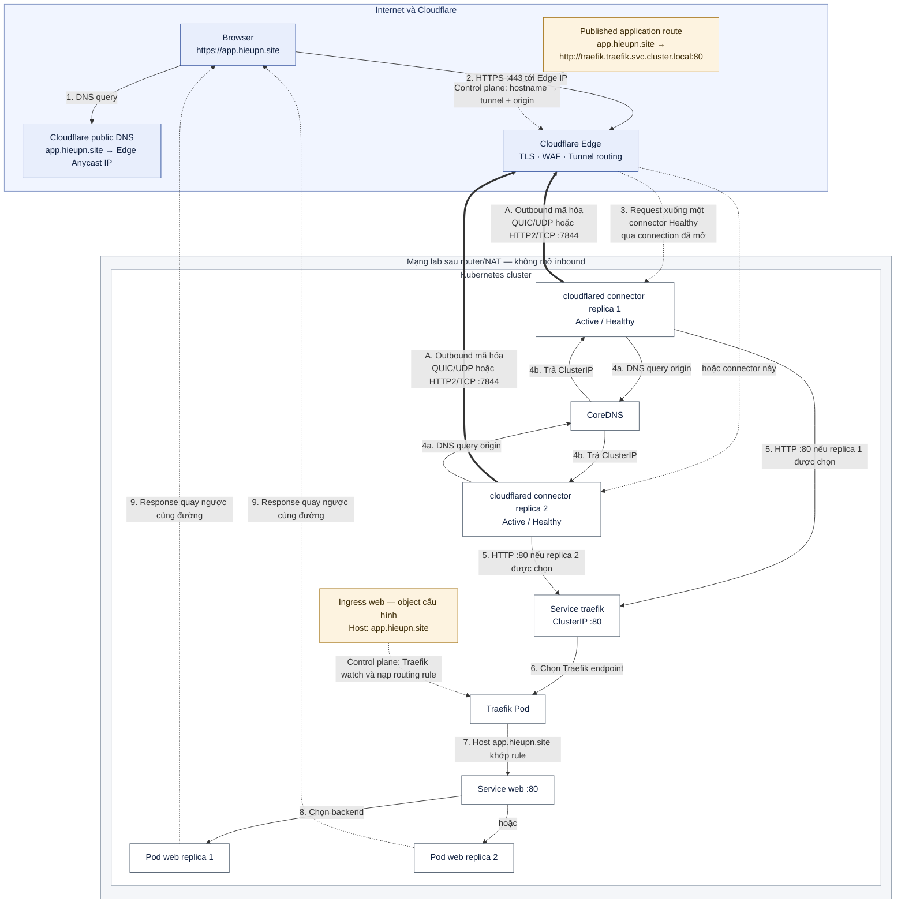
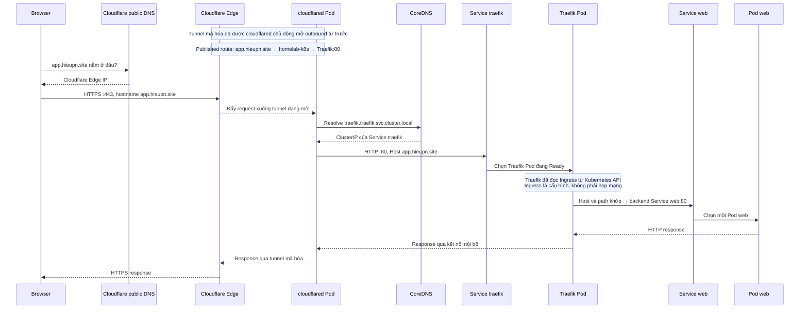

# Luồng Cloudflare Tunnel → Kubernetes qua Traefik

> Tài liệu này tách ra từ [§12.3.2 của runbook-k8s-vmware.md](../runbook-k8s-vmware.md#1232-hiểu-đầy-đủ-luồng-cloudflare-tunnel--kubernetes)
> để giữ runbook ở độ dài đọc được. Đây là phần **giải thích cơ chế**, không chứa bước thao tác:
> mọi lệnh, gate `PASS:` và thứ tự triển khai vẫn nằm trong runbook.
>
> Tham chiếu dạng `§12`, `§13`, `§12.3.1` trong bài trỏ về mục cùng số của
> [§12.3.2 của runbook-k8s-vmware.md](../runbook-k8s-vmware.md#1232-hiểu-đầy-đủ-luồng-cloudflare-tunnel--kubernetes). Tên gọi lấy đúng theo lab của runbook:
> hostname `app.hieupn.site`, tunnel `homelab-k8s`, Traefik ở namespace `traefik`, `cloudflared`
> ở namespace `cloudflare`.

Bố cục: hai sơ đồ tổng quan → bản kể lại bằng ngôn ngữ đơn giản → luồng end-to-end theo 14 bước
→ 12 mục đào sâu từng hop.

---

Điểm cốt lõi: **Cloudflare không chủ động mở một kết nối mới từ Internet vào IP của lab**. Chính các Pod `cloudflared` đang nằm trong Kubernetes đã mở kết nối outbound tới Cloudflare và giữ các kết nối đó hoạt động. Khi có request, Cloudflare truyền request xuống chính đường kết nối đã được mở sẵn.



Nét đậm `==>` là kết nối outbound do cả hai replica `cloudflared` chủ động mở và giữ; chúng đều Active/Healthy, không có replica primary/standby cố định. Nét đứt từ Edge cho biết mỗi request được đẩy xuống **một** connector Healthy qua connection đã mở sẵn. `Published application route` và `Ingress web` là control-plane/configuration, không phải hop mạng: route ánh xạ hostname public sang tunnel/origin, còn Traefik watch Ingress để nạp rule Host → Service. Response từ Pod web quay ngược qua chính chuỗi Traefik → `cloudflared` → Tunnel → Edge → Browser.

**Trình tự đầy đủ của một request và response:**



Sơ đồ tuần tự đọc từ trên xuống dưới. Mũi tên đi sang phải là chiều request vào ứng dụng; các mũi tên nét đứt quay sang trái là chiều response trở về browser. `Cloudflare public DNS` chỉ dẫn browser tới Edge, còn `CoreDNS` chỉ được Pod trong cluster dùng để tìm ClusterIP của Service Traefik.

## Đối chiếu cấu hình: hostname chọn tunnel, Service URL chọn origin

Ở §12.3.3 của runbook, vào **Zero Trust → Networks → Connectors**
(UI mới có thể hiện **Tunnels & Mesh**) → tunnel `homelab-k8s` →
**Published application routes** → **Add route** → **Published application**,
rồi khai báo:

| Trường | Giá trị | Vai trò |
| --- | --- | --- |
| **Subdomain** | `app` (để trống nếu dùng root domain) | Ghép với Domain để xác định hostname public |
| **Domain** | `hieupn.site` | Cùng Subdomain tạo hostname `app.hieupn.site` |
| **Service URL** | `http://traefik.traefik.svc.cluster.local:80` | Đích mà connector `cloudflared` gọi sau khi nhận request từ tunnel |

**Cách hiểu:** tạo route cho `app.hieupn.site` **bên trong tunnel
`homelab-k8s`** là thiết lập lối vào đúng tunnel; Service URL là thiết lập
“vào tunnel rồi thì connector gọi đâu trong cụm”.

Subdomain và Domain xác định **hostname**, còn tunnel đang được chọn khi tạo route
xác định **tunnel nhận request**. Hai trường hostname tự chúng không xác định tunnel.
Service URL cũng không giúp Cloudflare nhận diện cluster: nhiều cluster có thể có
cùng tên Service `traefik.traefik.svc.cluster.local`.

Các bước tiên quyết và bước cấu hình nối với nhau như sau:

| Bước runbook | Thiết lập gì? | Vai trò khi request chạy |
| --- | --- | --- |
| §9.3 | Helm tạo Service `traefik` trong namespace `traefik`, loại `ClusterIP` | Có địa chỉ nội bộ ổn định dẫn tới Pod Traefik |
| §11 | Chuẩn bị domain và chuyển DNS authoritative sang Cloudflare; zone phải `Active` | Có nền DNS public để publish hostname |
| §12.1 | Tạo tunnel `homelab-k8s`, có ID riêng, và lấy token | Xác định danh tính tunnel |
| §12.2 | Deploy `cloudflared` bằng token của tunnel | Cloudflare nhận biết các connection đang mở thuộc tunnel nào |
| §12.3.1 | Đổi Ingress sang Host `app.hieupn.site`, test nội bộ PASS | Traefik có rule khớp hostname public |
| §12.3.3 | Save Published application route trong đúng tunnel và kiểm tra DNS record `Proxied` | Gắn hostname với tunnel, đồng thời khai báo origin connector phải gọi |
| §13 | Kiểm tra DNS, HTTPS headers và body/trình duyệt | Xác nhận đường public hoạt động end-to-end |

Với **Full Setup** của runbook, Cloudflare tự tạo DNS record khi thêm Published
application route. Chỉ coi cấu hình hoàn tất khi route đã lưu đúng, record tồn tại
đúng một lần và connector/tunnel đang **Healthy**.

Token gắn connector với **tunnel**, không khóa connector vào một Kubernetes cluster
cụ thể. Nếu dùng cùng token để chạy `cloudflared` ở cluster khác, connector đó cũng
có thể tham gia cùng tunnel. Khi cần tách đường vào giữa các cluster, dùng tunnel/token
riêng và giữ token bí mật.

### Từ Service URL tới kết nối nội bộ

§12.3.3 là **bước lưu cấu hình**; khi request đến, Edge và connector sử dụng cấu hình
đã lưu. Route có vai trò ở cả hai phía:

1. **Tại Cloudflare:** hostname `app.hieupn.site` được ánh xạ tới tunnel
   `homelab-k8s`; request được truyền xuống một connector Healthy của tunnel đó.
2. **Tại connector:** `cloudflared` dùng Service URL để gọi origin nội bộ.
   Đây là remotely-managed tunnel, nên cấu hình origin nằm trên dashboard;
   manifest `cloudflared.yaml` ở §12.2 chỉ cần token để tham gia tunnel,
   không cần ghi thêm địa chỉ Traefik.
3. **Tại Traefik:** Ingress tiếp tục quyết định hostname/path này thuộc ứng dụng nào.

Service URL chỉ dẫn rõ ba việc:

| Phần URL | Chỉ dẫn cho `cloudflared` |
| --- | --- |
| `http://` | Dùng HTTP để gọi origin |
| `traefik.traefik.svc.cluster.local` | Phân giải tên Service `traefik` trong namespace `traefik` |
| `:80` | Kết nối tới port 80 của địa chỉ đã phân giải |

CoreDNS không chọn ngẫu nhiên một Service. Nó trả ClusterIP của Service có
**đúng tên và namespace được hỏi**. Service đã được tạo ở §9.3; DNS Kubernetes
cung cấp ánh xạ tên Service tương ứng, không cần nhập record hoặc entry `hosts`
riêng cho Traefik. CoreDNS được triển khai khi `kubeadm init` ở §6 và kiểm tra tại
§8.4; Pod `cloudflared` ở §12.2 dùng DNS policy mặc định `ClusterFirst`.

Ví dụ CoreDNS trả `10.96.123.45` (IP minh họa), connector mở connection tới
`10.96.123.45:80`. **Tên DNS được dùng để tìm IP; IP được dùng để mở kết nối.**
DNS có thể được cache và connection có thể được tái sử dụng, nên không phải mỗi
request đều tạo một DNS query và connection mới.

Trong cấu hình lab không override Host, HTTP request gửi qua connection đó vẫn mang
`Host: app.hieupn.site`. Phân biệt:

| Thông tin | Mục đích |
| --- | --- |
| `traefik.traefik.svc.cluster.local` | Tìm IP Service origin |
| ClusterIP Traefik + port 80 | Đích kết nối mạng |
| `Host: app.hieupn.site` và path | Traefik dùng để khớp rule Ingress |

### Phân loại vai trò trong toàn bộ luồng

| Nhóm | Thành phần | Nhiệm vụ |
| --- | --- | --- |
| Tìm địa chỉ | Public DNS, CoreDNS | Trả IP cần kết nối |
| Nhận/chuyển tiếp HTTP | Cloudflare Edge, `cloudflared`, Traefik | Proxy request và response |
| Cấu hình chỉ đường | Published application route, Ingress | Khai báo tunnel/origin và Host/path → backend |
| Địa chỉ và chuyển tiếp mạng | Service, ClusterIP, EndpointSlice | Cung cấp địa chỉ ổn định và thông tin backend |
| Xử lý ứng dụng | Pod web | Tạo response |

Trong nhóm mạng, **Service** khai báo cách truy cập nhóm backend, **ClusterIP** là
địa chỉ ảo, **EndpointSlice** lưu thông tin các endpoint; dataplane Kubernetes thực
hiện chuyển tiếp khi đi qua Service IP. Chúng không phải ba chương trình proxy HTTP.
Traefik cũng có thể gọi trực tiếp Pod endpoint tùy cấu hình.

Public DNS và CoreDNS chỉ tham gia tìm địa chỉ, không chuyển tiếp HTTP.
Published application route và Ingress là cấu hình, không phải hop mạng.
Response từ Pod web quay về qua Traefik → `cloudflared` → tunnel → Edge → browser;
không quay qua hai hệ DNS.

## Cách đọc toàn bộ luồng §12 → §13 theo ngôn ngữ đơn giản

Có thể hình dung Cloudflare Edge là **cổng tiếp nhận công khai**, Tunnel là **đường hầm đã mở sẵn**, Pod `cloudflared` là **đầu đường hầm nằm trong cluster**, Traefik là **lễ tân đọc hostname để chọn ứng dụng**, Service là **địa chỉ ổn định của một nhóm backend**, còn Pod web là **server thật sự xử lý request và tạo response**.

Trước khi người dùng truy cập, §12 đã chuẩn bị năm liên kết:

1. Token gắn hai Pod `cloudflared` với tunnel `homelab-k8s`.
2. Hai Pod chủ động mở và giữ các kết nối outbound mã hóa tới Cloudflare; router/NAT của lab không mở inbound.
3. Public DNS làm cho `app.hieupn.site` được client phân giải tới Cloudflare Edge.
4. Published application route ánh xạ `app.hieupn.site` → tunnel `homelab-k8s` → origin `http://traefik.traefik.svc.cluster.local:80`.
5. Ingress làm cho Traefik nạp rule `Host: app.hieupn.site` → backend `Service web:80`.

Khi người dùng nhập `https://app.hieupn.site/`, URL cung cấp ba dữ kiện: `https` yêu cầu kết nối TLS công khai, `app.hieupn.site` là hostname dùng để chọn route, còn `/` là path gửi tới ứng dụng. Một request hoàn chỉnh đi qua các hop sau:

1. **Browser hỏi public DNS.** DNS trả một hoặc nhiều Cloudflare Anycast IP. Browser không nhận ClusterIP, Pod IP, worker IP hay IP router của lab.
2. **Browser mở HTTPS tới Cloudflare Edge trên port 443.** Cloudflare cung cấp certificate cho `app.hieupn.site`, kết thúc TLS public và nhận request mang hostname logic `Host: app.hieupn.site` (hoặc `:authority` tương đương khi dùng HTTP/2/HTTP/3).
3. **Cloudflare tra Published application route.** Hostname cho biết phải dùng tunnel `homelab-k8s` và origin nội bộ nào. Cloudflare chọn một connector `cloudflared` đang Healthy; một request bình thường không được gửi đồng thời tới cả hai replica.
4. **Cloudflare đẩy request xuống connection tunnel đã tồn tại.** Đây không phải một connection inbound mới tới IP lab. Dữ liệu đi ngược xuống chính session outbound mà Pod `cloudflared` đã chủ động mở qua router/NAT từ trước.
5. **Tunnel kết thúc tại Pod `cloudflared`.** Pod này nhận request rồi đóng vai trò reverse proxy/client để mở một connection nội bộ mới tới origin `traefik.traefik.svc.cluster.local:80`.
6. **`cloudflared` hỏi CoreDNS.** CoreDNS trả ClusterIP của Service `traefik` trong namespace `traefik`; public DNS không tham gia bước này và Cloudflare Edge cũng không thể tự phân giải tên `*.svc.cluster.local`.
7. **`cloudflared` gọi Service Traefik bằng HTTP port 80.** Kubernetes Service dataplane chuyển connection từ ClusterIP tới một Traefik Pod đang Ready. ClusterIP là địa chỉ ảo ổn định, không phải một server riêng.
8. **Traefik chọn đúng ứng dụng.** Traefik đã watch Kubernetes API và nạp rule từ Ingress trước đó. Request không đi xuyên qua object Ingress; Traefik chỉ so sánh `Host: app.hieupn.site` và path `/` với rule đã nạp. Khi khớp, backend logic là `Service web:80`.
9. **Service/backend chọn một Pod web.** Traefik/Kubernetes dùng các endpoint của Service `web` để chọn một Pod phù hợp. Pod web mới là server thực sự tạo nội dung `nginxdemos/hello`.

Response quay về trên các connection tương ứng theo chiều ngược lại:

```text
Pod web
→ Traefik
→ cloudflared
→ tunnel mã hóa
→ Cloudflare Edge
→ kết nối HTTPS
→ Browser
```

Router vẫn không nhận kết nối inbound mới: nó chỉ thấy traffic hai chiều thuộc session outbound đã được `cloudflared` thiết lập. Các chặng bảo mật cũng phải được phân biệt:

```text
Browser ── HTTPS :443 ──> Cloudflare Edge
Cloudflare Edge ══ tunnel mã hóa ══> cloudflared Pod
cloudflared Pod ── HTTP :80 nội bộ ──> Traefik → Pod web
```

Bốn lớp “route” trong chuỗi trả lời bốn câu hỏi khác nhau:

| Lớp | Câu hỏi được trả lời | Kết quả trong lab này |
| --- | --- | --- |
| Public DNS | Browser phải kết nối tới đâu? | Cloudflare Edge IP |
| Published application route | Hostname này thuộc tunnel và origin nào? | `app.hieupn.site` → `homelab-k8s` → Traefik:80 |
| Traefik Ingress rule | Request này thuộc ứng dụng nào? | Host/path khớp → `Service web:80` |
| Service/endpoints | Backend cụ thể nào nhận request? | Một Pod có label/endpoint của `web` |

Vì thế các kết quả nhìn thấy ở §13 thuộc các tầng khác nhau:

- `nslookup app.hieupn.site` trả Cloudflare Edge IP: mới chứng minh public DNS dẫn client tới đúng cổng Cloudflare.
- `curl -I https://app.hieupn.site` trả `HTTP 200`, `server: cloudflare` và `cf-ray`: chứng minh request đã đi qua Edge và chuỗi end-to-end trả được response headers; `server: cloudflare` không có nghĩa Cloudflare tạo nội dung ứng dụng.
- Body/trình duyệt hiện `Server address` và `Server name`: đây là Pod IP và tên Pod web đã xử lý request, không phải địa chỉ Cloudflare hay Traefik.

Tóm lại, request vào đúng Pod nhờ bốn lần lựa chọn liên tiếp: **hostname public → đúng Cloudflare Edge → đúng tunnel/origin → đúng Ingress/Service → đúng Pod backend**. Mười hai mục cuối tài liệu này phân tích sâu từng hop; §13 của runbook kiểm tra lần lượt DNS public, HTTPS headers và body thật của chính chuỗi này.

## Luồng end-to-end theo 14 bước

### Bước 1 — §12 chuẩn bị đường đi trước khi có request

Cloudflare tạo tunnel `homelab-k8s` và sinh token. Deployment trong namespace `cloudflare` dùng token đó để chạy hai Pod `cloudflared`. Cả hai connector đều Active/Healthy và chủ động mở các connection outbound dài hạn tới Cloudflare bằng QUIC/UDP `7844` hoặc HTTP/2/TCP `7844`.

```text
cloudflared Pod → router/NAT → Internet → Cloudflare
```

Cloudflare không mở connection mới vào master, worker hay router. Router chỉ cho phép session outbound do `cloudflared` khởi tạo; sau đó dữ liệu request và response đi hai chiều bên trong session đã tồn tại. Vì vậy lab không cần public IP cho Kubernetes, port-forward hoặc mở inbound `80`, `443`, `7844`.

§12 cũng chuẩn bị hai bảng route:

```text
Published application:
app.hieupn.site → homelab-k8s → http://traefik.traefik.svc.cluster.local:80

Kubernetes Ingress:
Host app.hieupn.site + Path / → Service web:80
```

### Bước 2 — Browser phân tích URL

Khi người dùng nhập:

```text
https://app.hieupn.site/
```

browser tách URL thành:

```text
https://  app.hieupn.site  /
│         │                 │
│         │                 └─ path gửi tới ứng dụng
│         └─ hostname dùng cho DNS, TLS và routing
└─ giao thức HTTPS
```

Browser cần tìm IP cho hostname, thiết lập TLS và gửi request cho path `/`.

### Bước 3 — Browser hỏi Cloudflare public DNS

Browser/hệ điều hành hỏi DNS: “`app.hieupn.site` nằm ở đâu?”. Vì record Tunnel ở trạng thái Proxied, DNS trả một hoặc nhiều Cloudflare Anycast IPv4/IPv6, không trả IP router, master, worker, ClusterIP hay Pod IP của lab.

```text
app.hieupn.site → Cloudflare Edge IP
```

Trong output `nslookup`, dòng `Server: 127.0.0.53` chỉ là DNS stub resolver cục bộ trên Ubuntu. Các địa chỉ trong `Non-authoritative answer` mới là kết quả phân giải hostname.

### Bước 4 — Browser mở HTTPS tới Cloudflare Edge

Browser kết nối tới Cloudflare Edge IP trên port `443`. Cloudflare đưa certificate hợp lệ cho `app.hieupn.site`, kết thúc TLS public rồi nhận request có hostname logic:

```http
GET / HTTP/1.1
Host: app.hieupn.site
```

Với HTTP/2 hoặc HTTP/3, tên trường trên wire có thể là `:authority`, nhưng ý nghĩa vẫn là hostname `app.hieupn.site`. Ở chặng này Cloudflare có thể áp dụng WAF, DDoS protection, cache và các edge rule. Browser chưa hề kết nối tới mạng lab.

### Bước 5 — Cloudflare chọn Published application route

Cloudflare đọc hostname và tìm thấy cấu hình:

```text
app.hieupn.site
→ tunnel homelab-k8s
→ origin http://traefik.traefik.svc.cluster.local:80
```

DNS chỉ đưa browser tới Cloudflare Edge. Published route mới cho Cloudflare biết request này thuộc tunnel nào và connector phải gọi origin nội bộ nào.

### Bước 6 — Cloudflare chọn một connector Healthy và đẩy request xuống tunnel

Cloudflare thấy hai connector của `homelab-k8s` đang Healthy rồi chọn một connector phù hợp cho request. Một request bình thường đi xuống một connector, không được nhân đôi tới cả hai replica.

```text
Không phải: Cloudflare → mở connection inbound mới tới IP lab

Mà là:     cloudflared → đã mở connection outbound tới Cloudflare
            Cloudflare → đẩy request xuống connection đang mở
```

Nếu một Pod `cloudflared` chết, connector còn lại tiếp tục nhận request. Hai replica tạo HA cho tunnel, không phải bộ cân bằng tải giữa các Pod web.

### Bước 7 — Tunnel kết thúc tại Pod `cloudflared`

Điểm cuối của tunnel trong lab là Pod `cloudflared`, không phải Traefik:

```text
Cloudflare Edge ══ tunnel mã hóa ══> cloudflared Pod
```

Sau khi nhận request, `cloudflared` đóng vai trò reverse proxy/client. Nó đọc Service URL của Published route rồi mở một connection HTTP nội bộ mới tới `traefik.traefik.svc.cluster.local:80`. Cloudflare Edge không trực tiếp truy cập địa chỉ `*.svc.cluster.local`.

### Bước 8 — `cloudflared` dùng CoreDNS tìm Service Traefik

Pod `cloudflared` phân giải origin qua CoreDNS của Kubernetes:

```text
traefik.traefik.svc.cluster.local:80
│       │       │   │             │
│       │       │   │             └─ Service port
│       │       │   └─ cluster domain nội bộ
│       │       └─ đối tượng Service
│       └─ namespace traefik
└─ tên Service traefik
```

CoreDNS trả ClusterIP của Service Traefik. Đây là hệ DNS nội bộ thứ hai, độc lập với Cloudflare public DNS.

### Bước 9 — Service Traefik chuyển connection tới Traefik Pod

`cloudflared` gọi:

```text
http://<Traefik-ClusterIP>:80
```

Kubernetes Service dataplane chọn một Traefik Pod đang Ready và chuyển connection tới Pod đó:

```text
cloudflared → Service traefik ClusterIP:80 → Traefik Pod
```

ClusterIP là địa chỉ ảo ổn định đại diện cho các endpoint, không phải một máy chủ riêng. Pod Traefik có thể bị tạo lại và đổi Pod IP mà Service DNS vẫn giữ nguyên.

### Bước 10 — Traefik dùng Host header để chọn đúng ứng dụng

Traefik đã watch Kubernetes API và nạp rule từ Ingress trước khi request đến. Object Ingress là cấu hình control plane, không phải một hop mà packet phải đi xuyên qua.

Hostname bắt nguồn từ URL người dùng nhập và được giữ qua từng chặng:

```text
Browser
  Host: app.hieupn.site
        ↓
Cloudflare Edge
  hostname: app.hieupn.site
        ↓ tunnel
cloudflared
  Host: app.hieupn.site
        ↓ HTTP origin request
Traefik
```

`cloudflared` kết nối mạng tới `http://<Traefik-ClusterIP>:80`, nhưng HTTP request bên trong connection vẫn mang `Host: app.hieupn.site`. ClusterIP/port giúp Kubernetes đưa connection tới Traefik Pod; Host header giúp Traefik chọn đúng Router. Vì Published application không đặt `HTTP Host Header` override nên hostname public không bị đổi thành `traefik.traefik.svc.cluster.local`.

Traefik so sánh hostname/path với rule:

```text
Host app.hieupn.site + Path /
→ backend Service web:80
```

Nếu Ingress còn dùng `app.example.com`, rule không khớp và Traefik thường trả `404`.

### Bước 11 — Service `web` chọn Pod backend

Ingress chỉ định backend logic là `Service web:80`. Traefik/Kubernetes dùng các endpoint của Service để chọn một Pod có label phù hợp, ví dụ `app=web`. Tùy cách Traefik được cấu hình, nó có thể dùng Service dataplane hoặc kết nối trực tiếp tới Pod endpoint đã lấy từ Kubernetes.

```text
Traefik → Service/endpoints web → một Pod web
```

Pod web mới là server thực sự xử lý request và tạo nội dung. Vì thế trang `nginxdemos/hello` có thể hiển thị:

```text
Server address: <Pod-IP>:80
Server name: web-<replicaset-hash>-<pod-suffix>
```

Chạy nhiều request có thể thấy Pod name/IP thay đổi do backend được chọn khác nhau.

### Bước 12 — Response quay ngược về browser

Pod web tạo HTTP response rồi trả về trên các connection tương ứng theo chiều ngược lại:

```text
Pod web
→ Traefik
→ cloudflared
→ tunnel mã hóa
→ Cloudflare Edge
→ kết nối HTTPS
→ Browser
```

Router/NAT không nhận một connection inbound mới. Nó chỉ chuyển traffic response thuộc session outbound mà `cloudflared` đã thiết lập. Ba chặng bảo mật là:

```text
Browser ── HTTPS :443 ──> Cloudflare Edge
Cloudflare Edge ══ tunnel mã hóa ══> cloudflared Pod
cloudflared Pod ── HTTP :80 nội bộ ──> Traefik → Pod web
```

Cloudflare có thể thêm các response header như `server: cloudflare` và `cf-ray`, sau đó gửi response về browser qua HTTPS. Nội dung trang vẫn do Pod web tạo ra.

### Bước 13 — §13 kiểm tra từng lớp của chuỗi

Ba phép kiểm tra có phạm vi khác nhau:

| Kiểm tra | Chứng minh được | Chưa tự chứng minh được |
| --- | --- | --- |
| `nslookup app.hieupn.site` | Public DNS dẫn client tới Cloudflare Edge | Tunnel, Traefik, Ingress và Pod còn hoạt động |
| `curl -I https://app.hieupn.site` | DNS, HTTPS/TLS, Published route, Tunnel và origin trả được headers | Nội dung body hiển thị đúng |
| `curl -sS https://app.hieupn.site` hoặc browser | Body thật đã được một Pod web xử lý và trả về | — |

`HTTP 200`, `server: cloudflare` và `cf-ray` cho biết response đã đi qua Cloudflare Edge. `Server address`/`Server name` trong body là IP và tên Pod web đã phục vụ request, không phải Cloudflare Edge hay Traefik.

### Bước 14 — Phân biệt bốn loại “route”

| Loại route | Câu hỏi nó trả lời | Ánh xạ trong lab |
| --- | --- | --- |
| **Public DNS route** | Browser phải kết nối tới đâu? | `app.hieupn.site` → Cloudflare Edge IP |
| **Published application route** | Hostname này thuộc tunnel và origin nào? | `app.hieupn.site` → `homelab-k8s` → `traefik...:80` |
| **Traefik Ingress route** | Request này thuộc ứng dụng/Service nào? | Host `app.hieupn.site`, path `/` → `Service web:80` |
| **Service/endpoint route** | Pod cụ thể nào nhận request? | `Service web` → một Pod endpoint Ready |

Bốn loại route thực hiện bốn lần lựa chọn nối tiếp, không thay thế nhau:

```text
Hostname public
→ đúng Cloudflare Edge
→ đúng tunnel và origin
→ đúng Ingress/Service
→ đúng Pod backend
```

## 1. `cloudflared` đã nằm bên trong cluster

Deployment ở §12.2 tạo hai Pod `cloudflared` trong namespace `cloudflare`. Vì là Pod Kubernetes, mỗi replica:

- dùng được mạng nội bộ của cluster;
- dùng CoreDNS để phân giải tên `*.svc.cluster.local`;
- truy cập được các Kubernetes Service;
- có egress ra Internet;
- dùng `TUNNEL_TOKEN` để đăng ký với cùng tunnel `homelab-k8s`.

Hai replica không cần hai tunnel riêng. Chúng cùng gắn vào một tunnel UUID để dự phòng: nếu một connector/worker lỗi, replica còn lại tiếp tục phục vụ. Replica `cloudflared` là cơ chế HA cho đường hầm, không phải bộ cân bằng tải backend ứng dụng; Kubernetes Service và Traefik đảm nhiệm việc phân phối request ở phía cluster. Xem [Cloudflare — Kubernetes deployment guide](https://developers.cloudflare.com/tunnel/deployment-guides/kubernetes/).

## 2. Pod chủ động mở đường outbound qua router/NAT

Khi container khởi động, `cloudflared` đọc token và mở các kết nối outbound dài hạn tới Cloudflare. Với `--protocol auto` mặc định, nó có thể dùng QUIC qua UDP `7844` hoặc HTTP/2 qua TCP `7844`. Cloudflare duy trì nhiều kết nối tới ít nhất hai data center để có dự phòng. Xem [Cloudflare Tunnel configuration](https://developers.cloudflare.com/tunnel/configuration/) và [Tunnel with firewall](https://developers.cloudflare.com/cloudflare-one/networks/connectors/cloudflare-tunnel/configure-tunnels/tunnel-with-firewall/).

Router chỉ thấy chiều khởi tạo:

```text
cloudflared Pod → router/NAT → Cloudflare
```

NAT/firewall tạo state cho session outbound. Sau khi session tồn tại, dữ liệu đi được hai chiều trong chính session đó. Cloudflare **không** quay lại mở kết nối trực tiếp tới IP riêng của master/worker, nên kiến trúc này không cần:

- IP public cho Kubernetes;
- port-forward trên router;
- mở inbound `80`, `443` hoặc `7844` vào lab;
- công bố IP worker hay ClusterIP ra Internet.

Dashboard `Healthy` với `Replicas = 2` chứng minh hai Pod đã đăng ký và giữ được đường kết nối từ cluster tới Cloudflare.

**Vì sao outbound thay được inbound?** Vì "chiều" của một kết nối chỉ tồn tại ở khoảnh khắc khởi tạo: bắt tay xong thì kênh là **hai chiều như nhau** — bên nào cũng gửi được, bên nào cũng nhận được. Router/NAT vận hành đúng theo nguyên lý đó: nó chặn kết nối *khởi tạo từ ngoài vào*, nhưng ghi state cho session *từ trong gọi ra* và cho toàn bộ dữ liệu trả về của session đó đi qua — nếu không thì việc duyệt web thường ngày đã không hoạt động (browser gọi ra, cả trang web đổ về, router không cần mở port nào). Giống một cuộc gọi điện thoại: ai bấm số không quyết định ai được nói; nối máy rồi thì hai bên bình đẳng. `cloudflared` là bên bấm số, Cloudflare là bên nghe máy; request của người dùng sau đó được Cloudflare "nói" xuống qua cuộc gọi đang mở. Cái giá của mô hình nằm ở mục 6: đường public sống chết theo các kết nối do connector giữ — connector chết hết thì hostname mất đường về origin dù DNS vẫn trỏ đúng.

**`cloudflared` gọi ra khi nào — liên tục hay theo từng request?** Không phải mỗi request một lần gọi. Nó quay số đúng **một lần lúc container khởi động**: đọc token, mở mặc định bốn kết nối dài hạn tới ít nhất hai data center Cloudflare khác nhau, rồi giữ chúng sống bằng keep-alive. Từ đó trở đi nó không "gọi ra" thêm — mọi request được Edge multiplex (ghép kênh) xuống các kết nối sẵn có, nhiều request dùng chung một kết nối. `cloudflared` chỉ quay số lại khi một kết nối đứt (mạng chập chờn, Cloudflare bảo trì data center, Pod restart) — tự động nối lại, không cần ai can thiệp. Vì vậy trạng thái `Healthy` trên dashboard nghĩa là "các kết nối đang sống", không phải "vừa có request thành công".

## 3. Published application là bảng ánh xạ hostname → origin nội bộ

Khai báo ở bước kế tiếp có ý nghĩa:

```text
Public hostname: app.hieupn.site
Tunnel:          homelab-k8s
Service URL:     http://traefik.traefik.svc.cluster.local:80
```

Tức là:

```text
Nếu Cloudflare nhận request cho app.hieupn.site
→ chọn tunnel homelab-k8s
→ gửi request xuống một connector Healthy
→ cloudflared gọi http://traefik.traefik.svc.cluster.local:80
```

Đây là cấu hình của **remotely-managed tunnel**, được lưu ở Cloudflare và áp dụng cho các connector của tunnel. Có thể publish nhiều hostname qua cùng một tunnel, mỗi hostname ánh xạ tới một service nội bộ khác nhau. Xem [Cloudflare — Published application routing](https://developers.cloudflare.com/tunnel/routing/).

## 4. Có hai hệ DNS độc lập

Khi lưu Published application trong Full Setup, Cloudflare tự tạo DNS record public tương đương:

```text
app.hieupn.site → <TUNNEL-UUID>.cfargotunnel.com
```

Record được proxy qua Cloudflare. Người dùng ngoài Internet nhận địa chỉ Anycast của Cloudflare, không nhận ClusterIP, Pod IP, worker IP hoặc IP router của lab.

Ở phía trong cluster, `cloudflared` lại dùng CoreDNS để phân giải origin:

| Hệ DNS               | Tên được phân giải              | Người dùng kết quả                                |
| --------------------- | ------------------------------------- | ------------------------------------------------------ |
| Cloudflare public DNS | `app.hieupn.site`                   | Browser ngoài Internet tìm tới Cloudflare Edge      |
| Kubernetes CoreDNS    | `traefik.traefik.svc.cluster.local` | Pod`cloudflared` tìm ClusterIP của Service Traefik |

Cloudflare Edge không phân giải và không truy cập trực tiếp tên `*.svc.cluster.local`; tên này chỉ có nghĩa sau khi request đã xuống Pod `cloudflared` bên trong cluster. Kubernetes định nghĩa DNS Service theo dạng `<service>.<namespace>.svc.<cluster-domain>`; xem [Kubernetes — DNS for Services and Pods](https://kubernetes.io/docs/concepts/services-networking/dns-pod-service/).

## 5. Request từ browser tới Cloudflare Edge

Khi người dùng mở:

```text
https://app.hieupn.site
```

trình duyệt thực hiện:

1. Hỏi DNS public và nhận địa chỉ Cloudflare.
2. Mở HTTPS tới Cloudflare Edge trên port `443`.
3. Nhận certificate cho `app.hieupn.site` từ Cloudflare.
4. Gửi request có HTTP Host header `app.hieupn.site`.
5. Cloudflare có thể áp dụng TLS termination, WAF, DDoS protection, cache và các rule ở edge.

Browser kết nối tới Cloudflare, **không** kết nối tới router hay worker của lab.

## 6. Cloudflare gửi request xuống đường hầm đã tồn tại

Cloudflare dùng hostname và DNS/tunnel route để xác định tunnel UUID. Nó chọn một connector đang Healthy rồi multiplex request xuống kết nối mã hóa mà connector đó đã mở từ trước:

```text
Không phải: Cloudflare → mở kết nối mới vào IP lab

Mà là:     cloudflared → mở kết nối outbound tới Cloudflare
            Cloudflare → trả request xuống kết nối đang mở
```

Nếu một Pod `cloudflared` chết, replica còn lại có thể tiếp tục. Nếu không còn connector nào Healthy nhưng DNS record vẫn tồn tại, Cloudflare không tới được origin; DNS record không tự biến mất chỉ vì tunnel dừng. Xem [Cloudflare Tunnel overview](https://developers.cloudflare.com/tunnel/) và [Cloudflare routing](https://developers.cloudflare.com/tunnel/routing/).

## 7. Tunnel kết thúc tại Pod `cloudflared`

Tunnel không kết thúc tại Traefik. Điểm cuối trong lab là Pod `cloudflared`, và Pod này tiếp tục đóng vai trò reverse proxy/client cho origin nội bộ:

```text
Cloudflare Edge ══ tunnel mã hóa ══> cloudflared Pod
cloudflared Pod ── HTTP nội bộ ──> Traefik Service
```

Service URL không phải địa chỉ mà Cloudflare Edge truy cập trực tiếp. Nó là chỉ dẫn để `cloudflared`, sau khi nhận request trong cluster, mở một connection mới tới origin.

## 8. `cloudflared` dùng CoreDNS tìm Service Traefik

Tên origin được tách như sau:

```text
traefik.traefik.svc.cluster.local:80
│       │       │   │             │
│       │       │   │             └─ Service port HTTP
│       │       │   └─ DNS domain nội bộ mặc định
│       │       └─ đối tượng Kubernetes Service
│       └─ namespace
└─ tên Service
```

CoreDNS trả ClusterIP của Service `traefik`. `cloudflared` gọi Service port `80`; cơ chế dataplane của Kubernetes chuyển connection tới một Pod Traefik đang Ready. Dùng Service DNS thay vì Pod IP giúp origin ổn định khi Pod Traefik bị tạo lại hoặc đổi IP.

## 9. Traefik dùng Host header chọn đúng ứng dụng

Request đến Traefik vẫn mang:

```http
Host: app.hieupn.site
```

Ta không đặt **HTTP Host Header override**, nên không yêu cầu `cloudflared` thay hostname gửi tới origin. Traefik so sánh Host header với Ingress đã PASS §12.3.1:

```yaml
spec:
  rules:
    - host: app.hieupn.site
      http:
        paths:
          - path: /
            backend:
              service:
                name: web
                port:
                  number: 80
```

Khi hostname khớp, Traefik chuyển request tới Service `web:80`. Nếu Ingress còn `app.example.com`, Traefik không tìm thấy Router phù hợp và thường trả `404`. Tùy chọn `httpHostHeader` chỉ cần khi muốn chủ động ghi đè Host gửi tới origin; xem [Cloudflare — Origin parameters](https://developers.cloudflare.com/tunnel/advanced/origin-parameters/).

## 10. Service `web` chọn Pod và response quay ngược lại

Service `web` chọn các Pod có label `app=web` rồi chuyển request tới một backend. Pod tạo response có thể chứa:

```text
Server address: <Pod-IP>:80
Server name: web-<replicaset-hash>-<pod-suffix>
```

Response đi ngược đúng chuỗi:

```text
Pod web
→ Service web
→ Traefik
→ cloudflared
→ tunnel mã hóa
→ Cloudflare Edge
→ Browser
```

Chạy request nhiều lần có thể thấy `Server name`/`Server address` thay đổi giữa hai Pod web; việc chọn backend thuộc tầng Kubernetes Service/Traefik, không phải hai replica `cloudflared`.

## 11. Vì sao browser dùng HTTPS nhưng Service URL dùng HTTP?

Hai trường này thuộc hai chặng khác nhau:

```text
Browser ── HTTPS ──> Cloudflare Edge
Cloudflare Edge ══ tunnel mã hóa ══> cloudflared
cloudflared ── HTTP nội bộ ──> Traefik:80
```

Cloudflare xử lý certificate và TLS public ở edge; kết nối Edge ↔ `cloudflared` được tunnel bảo vệ. `Type=HTTP` hoặc scheme `http://` chỉ mô tả chặng cuối từ Pod `cloudflared` tới Traefik bên trong cluster. Nếu threat model yêu cầu mã hóa cả chặng nội bộ, có thể cấu hình HTTPS origin riêng; lab này dùng HTTP để tránh quản lý thêm certificate nội bộ.

## 12. Ba liên kết mà bước Published application tạo ra

```text
1. Public DNS
   app.hieupn.site → Cloudflare

2. Tunnel routing
   app.hieupn.site → homelab-k8s

3. Internal origin
   homelab-k8s → http://traefik.traefik.svc.cluster.local:80
```

Điều đưa traffic từ Cloudflare vào Kubernetes là tổ hợp của **các Pod `cloudflared` nằm trong cluster**, **kết nối outbound dài hạn do chúng mở**, và **route ánh xạ hostname public tới Kubernetes Service nội bộ** — không phải port-forward hay public IP của lab.

---

## Tự kiểm tra

Các tham chiếu §9–§14 bên dưới trỏ tới [runbook-k8s-vmware.md](../runbook-k8s-vmware.md).

Phần này kiểm tra kiến thức Cloudflare Tunnel → Traefik → ứng dụng sau khi hoàn tất
§9–§13. Cách trình bày theo [bài Probes](../k8s-docs/49-probes-vi.md): tự trả lời trước,
sau đó mới mở đáp án. Sáu câu đầu là bộ câu hỏi vòng 1; các câu tiếp theo tổng hợp
những câu hỏi bổ sung đã dùng để làm rõ kiến thức. Không cần nhớ nguyên lệnh,
nhưng phải giải thích được từng cấu hình và phạm vi của từng phép kiểm tra.

Đọc lại khi cần:
[luồng và vai trò thành phần](tunnel-traefik.md),
[request/response theo 14 bước](tunnel-traefik-request-response.md).

### Câu hỏi — vòng 1

1. **Đường đi của request:** khi mở `https://app.hieupn.site/`, request đi từ browser
   đến Pod web và response quay về thế nào? Thành phần nào tìm địa chỉ, chuyển tiếp
   HTTP, chỉ cung cấp cấu hình, chuyển tiếp mạng và xử lý ứng dụng? TLS diễn ra trước
   hay sau khi browser gửi HTTP request?
2. **Tunnel và NAT:** không mở inbound trên router mà vẫn truy cập được app vì sao?
   Ai mở kết nối trước, tới đâu? Cloudflare chuyển request về lab bằng cách nào?
   Vì sao đó không phải kết nối inbound mới, và vì sao không gọi request xuống tunnel
   là “HTTP response cho việc mở outbound”? Các bước setup/verify nằm ở đâu?
3. **Hai hệ DNS:** browser phân giải `app.hieupn.site` nhận IP gì? Connector phân giải
   `traefik.traefik.svc.cluster.local` hỏi ai và nhận IP gì? Vì sao Edge không cần
   tự phân giải tên Service? Bước nào quyết định connector hỏi Service Traefik thay
   vì Service khác?
4. **Publish app:** cluster, Traefik và app đã test nội bộ thành công, Ingress còn
   hostname tạm `app.example.com`, chưa chuẩn bị domain/tunnel. Hãy nêu đúng thứ tự
   thao tác tại Hostinger, Cloudflare và Kubernetes, cùng điều kiện kiểm tra trước
   khi coi publish hoàn tất.
5. **Service URL và Host:** origin là `http://traefik.traefik.svc.cluster.local:80`
   nhưng Ingress khai `host: app.hieupn.site`. Vì sao vẫn khớp? Hostname origin và
   HTTP Host phục vụ nhiệm vụ gì? Nếu override Host thành
   `traefik.traefik.svc.cluster.local`, rule còn khớp không? Override có đổi sang
   HTTPS hoặc đổi port không?
6. **Khoanh vùng lỗi:** `curl -H 'Host: app.hieupn.site' "http://$ING_IP/"` trả đúng
   app nhưng browser báo không tìm thấy hostname public. Test nội bộ chứng minh
   được gì và chưa chứng minh gì? Kiểm tra tiếp bằng lệnh/dashboard nào? Có nên
   sửa Ingress hoặc restart Pod web ngay không?

### Câu hỏi bổ sung

7. Nếu request mang Host `app.hieupn.site` nhưng Ingress vẫn khai
   `app.example.com`, ai phát hiện không khớp, kết quả thường là gì và kiểm tra thế nào?
8. Chưa tạo Published application route nhưng connector đã kết nối thành công:
   tunnel có thể Healthy không? App đã public được chưa?
9. Public DNS và tunnel hoạt động nhưng CoreDNS hỏng: request có thể tới connector
   không? Connector gọi origin bằng tên Service được không? Giả sử không có DNS cache
   hoặc kết nối origin mở sẵn.
10. Vì sao request vào đúng tunnel/connector thay vì cluster khác có cùng tên Service?
    Token có khóa connector vào một cluster cụ thể không? Subdomain/Domain, tunnel
    đang chọn và Service URL mỗi thứ quyết định gì?
11. CoreDNS biết ClusterIP của Service Traefik bằng bước setup nào? Có cần thêm record
    thủ công không? Sau khi DNS trả IP, connector gọi bằng IP hay tên? Ai cung cấp
    origin URL cho connector trong mô hình remotely-managed?
12. Nameserver có ý nghĩa gì? Trước/sau §11.2, ai quản lý DNS và ai giữ việc đăng ký
    domain? Record của app sau publish là gì? Địa chỉ Traefik có nằm trong DNS public
    không? Root domain và `www` có tự phục vụ cùng app không?
13. Dữ liệu đi qua tunnel có bắt buộc là JSON không? Mô tả method, path/query,
    Host, headers, body của GET `/?page=2` và POST có JSON; connector gọi origin
    thế nào và response quay về ra sao? Bước nào thiết lập Host thực tế và bước nào
    chỉ khai báo Host mong đợi?
14. Hai Ingress `app.hieupn.site` → Service `web` và `api.hieupn.site` → Service
    `api` cùng dùng origin Service Traefik. Traefik phân biệt bằng gì? Replica
    connector 1 có bị ghép cố định với Pod web replica 1 không?

<details>
<summary>Đáp án — chỉ mở sau khi đã tự trả lời</summary>

### Đáp án 1 — Đường đi và vai trò

Browser dùng resolver để tìm Edge IP, kết nối tới Edge trên port 443, hoàn tất
TLS handshake và kiểm tra certificate rồi mới gửi HTTP request. Edge chọn tunnel
theo hostname, truyền request qua kết nối đã mở tới một connector. Connector
phân giải tên origin bằng CoreDNS, gọi ClusterIP Service Traefik:80; dataplane
chuyển tới Traefik Pod. Traefik khớp Host/path với rule Ingress rồi chọn backend
của Service web; một Pod web xử lý và tạo response. Traefik có thể gọi Pod endpoint
trực tiếp hoặc qua Service IP tùy cấu hình.

Response quay về Pod → Traefik → connector → tunnel → Edge → browser trên các
kết nối tương ứng. Không có một TCP connection duy nhất xuyên từ browser tới Pod.
DNS và object cấu hình không chuyển tiếp HTTP response.

| Nhóm | Thành phần | Nhiệm vụ |
| --- | --- | --- |
| Tìm địa chỉ | Public DNS, CoreDNS | Trả IP cần kết nối |
| Nhận/chuyển tiếp HTTP | Edge, cloudflared, Traefik | Proxy request/response |
| Cấu hình chỉ đường | Published application route, Ingress | Khai báo tunnel/origin và Host/path → backend |
| Địa chỉ và chuyển tiếp mạng | Service, ClusterIP, EndpointSlice | Địa chỉ ổn định và thông tin backend; dataplane thực hiện chuyển tiếp |
| Xử lý ứng dụng | Pod web | Tạo response |

Service là object, ClusterIP là địa chỉ ảo, EndpointSlice lưu thông tin endpoint;
không phải ba chương trình HTTP proxy. Tham chiếu §9–§13.

### Đáp án 2 — Outbound không đồng nghĩa chỉ truyền một chiều

`cloudflared` mở outbound tới Cloudflare, dùng QUIC/UDP hoặc HTTP/2/TCP 7844,
đăng ký connector rồi giữ kết nối. Router/NAT cho traffic thuộc kết nối đó quay về.
Edge truyền request qua chính kênh đã tồn tại, không mở connection mới tới IP lab.

Ở tầng HTTP, dữ liệu xuống connector vẫn là **request của người dùng**, chưa phải
response của app. Response chỉ được backend tạo ra sau khi xử lý request.
Thiết lập kênh tunnel không phải một GET/POST thông thường tới app.

§12.1 tạo tunnel/token; §12.2 chạy connector và kiểm tra Deployment, Pod,
dashboard Healthy; §12.3.3 gắn hostname và origin; §5.7 liên quan egress/firewall.
§13 kiểm tra đường public; §10.3 và §12.3.1 kiểm tra riêng đường nội bộ.

### Đáp án 3 — Hai hệ DNS độc lập

Browser nhận Edge IPv4/IPv6 vì record public Proxied. Connector hỏi CoreDNS
và nhận ClusterIP của Service `traefik` trong namespace `traefik`.
**Service URL ở §12.3.3** quyết định tên origin được phân giải.

Edge chỉ cần đưa request vào đúng tunnel/connector; connector mới trực tiếp gọi
origin và dùng DNS của cluster. Public DNS không phân giải tên
`*.svc.cluster.local` để giúp Edge gọi Service.

### Đáp án 4 — Thứ tự publish và gate

| Bước | Thao tác | Kết quả cần kiểm tra |
| --- | --- | --- |
| §11.1 | Mua domain tại Hostinger | Có quyền quản lý domain |
| §11.2 | Review record hiện có, xử lý DNSSEC cũ nếu có, thêm domain vào Cloudflare, đổi NS tại Hostinger theo đúng cặp được cấp | Resolver trả đúng NS và zone Active; hoàn tất gate DNSSEC theo runbook |
| §12.1 | Tạo homelab-k8s, lấy token | Đúng tunnel và token |
| §12.2 | Tạo namespace cloudflare, Secret token, Deployment cloudflared | Hai Pod Running, Deployment 2/2 và tunnel Healthy |
| §12.3.1 | Sửa Ingress hiện có sang app.hieupn.site, apply và test Host mới | Host đúng, curl nội bộ trả demo |
| §12.3.3 | Save route trong đúng tunnel, Service URL HTTP Traefik:80 | Route đúng, DNS record Proxied tồn tại đúng một lần, connector còn Healthy |
| §13.1–§13.3 | Kiểm tra DNS, HTTPS headers, body/browser | Edge IP, không lỗi TLS, status/nội dung đúng |

Không cần tạo Ingress thứ hai. Field `host` chứa `app.hieupn.site`,
không chứa `https://` hoặc dấu `/`. Không công khai token trong repo/log/chat.

### Đáp án 5 — Đích kết nối khác danh tính website

Hostname origin được phân giải thành IP để connector kết nối tới **Traefik**.
Host header giữ `app.hieupn.site` trong cấu hình lab và được Traefik dùng để
chọn website/router; path tiếp tục khớp rule đường dẫn.

`traefik.traefik.svc.cluster.local` là hostname; chuỗi có scheme và port là
Service URL đầy đủ. Host header không chỉ định trực tiếp Pod cuối cùng.

Override Host thành tên Service sẽ không khớp rule `app.hieupn.site`;
nếu không có router khác phù hợp, Traefik thường trả 404. Nó không đổi scheme/port:
origin vẫn HTTP:80 do Service URL quyết định. Tham chiếu §12.3.1 và §12.3.3.

### Đáp án 6 — Bắt đầu ở DNS, không restart backend

Test nội bộ chứng minh đường Service Traefik → Traefik khớp Ingress → backend
web trả được nội dung từ vị trí chạy test. Nó bỏ qua DNS public, Edge/TLS, route
Cloudflare và tunnel.

Bắt đầu bằng:

```bash
nslookup app.hieupn.site
nslookup app.hieupn.site 1.1.1.1
```

Đối chiếu **Cloudflare DNS → Records**: record app đúng tunnel và Proxied;
**domain Overview**: zone Active; **Hostinger**: đúng cặp NS Cloudflare;
**tunnel → Published application routes**: route đã lưu đúng hostname.
Nếu public resolver trả đúng nhưng máy/browser không resolve được, kiểm tra
resolver/cache, Secure DNS của browser và mạng client. Nếu SERVFAIL, kiểm tra
thêm delegation/DNSSEC; NXDOMAIN cần kiểm tra record và tên truy vấn.

Khi DNS đã đúng, tiếp tục:

```bash
curl -I https://app.hieupn.site
curl -sS https://app.hieupn.site
```

Hai lệnh curl đều dừng ở DNS nếu hostname chưa phân giải được. Không sửa Ingress
hay restart backend chỉ vì lỗi DNS public khi test nội bộ vẫn thành công.
Tham chiếu §11.2, §12.3.3, §13.1–§13.3.

### Đáp án 7 — Host không khớp

Traefik so Host với rule đã nạp. Không có router phù hợp thì thường trả 404;
request chưa được chuyển tới backend của rule đó. Kiểm tra:

```bash
kubectl get ingress web -o jsonpath='{.spec.rules[*].host}{"\n"}'
kubectl describe ingress web
ING_IP=$(kubectl -n traefik get svc traefik -o jsonpath='{.spec.clusterIP}')
curl -i -H 'Host: app.hieupn.site' "http://$ING_IP/"
```

Đối chiếu Host, path và IngressClass. Sửa source manifest, apply rồi test lại theo
§12.3.1. Một 404 nói chung cũng có thể do app trả; phải kiểm tra route/log để xác
định tầng, không kết luận mọi 404 đều do Ingress.

### Đáp án 8 — Healthy chưa chứng minh app đã public

**Có thể Healthy.** Trạng thái đó chứng minh connector kết nối tới Cloudflare,
không chứng minh hostname/route/origin đầy đủ. Nếu chưa có cấu hình khác cho hostname,
app chưa public được qua đường runbook này. §12.3.3 tạo ánh xạ hostname → tunnel
và origin, đồng thời tạo DNS record trong Full Setup.

### Đáp án 9 — CoreDNS hỏng

Request vẫn có thể tới connector qua tunnel đang mở. Nhưng với giả định không có
DNS cache hoặc connection origin sẵn có, connector không resolve được tên Service
nên không mở được kết nối tới Traefik bằng Service URL hiện tại. Tunnel Healthy
không chứng minh DNS nội bộ hay origin hoạt động. Kiểm tra §8.4 và log connector.

### Đáp án 10 — Chọn đúng tunnel và origin

§12.1 tạo tunnel có ID riêng/token; §12.2 đưa token vào connector để đăng ký đúng
tunnel; §12.3.3 tạo route trong tunnel đó. Subdomain + Domain xác định hostname,
tunnel đang chọn xác định tập connector, Service URL xác định origin.

Tên Service giống nhau giữa hai cluster không làm request tự nhảy sang cluster khác.
Tuy nhiên token **không khóa cluster**: connector ở cluster khác dùng cùng token
có thể tham gia cùng tunnel. Muốn tách đường vào thì dùng tunnel/token riêng.

### Đáp án 11 — DNS Service và kết nối origin

§6 triển khai CoreDNS; §8.4 kiểm tra DNS; §9.3 tạo Service traefik trong namespace
traefik kiểu ClusterIP; §12.2 dùng DNS policy mặc định ClusterFirst. CoreDNS
theo dõi Service Kubernetes và trả IP theo tên/namespace, không cần nhập record
riêng. §12.3.3 quyết định tên được hỏi qua Service URL.

Ví dụ DNS trả `10.96.123.45` thì connector kết nối TCP tới `10.96.123.45:80`.
Tên dùng để tìm IP; IP dùng để mở connection; port 80 lấy từ URL, không từ DNS.
Request bên trong connection vẫn mang Host public. Cache/connection có thể được
tái sử dụng. Origin cấu hình trên Cloudflare được cung cấp cho connector của
remotely-managed tunnel; không cần ghi địa chỉ Traefik trong manifest §12.2.

### Đáp án 12 — Nameserver và DNS record

Nameserver authoritative cung cấp bản ghi có thẩm quyền cho domain; recursive
resolver tra cứu/cache các câu trả lời đó. NS không phải web server.

Trước §11.2, nếu dùng mặc định Hostinger thì NS thường là
`ns1.dns-parking.com`/`ns2.dns-parking.com`; phải kiểm tra domain thực tế.
Sau khi đổi NS và propagation hoàn tất, đó là **đúng hai tên Cloudflare cấp cho
zone**, dạng `<tên>.ns.cloudflare.com`. Cloudflare quản DNS; Hostinger vẫn giữ
đăng ký/gia hạn. §11.2.3 lấy NS, §11.2.4 thay tại Hostinger, §11.2.5 verify.

Record app trong Full Setup: **CNAME app → <TUNNEL-UUID>.cfargotunnel.com,
Proxied**. DNS public thường trả Edge IP. Origin
`http://traefik.traefik.svc.cluster.local:80` nằm trong route tunnel, không nằm
trong record public. Root domain và www không tự phục vụ app; cần route/record
riêng nếu muốn dùng. Record email/website khác được giữ theo nhu cầu tại §11.2.

### Đáp án 13 — Request, tunnel và response

Mở outbound là thiết lập transport/đăng ký tunnel, không phải một GET/POST tới app.
Dữ liệu người dùng trong tunnel là biểu diễn HTTP request: metadata và body stream
được đóng gói/mã hóa theo giao thức; định dạng phụ thuộc transport/triển khai,
không phải luôn một JSON object.

Ví dụ HTTP/1.1 minh họa:

```http
GET /?page=2 HTTP/1.1
Host: app.hieupn.site
Accept: text/html

```

Method GET, path /, query page=2, body rỗng. Browser tạo Host từ URL
(HTTP/2/3 dùng :authority tương ứng). §12.3.1 khai Host **mong đợi** trong Ingress;
§12.3.3 có tùy chọn HTTP Host Header để override Host gửi origin.
Không override trong cấu hình lab thì giữ hostname public.

Connector nhận request, dùng origin URL để resolve tên Service rồi mở hoặc
tái sử dụng TCP connection tới ClusterIP:80, gửi method/path/query/headers/body.
Traefik khớp Host/path và proxy tới backend; headers hoặc framing có thể được proxy
điều chỉnh. Không có rule đổi method/rewrite path trong cấu hình đang xét.

Ví dụ POST, **chỉ khi thay demo bằng API hỗ trợ endpoint này**:

```http
POST /api/orders?dry_run=true HTTP/1.1
Host: app.hieupn.site
Content-Type: application/json

{"product_id":123,"quantity":2}
```

JSON chỉ là body; method là POST, query là dry_run=true. App quyết định response,
nginx demo không tự trở thành API tạo đơn hàng.

Response gồm status, headers, body, quay về Pod → Traefik → connector → tunnel →
Edge → browser, có thể truyền theo từng phần. DNS không chuyển response.
Browser–Edge dùng HTTPS, Edge–connector dùng tunnel mã hóa, connector–Traefik
và Traefik–web dùng HTTP nội bộ trong lab. curl -I gửi HEAD, không có response body;
curl -sS mặc định GET. Cache/edge rules có thể khiến request không tới origin;
headers Cloudflare hoặc status 200 tự chúng không chứng minh origin vừa được gọi.

### Đáp án 14 — Một điểm vào, nhiều ứng dụng

Traefik dùng Host `api.hieupn.site` và path để khớp Ingress của API, dù cả hai
hostname public đều đi tới cùng Service Traefik. ClusterIP/port chọn ingress
controller; Host/path chọn ứng dụng.

Lựa chọn connector và backend Pod độc lập. Connector replica 1 không bị ghép
với Pod web replica 1; một request thông thường không được broadcast tới mọi replica.

</details>

Câu nào chưa trả lời được thì quay lại §9–§13 và phần giải thích tương ứng trước
khi học Rancher ở §14 hoặc chuyển sang các tình huống xử lý sự cố nâng cao.

---
