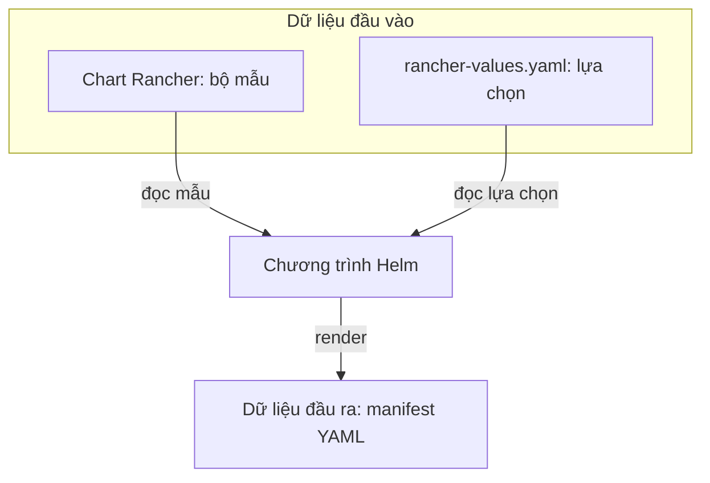

# M01 — Helm làm gì?

**Trạng thái:** Hoàn tất bài học lý thuyết; không phải xác nhận trạng thái cluster thực tế.

[Giáo án M01](rancher-mentor-study-plan.md#m01-helm-làm-gì) · [Tiến độ](README.md)

## Mục tiêu và phạm vi đã học

- Hiểu chart Rancher và `rancher-values.yaml` là đầu vào của bước render.
- Phân biệt manifest được render với bản cài có tên (release).
- Phân biệt mục đích của `helm template` và `helm install` trong runbook.
- Phân biệt Helm quản lý bản cài với các thành phần Kubernetes tạo tài nguyên và chạy Pod.
- Biết việc thay Pod không tự tạo release Helm mới.

## Toàn bộ phần giảng và hỏi–đáp

Các lượt dưới đây giữ nội dung giảng, sơ đồ, câu hỏi, câu trả lời gốc và các lần sửa theo thứ tự.
Đoạn tổ chức thư mục cũng được giữ để thấy việc lưu bài đã được yêu cầu khi nào.
Các câu trả lời gốc có điểm nhầm được giữ nguyên; đọc kèm nhận xét ngay sau đó.

### Lượt 01 — Mentor: Bắt đầu M01 — Helm, chart, values và manifest

Ta bắt đầu **M01 — Helm làm gì?** Tôi đã đọc giáo án, tài liệu giải thích và runbook hiện tại trên nhánh `main`.

**Helm là chương trình giúp cài ứng dụng lên Kubernetes.** Với Rancher, Helm nhận một bộ mẫu có sẵn và các lựa chọn của bạn, rồi tạo cấu hình cụ thể để gửi tới Kubernetes.

Trước hết, làm quen với ba tên:

| Tên | Hiểu đơn giản | Trong lab |
|---|---|---|
| **Chart** | Gói chứa các mẫu cấu hình và giá trị mặc định | Chart Rancher `2.14.3` |
| **Values** | Các lựa chọn bạn đưa vào để điều chỉnh mẫu | File `rancher-values.yaml` |
| **Manifest** | Bản khai cụ thể mô tả tài nguyên cần tạo trong Kubernetes | Bản khai Deployment, Service, Ingress… |

Ví dụ, đây là **một dòng trích từ** `rancher-values.yaml` trong [runbook §14.3](https://github.com/hieupham259/ansible_playbook_k8s-installation/blob/main/runbook-k8s-vmware.md#143-cài-rancher-helm-pin-2143):

```yaml
hostname: rancher.hieupn.site
```

Chart Rancher có mẫu tạo **Ingress** — object cấu hình đường truy cập theo hostname và đường dẫn. Helm đọc lựa chọn trên, rồi điền `rancher.hieupn.site` vào vị trí hostname trong bản khai Ingress.

Việc **đọc mẫu và điền giá trị để tạo bản khai cụ thể** được gọi là **render**.



Sau bước render, nếu thực hiện **install**, Helm gửi các bản khai tới Kubernetes để tạo tài nguyên. Các thành phần của Kubernetes tiếp tục tạo và chạy Pod Rancher theo cấu hình đó. Helm là công cụ thực hiện việc cài; chương trình Rancher chạy trong Pod.

**Câu kiểm tra nhỏ:** Trong ví dụ lab này, khi render, Helm lấy **hai đầu vào nào**, rồi tạo ra **thứ gì**? Bạn thử giải thích bằng lời của mình.

### Lượt 02 — Người học: Trả lời về đầu vào, render và đầu ra

Lấy 2 đầu vào: Chart Rancher và file rancher-values.yaml làm đầu vào sau đó, 2 thứ đó chạy qua chương trình Helm, Helm tiến hành gửi các bản khai tới K8s để render -> Đầu ra là file manifest YAML

### Lượt 03 — Mentor: Sửa thứ tự render và gửi bản khai

Bạn hiểu đúng **hai đầu vào** là chart Rancher và `rancher-values.yaml`, và **kết quả render** là manifest YAML.

Cần sửa một điểm về thứ tự: **Helm tự render trước, rồi mới gửi bản khai đã render tới Kubernetes.**

Cụ thể trong lab:

1. **Helm render:** đọc mẫu trong chart Rancher, lấy `hostname: rancher.hieupn.site` từ values để tạo bản khai Ingress có hostname cụ thể.
2. **Helm gửi bản khai khi cài:** Kubernetes nhận bản khai ấy và các thành phần của Kubernetes thực hiện việc tạo tài nguyên.

Vì vậy, hãy sửa đoạn bạn vừa nói thành:

> Chart Rancher và `rancher-values.yaml` được Helm dùng để render thành manifest YAML. Khi cài đặt, Helm gửi manifest đã render tới Kubernetes.

Một chi tiết nhỏ: manifest YAML là **nội dung bản khai**; nội dung đó trở thành file khi bạn lưu nó ra file.

**Câu kiểm tra:** Giả sử chưa cài Rancher, bạn chỉ dùng Helm để render chart với values, chưa gửi bản khai tới Kubernetes. Lúc này cluster đã có Pod Rancher mới chưa? Vì sao?

### Lượt 04 — Người học: Yêu cầu tổ chức giáo án và lưu đầy đủ bài học

Tạo 1 folder mới nằm ngoài folder cloudflare-rancher-docs, đưa file study plan sang file đó. Khi nào học xong bài nào, ví dụ M01 hay M02 thì tạo 1 file tương ứng cho bài đó, bao gồm các câu hỏi và câu trả lời đã đưa 1 cách đầy đủ trong folder mới đó.

### Lượt 05 — Mentor: Xác nhận chuyển giáo án; M01 khi đó chưa hoàn tất

Đã cập nhật lên nhánh `main`:

- Tạo thư mục [rancher-mentor](https://github.com/hieupham259/ansible_playbook_k8s-installation/tree/main/rancher-mentor), ngang cấp với `cloudflare-rancher-docs`.
- Chuyển giáo án sang thư mục mới và sửa các liên kết liên quan.
- Thêm `README.md` theo dõi tiến độ và checkpoint.

Từ nay, khi hoàn tất mỗi bài, tôi sẽ tự lưu `M01.md`, `M02.md`… với **đầy đủ phần giảng, sơ đồ, câu hỏi, nguyên văn câu trả lời của bạn, nhận xét và các lượt sửa**.

M01 đang học nên chưa tạo file hoàn tất.

### Lượt 06 — Người học: Trả lời về render khi chưa gửi bản khai

Quay trở lại với **Câu kiểm tra:** Giả sử chưa cài Rancher, bạn chỉ dùng Helm để render chart với values, chưa gửi bản khai tới Kubernetes. Lúc này cluster đã có Pod Rancher mới chưa? Vì sao?&#x20;
Chưa, vì lúc đó chỉ render ra bản khai, cần gửi bản khai lên Kubernetes đợi install thì mới có Pod Rancher

### Lượt 07 — Mentor: Phân biệt helm template và helm install

**Đúng: chỉ render thì chưa có Pod Rancher mới**, vì Kubernetes chưa nhận được yêu cầu tạo tài nguyên.

Chỉnh nhẹ cụm “gửi bản khai lên Kubernetes đợi install”: khi bạn dùng **`helm install`**, chính lệnh đó thực hiện việc render và gửi bản khai tới Kubernetes. Kubernetes nhận bản khai rồi bắt đầu tạo tài nguyên; Pod có thể được tạo **ngay khi lệnh Helm còn đang chạy**.

Ta tiếp tục M01 với một ý nhỏ: **phân biệt hai cách dùng Helm**.

| Cách dùng | Helm làm gì? | Tạo tài nguyên trong cluster? |
|---|---|---|
| `helm template` | Render chart với values để bạn xem manifest | Không, với cách render trong runbook |
| `helm install` | Render chart với values, rồi gửi bản khai tới Kubernetes để cài | Có |

Trong lab, runbook cho bạn xem bản render trước để kiểm tra Ingress có đúng hostname `rancher.hieupn.site`, rồi mới cài. **Xem bản cấu hình và thực hiện cài đặt là hai việc riêng.**

**Câu kiểm tra:** Bạn muốn kiểm tra chart Rancher có tạo bản khai Ingress với đúng hostname trong `rancher-values.yaml`, đồng thời chưa tạo tài nguyên nào trong cluster. Bạn chọn `helm template` hay `helm install`? Vì sao?

### Lượt 08 — Người học: Chọn helm template

helm template vì nó chỉ render ra bản khai trước khi install và gửi đi cho K8s

### Lượt 09 — Mentor: Khái niệm release

**Đúng.** Với `helm template`, bước này kết thúc khi có nội dung manifest. Việc cài bằng `helm install` là một thao tác riêng.

Ta học thêm một khái niệm của M01: **release**.

**Release là một bản cài có tên mà Helm theo dõi trong Kubernetes.** Nhờ đó, Helm biết bản cài ấy đã dùng chart nào và các values nào.

Trong lab:

| Thành phần | Giá trị | Ý nghĩa |
|---|---|---|
| Chart | `rancher-stable/rancher` | Gói mẫu dùng để cài Rancher |
| Values | `rancher-values.yaml` | Các lựa chọn cho lần cài này |
| Release | `rancher` | Tên bản cài mà Helm theo dõi |
| Namespace | `cattle-system` | Nơi chứa release và các tài nguyên Rancher của lần cài này |

Có thể liên hệ với Python: **chart hơi giống gói phần mềm dùng để cài; release là bản cài cụ thể được đặt tên và theo dõi**. Đây chỉ là ví dụ để phân biệt bộ mẫu với bản cài.

Sau khi Helm gửi bản khai, các thành phần Kubernetes chịu trách nhiệm tạo và chạy Pod Rancher theo bản khai đó.

**Câu kiểm tra:** Trong lab, chart `rancher-stable/rancher` và release `rancher` khác nhau thế nào? Bạn giải thích ngắn bằng lời của mình.

### Lượt 10 — Người học: Phân biệt chart và release — lượt đầu

chart `rancher-stable/rancher` là gói mẫu có sẵn, chứa các cấu hình mặc định, hiểu cách khác nó là đầu vào còn release `rancher` là kết quả sau khi Kubernetes tạo ra, nói cách khác là đầu ra

### Lượt 11 — Mentor: Phân biệt manifest với bản cài Helm quản lý

Bạn hiểu đúng phần **chart là gói mẫu có cấu hình mặc định, được dùng làm đầu vào**.

Phần release cần chỉnh: **Helm tạo và theo dõi release; Kubernetes nhận bản khai rồi tạo các tài nguyên.** Cách gọi “đầu ra” ở đây hơi rộng, dễ làm lẫn release với manifest.

Ta tách rõ ba thứ:

| Thứ | Ý nghĩa trong lab |
|---|---|
| **Chart** `rancher-stable/rancher` | Bộ mẫu để Helm sử dụng |
| **Manifest YAML** | Bản khai cụ thể do Helm render từ chart và values |
| **Release** `rancher` | Bản cài có tên mà Helm quản lý và lưu thông tin |

Ví dụ, khi cài Rancher:

- **Helm** đặt tên bản cài là `rancher`, lưu thông tin chart, values và manifest của bản cài ấy.
- **Kubernetes** nhận manifest rồi tạo Deployment, Service, Ingress… Các thành phần Kubernetes tiếp tục tạo và chạy Pod.

Release có thể đang cài hoặc cài thất bại. Vì vậy, **có release chưa đồng nghĩa Pod đã chạy thành công**.

Bạn có thể sửa câu vừa rồi thành:

> Chart là gói mẫu đầu vào. Manifest là kết quả render. Release là bản cài có tên do Helm theo dõi.

**Câu kiểm tra:** Trong lab, **manifest YAML** và **release `rancher`** khác nhau thế nào?

### Lượt 12 — Người học: Phân biệt manifest và release — trả lời lại

manifest YAML là Bản khai cụ thể do Helm render từ chart và values để gửi đi cho K8s nhận rồi tạo Deployment, Service, Ingress… Các thành phần Kubernetes tiếp tục tạo và chạy Pod.
release `rancher`  có thể đang cài hoặc cài thất bại. Vì vậy, **có release chưa đồng nghĩa Pod đã chạy thành công**.

### Lượt 13 — Mentor: Bổ sung ý chính của release và kiểm tra bằng việc thay Pod

Bạn giải thích **đúng phần manifest** và cũng hiểu đúng rằng **có release chưa chứng minh Pod chạy thành công**.

Phần release còn thiếu ý chính: **release `rancher` là bản cài có tên `rancher` mà Helm quản lý trong namespace `cattle-system`.** “Đang cài”, “thành công” hay “thất bại” là **trạng thái của bản cài ấy**.

Hãy hình dung Helm giữ một hồ sơ cho bản cài:

| Thông tin được theo dõi | Trong lab |
|---|---|
| Tên bản cài | `rancher` |
| Namespace | `cattle-system` |
| Chart đã dùng | `rancher-stable/rancher` |
| Values đã dùng | Các giá trị cấu hình cho lần cài |
| Manifest đã render | Các bản khai của bản cài |

Pod là tài nguyên chạy ứng dụng. Một bản cài có thể có nhiều Pod, và các Pod có thể được thay thế trong quá trình ứng dụng hoạt động.

**Câu kiểm tra — chỉ là tình huống giả định:** Deployment Rancher thay một Pod cũ bằng Pod mới, và bạn không thực hiện thao tác Helm nào. Việc thay Pod đó có tự tạo ra một release Helm mới không? Vì sao?

### Lượt 14 — Người học: Phân biệt việc thay Pod với việc tạo release mới

Không? Bản release là install và cài đặt là từ Deployment, Service, ... Còn việc 1 Pod trong K8s mất đi và tự tạo lại là bình thường trong K8s

### Lượt 15 — Mentor: Nhận xét cuối M01

Đúng: Kubernetes có thể thay Pod để duy trì trạng thái mong muốn của Deployment; việc đó không tạo release Helm mới. Release là bản cài có tên do Helm quản lý, gồm các tài nguyên như Deployment, Service, Ingress…

Bạn đã đạt mục tiêu M01. Tôi sẽ lưu đầy đủ phần giảng và các lượt hỏi–đáp vào `M01.md`, rồi cập nhật checkpoint.

## Checkpoint cuối M01

- **Bài vừa hoàn tất:** M01 — Helm làm gì?
- **Đã học:** chart, values, render, manifest, mục đích của `helm template` / `helm install`,
  release và trách nhiệm của Kubernetes trong việc tạo tài nguyên/chạy Pod.
- **Người học đã tự giải thích đúng:** hai đầu vào của render; chỉ render thì chưa có Pod mới;
  chọn `helm template` để xem bản khai trước khi cài; Kubernetes nhận manifest rồi tạo tài nguyên;
  việc mất/thay Pod không tự tạo release Helm mới.
- **Các điểm đã sửa:** render diễn ra trong Helm trước khi gửi bản khai; không có bước Kubernetes
  nhận bản khai rồi đợi một thao tác install riêng; release là bản cài có tên do Helm quản lý,
  không phải tên gọi khác của manifest hoặc một Pod.
- **Điểm cần tiếp tục củng cố:** câu diễn đạt cuối về release còn chưa gọn; giữ định nghĩa
  “bản cài có tên do Helm quản lý”. Việc người học phân biệt đúng thay Pod với tạo release mới
  là căn cứ hoàn tất mục tiêu cơ bản, không phải yêu cầu học thuộc định nghĩa.
- **Bài tiếp theo:** M02 — object, controller và CRD; bắt đầu từ bản khai và chương trình thực hiện.
- **Câu hỏi M01 đang chờ:** không có; câu kiểm tra cuối đã được trả lời và nhận xét.
- **Câu 2/6:** chưa trả lời lại/chấm lượt mới; đợi sau M07.
- **Câu 3/6:** chưa trả lời; đợi sau M12.
- **Thực hành:** không có output cluster được người học cung cấp trong bài; không suy ra
  Rancher đã được cài hoặc Pod thực tế đang Ready từ kết quả học lý thuyết.

## Nguồn đã dùng trong bài

- [Giáo án M01](rancher-mentor-study-plan.md#m01-helm-làm-gì).
- [Setup Rancher — Helm](../cloudflare-rancher-docs/setup-rancher.md#helm--trình-quản-lý-gói-của-kubernetes).
- [Runbook §14.3](../runbook-k8s-vmware.md#143-cài-rancher-helm-pin-2143): chart, values, bước render và install.
