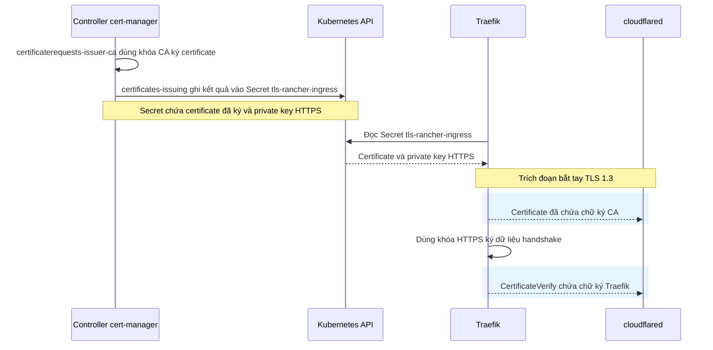
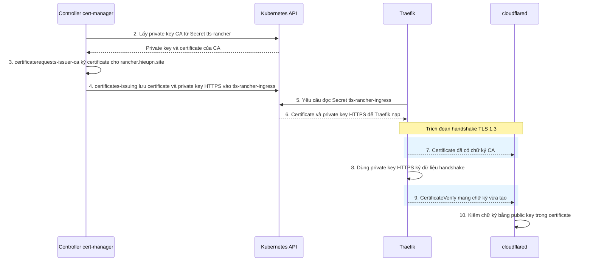
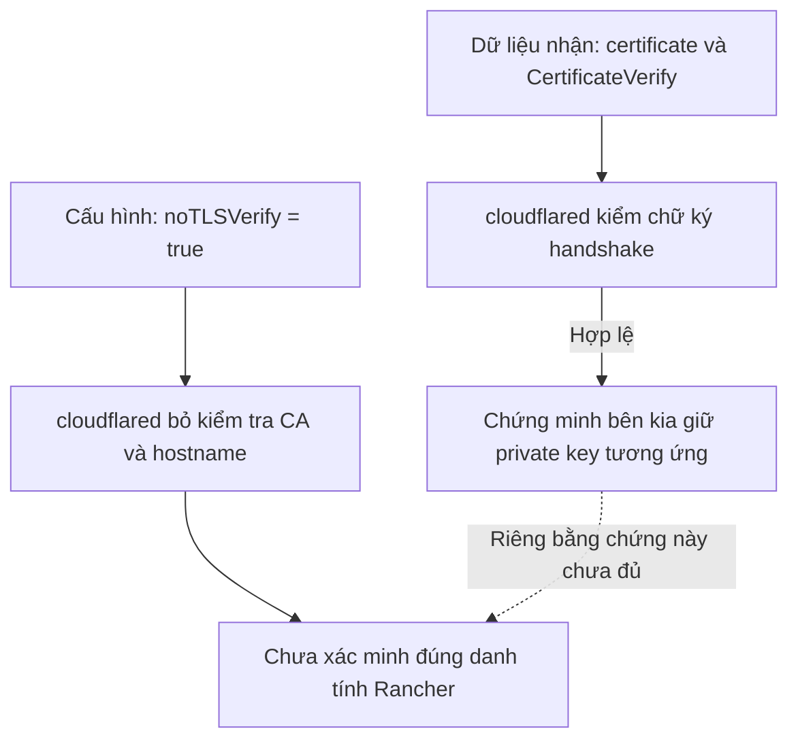
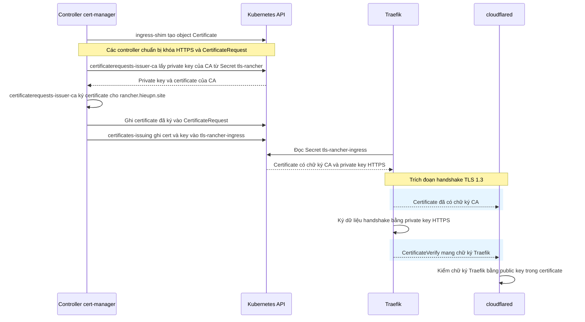

# M03 — Certificate, CA và key ở mức cần thiết

- **Trạng thái kiến thức:** hoàn tất ngày 17/10/2026, dựa trên các câu trả lời cuối bài.
- **Trạng thái bản lưu hội thoại:** chưa đủ toàn văn các lời giảng đầu M03. Các chỗ thiếu được đánh dấu ngay tại vị trí tương ứng; không viết lại hoặc bịa lời Mentor.
- **Phạm vi:** certificate/CA, public/private key, hai chữ ký, `noTLSVerify`; các câu hỏi phát sinh về TLS 1.3 và TLS 1.2 được giữ theo lịch sử.
- **Bối cảnh:** lab Rancher `rancher.hieupn.site`, Ingress do Traefik xử lý, TLS client đang xét là `cloudflared`.
- **Mục tiêu đạt:** phân biệt có certificate, client tin certificate và kết nối được mã hóa. Khóa CA trong `tls-rancher` khác khóa HTTPS của endpoint trong `tls-rancher-ingress`.

## Phạm vi và tính đầy đủ của bản lưu

File giữ nguyên các câu hỏi/câu trả lời của người học còn có trong ngữ cảnh, kể cả điểm nhầm, các lần sửa và các lượt gửi lại. Những phản hồi Mentor còn đủ nội dung được lưu cùng Mermaid và nhận xét. Phần lời giảng trong ảnh 2 được chép từ ảnh người học cung cấp, ghi rõ nguồn tại lượt tương ứng.

Không còn nguyên văn phần mở đầu M03, nhiều phản hồi Mentor ở đoạn hỏi về verify TLS, TLS 1.2 và hai chữ ký, cùng một số Mermaid đầu bài. Việc tìm lại ngữ cảnh chỉ trả về tóm tắt, không trả toàn văn; các tóm tắt ấy không được dùng để dựng transcript. Vì vậy, file này chưa thể gọi là bản chép đầy đủ toàn bộ hội thoại M03.

Mục “Tài liệu đối chiếu đã cập nhật trong lúc học” ở cuối là nội dung có nguồn từ file giải thích, không phải bản thay thế cho các lượt hội thoại bị thiếu.

## Hội thoại theo thứ tự còn truy xuất được

> Trước lượt đầu dưới đây còn thiếu nguyên văn lời giảng và câu kiểm tra mở đầu M03.
### Lượt 1 — Người học: Trả lời mở đầu M03 và yêu cầu chỉ nhận xét

Tôi sẽ trả lời câu M03, sau đó bạn chỉ nhận xét thôi vì sau đó tôi sẽ hỏi thêm 1 số chỗ.
Traefik gửi Certificate — chứng chỉ số — chứa public key và thông tin về hostname mà nó được cấp cho. Nó giữ lại private key.

### Lượt 2 — Khoảng trống bản lưu: Thiếu nguyên văn phản hồi Mentor

Không truy xuất được nguyên văn phản hồi Mentor tại vị trí này. Không viết lại lời giảng hoặc dựng một câu trả lời thay cho lượt gốc.

### Lượt 3 — Người học: Hỏi public key dùng để làm gì khi noTLSVerify bật

Nếu như Traefik cùng giữ cả 2 loại key thì quá trình xác thực diễn ra ở đâu, vì bản chất đưa cho cloudflared Certificate chứa public key thì bên phía cloudflared như trong runbook đang bật noTLSVerify: true mà thì việc đưa public key cho cloudflared để làm gì

### Lượt 4 — Khoảng trống bản lưu: Thiếu nguyên văn phản hồi Mentor

Không truy xuất được nguyên văn phản hồi Mentor tại vị trí này. Không viết lại lời giảng hoặc dựng một câu trả lời thay cho lượt gốc.

### Lượt 5 — Người học: Hỏi bằng chứng sở hữu private key

cloudflared nhận public key thì làm sao chứng minh được public key đó là được private key của Traefik ký làm bằng chứng.

### Lượt 6 — Khoảng trống bản lưu: Thiếu nguyên văn phản hồi Mentor

Không truy xuất được nguyên văn phản hồi Mentor tại vị trí này. Không viết lại lời giảng hoặc dựng một câu trả lời thay cho lượt gốc.

### Lượt 7 — Người học: Làm rõ câu hỏi sở hữu khóa

cloudflared nhận public key thì làm sao chứng minh được public key đó là được private key của Traefik ký làm bằng chứng, tức là làm sao nó biết bên kia giữ khóa tương ứng với certificate mà họ vừa đưa.

### Lượt 8 — Khoảng trống bản lưu: Thiếu nguyên văn phản hồi Mentor

Không truy xuất được nguyên văn phản hồi Mentor tại vị trí này. Không viết lại lời giảng hoặc dựng một câu trả lời thay cho lượt gốc.

### Lượt 9 — Người học: Yêu cầu định nghĩa verify TLS

giải thích thuật ngữ: "verify TLS". So sánh khi có và không có verify TLS bằng ngôn ngữ đơn giản

### Lượt 10 — Khoảng trống bản lưu: Thiếu nguyên văn phản hồi Mentor

Không truy xuất được nguyên văn phản hồi Mentor tại vị trí này. Không viết lại lời giảng hoặc dựng một câu trả lời thay cho lượt gốc.

### Lượt 11 — Người học: Hỏi hai bản tin trong TLS 1.3

như vậy, là cloudflared nhận từ Traefik 2 thứ trong quá trình thiết lập TLS, certificate và `CertificateVerify` đúng hay không

### Lượt 12 — Khoảng trống bản lưu: Thiếu nguyên văn phản hồi Mentor

Không truy xuất được nguyên văn phản hồi Mentor tại vị trí này. Không viết lại lời giảng hoặc dựng một câu trả lời thay cho lượt gốc.

### Lượt 13 — Người học: Hỏi TLS 1.2

thế 1.2 dùng gì

### Lượt 14 — Khoảng trống bản lưu: Thiếu nguyên văn phản hồi Mentor

Không truy xuất được nguyên văn phản hồi Mentor tại vị trí này. Không viết lại lời giảng hoặc dựng một câu trả lời thay cho lượt gốc.

### Lượt 15 — Người học: Trở lại hình thức hỏi, trả lời, nhận xét

Quay trở lại quá trình đặt câu hỏi + trả lời + nhận xét (kèm định vị vị trí step trong diagram)

### Lượt 16 — Khoảng trống bản lưu: Thiếu nguyên văn phản hồi Mentor

Không truy xuất được nguyên văn phản hồi Mentor tại vị trí này. Không viết lại lời giảng hoặc dựng một câu trả lời thay cho lượt gốc.

### Lượt 17 — Người học: Trả lời về danh tính khi noTLSVerify bật

chưa vì nếu cần xác minh bên kia đúng là endpoint Rancher thì cần bật verifyTLS để xác minh được CA và hostname. Hiện tại chỉ chứng minh được public key mà cloudflared nhận là do Traefik gửi.

### Lượt 18 — Khoảng trống bản lưu: Thiếu nguyên văn phản hồi Mentor

Không truy xuất được nguyên văn phản hồi Mentor tại vị trí này. Không viết lại lời giảng hoặc dựng một câu trả lời thay cho lượt gốc.

### Lượt 19 — Người học: Sửa lại phần chứng minh sở hữu khóa

biết là Bên đang kết nối giữ private key tương ứng. còn chưa xác minh được danh tính của bên gửi

### Lượt 20 — Khoảng trống bản lưu: Thiếu nguyên văn phản hồi Mentor

Không truy xuất được nguyên văn phản hồi Mentor tại vị trí này. Không viết lại lời giảng hoặc dựng một câu trả lời thay cho lượt gốc.

### Lượt 21 — Người học: Hỏi người tạo chữ ký và người gửi bản tin

**CA cũng có một cặp khóa riêng.** Trong lab:

| Private key                          | Nằm trong Secret      | Được dùng làm gì?                                                                                    |
| ------------------------------------ | --------------------- | ---------------------------------------------------------------------------------------------------- |
| **Private key của CA**               | `tls-rancher`         | Controller cấp phát dùng để **ký certificate cho Rancher**                                           |
| **Private key của endpoint Rancher** | `tls-rancher-ingress` | Traefik dùng để **chứng minh sở hữu khóa khi bắt tay TLS**, như ký `CertificateVerify` trong TLS 1.3 |

Hai chữ ký phục vụ hai việc khác nhau:

- **Chữ ký trên certificate:** chứng nhận sự gắn kết giữa hostname và public key của endpoint.
- **Chữ ký trong handshake:** chứng minh bên đang kết nối giữ private key tương ứng.

Đoạn này là sao? Sao ở trên thì đưa bảng phân biệt loại key xong ở dưới lại nói về 2 chữ ký. Mà không biết chữ ký nào được thằng nào gửi. "**Chữ ký trên certificate:** chứng nhận sự gắn kết giữa hostname và public key của endpoint.", endpoint ở đây là thằng nào????  "Chữ ký trong handshake" là giữa 2 thằng nào gửi cho nhau ????

### Lượt 22 — Khoảng trống bản lưu: Thiếu nguyên văn phản hồi Mentor

Không truy xuất được nguyên văn phản hồi Mentor tại vị trí này. Không viết lại lời giảng hoặc dựng một câu trả lời thay cho lượt gốc.

### Lượt 23 — Người học: Câu trả lời còn nhầm giữa người ký và người gửi

của Traefik. Diagram đang mô phỏng việc gửi đi cả 2 certificates sang cloudflared

### Lượt 24 — Khoảng trống bản lưu: Thiếu nguyên văn phản hồi Mentor

Không truy xuất được nguyên văn phản hồi Mentor tại vị trí này. Không viết lại lời giảng hoặc dựng một câu trả lời thay cho lượt gốc.

### Lượt 25 — Người học: Yêu cầu vẽ diagram trực tiếp trong chat

Của Traefik. Diagram đang mô phỏng việc gửi đi cả 2 certificates sang cloudflared là diagrams nào? Tiến hành vẽ lại luôn ra đay cho tôi. Những câu hỏi sau cũng vậy, khi nhắc tới diagram nào thì vẽ luôn ra đây, không gửi link cho tôi nữa

### Lượt 26 — Khoảng trống bản lưu: Thiếu nguyên văn phản hồi Mentor

Không truy xuất được nguyên văn phản hồi Mentor tại vị trí này. Không viết lại lời giảng hoặc dựng một câu trả lời thay cho lượt gốc.

### Lượt 27 — Người học: Yêu cầu mô tả từng bước, highlight hai lần gửi

mô tả bằng ngôn ngữ đơn giản những step diễn ra trong diagram trên. Nhớ highlight 2 bước từ Traefik sang `cloudflared`.

### Lượt 28 — Mentor: Phần phản hồi còn nguyên văn trong ảnh 2

> Nguồn: ảnh người học cung cấp `image(20261016-133822).png`. Chỉ phần nội dung xuất hiện trong ảnh được chép dưới đây; không khẳng định đây là toàn bộ lượt phản hồi ban đầu.

**Trước khi `cloudflared` kết nối:**

1. **Controller lấy private key của CA** từ Secret `tls-rancher`.
2. **Controller dùng khóa CA để ký certificate** cho `rancher.hieupn.site`. Certificate ghi hostname này và public key mà Traefik sẽ sử dụng.
3. **Controller lưu kết quả vào Secret `tls-rancher-ingress`:** certificate đã có chữ ký CA và private key HTTPS tương ứng.
4. **Traefik yêu cầu đọc Secret đó.**
5. **Traefik nhận và nạp cả certificate lẫn private key HTTPS** để chuẩn bị phục vụ kết nối.

**Khi đến phần đang xét của handshake TLS:**

6. ⭐ **Traefik → `cloudflared`: gửi `Certificate`.**

   Traefik gửi certificate **đã có chữ ký CA từ bước 2**. Certificate cũng chứa public key. Traefik đang chuyển **certificate đã được cấp**, không tạo chữ ký CA ở bước này.
7. **Traefik tạo một chữ ký mới:** nó dùng private key HTTPS của mình để ký dữ liệu của phiên bắt tay hiện tại.
8. ⭐ **Traefik → `cloudflared`: gửi `CertificateVerify`.**

   Bản tin này mang **chữ ký Traefik vừa tạo ở bước 7**. Nó không phải một certificate khác.
9. **`cloudflared` kiểm tra chữ ký:** lấy public key nhận ở bước 6 để kiểm tra chữ ký nhận ở bước 8. Thành công nghĩa là bên kia giữ private key tương ứng.

### Lượt 29 — Người học: Hỏi controller có phải ingress-shim và yêu cầu cập nhật có điều kiện

Controller trong câu trả lời trên của bạn có phải ingress-shim hay không? Nếu đúng, update câu trả lời trên vào file cloudflare-rancher-docs/setup-rancher.md ở vị trí thích hợp, có thể ở ngay trên Sơ đồ 1 — Ai tạo gì trong chuỗi cấp certificate. Câu trả lời cần nói rõ thêm Controller tên là gì.
Trả lời:
gửi certificate đã có chữ ký CA từ trước vì **Controller lưu kết quả vào Secret `tls-rancher-ingress`:** certificate đã có chữ ký CA và private key HTTPS tương ứng. &#x20;

### Lượt 30 — Khoảng trống bản lưu: Thiếu nguyên văn phản hồi Mentor

Không truy xuất được nguyên văn phản hồi Mentor tại vị trí này. Không viết lại lời giảng hoặc dựng một câu trả lời thay cho lượt gốc.

### Lượt 31 — Người học: Yêu cầu lưu giải thích và đổi tên nhãn

Cập nhật file `setup-rancher.md` với câu trả lời trước đó, nhớ đổi tên Chương trình cert-manager trong diagram thành Controller cert-manager

### Lượt 32 — Mentor: Xác nhận cập nhật tài liệu

Đã cập nhật [setup-rancher.md](https://github.com/hieupham259/ansible_playbook_k8s-installation/blob/main/cloudflare-rancher-docs/setup-rancher.md) trên nhánh `main`:

- Thêm câu trả lời, ghi rõ tên từng controller và nhiệm vụ.
- Phân biệt chữ ký CA với chữ ký Traefik trong handshake.
- Đổi nhãn **“Chương trình cert-manager”** thành **“Controller cert-manager”**.
- Cập nhật mục lục và kiểm tra nội dung sau khi lưu.

### Lượt 33 — Người học: Yêu cầu tiếp tục sau khi cập nhật file

rồi giờ tiếp theo là gì

### Lượt 34 — Mentor: Quay lại kiểm tra hai chữ ký

Tiếp theo, ta **chốt phần hai chữ ký của M03**: phân biệt **người tạo chữ ký** với **người gửi bản tin**.

Trong lab, Traefik gửi cả hai bản tin sang `cloudflared`, nhưng chữ ký trong mỗi bản tin có nguồn khác nhau:

- **Certificate:** đã được controller dùng **private key CA** ký từ trước.
- **CertificateVerify:** chứa chữ ký Traefik vừa tạo bằng **private key HTTPS**, để chứng minh mình giữ khóa tương ứng.

Đây là **trích đoạn rút gọn** từ phần “Controller nào cấp certificate và ai gửi hai bản tin TLS?” vừa thêm vào `setup-rancher.md`. Các bước chuẩn bị khóa và `CertificateRequest` được lược bỏ.

**Bạn đang ở đâu trong sơ đồ:** ta đang củng cố sự khác nhau giữa **bước ký certificate trước khi kết nối** và **hai mũi tên Traefik → `cloudflared` khi bắt tay TLS**.

**Câu kiểm tra:**

1. Trong certificate mà Traefik gửi cho `cloudflared`, chữ ký có sẵn được tạo bằng **private key CA** hay **private key HTTPS của Traefik**?
2. Bản tin `CertificateVerify` là **certificate thứ hai**, hay là **bản tin chứa chữ ký của lần handshake hiện tại**?

### Lượt 35 — Người học: Chỉ ra việc lời giảng bị viết lại và yêu cầu giữ cách diễn đạt của ảnh 2

> Hai ảnh kèm lượt này: `image(20261016-133758).png` (ảnh 1) và `image(20261016-133822).png` (ảnh 2).

khoan đã, tôi thấy ảnh thứ nhất là cái bạn update vào file, còn ảnh thứ 2 là câu trả lời trước đó. Ảnh thứ 1 viết rất mơ hồ, trong khi ảnh thứ 2 viết rõ ràng hơn nhưng có 1 số step chỉ tồn tại ở 1 trong 2 phong cách. Điều này gây rất khó chịu, ví dụ: **Controller lấy private key của CA** từ Secret `tls-rancher`. chỉ có ở cách 2, trong khi ảnh 1 viết: `certificaterequests-issuer-ca` đọc khóa CA trong `tls-rancher`, ký certificate và trả kết quả về `CertificateRequest` , đáng nhẽ nó phải viết `certificaterequests-issuer-ca` lấy private key của CA `tls-rancher`, sau đó ký certificate cho rancher.hieupn.site và trả kết quả về `CertificateRequest`. Nói chung, giữ nguyên câu trả lời trong ảnh 2, chỉ thêm đoạn `ingress-shim` thấy Ingress cần certificate, nên tạo object `Certificate`. + tên các controller ở các bước thôi.
Update lại file cloudflare-rancher-docs/setup-rancher.md theo những cái tôi chỉ.

### Lượt 36 — Mentor: Xác nhận sửa lại theo ảnh 2

Đã sửa [setup-rancher.md](https://github.com/hieupham259/ansible_playbook_k8s-installation/blob/main/cloudflare-rancher-docs/setup-rancher.md) trên nhánh `main`:

- Giữ nguyên nội dung và cách diễn đạt của **9 bước trong ảnh 2**.
- Thêm bước `ingress-shim` tạo object `Certificate`, thành **10 bước**.
- Bổ sung tên controller phụ trách và cập nhật số bước tham chiếu.

Đã kiểm tra lại nội dung sau khi lưu.

### Lượt 37 — Người học: Yêu cầu tiếp tục

rồi bước tiếp là gì

### Lượt 38 — Mentor: Câu kiểm tra hai chữ ký

Ta quay lại **câu kiểm tra đang chờ của M03 — phân biệt hai chữ ký**. Bạn trả lời theo cách hiểu, không cần nhớ chính xác tên controller:

1. Trong **certificate Traefik gửi cho `cloudflared`**, chữ ký có sẵn được tạo bằng **private key của ai**? Traefik có tạo lại chữ ký này mỗi khi `cloudflared` kết nối không?

2. Sau đó, Traefik gửi **`CertificateVerify`** cho `cloudflared`. Bản tin này dùng để chứng minh điều gì, và có phải một certificate thứ hai không?

### Lượt 39 — Người học: Trả lời đúng về khóa CA và bằng chứng sở hữu khóa

1. **private key của CA** từ Secret `tls-rancher`.  Không, nó tạo trước khi cloudlfared kết nối.
2. Nó dùng để chứng minh Bên đang kết nối giữ private key tương ứng với public key trong certificate vừa trình.

### Lượt 40 — Mentor: Nhận xét đúng, định vị và câu chốt M03

**Cả hai ý đều đúng.**

1. Chữ ký trên certificate được controller `certificaterequests-issuer-ca` tạo bằng **private key CA từ Secret `tls-rancher`**. Traefik gửi certificate đã được ký sẵn đó.
2. `CertificateVerify` chứng minh bên đang kết nối giữ private key tương ứng. Đây là **bản tin mang chữ ký của lần handshake hiện tại**, không phải certificate thứ hai.

**Bạn đang ở đâu trong sơ đồ:** bạn đã phân biệt đúng **bước 3 — ký certificate** với **bước 8 — ký dữ liệu handshake**, trong phần “Controller nào cấp certificate và ai gửi hai bản tin TLS?” của `setup-rancher.md`.

Dưới đây là trích đoạn tương ứng; các bước chuẩn bị khóa và `CertificateRequest` được lược bỏ:

Điểm cuối cần chốt ở M03 là: **mã hóa kết nối** và **xác minh danh tính bên kia** là hai việc riêng. Kiểm đúng chữ ký trong handshake chứng minh bên kia giữ khóa tương ứng; để tin đó là Rancher mong muốn, client còn cần kiểm tra certificate theo CA tin cậy và hostname.

**Câu kiểm tra chốt M03:** Trong lab, `cloudflared` dùng `noTLSVerify: true` và hoàn tất kết nối HTTPS tới Traefik. Dữ liệu có được mã hóa không? Việc kết nối thành công đã đủ chứng minh `cloudflared` xác minh đúng Rancher theo CA và hostname chưa?

### Lượt 41 — Người học: Câu trả lời chốt — lượt đầu

dữ liệu được mã hoá nhưng việc kết nối thành công không đủ chứng minh `cloudflared` xác minh đúng Rancher theo CA và hostname chưa?

### Lượt 42 — Mentor: Nhận xét xác nhận đạt mục tiêu

Đúng rồi: dữ liệu vẫn được mã hóa, nhưng `noTLSVerify: true` khiến `cloudflared` bỏ kiểm tra certificate theo CA và hostname. Bạn đã đạt mục tiêu M03.

Tôi sẽ dùng kỹ năng Personal Context để tìm lại các lượt hỏi–đáp cần lưu vào bài M03, rồi cập nhật checkpoint và chuyển sang M04.

### Lượt 43 — Người học: Câu trả lời chốt — người học gửi lại bỏ dấu hỏi cuối

dữ liệu được mã hoá nhưng việc kết nối thành công không đủ chứng minh `cloudflared` xác minh đúng Rancher theo CA và hostname

### Lượt 44 — Người học: Yêu cầu tiếp tục lưu bài và học

ok làm tiếp đi

### Lượt 45 — Mentor: Chốt M03 và định vị phần đã hiểu

**Đúng. M03 đã hoàn tất.** Bạn đã phân biệt được **kết nối được mã hóa** với **client xác minh đúng danh tính Rancher**.

**Bạn đang ở đâu trong sơ đồ:** ở bước 10 và ghi chú `noTLSVerify` trong phần “Controller nào cấp certificate và ai gửi hai bản tin TLS?” của `setup-rancher.md`. Minh họa bổ sung dưới đây tách rõ việc kiểm chữ ký handshake với việc bỏ kiểm tra CA/hostname:

## Checkpoint cuối M03

- **Người học đã tự giải thích đúng:** Traefik gửi certificate, giữ kín private key; chữ ký có sẵn trên certificate dùng private key CA từ `tls-rancher` và được tạo trước kết nối; `CertificateVerify` chứng minh bên kia giữ private key tương ứng với public key trong certificate; HTTPS vẫn mã hóa khi `noTLSVerify: true`, nhưng kết nối thành công chưa chứng minh xác minh đúng Rancher theo CA/hostname.
- **Điểm nhầm đã sửa:** từng chọn khóa Traefik cho chữ ký CA và gọi hai bản tin là “2 certificates”. Phản hồi sau đó đã phân biệt chữ ký CA có sẵn với chữ ký trong handshake. Mentor nhắc rõ `CertificateVerify` là bản tin mang chữ ký, không phải certificate thứ hai.
- **Vai trò controller đã được giảng/đối chiếu:** `ingress-shim` tạo object `Certificate`; `certificaterequests-issuer-ca` dùng private key CA ký certificate; `certificates-issuing` ghi certificate đã ký cùng private key HTTPS tương ứng vào Secret cuối. Không coi việc đã đọc tên controller là bằng chứng người học đã thuộc tên.
- **Vị trí đã đối chiếu:** phần “Controller nào cấp certificate và ai gửi hai bản tin TLS?” — bước 3 ký certificate, bước 8 ký handshake, bước 10 kiểm chữ ký và ghi chú `noTLSVerify`. Các trích đoạn Mermaid thực sự còn truy xuất được và minh họa bổ sung lúc chốt bài được giữ ở các lượt trên.
- **Điểm nền cần củng cố ở M04:** Ingress khai hostname/tên Secret và annotation Issuer; Issuer là object cấu hình, không phải chương trình ký; Certificate object khác certificate trong Secret.
- **Bài tiếp theo:** M04 — Ingress, Issuer, Certificate và hai Secret; bắt đầu bằng việc khai tên Secret khác với việc Secret đã tồn tại.
- **Câu hỏi M04 đang chờ:** Ingress Rancher khai Secret TLS tên `tls-rancher-ingress`; chỉ nhìn khai báo ấy đã kết luận Secret tồn tại và chứa certificate chưa? Vì sao?
- **Câu 2/6:** chưa trả lời lại/chấm lượt mới; giữ mốc sau M07.
- **Câu 3/6:** chưa trả lời; giữ mốc sau M12.
- **Cluster:** chưa có output thực tế được người học cung cấp trong các lượt này.
- **Giới hạn bản lưu:** còn thiếu nguyên văn nhiều lời giảng và Mermaid đầu M03; không đánh dấu bản chép hội thoại là đầy đủ.

## Tài liệu đối chiếu đã cập nhật trong lúc học

> Nguồn: `cloudflare-rancher-docs/setup-rancher.md` tại commit `8ec4d655d165fc2a0535f8114d0561a04d244cdf`. Đây là bản đối chiếu của phần giải thích được người học yêu cầu chỉnh theo ảnh 2, không phải transcript của những phản hồi bị thiếu.

### Controller nào cấp certificate và ai gửi hai bản tin TLS?

**Không phải `ingress-shim` thực hiện việc ký certificate hay ghi Secret TLS cuối cùng.**
Trong Deployment `cert-manager` có nhiều controller. Mỗi controller là phần chương trình
theo dõi một loại công việc và xử lý để trạng thái thực tiến gần trạng thái được khai báo.

| Controller | Nhiệm vụ trong lab |
|---|---|
| **`ingress-shim`** | Đọc Ingress và tạo **object `Certificate`**, khai nhu cầu cấp chứng chỉ. |
| **`certificaterequests-issuer-ca`** | Xử lý `CertificateRequest` theo CA Issuer: dùng private key CA để **ký certificate**, trả kết quả để lưu vào `CertificateRequest.status.certificate`. |
| **`certificates-issuing`** | Lấy certificate đã ký và private key HTTPS đã được chuẩn bị, rồi ghi vào **Secret `tls-rancher-ingress`**. |

Vì vậy, **khâu ký và khâu ghi Secret do hai controller khác nhau thực hiện**.
`Issuer/rancher` là object cấu hình chỉ CA cần dùng; nó không phải chương trình ký.
Trong lab, Issuer này tham chiếu Secret `tls-rancher`.

**Endpoint Rancher** ở đoạn này là điểm phục vụ HTTPS cho `rancher.hieupn.site`, do
**Traefik** đảm nhiệm. Client TLS đang kết nối tới Traefik là **`cloudflared`**.

| Private key | Nằm trong Secret | Ai dùng và dùng làm gì? |
|---|---|---|
| **Private key của CA** | `tls-rancher` | `certificaterequests-issuer-ca` dùng để ký certificate cho hostname Rancher. |
| **Private key HTTPS của endpoint Rancher** | `tls-rancher-ingress` | Traefik dùng để chứng minh mình giữ khóa tương ứng với public key trong certificate, ví dụ ký `CertificateVerify` ở TLS 1.3. |

Trong diagram dưới đây, nhãn **Controller cert-manager** đại diện cho các controller
bên trong Deployment `cert-manager`; tên controller thực hiện từng việc được ghi trên mũi tên.
Đây là bản rút gọn: các bước chuẩn bị private key HTTPS và tạo `CertificateRequest`
được gom vào ghi chú. Phần TLS chỉ trích hai bản tin của một lần bắt tay TLS 1.3 mới
có dùng certificate; các bản tin khác, như `ClientHello`, `ServerHello` và `Finished`,
được lược bỏ. Nó không khẳng định phiên TLS thực tế của lab đã thương lượng phiên bản nào.

Đọc bằng ngôn ngữ đơn giản:

**Trước khi `cloudflared` kết nối:**

1. `ingress-shim` thấy Ingress cần certificate, nên tạo object `Certificate`.
2. **Controller `certificaterequests-issuer-ca` lấy private key của CA** từ Secret `tls-rancher`.
3. **Controller `certificaterequests-issuer-ca` dùng khóa CA để ký certificate** cho `rancher.hieupn.site`. Certificate ghi hostname này và public key mà Traefik sẽ sử dụng.
4. **Controller `certificates-issuing` lưu kết quả vào Secret `tls-rancher-ingress`:** certificate đã có chữ ký CA và private key HTTPS tương ứng.
5. **Traefik yêu cầu đọc Secret đó.**
6. **Traefik nhận và nạp cả certificate lẫn private key HTTPS** để chuẩn bị phục vụ kết nối.

**Khi đến phần đang xét của handshake TLS:**

7. ⭐ **Traefik → `cloudflared`: gửi `Certificate`.**

   Traefik gửi certificate **đã có chữ ký CA từ bước 3**. Certificate cũng chứa public key. Traefik đang chuyển **certificate đã được cấp**, không tạo chữ ký CA ở bước này.
8. **Traefik tạo một chữ ký mới:** nó dùng private key HTTPS của mình để ký dữ liệu của phiên bắt tay hiện tại.
9. ⭐ **Traefik → `cloudflared`: gửi `CertificateVerify`.**

   Bản tin này mang **chữ ký Traefik vừa tạo ở bước 8**. Nó không phải một certificate khác.
10. **`cloudflared` kiểm tra chữ ký:** lấy public key nhận ở bước 7 để kiểm tra chữ ký nhận ở bước 9. Thành công nghĩa là bên kia giữ private key tương ứng.

Hai chữ ký có hai người tạo và hai mục đích:

| Chữ ký | Ai tạo? | Ai gửi sang `cloudflared`? | Ý nghĩa khi kiểm tra thành công |
|---|---|---|---|
| **Chữ ký CA trên certificate** | Controller `certificaterequests-issuer-ca`, dùng private key CA trước khi handshake diễn ra. | Traefik gửi certificate đã chứa chữ ký này ở bước 7. | CA đã ký xác nhận sự gắn kết giữa hostname và public key của endpoint. Client còn phải kiểm tra CA có được tin cậy và hostname có khớp hay không. |
| **Chữ ký trong `CertificateVerify`** | Traefik, dùng private key HTTPS trong lần handshake hiện tại. | Traefik gửi bản tin `CertificateVerify` ở bước 9. | Bên đang kết nối giữ private key tương ứng với public key trong certificate vừa trình. |

Với `noTLSVerify: true` trong lab, `cloudflared` bỏ kiểm tra độ tin cậy của certificate
theo CA và hostname, nhưng vẫn kiểm chứng mật mã của handshake. Vì vậy, bước 10
chưa đủ xác nhận bên kia đúng là endpoint Rancher mong muốn. Việc cấp/gia hạn certificate
chạy nền cũng không phải việc ký lại certificate mỗi khi client kết nối.

Tên controller được đối chiếu theo cert-manager `v1.21.1` mà runbook dùng:
[ingress-shim](https://github.com/cert-manager/cert-manager/blob/v1.21.1/pkg/controller/certificate-shim/ingresses/controller.go),
[certificaterequests-issuer-ca](https://github.com/cert-manager/cert-manager/blob/v1.21.1/pkg/controller/certificaterequests/ca/ca.go),
[certificates-issuing](https://github.com/cert-manager/cert-manager/blob/v1.21.1/pkg/controller/certificates/issuing/issuing_controller.go).
Bản tin `CertificateVerify` được mô tả trong
[TLS 1.3, RFC 8446 §4.4.3](https://www.rfc-editor.org/rfc/rfc8446.html#section-4.4.3).

## Nguồn và liên kết

- [Giáo án M03](rancher-mentor-study-plan.md#m03-certificate-ca-và-key-ở-mức-cần-thiết).
- [Setup Rancher — bản đối chiếu dùng khi lưu bài](https://github.com/hieupham259/ansible_playbook_k8s-installation/blob/8ec4d655d165fc2a0535f8114d0561a04d244cdf/cloudflare-rancher-docs/setup-rancher.md).
- [Tài liệu CA, TLS và HTTPS](../cloudflare-rancher-docs/ca-tls-https-request-response.md).
- [Tiến độ hiện tại](README.md).
