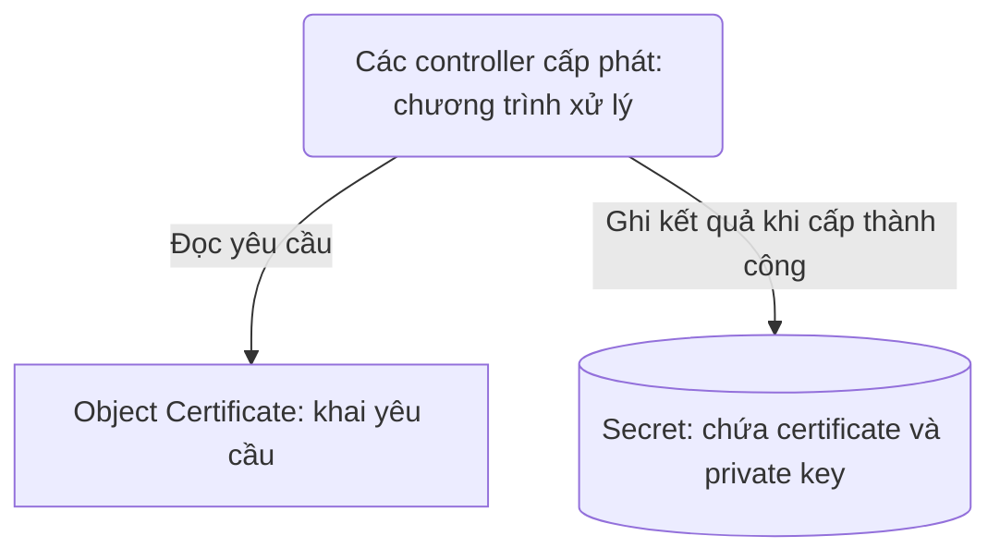
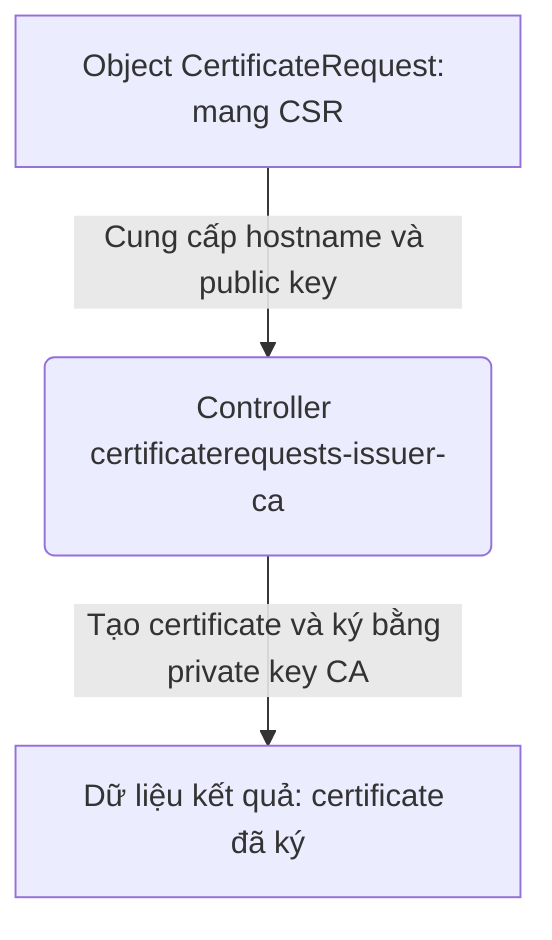
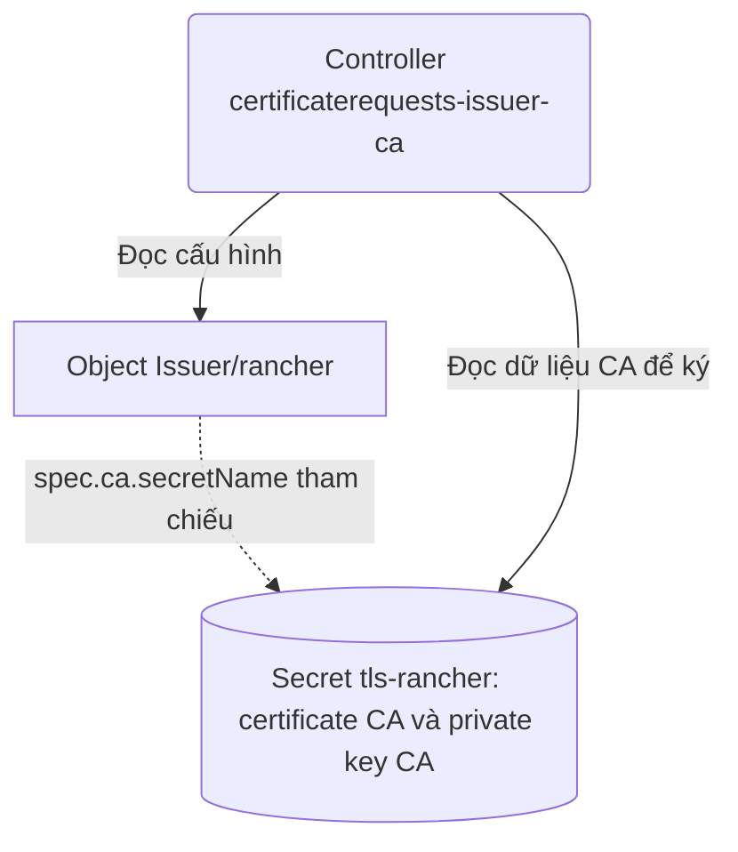
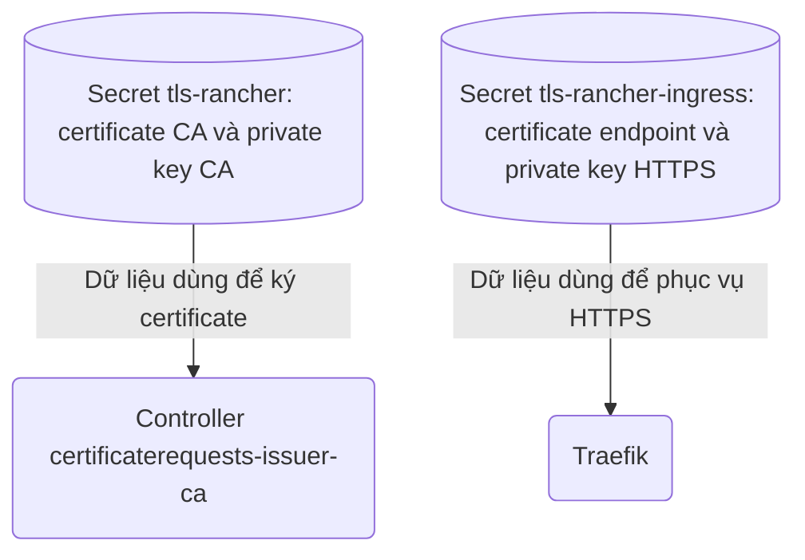
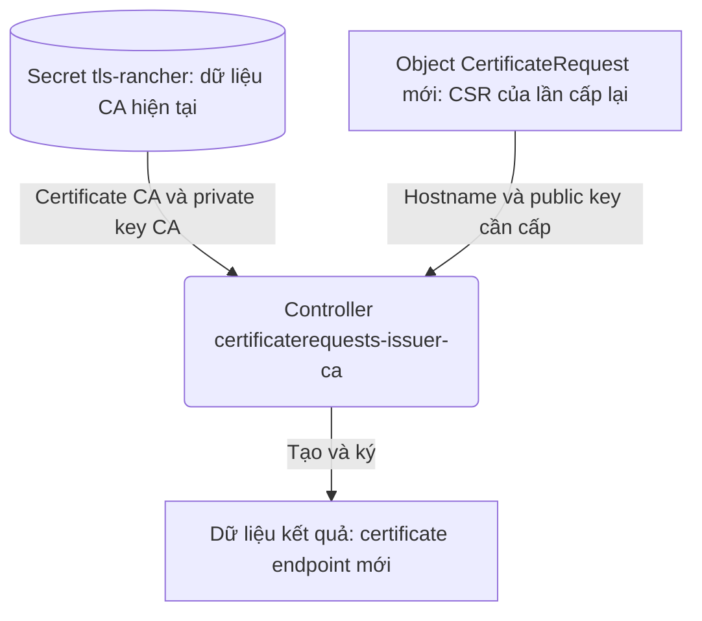
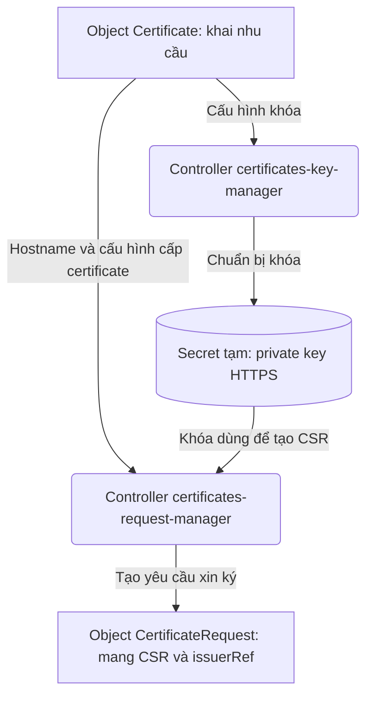

# M04 — Ingress, Issuer, Certificate và hai Secret

- **Trạng thái:** hoàn tất mục tiêu kiến thức ngày 18/10/2026 (giờ Việt Nam).
- **Phạm vi:** vai trò và quan hệ giữa Ingress, Issuer, Certificate, CertificateRequest, Secret CA và Secret TLS endpoint; phân biệt một lần xin cấp/gia hạn certificate với kết nối TLS và HTTP request.
- **Bối cảnh:** Rancher `rancher.hieupn.site`, namespace `cattle-system`, Ingress do Traefik xử lý. Client TLS của origin là `cloudflared`; Traefik → backend Rancher dùng HTTP port `80`.
- **Bài trước:** [M03](M03.md). **Bài tiếp theo:** M05 — chuỗi xin và cấp certificate; chưa bắt đầu bài mới.

[Giáo án M04](rancher-mentor-study-plan.md#m04-ingress-issuer-certificate-và-hai-secret) · [Tiến độ](README.md)

## Phạm vi và giới hạn bản lưu

File giữ nguyên nội dung giảng, câu hỏi, câu trả lời, nhận xét, các lần sửa cách giải thích và Mermaid của phiên học từ “làm tiếp M04 thôi” ngày 17/10/2026 đến xác nhận cuối bài ngày 18/10/2026. Các trao đổi review và cập nhật tài liệu phát sinh trong bài cũng được giữ theo thứ tự. Không thay những câu trả lời sai hoặc lời giảng thiếu rõ ràng ban đầu bằng đáp án đã sửa ở cuối phiên.

Checkpoint đầu phiên do người học cung cấp cho biết M01–M03 đã học xong, M04 đang học và ba ý sau đã được trả lời đúng trước phiên này:

1. Ingress ghi `secretName: tls-rancher-ingress` chưa chứng minh Secret tồn tại hoặc chứa dữ liệu.
2. Traefik lấy certificate/private key thực tế từ Secret.
3. Secret `tls-rancher` chứa certificate CA và private key CA dùng cho việc ký.

Không có nguyên văn đầy đủ các lượt giảng/hỏi–đáp trước phiên cho ba ý này; chỉ lưu chúng như checkpoint người học cung cấp, không dựng lại hội thoại cũ. README/giáo án khi mở phiên còn ghi M04 đang chờ câu hỏi mở đầu; Mentor đã đối chiếu và dùng checkpoint mới của người học để nối tiếp.

Các trích dẫn nguồn của giao diện chat được chuyển thành liên kết Markdown đến đúng nguồn. Khung giao diện Writing Blocks không được chép thành nội dung tài liệu; nguyên văn bản nháp bên trong được giữ. Output công cụ, lời gọi API và các thông báo thuần tác nghiệp không phải nội dung giảng được lược khỏi bản chép. Hình đính kèm được nhận diện bằng tên/đường dẫn; phần chữ người học gửi cùng hình được giữ nguyên.

Mọi tình huống về cluster trong bài là giả định để học. Không có output cluster thực tế được cung cấp hoặc xác minh trong phiên.

## Toàn bộ phần giảng và hỏi–đáp trong phiên

### Lượt 01 — Người học: Tiếp tục M04

làm tiếp M04 thôi

### Lượt 02 — Mentor: Câu hỏi đang chờ

Tiếp tục **M04**, đúng câu đang chờ.

**Tình huống giả định:** Trong namespace `cattle-system`, object `Certificate/tls-rancher-ingress` đã tồn tại.

**Chỉ dựa vào đó, đã đủ kết luận Secret `tls-rancher-ingress` chứa certificate đã ký chưa? Vì sao?**

### Lượt 03 — Người học: Kết luận chưa, nhưng lý do còn nhầm nơi lưu

chưa. Vì đó là nơi để lưu certificate vào chứ không phải người trực tiếp tạo ra

### Lượt 04 — Mentor: Phân biệt yêu cầu với nơi chứa kết quả

**Kết luận “chưa” đúng. Nhưng lý do cần sửa rõ:** object `Certificate` không phải nơi lưu certificate đã ký.

- **Object `Certificate`** khai nhu cầu: cần certificate cho `rancher.hieupn.site`, kết quả sẽ lưu vào Secret `tls-rancher-ingress`.
- **Secret `tls-rancher-ingress`** mới là nơi chứa certificate đã ký và private key HTTPS tương ứng.

Vì vậy, **yêu cầu đã tồn tại chưa chứng minh các controller đã xử lý và ghi kết quả xong**.

Để đối chiếu vị trí vừa học, đây là **minh họa mới cho M04**, lược bỏ các bước trung gian:



**Bạn thử nói lại: vì sao object `Certificate` đã tồn tại vẫn chưa đủ kết luận Secret chứa certificate đã ký?**

### Lượt 05 — Người học: Nêu controller ghi kết quả

Vì cần **Controller `certificates-issuing` lưu kết quả vào Secret `tls-rancher-ingress`**

### Lượt 06 — Mentor: Nhận xét và hỏi về yêu cầu xin ký

**Đúng.** Object `Certificate` tồn tại mới cho thấy nhu cầu đã được khai báo. Còn controller **`certificates-issuing` phải ghi certificate đã ký cùng private key HTTPS tương ứng vào Secret `tls-rancher-ingress`**.

Trong **minh họa M04 đã dùng ở chat** dưới đây, bạn vừa giải thích đúng mũi tên **“Ghi kết quả”**. Đây là minh họa rút gọn, không phải sơ đồ chép từ file:


Ta chốt tiếp vai trò của yêu cầu xin ký: **hostname và public key cần được CA ký nằm trong yêu cầu của object nào?**

### Lượt 07 — Người học: Nhầm Certificate với CertificateRequest

object `Certificate`

### Lượt 08 — Mentor: Sửa phân biệt hai object

**Cần sửa thành `CertificateRequest`.** Bạn nhớ đúng một phần: hostname cũng được khai trong `Certificate`.

| Object | Vai trò |
|---|---|
| `Certificate` | Khai nhu cầu: cần certificate cho hostname nào, lưu kết quả vào Secret nào. |
| `CertificateRequest` | Mang **CSR** của một lần xin ký cụ thể, chứa hostname và public key cần được CA ký. |

**CSR** nghĩa là *yêu cầu xin ký certificate*.

**Vậy controller `certificaterequests-issuer-ca` đọc yêu cầu xin ký cụ thể từ object nào?**

### Lượt 09 — Người học: Trả lời lại

**`CertificateRequest`**

### Lượt 10 — Mentor: Đối chiếu bước ký và hỏi về Issuer

**Đúng.** Controller `certificaterequests-issuer-ca` đọc **CSR trong object `CertificateRequest`**, rồi dùng thông tin đó để tạo certificate và ký bằng private key CA.

Đây là **minh họa mới cho bước ký ở M04**, chỉ thể hiện quan hệ đầu vào → xử lý → kết quả:



Bạn vừa xác định đúng **object mang đầu vào cho bước ký**.

**Trong lab, object `Issuer/rancher` chỉ cho controller biết phải dùng CA ở đâu bằng cách nào?**

### Lượt 11 — Người học: Trường tham chiếu CA

dựa vào spec:
  ca:
    secretName: tls-rancher trong Issuer/rancher

### Lượt 12 — Mentor: Đối chiếu Issuer và Secret CA

**Đúng.** Trường **`Issuer/rancher.spec.ca.secretName: tls-rancher`** chỉ tới Secret chứa CA. Controller `certificaterequests-issuer-ca` đọc certificate CA và private key CA từ Secret đó để thực hiện việc ký.

Đây là **minh họa mới cho M04**, tách chương trình, object cấu hình và dữ liệu:



**Tình huống giả định:** `Issuer/rancher` đã tồn tại nhưng Secret `tls-rancher` chưa có. Controller đã đủ dữ liệu để ký certificate chưa? Vì sao?

### Lượt 13 — Người học: Yêu cầu sửa cách đặt câu hỏi

Bạn đang hỏi theo kiểu rất vụn và thiếu chủ đích. Nhìn vào cách đặt câu hỏi của các files khác như: M01.md, M02.md, ... hoặc trong tunnel-traefik.md trong projetc ý mà đặt câu trả lời

### Lượt 14 — Mentor: Đọc lại mẫu câu hỏi và đặt lại tình huống M04

**Thông báo trước tra cứu:**

Tôi đã hỏi quá nhiều câu nhắc lại từng tên object và trường YAML, khiến M04 thiếu một mục tiêu xuyên suốt. Tôi sẽ đọc lại cách đặt câu hỏi trong M01, M02 và `tunnel-traefik.md` để đổi sang câu hỏi tình huống có chủ đích hơn.

**Phản hồi sau khi đọc nguồn:**

Tôi đã đọc lại [M01](https://github.com/hieupham259/ansible_playbook_k8s-installation/blob/main/rancher-mentor/M01.md), [M02](https://github.com/hieupham259/ansible_playbook_k8s-installation/blob/main/rancher-mentor/M02.md) và phần tự kiểm tra trong [tunnel-traefik.md](https://github.com/hieupham259/ansible_playbook_k8s-installation/blob/main/cloudflare-rancher-docs/tunnel-traefik.md).

Các câu hỏi đó có **tình huống cụ thể và mục tiêu suy luận rõ**. Ví dụ: thay Pod có tạo release mới không; controller dừng thì bản khai còn thực hiện được không; tunnel Healthy chứng minh được chặng nào.

Tôi đã biến M04 thành nhiều câu nhớ tên, rồi hỏi lại cả những điểm bạn đã hiểu. Tôi sẽ dùng câu hỏi giúp bạn nối các thành phần và giải thích hệ quả của cấu hình.

Tôi thay câu vừa rồi bằng tình huống này, vẫn trong phạm vi M04:

**Tình huống giả định:** Trong lab, `Issuer/rancher` tham chiếu Secret `tls-rancher`, còn Ingress Rancher tham chiếu Secret `tls-rancher-ingress`.

Một người đề xuất:

> “Secret `tls-rancher` đã chứa certificate và private key rồi. Vậy cho Ingress dùng luôn Secret đó, khỏi cần `tls-rancher-ingress`.”

**Bạn đánh giá đề xuất này thế nào, dựa trên vai trò của hai Secret và dữ liệu Traefik cần để phục vụ HTTPS cho `rancher.hieupn.site`?**

### Lượt 15 — Người học: Phân biệt dữ liệu CA và dữ liệu endpoint

Đề xuất này ngu. Vì thứ lưu trong Secret `tls-rancher` là dùng để ký **certificate cho `rancher.hieupn.site`**. Còn thứ lưu trong `tls-rancher-ingress` là thứ được ký. Nếu dùng luôn thì là dùng CA để thiết lập TLS chứ không phải dùng Certificate

### Lượt 16 — Mentor: Nhận xét, sửa thuật ngữ và hỏi về gia hạn

**Bạn phân biệt đúng vai trò của hai Secret:** `tls-rancher` chứa dữ liệu CA dùng để ký; `tls-rancher-ingress` chứa certificate đã được cấp cho endpoint và private key HTTPS tương ứng.

Chỉnh một thuật ngữ ở câu cuối: **CA cũng có certificate của chính nó**. Vì vậy, cách nói chính xác là: đề xuất đó lấy **certificate/key của CA** để thay cho **certificate/key của endpoint**.

Đây là **minh họa mới cho M04**, tách hai mục đích sử dụng:



Giữ cùng ý này, xét **tình huống giả định**: certificate cho `rancher.hieupn.site` sắp hết hạn, nhưng CA trong `tls-rancher` vẫn còn hiệu lực và private key CA vẫn an toàn.

**Việc gia hạn certificate cho endpoint có bắt buộc thay CA trong `tls-rancher` không? Vì sao?**

### Lượt 17 — Người học: Có thể dùng cùng CA để cấp lại

Không vì dùng cùng 1 CA trong `tls-rancher` có thể tạo 1 certificate mới hoặc gia hạn certificate mà vẫn đảm bảo tính bảo mật trong kết nối

### Lượt 18 — Mentor: Phân biệt gia hạn và lần xin ký mới

**Đúng về ý không bắt buộc thay CA.** Với giả định CA còn hiệu lực và private key CA an toàn, CA đó có thể tiếp tục ký certificate mới cho `rancher.hieupn.site`.

Một điểm cần làm rõ: **“gia hạn” là cấp certificate mới có thời hạn mới**, chứ không sửa ngày hết hạn trên certificate cũ.

Đây là **minh họa mới, rút gọn cho lần cấp lại**, không phải output cluster:



Ta dùng tình huống này để chốt sự khác nhau giữa `Certificate` và `CertificateRequest`:

**Khi hostname và Secret đích vẫn giữ nguyên, vì sao lúc cấp lại vẫn cần một `CertificateRequest` mới?**

### Lượt 19 — Người học: Liên hệ nhầm thời hạn certificate với CertificateRequest

Vì cái cũ có thời hạn sống nhất định. Nếu tạo 1 Certificate không bao giờ hết hạn thì rất dễ tạo ra lỗ hổng

### Lượt 20 — Mentor: Phân biệt thời hạn và tính chất một lần xin ký

**Thông báo trước tra cứu:**

Bạn đang nói đến thời hạn của certificate đã cấp. Tôi sẽ đối chiếu vòng đời `CertificateRequest` trong tài liệu cert-manager để làm rõ vì sao một lần cấp lại cần yêu cầu mới.

**Phản hồi sau tra cứu:**

**Bạn đúng rằng certificate đã cấp có thời hạn, nhưng đó chưa phải lý do cần `CertificateRequest` mới.** Tôi chưa làm rõ tính chất “một lần xin ký” của object này.

| Thành phần | Ý nghĩa |
|---|---|
| Object `Certificate` | Khai nhu cầu cần duy trì: certificate cho hostname nào, lưu vào Secret nào. |
| Object `CertificateRequest` | Ghi nhận **một lần xin ký cụ thể**. |
| Certificate đã cấp | Dữ liệu có chữ ký CA và thời hạn hiệu lực. |

`CertificateRequest` đã hoàn tất không được dùng lại cho lần cấp tiếp theo; nội dung `spec` của nó cũng không sửa được sau khi tạo. Vì vậy, lần cấp mới cần một `CertificateRequest` mới, dù hostname và Secret đích giữ nguyên. [Nguồn: CertificateRequest resource](https://cert-manager.io/docs/usage/certificaterequest/)

**Nếu chủ động cấp lại certificate trước ngày hết hạn, vẫn cho `rancher.hieupn.site`, có cần `CertificateRequest` mới không? Vì sao?**

### Lượt 21 — Người học: Yêu cầu giải thích nguyên nhân và phân biệt loại request

Bạn phải giải thích tại sao không dùng lại được trong lần tiếp theo chứ. Mà bạn đang nói trong cùng 1 kết nối hay là khác kết nối, chỉ khác request

### Lượt 22 — Mentor: Tách cấp/gia hạn khỏi TLS và HTTP

**Thông báo trước tra cứu:**

Tôi đang nói về **một lần xin cấp/gia hạn certificate của cert-manager**, không phải HTTP request hay kết nối TLS. Tôi đã dùng từ “request” thiếu rõ ràng. Tôi sẽ đối chiếu thêm cơ chế xử lý để giải thích vì sao object cũ không được dùng lại.

**Phản hồi sau tra cứu:**

Tôi đang nói về **lần xin cấp/gia hạn certificate của cert-manager**. Việc này chạy nền, độc lập với các HTTP request và kết nối TLS giữa `cloudflared` với Traefik. Tôi đã dùng từ “request” thiếu rõ ràng.

**`CertificateRequest` không được dùng lại để xin cấp mới vì nó là bản ghi của một công việc có đầu vào và kết quả riêng:**

1. Controller đọc yêu cầu trong `spec`.
2. Khi cấp thành công, controller ghi certificate đã ký vào `status.certificate`, đánh dấu `Ready=True`, lý do `Issued`.
3. Khi gặp lại object đã hoàn tất đó, controller **bỏ qua việc ký**, vì công việc đã xong. Trong code cert-manager `v1.21.1`, đây là điều kiện xử lý cụ thể. [Nguồn code](https://github.com/cert-manager/cert-manager/blob/v1.21.1/pkg/controller/certificaterequests/sync.go)

Ngoài ra, `spec` của `CertificateRequest` không sửa được sau khi tạo. Muốn yêu cầu **một lần cấp mới**, cert-manager tạo object mới, có trạng thái và kết quả riêng. Đây là thiết kế vòng đời của cert-manager; không phải do object `CertificateRequest` cũ có ngày hết hạn như certificate đã cấp. [Nguồn: CertificateRequest resource](https://cert-manager.io/docs/usage/certificaterequest/)

Ví dụ giả định: lần cấp đầu dùng `CertificateRequest A`, nhận certificate A. Đến lần gia hạn, dùng `CertificateRequest B`, nhận certificate B. Hostname và Secret đích vẫn có thể giữ nguyên.

Còn với kết nối phục vụ ứng dụng:

| Sự kiện | Có cần `CertificateRequest` mới chỉ vì sự kiện này không? |
|---|---|
| Gửi HTTP request tiếp theo trong cùng kết nối TLS | Không. |
| `cloudflared` mở kết nối TLS mới tới Traefik | Không. Traefik có thể tiếp tục dùng certificate đã được cấp và nạp sẵn. |
| cert-manager thực hiện một lần cấp/gia hạn certificate mới | Có. Đây mới là “lần tiếp theo” tôi đang nói đến. |

> **Ghi chú đọc bản lưu:** Cách nêu nguyên nhân ở đầu lượt này bị người học phản biện tại lượt 31. Giữ nguyên lời giảng để thấy lịch sử; phần giải thích rõ hơn về quy ước API, việc controller đọc lại object và lý do cần certificate mới nằm ở lượt 32–36.

### Lượt 23 — Người học: Chỉ ra đoạn tài liệu thiếu kết nối

> Ảnh đính kèm của người học: `image(20261017-170546).png`. Đoạn trong ảnh đã được đối chiếu với file GitHub hiện tại; nội dung chữ người học gửi được giữ dưới đây.

Đoạn này trong file cloudflare-rancher-docs/setup-rancher.md đang viết hơi thiếu kết nối như sau:
`ingress-shim` thấy Ingress cần certificate, nên tạo object `Certificate` nhưng ở dưới lại không có nói đến việc dùng object này. Phải đến ⭐ **Traefik → `cloudflared`: gửi `Certificate`.**  Tức là từ bước 2 đến bước 6 không nói gì đến việc sử dụng object `Certificate`.

### Lượt 24 — Mentor: Bổ sung mắt xích Certificate → CertificateRequest

**Đúng, đoạn này thiếu mắt xích từ object `Certificate` sang object `CertificateRequest`.** Vì vậy, đến bước 3, `CertificateRequest` xuất hiện mà chưa được giải thích ai tạo nó và dựa vào đâu.

**Phần cần bổ sung giữa bước 1 và bước 2 hiện tại là:**

Sau khi `ingress-shim` tạo object `Certificate`, các controller cấp phát đọc object này để thực hiện nhu cầu đã khai:

- **`certificates-key-manager`** đọc cấu hình để chuẩn bị private key HTTPS của endpoint.
- **`certificates-request-manager`** đọc hostname, cấu hình cấp certificate trong object `Certificate` và khóa đã chuẩn bị để tạo **CSR**, rồi tạo object **`CertificateRequest`** mang yêu cầu xin ký đó. [Nguồn xử lý](https://github.com/cert-manager/cert-manager/blob/v1.21.1/pkg/controller/certificates/requestmanager/requestmanager_controller.go)

Đây là **minh họa mới, rút gọn riêng phần đang thiếu**; các mũi tên thể hiện quan hệ đọc và tạo dữ liệu:



**Sau đoạn nối này**, bước đọc Issuer và ký certificate trong tài liệu mới tiếp tục từ yêu cầu nằm trong `CertificateRequest`. Khi ghi kết quả, `certificates-issuing` cũng dùng **`Certificate.spec.secretName`** để xác định Secret đích.

Còn **`Certificate` ở bước 7 là tên bản tin TLS**, mang certificate đã ký mà Traefik nạp từ Secret. **Object Kubernetes `Certificate` ở bước 1 không được gửi sang `cloudflared`.** Hai thứ trùng tên này cũng cần được ghi rõ ngay trong tài liệu.

### Lượt 25 — Người học: Yêu cầu bản nháp đầy đủ để review

Viết lại 10 bước đó trong tài liệu ra đây để tôi review

### Lượt 26 — Mentor: Nguyên văn bản nháp 10 bước đã đưa để review

Đọc bằng ngôn ngữ đơn giản:

**Chuẩn bị certificate — công việc chạy nền của cert-manager**

Các bước 1–6 mô tả việc chuẩn bị và nạp dữ liệu TLS. Công việc này không chạy lại cho mỗi HTTP request hoặc mỗi kết nối TLS mới.

1. **`ingress-shim` đọc Ingress Rancher và tạo object `Certificate/tls-rancher-ingress`.**

   Ingress khai hostname `rancher.hieupn.site`, annotation chỉ `Issuer/rancher` và tên Secret TLS `tls-rancher-ingress`.

   Object `Certificate` được tạo ra để khai nhu cầu: **cần certificate cho `rancher.hieupn.site`, dùng `Issuer/rancher` để cấp, lưu kết quả vào Secret `tls-rancher-ingress`.** Đây là object cấu hình trong Kubernetes, chưa phải certificate đã được ký.

2. **Các controller cấp phát đọc object `Certificate` để chuẩn bị khóa HTTPS và tạo object `CertificateRequest`.**

   - Controller **`certificates-key-manager`** đọc cấu hình trong `Certificate` để chuẩn bị **private key HTTPS của endpoint**, lưu khóa vào một Secret tạm.
   - Controller **`certificates-request-manager`** đọc thông tin trong `Certificate` và sử dụng khóa đã chuẩn bị để tạo **CSR — yêu cầu xin ký certificate**. CSR chứa hostname `rancher.hieupn.site` và public key tương ứng với private key HTTPS.
   - Controller **`certificates-request-manager`** tạo object **`CertificateRequest`** mang CSR và tham chiếu tới `Issuer/rancher`.

   Như vậy, **object `Certificate` là đầu vào để các controller chuẩn bị một lần xin ký cụ thể trong `CertificateRequest`**. Private key HTTPS không được đưa vào CSR.

3. **Controller `certificaterequests-issuer-ca` xử lý `CertificateRequest`, chọn CA theo `Issuer/rancher`, rồi ký certificate.**

   Tham chiếu `issuerRef` trong `CertificateRequest` cho biết yêu cầu này dùng `Issuer/rancher`. Controller đọc cấu hình Issuer để biết phải dùng CA nào.

   Trong lab, `Issuer/rancher` khai:

   ```yaml
   spec:
     ca:
       secretName: tls-rancher
   ```

   Nghĩa là **dùng CA nằm trong Secret `tls-rancher`**. Controller đọc Secret đó, lấy **certificate CA và private key CA**.

   Tiếp theo, controller đọc hostname và public key từ CSR trong `CertificateRequest`, tạo certificate chứa thông tin này, rồi dùng **private key CA** để ký.

   Controller ghi certificate đã ký vào **`CertificateRequest.status.certificate`**. Đây là kết quả của lần xin ký ở bước 2.

4. **Controller `certificates-issuing` lưu kết quả vào Secret `tls-rancher-ingress`.**

   Controller lấy **certificate đã ký từ `CertificateRequest`** và **private key HTTPS đã được chuẩn bị ở bước 2**, rồi ghi chúng vào Secret đích được khai trong **`Certificate.spec.secretName`**:

   - `tls.crt`: certificate đã có chữ ký CA.
   - `tls.key`: private key HTTPS tương ứng với public key trong certificate đó.

   Secret `tls-rancher-ingress` chứa dữ liệu để Traefik phục vụ HTTPS. Secret này khác với `tls-rancher`, nơi chứa dữ liệu CA dùng để ký.

5. **Traefik yêu cầu đọc Secret `tls-rancher-ingress`.**

   Traefik dựa vào tham chiếu Secret TLS trong Ingress Rancher để biết cần nạp dữ liệu từ Secret nào. Việc đọc dữ liệu Secret được thực hiện qua Kubernetes API.

6. **Traefik nhận và nạp cả certificate lẫn private key HTTPS** để chuẩn bị phục vụ kết nối cho `rancher.hieupn.site`.

   Traefik sử dụng **dữ liệu đã được cấp và lưu trong Secret**. Object Kubernetes `Certificate` ở bước 1 vẫn là bản khai nhu cầu để cert-manager theo dõi và duy trì việc cấp/gia hạn.

**Khi đến phần đang xét của handshake TLS**

Các bước 7–10 chỉ trích phần dùng certificate trong một lần bắt tay TLS 1.3 mới. Chúng không liệt kê đầy đủ các bản tin của handshake và không khẳng định phiên TLS thực tế của lab đã thương lượng phiên bản nào.

7. ⭐ **Traefik → `cloudflared`: gửi bản tin TLS `Certificate`.**

   Traefik gửi certificate **đã có chữ ký CA từ bước 3**, được lưu vào Secret ở bước 4 và được Traefik nạp ở bước 6. Certificate này chứa public key của endpoint.

   **`Certificate` ở đây là tên bản tin TLS, khác với object Kubernetes `Certificate` ở bước 1.** Traefik không gửi object Kubernetes hoặc private key HTTPS sang `cloudflared`, cũng không tạo chữ ký CA ở bước này.

8. **Traefik tạo một chữ ký mới:** nó dùng private key HTTPS của mình để ký dữ liệu của phiên bắt tay hiện tại.

   Đây là chữ ký phục vụ handshake đang diễn ra, khác với chữ ký CA đã có trên certificate.

9. ⭐ **Traefik → `cloudflared`: gửi bản tin TLS `CertificateVerify`.**

   Bản tin này mang **chữ ký Traefik vừa tạo ở bước 8**. Nó không phải một certificate khác.

10. **`cloudflared` kiểm tra chữ ký:** lấy public key trong certificate nhận ở bước 7 để kiểm tra chữ ký nhận ở bước 9.

    Kiểm tra thành công chứng minh bên đang bắt tay giữ private key tương ứng với public key trong certificate vừa trình.

Với **`noTLSVerify: true`** trong lab, `cloudflared` bỏ bước xác minh certificate theo CA tin cậy và hostname, nhưng vẫn thực hiện các kiểm chứng mật mã của handshake. Vì vậy, kết quả ở bước 10 **chưa đủ xác nhận bên kia đúng là endpoint Rancher mong muốn**.

Việc cấp/gia hạn certificate ở các bước 1–4 chạy nền, độc lập với handshake. Traefik có thể dùng certificate đã nạp để phục vụ nhiều kết nối TLS.

### Lượt 27 — Người học: Duyệt và yêu cầu thay đoạn hiện tại

update nguyên câu trả lời trên thay thế đoạn hiện tại trong file cloudflare-rancher-docs/setup-rancher.md

### Lượt 28 — Mentor: Xác nhận cập nhật tài liệu

Đã cập nhật nguyên văn bản bạn duyệt vào [setup-rancher.md](https://github.com/hieupham259/ansible_playbook_k8s-installation/blob/main/cloudflare-rancher-docs/setup-rancher.md#controller-nào-cấp-certificate-và-ai-gửi-hai-bản-tin-tls) trên nhánh `main`.

Đã đọc lại để xác nhận nội dung khớp. Commit: [`2684e67`](https://github.com/hieupham259/ansible_playbook_k8s-installation/commit/2684e677e66d04e20e3c64528c8f46d21b50423e).

### Lượt 29 — Người học: Hỏi trạng thái M04 sau khi sửa tài liệu

rồi M04 xong chưa

### Lượt 30 — Mentor: Khi đó chưa chốt điểm phân biệt lần cấp với kết nối

**Chưa chốt hoàn tất; còn một điểm cần xác nhận.**

Bạn đã phân biệt đúng hai Secret, vai trò của Issuer và các controller ký/ghi kết quả. Riêng việc **`CertificateRequest` đại diện cho một lần xin cấp certificate, độc lập với kết nối TLS và HTTP request**, chúng ta vừa làm rõ nhưng bạn chưa diễn đạt lại sau phần giải thích đó.

**Câu chốt M04:** Mở thêm kết nối TLS tới Traefik và xin cấp lại certificate cho cùng hostname — trường hợp nào cần `CertificateRequest` mới, và vì sao?

### Lượt 31 — Người học: Phản biện lý do Mentor đưa ra

Bạn vừa giải thích không được dùng lại vì: "**`CertificateRequest` không được dùng lại để xin cấp mới vì nó là bản ghi của một công việc có đầu vào và kết quả riêng:**

1. Controller đọc yêu cầu trong `spec`.
2. Khi cấp thành công, controller ghi certificate đã ký vào `status.certificate`, đánh dấu `Ready=True`, lý do `Issued`.
3. Khi gặp lại object đã hoàn tất đó, controller **bỏ qua việc ký**, vì công việc đã xong. Trong code cert-manager `v1.21.1`, đây là điều kiện xử lý cụ thể. [Nguồn code](https://github.com/cert-manager/cert-manager/blob/v1.21.1/pkg/controller/certificaterequests/sync.go)"

Câu trả lời này giống kiểu hỏi A ngủ chưa thì trả lời B ăn rồi vậy. "là bản ghi của một công việc có đầu vào và kết quả riêng" thì liên quan gì đến việc không được dùng lại ???? Bạn muốn giải thích không được dùng lại vì nó hết hạn hay nó không được lưu hay nó mỗi lần được làm lại từ đầu khi có 1 kết nối mới hay 1 request mới chứ

### Lượt 32 — Mentor: Sửa cách giải thích nguyên nhân và giới hạn quy tắc

**Thông báo trước tra cứu:**

Đúng, tôi đã dùng đặc điểm của bản ghi để giải thích cho một quy tắc mà chưa nói rõ lý do. Tôi sẽ đối chiếu lại mã nguồn để tách hai việc: vì sao cần cấp certificate mới và vì sao cert-manager tạo `CertificateRequest` mới cho lần cấp đó.

**Phản hồi sau tra cứu:**

Bạn chỉ ra đúng: **việc “có đầu vào và kết quả riêng” tự nó không giải thích được tại sao không thể dùng lại.** Câu trước của tôi thiếu phần đó.

**“Không dùng lại” ở đây chỉ có nghĩa: cert-manager không cho dùng object `CertificateRequest` đã hoàn tất để yêu cầu một lần cấp mới.**

| Điều bạn đang hỏi | Thực tế |
|---|---|
| Do `CertificateRequest` hết hạn? | Không. Thứ có ngày hết hạn là certificate đã cấp. |
| Do `CertificateRequest` không được lưu? | Không. Nó được lưu trong Kubernetes, gồm yêu cầu, trạng thái và kết quả. |
| Mỗi kết nối TLS mới phải tạo lại? | Không. Traefik tiếp tục dùng certificate đã nạp. |
| Mỗi HTTP request phải tạo lại? | Không. |
| Vì sao lần cấp mới cần object mới? | Vì **API và controller của cert-manager được thiết kế như vậy**, không phải yêu cầu bắt buộc của TLS. |

**Điểm thiết kế cần giải thích là: controller có thể đọc lại cùng một object nhiều lần.** Việc đọc lại không có nghĩa người dùng đang yêu cầu cấp thêm một certificate.

Ví dụ:

- Controller xử lý `CertificateRequest A`, cấp certificate A thành công.
- Sau đó controller gặp lại object A: nó nhận biết công việc này đã xong và không ký thêm.
- Khi thực sự cần gia hạn, cert-manager tạo **`CertificateRequest B`** để biểu thị **một công việc cấp mới**.

Cách tổ chức này giúp phân biệt **xử lý lại công việc cũ** với **bắt đầu công việc mới**. Đây là ý nghĩa thiết kế suy ra từ cơ chế xử lý; mã nguồn xác nhận object đã cấp thành công được bỏ qua, còn lần cấp tiếp theo được quản lý bằng revision mới. [Controller ký](https://github.com/cert-manager/cert-manager/blob/v1.21.1/pkg/controller/certificaterequests/sync.go) · [Controller tạo yêu cầu](https://github.com/cert-manager/cert-manager/blob/v1.21.1/pkg/controller/certificates/requestmanager/requestmanager_controller.go)

**Certificate A vẫn dùng được cho nhiều kết nối TLS.** Quy tắc “mỗi lần cấp một object mới” áp dụng cho `CertificateRequest`, không áp dụng cho số lần sử dụng certificate đã cấp.

### Lượt 33 — Người học: Hỏi khi nào thật sự cần cấp mới, yêu cầu ví dụ dùng app

Nhưng tại sao `CertificateRequest` không hết hạn mà phải cấp mới lại. Khi nào thì cần cấp mới, lấy ví dụ khi người dùng dùng app và `CertificateRequest` không dùng lại được và phải thiết lập lại

### Lượt 34 — Mentor: Ví dụ vòng đời certificate trong lúc người dùng dùng app

**Thứ cần được cấp lại là certificate đã ký, vì nó có ngày hết hạn. `CertificateRequest` là yêu cầu đã dùng để xin certificate đó.** Yêu cầu cũ vẫn còn lưu không làm certificate đã cấp có hiệu lực mãi.

Không có thao tác sử dụng app thông thường nào khiến `CertificateRequest` phải được “thiết lập lại”.

Lấy **ví dụ giả định trong lab**, certificate cho chặng **`cloudflared` → Traefik** có hiệu lực 90 ngày:

1. **Ngày đầu:** cert-manager tạo `CertificateRequest A`, xin được **certificate A**, rồi ghi certificate và khóa HTTPS tương ứng vào Secret `tls-rancher-ingress`. Traefik nạp dữ liệu này.

2. **Những ngày tiếp theo:** người dùng mở Rancher, đăng nhập, xem Dashboard, gửi nhiều HTTP request. `cloudflared` có thể dùng kết nối TLS đang mở hoặc mở kết nối mới tới Traefik. **Traefik tiếp tục dùng certificate A; không cần yêu cầu xin cấp mới.**

3. **Đến thời điểm gia hạn trước khi certificate A hết hạn:** cert-manager cần xin **certificate B có thời hạn mới**. Công việc này chạy nền, kể cả lúc không có người dùng truy cập. [Nguồn: Certificate resource](https://cert-manager.io/docs/usage/certificate/)

4. **Lúc này cert-manager tạo `CertificateRequest B`.** Object A đã ghi kết quả của lần cấp A; trong thiết kế cert-manager, nó không phải lệnh để xin thêm certificate B. Controller tạo yêu cầu mới cho lần cấp mới, rồi cập nhật Secret để Traefik nạp kết quả. [Nguồn xử lý](https://github.com/cert-manager/cert-manager/blob/v1.21.1/pkg/controller/certificates/requestmanager/requestmanager_controller.go)

Vậy hai nguyên nhân nằm ở hai tầng:

- **Cần certificate mới:** chẳng hạn certificate hiện tại sắp hết hạn.
- **Cần `CertificateRequest` mới:** cert-manager quy định mỗi object đại diện cho một lần xin cấp; nó tạo object mới để thực hiện công việc cấp mới đó.

**Người dùng tiếp tục dùng app; việc cấp/gia hạn chạy nền.** Không phải cứ đổi kết nối TLS hoặc gửi request HTTP mới là phải cấp lại certificate.

### Lượt 35 — Người học: Tự chốt quan hệ giữa nhu cầu cấp mới và yêu cầu xin cấp mới

tức là vì Cần certificate mới nên cần dùng `CertificateRequest`mới để cấp lại certificate

### Lượt 36 — Mentor: Xác nhận kết luận cuối

**Đúng. Khi cần certificate mới, cert-manager tạo `CertificateRequest` mới để thực hiện lần xin cấp đó.** `CertificateRequest` cũ đã hoàn tất nhiệm vụ của lần cấp trước.

Việc này chạy nền, **không xảy ra cho mỗi kết nối TLS hoặc mỗi HTTP request mới**.

### Lượt 37 — Người học: Yêu cầu chốt trạng thái bài

ok rồi thế M04 xong chưa

### Lượt 38 — Mentor: Xác nhận đạt mục tiêu và bắt đầu lưu bài

M04 đã đạt mục tiêu. Bạn đã phân biệt được vai trò các object, hai Secret và việc xin cấp certificate với việc mở kết nối TLS. Tôi sẽ lưu đầy đủ phần giảng và hỏi–đáp của phiên này vào `M04.md`, rồi cập nhật tiến độ trên `main`.

## Checkpoint cuối M04

- **Bài vừa hoàn tất:** M04 — Ingress, Issuer, Certificate và hai Secret, ngày 18/10/2026 (giờ Việt Nam).
- **Căn cứ hoàn tất:** câu trả lời đã sửa về controller `certificates-issuing` ghi kết quả (lượt 05), CSR nằm trong `CertificateRequest` (lượt 09), trường `Issuer.spec.ca.secretName` chỉ Secret CA (lượt 11), lập luận phân biệt hai Secret trong một tình huống cấu hình (lượt 15), có thể dùng cùng CA hợp lệ để cấp lại (lượt 17), và lời tự chốt “Cần certificate mới nên cần dùng CertificateRequest mới” sau khi đã phân biệt lần cấp với kết nối/HTTP request (lượt 35–36). Kết luận cuối được đọc trong toàn bộ ngữ cảnh sửa nhầm, không được diễn giải thành việc người học đã trả lời lại mọi câu hỏi bằng cùng một cách diễn đạt.
- **Điều người học đã tự giải thích đúng:** khai tên/tạo object chưa chứng minh có kết quả; kết quả endpoint phải được ghi vào Secret; CSR của lần xin ký nằm trong CertificateRequest; Issuer tham chiếu CA trong `tls-rancher`; CA/key dùng để ký khác certificate/key HTTPS mà Traefik sử dụng; CA còn hợp lệ có thể tiếp tục ký certificate mới; lần xin cấp mới cần CertificateRequest mới theo cơ chế cert-manager.
- **Các điểm đã sửa:** Certificate object là nhu cầu, Secret là nơi chứa kết quả; hostname cũng có trong Certificate nhưng hostname và public key của yêu cầu xin ký cụ thể nằm trong CSR của CertificateRequest; CA cũng có certificate, nên phải phân biệt certificate CA với certificate endpoint; CertificateRequest không hết hạn theo ngày hết hạn của certificate đã cấp; nhu cầu cấp lại certificate khác với HTTP request hoặc một kết nối TLS mới.
- **Điểm Mentor đã đính chính:** nói “có đầu vào và kết quả riêng” không tự giải thích được vì sao không tái sử dụng. Quy tắc một lần cấp thuộc thiết kế API/controller; nhu cầu tạo certificate mới mới là nguyên nhân bắt đầu một lần xin cấp mới. Giữ cả giải thích thiếu rõ ràng và các phản biện của người học trong transcript.
- **Phần đã giảng/tra cứu để sửa tài liệu, chưa phải bằng chứng người học tự kể đầy đủ chuỗi M05:** key-manager chuẩn bị khóa; request-manager dùng Certificate để tạo CSR/CertificateRequest; CA signer ký; issuing ghi Secret; Traefik nạp. Chuỗi này sẽ được hệ thống lại ở M05.
- **Điểm từ M02 chưa có câu trả lời riêng trực tiếp trong phiên M04:** annotation chỉ Issuer đến từ template chart khi Helm render. Không ghi thêm rằng người học đã tự trả lời câu này trong phiên.
- **Vị trí đã đối chiếu:** các minh họa mới trong chat về object yêu cầu → controller → Secret kết quả; CertificateRequest → controller ký → certificate đã ký; Issuer → Secret CA; hai Secret phục vụ hai mục đích; và đoạn bổ sung Certificate → key-manager/request-manager → CertificateRequest. Các Mermaid thực sự đã dùng được giữ ở các lượt tương ứng.
- **Tài liệu được sửa theo yêu cầu và sau review:** đoạn “Đọc bằng ngôn ngữ đơn giản” gồm 10 bước trong `cloudflare-rancher-docs/setup-rancher.md`, commit [`2684e67`](https://github.com/hieupham259/ansible_playbook_k8s-installation/commit/2684e677e66d04e20e3c64528c8f46d21b50423e). Object Kubernetes Certificate khác bản tin TLS Certificate; hai giai đoạn được tách rõ.
- **Cách học tiếp:** dùng tình huống có dữ kiện và mục tiêu suy luận rõ; mỗi lượt tập trung một quan hệ cần hiểu, không liên tục hỏi lại tên object hoặc trường đã hiểu. Khi người học hỏi lại hay review tài liệu, giải quyết chỗ đó, không chen câu kiểm tra.
- **Câu hỏi M04 đang chờ:** không còn; điểm cuối đã được người học tự chốt và Mentor xác nhận.
- **Bài/phần tiếp theo:** M05 — hệ thống lại chuỗi xin và cấp certificate, ai tạo gì, ai đọc gì, tới khi Traefik nạp dữ liệu. Chưa bắt đầu bài M05 và chưa đánh dấu M05 hoàn tất.
- **Câu 1/6:** nền đã học, không bắt làm lại toàn bộ.
- **Câu 2/6:** chưa trả lời lại/chấm lượt mới; giữ mốc sau M07.
- **Câu 3/6:** chưa trả lời; giữ mốc sau M12.
- **Cluster thực tế:** chưa có output được người học cung cấp trong bài; không suy ra trạng thái certificate, Secret hoặc endpoint thực tế từ kết quả học lý thuyết.
- **Giới hạn lịch sử:** phần M04 trước phiên này chỉ có checkpoint do người học cung cấp; không có nguyên văn các lượt ấy để phục dựng. Phần hiện có của phiên được lưu theo thứ tự ở trên, gồm các phản biện và sửa tài liệu.

## Nguồn đã đối chiếu

- [Giáo án M04](rancher-mentor-study-plan.md#m04-ingress-issuer-certificate-và-hai-secret).
- [Setup Rancher — controller cấp certificate và bản tin TLS](../cloudflare-rancher-docs/setup-rancher.md#controller-nào-cấp-certificate-và-ai-gửi-hai-bản-tin-tls).
- [Runbook §14.3](../runbook-k8s-vmware.md#143-cài-rancher-helm-pin-2143) và [§14.4](../runbook-k8s-vmware.md#144-gate-origin-https-nội-bộ-trước-khi-publish).
- [CertificateRequest — tài liệu cert-manager](https://cert-manager.io/docs/usage/certificaterequest/).
- [Certificate — tài liệu cert-manager](https://cert-manager.io/docs/usage/certificate/).
- [cert-manager v1.21.1 — định nghĩa CertificateRequest](https://github.com/cert-manager/cert-manager/blob/v1.21.1/pkg/apis/certmanager/v1/types_certificaterequest.go).
- [cert-manager v1.21.1 — controller xử lý CertificateRequest](https://github.com/cert-manager/cert-manager/blob/v1.21.1/pkg/controller/certificaterequests/sync.go).
- [cert-manager v1.21.1 — key-manager](https://github.com/cert-manager/cert-manager/blob/v1.21.1/pkg/controller/certificates/keymanager/keymanager_controller.go).
- [cert-manager v1.21.1 — request-manager](https://github.com/cert-manager/cert-manager/blob/v1.21.1/pkg/controller/certificates/requestmanager/requestmanager_controller.go).
