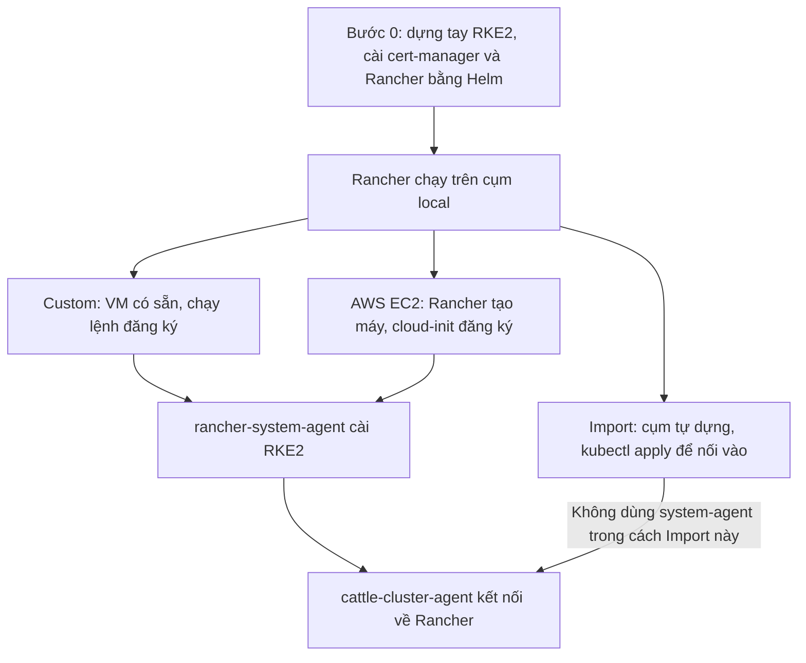

# Quy trình tạo cụm Kubernetes RKE2 với Rancher (3 cách)

> **Mục đích:** hướng dẫn từng bước cách dựng một cụm Kubernetes RKE2 và đưa cụm đó vào Rancher quản lý, theo 3 cách:
> 1. **Custom**: dùng VM có sẵn, Rancher cài RKE2 lên VM.
> 2. **AWS EC2 (node driver)**: Rancher tự tạo EC2 và cài RKE2.
> 3. **Import**: tự dựng cụm bằng tay, sau đó nối cụm vào Rancher.
>
> Trước cả 3 cách là **Bước 0**: dựng tay cụm đầu tiên (cụm **local**) và cài Rancher lên đó. Cả 3 cách đều cần làm xong Bước 0 trước.
>
> - **Cách 1 và cách 2** dùng Rancher có sẵn ở cụm local để **tạo các cụm khác (cụm downstream)**. Bạn không tự cài RKE2: Rancher cài lên máy thông qua rancher-system-agent.
> - **Cách 3**: cụm được **dựng tay giống hệt cụm local** ở Bước 0. Chỉ khác **bước cuối**: không cài Rancher lên cụm này, mà **import** nó vào Rancher có sẵn để nó trở thành một cụm downstream.
>
> **Dùng khi:** cần chọn cách tạo cụm phù hợp, cần thao tác theo từng bước, hoặc cần biết "phía sau" Rancher đang làm gì để debug khi bị kẹt.
>
> **Không bao gồm:** hardening bảo mật, cấu hình HA cho Load Balancer, backup/restore Rancher, nâng cấp phiên bản. Các lệnh dùng placeholder như `rancher.example.com` và `<token>`, cần thay bằng giá trị thật.
>
> **Phiên bản:** tài liệu không ghim version cụ thể. Trước khi cài, đối chiếu **Rancher Support Matrix** để chọn bộ version tương thích giữa Rancher, RKE2/Kubernetes và cert-manager.

---

## 0. Tổng quan

### 0.1. Vì sao luôn phải dựng tay cụm đầu tiên

Rancher là **một ứng dụng chạy trên Kubernetes**, cài vào cụm bằng Helm. Muốn có Rancher thì phải có một cụm K8S trước. Cụm đầu tiên này **luôn phải dựng bằng tay**, hoặc dùng một cụm có sẵn như EKS. Sau khi cài Rancher, cụm đó được gọi là **cụm local**.

- Cụm local là nơi Rancher chạy, đồng thời là "database" của Rancher. Mọi dữ liệu của Rancher (cụm, user, quyền, setting...) được lưu thành object K8S trong etcd của cụm này.

- Mọi cụm khác do Rancher tạo hoặc quản lý được gọi là **cụm downstream**.

Quan hệ giữa Bước 0 và 3 cách:

| | Dựng cụm bằng cách nào | Bước cuối | Kết quả |
|---|---|---|---|
| **Bước 0** | Dựng tay (cài RKE2 bằng lệnh) | **Cài Rancher** lên cụm | Cụm **local**, nơi chạy Rancher |
| **Cách 1** | **Rancher có sẵn** cài RKE2 lên VM có sẵn | Rancher tự đưa cụm vào quản lý | Cụm **downstream** mới |
| **Cách 2** | **Rancher có sẵn** tự tạo EC2 và cài RKE2 | Rancher tự đưa cụm vào quản lý | Cụm **downstream** mới |
| **Cách 3** | Dựng tay, **giống hệt Bước 0** | **Import** cụm vào Rancher có sẵn (không cài Rancher) | Cụm **downstream** |

### 0.2. Sơ đồ 3 cách



### 0.3. Ba agent sẽ gặp trong quy trình

| Agent | Chạy ở đâu | Có trên cụm nào | Vai trò |
|---|---|---|---|
| **rancher-system-agent** | **Hệ điều hành của từng node** (dịch vụ systemd, không phải pod) | Chỉ cụm RKE2/K3s **do Rancher tạo** (cách 1, cách 2) | Nhận "plan" từ Rancher rồi cài, cấu hình, nâng cấp RKE2 trên node; xoay vòng cert; snapshot/restore etcd |
| **cattle-cluster-agent** | Pod (Deployment) trong namespace `cattle-system` | Mọi cụm **downstream** (cách 1, 2, 3). Không có trên cụm local | Mở tunnel websocket về Rancher để UI và kubectl đi qua; đồng bộ RBAC, project, namespace; báo tình trạng cụm |
| **fleet-agent** | Pod trong `cattle-fleet-system` (downstream) hoặc `cattle-fleet-local-system` (local) | **Mọi cụm**, kể cả local | GitOps: nhận bundle từ fleet-controller, cài bằng Helm, báo trạng thái |

rancher-system-agent phải chạy ở tầng hệ điều hành, vì nhiệm vụ của nó là **cài K8S lên máy**. Lúc đó K8S chưa tồn tại nên không thể chạy dưới dạng pod.

Khi một agent bị lỗi, **ứng dụng đang chạy trong cụm không bị ảnh hưởng**. Chỉ khả năng quản lý từ Rancher bị mất: cụm báo Unavailable, không triển khai mới được, không nâng cấp được.

### 0.4. Chọn cách nào

| Tình huống | Nên chọn |
|---|---|
| Có sẵn VM (on-prem, VMware, cloud bất kỳ), muốn Rancher lo cài đặt và vòng đời RKE2 | **Cách 1: Custom** |
| Chạy trên AWS, muốn Rancher tự tạo, scale và thay máy | **Cách 2: AWS EC2** |
| Đã có cụm sẵn (tự dựng, EKS, kubeadm...) và chỉ cần quản lý tập trung | **Cách 3: Import** |

---

## 1. Bước 0: Dựng cụm local và cài Rancher

### 1.1. Chuẩn bị

- **3 VM Linux** cho production, hoặc 1 VM nếu chỉ để lab. Mỗi VM có hostname riêng và đã đồng bộ thời gian (NTP).

- **Tên miền cho Rancher**, ví dụ `rancher.example.com`. Tên miền trỏ vào IP các node, hoặc vào Load Balancer đứng trước các node. RKE2 có sẵn ingress controller lắng nghe port 80/443 trên node.

- **Port** cần mở: xem [mục 6.1](#61-port-cần-mở).

- Máy quản trị đã cài `kubectl` và `helm`. Có thể dùng luôn node 1 làm máy quản trị.

### 1.2. Cài RKE2 trên node 1

```bash
mkdir -p /etc/rancher/rke2
cat > /etc/rancher/rke2/config.yaml <<EOF
token: my-shared-secret
# tls-san:                      # thêm tên/IP dùng để truy cập K8S API từ bên ngoài (LB, DNS)
#   - k8s-api.example.com
EOF
curl -sfL https://get.rke2.io | sh -
# Ghim version: curl -sfL https://get.rke2.io | INSTALL_RKE2_VERSION=<vX.Y.Z+rke2rN> sh -
systemctl enable --now rke2-server
```

### 1.3. Join node 2 và node 3

```bash
mkdir -p /etc/rancher/rke2
cat > /etc/rancher/rke2/config.yaml <<EOF
server: https://<IP-node1>:9345
token: my-shared-secret
EOF
curl -sfL https://get.rke2.io | sh -
systemctl enable --now rke2-server
```

### 1.4. Lấy kubeconfig

```bash
mkdir -p ~/.kube && cp /etc/rancher/rke2/rke2.yaml ~/.kube/config
export PATH=$PATH:/var/lib/rancher/rke2/bin
kubectl get nodes        # đủ 3 node ở trạng thái Ready
```

File `rke2.yaml` trỏ tới `https://127.0.0.1:6443`. Nếu dùng kubeconfig từ máy khác, đổi địa chỉ này thành IP node hoặc địa chỉ LB.

### 1.5. Cài cert-manager và Rancher

```bash
helm repo add jetstack https://charts.jetstack.io
helm repo add rancher-stable https://releases.rancher.com/server-charts/stable
helm repo update
helm install cert-manager jetstack/cert-manager -n cert-manager --create-namespace \
  --set crds.enabled=true --wait
# cert-manager bản cũ (< 1.15) dùng --set installCRDs=true
helm install rancher rancher-stable/rancher -n cattle-system --create-namespace \
  --set hostname=rancher.example.com \
  --set bootstrapPassword=MatKhauBanDau \
  --set replicas=3 \
  --wait --timeout 10m
```

- `--wait` bắt Helm đợi các Deployment Ready mới báo thành công. Không có `--wait`, Helm báo thành công ngay khi API server nhận manifest, kể cả khi pod Rancher đang lỗi.

- Nên đặt sẵn `bootstrapPassword`. Nếu bỏ qua, Rancher tự sinh password lúc khởi động lần đầu và ghi vào secret `bootstrap-secret`. Secret này chỉ xuất hiện **sau khi pod Rancher chạy**. Xem [mục 6.2](#62-sự-cố-thường-gặp).

### 1.6. Đăng nhập lần đầu

1. Mở `https://rancher.example.com`.

2. Đăng nhập bằng bootstrap password.

3. Đặt password admin mới.

4. Xác nhận **Server URL**. Đây là URL mà mọi agent ở cụm downstream sẽ gọi về, nên phải là địa chỉ các cụm đó truy cập được.

### 1.7. Kiểm tra

```bash
kubectl get pods -n cattle-system                  # rancher-xxx, rancher-webhook-xxx Running
kubectl get pods -n cattle-fleet-local-system      # fleet-agent của cụm local
kubectl get clusters.management.cattle.io          # có cụm "local"
```

**Chỉ để lab:** có thể chạy nhanh `docker run -d --privileged -p 80:80 -p 443:443 rancher/rancher`. Bên trong container có sẵn một cụm K3s mini. **Không dùng cho production.**

---

## 2. Cách 1: Custom (VM có sẵn)

> Dùng **Rancher có sẵn** (đã cài ở Bước 0) để tạo một **cụm downstream mới** trên các VM bạn đã có. Bạn chỉ chạy lệnh đăng ký trên VM. Việc cài RKE2 do Rancher làm, thông qua rancher-system-agent.

### 2.1. Chuẩn bị

- Các VM Linux đã có sẵn, mỗi VM có hostname riêng và đồng bộ thời gian.

- VM **gọi được tới `https://rancher.example.com:443`**. Agent là bên chủ động kết nối nên không cần mở port chiều vào VM từ phía Rancher.

- Giữa các VM thông các port RKE2. Xem [mục 6.1](#61-port-cần-mở).

### 2.2. Tạo cụm trên Rancher UI

1. **☰ → Cluster Management → Create**, chọn **Custom**. Đảm bảo đang chọn RKE2/K3s.

2. Nhập **Cluster Name**.

3. Chọn **Kubernetes Version** (bản RKE2) và **Container Network** (Calico, Canal hoặc Cilium).

4. Tùy chọn thêm: lịch snapshot etcd, backup snapshot lên S3, private registry, cloud provider.

5. Bấm **Create**. Rancher chuyển sang tab **Registration**.

### 2.3. Chạy lệnh đăng ký trên từng VM

1. Ở tab Registration, tick vai trò cho node: `etcd`, `Control Plane`, `Worker`.

   - Nếu Rancher dùng cert tự ký thì tick thêm **Insecure**.

2. Copy lệnh Rancher sinh ra, SSH vào VM và chạy:

   ```bash
   curl -fL https://rancher.example.com/system-agent-install.sh | sudo sh -s - \
     --server https://rancher.example.com --token <token> --ca-checksum <checksum> \
     --etcd --controlplane --worker
   ```

3. Lặp lại cho từng VM, đổi vai trò cho phù hợp. Mô hình hay dùng:

   | Quy mô | Mô hình |
   |---|---|
   | Nhỏ | 3 node, mỗi node gánh cả `etcd + controlplane + worker` |
   | Vừa và lớn | 3 node `etcd + controlplane`, cộng N node `worker` |

   Số node etcd nên là số lẻ (1, 3, 5) để etcd luôn bầu được leader (quorum).

4. Theo dõi tab **Machines** trên UI cho tới khi cụm chuyển sang **Active**.

### 2.4. Chuyện gì xảy ra phía sau

1. Chạy lệnh đăng ký để cài rancher-system-agent dưới dạng dịch vụ systemd; agent báo danh với Rancher.

2. Rancher gửi plan; agent cài RKE2 theo vai trò.

3. Node etcd/control plane đầu tiên khởi tạo cụm; các node khác join.

4. Rancher triển khai cattle-cluster-agent; cụm chuyển Active, rồi cài fleet-agent.

### 2.5. Kiểm tra và debug

```bash
# Trên VM:
systemctl status rancher-system-agent
journalctl -u rancher-system-agent -f
journalctl -u rke2-server -f        # node etcd/controlplane
journalctl -u rke2-agent -f         # node chỉ có vai trò worker
# Trong cụm mới (kubeconfig tải từ Rancher UI):
kubectl get nodes
kubectl get deploy -n cattle-system cattle-cluster-agent
```

**Không gỡ rancher-system-agent** sau khi cụm đã chạy. Rancher vẫn cần nó để nâng cấp version, xoay vòng cert và snapshot/restore etcd.

---

## 3. Cách 2: AWS EC2 (Rancher tự tạo máy)

> Dùng **Rancher có sẵn** (đã cài ở Bước 0) để tạo một **cụm downstream mới** trên AWS. Rancher tự tạo EC2 và tự cài RKE2. Bạn không cần SSH vào máy nào.

### 3.1. Chuẩn bị phía AWS

- **IAM user hoặc access key** có quyền thao tác EC2:

  - tạo, chạy, dừng, xóa instance;

  - tạo security group và mở rule;

  - tạo, import, xóa key pair;

  - tạo tag, quản lý volume;

  - các quyền `Describe*`;

  - `iam:PassRole` nếu gắn instance profile.

  Tài liệu Rancher có sẵn IAM policy mẫu cho node driver Amazon EC2.

- Chọn sẵn **Region, VPC, Subnet**.

- **EC2 phải gọi được tới Server URL của Rancher.** Rancher có thể public, hoặc nằm trong mạng riêng thông với VPC.

- **Tùy chọn:** nếu muốn K8S tự tạo ELB/NLB cho Service `LoadBalancer` và tự cấp EBS volume (AWS cloud provider), cần thêm **IAM instance profile** gắn cho node.

### 3.2. Tạo Cloud Credential

**☰ → Cluster Management → Cloud Credentials → Create → Amazon**. Nhập Access Key, Secret Key và region mặc định.

### 3.3. Tạo cụm và khai báo Machine Pools

1. **☰ → Cluster Management → Create**, chọn **Amazon EC2**.

2. Chọn Cloud Credential vừa tạo và nhập **Cluster Name**.

3. Khai báo **Machine Pools**. Mỗi pool là một nhóm máy giống nhau. Ví dụ:

   | Pool | Số lượng | Vai trò | Instance type |
   |---|---|---|---|
   | `cp-etcd` | 3 | etcd + Control Plane | t3.large |
   | `worker` | 2 | Worker | t3.xlarge |

4. Với mỗi pool, khai báo thêm:

   | Trường | Ghi chú |
   |---|---|
   | Region / Zone | Có thể dàn các pool ra nhiều zone để tăng sẵn sàng |
   | AMI | Mặc định là Ubuntu |
   | VPC / Subnet | Subnet phải ra được Server URL của Rancher |
   | Security Group | Để Rancher tự tạo `rancher-nodes` với các port cần thiết, hoặc chọn SG có sẵn |
   | Root Disk Size | Dung lượng ổ root |
   | SSH User | Ví dụ `ubuntu` cho AMI Ubuntu |
   | IAM Instance Profile | Bắt buộc nếu bật AWS cloud provider |
   | Tags | Theo quy định của tổ chức |
   | Auto Replace | Thời gian node unhealthy trước khi Rancher xóa và tạo node mới |

### 3.4. Cluster Configuration

- Chọn **Kubernetes Version** và **Container Network**.

- **Cloud Provider: Amazon**, nếu cần ELB/EBS.

- Cấu hình lịch snapshot etcd và private registry nếu có.

- Bấm **Create** và chờ cụm **Active**.

### 3.5. Chuyện gì xảy ra phía sau

1. Rancher tạo các Job machine-provision trong namespace fleet-default trên cụm local.

2. Job gọi AWS API tạo EC2 và đưa user-data (cloud-init) vào máy.

3. EC2 khởi động; cloud-init cài rancher-system-agent và đăng ký với Rancher.

4. Tiếp theo giống Cách 1: agent cài RKE2, cattle-cluster-agent kết nối, cụm Active, rồi cài fleet-agent.

### 3.6. Vận hành

| Việc | Cách làm |
|---|---|
| Scale | Sửa số lượng máy trong Machine Pool. Rancher tự tạo hoặc xóa EC2 |
| Thay node hỏng | Bật **Auto Replace**. Node unhealthy quá thời gian cho phép sẽ được thay |
| Xóa cụm | Xóa trên Rancher UI. Rancher terminate luôn các EC2 nó đã tạo |

### 3.7. Debug

```bash
# Trên cụm local:
kubectl get jobs,pods -n fleet-default          # Job tạo máy có lỗi không
kubectl logs -n fleet-default <pod-machine-provision>
```

Lỗi hay gặp:

- thiếu quyền IAM;

- sai subnet hoặc security group;

- EC2 không gọi được tới Rancher (thiếu route ra Internet, thiếu NAT, sai DNS);

- hết quota instance trong region.

---

## 4. Cách 3: Tự dựng tay rồi Import

> Cụm được **dựng tay giống hệt cụm local ở Bước 0**. Khác biệt duy nhất là **bước cuối**:
>
> - Bước 0: cài cert-manager và Rancher lên cụm, nên cụm trở thành cụm local.
> - Cách 3: **không cài Rancher**, mà **import** cụm vào Rancher có sẵn, nên cụm trở thành cụm downstream.

### 4.1. Dựng cụm

Dựng cụm RKE2 bằng tay trên các VM khác, làm giống hệt [mục 1.2 – 1.4](#12-cài-rke2-trên-node-1). **Không làm mục 1.5 – 1.6**, tức là không cài cert-manager và Rancher lên cụm này.

Thực ra cụm Kubernetes nào cũng import được: EKS, AKS, GKE, kubeadm, K3s...

### 4.2. Import vào Rancher

1. **☰ → Cluster Management → Import Existing → Generic**.

   - Với EKS/AKS/GKE có thể chọn mục riêng của từng nhà cung cấp, để Rancher quản lý thêm node group và version qua API của cloud.

2. Nhập **Cluster Name** và bấm **Create**.

3. Rancher sinh lệnh import. Chạy lệnh **với kubeconfig đang trỏ vào cụm cần import** và có quyền cluster-admin:

   ```bash
   kubectl apply -f https://rancher.example.com/v3/import/<token>.yaml
   # Rancher dùng cert tự ký:
   curl --insecure -sfL https://rancher.example.com/v3/import/<token>.yaml | kubectl apply -f -
   ```

4. Chờ cụm chuyển **Active** trên Rancher UI.

### 4.3. Chuyện gì xảy ra phía sau

1. kubectl apply tạo namespace cattle-system, ServiceAccount, RBAC và Deployment cattle-cluster-agent.

2. Agent mở tunnel về Rancher; cụm chuyển Active.

3. Rancher cài fleet-agent.

### 4.4. Giới hạn

Cách này **không có rancher-system-agent**, nên Rancher không đụng tới tầng cài đặt RKE2. Các việc sau chủ yếu **phải tự làm**:

- thêm hoặc bớt node;

- snapshot và restore etcd;

- xoay vòng cert;

- vá hệ điều hành.

Với cụm RKE2/K3s import, một số bản Rancher cho phép nâng version Kubernetes từ UI.

---

## 5. Bảng tóm tắt

| | Bước 0 (cụm local) | Cách 1: Custom | Cách 2: AWS EC2 | Cách 3: Import |
|---|---|---|---|---|
| Cần có Rancher trước | ❌ (đây là nơi cài Rancher) | ✅ | ✅ | ✅ |
| Kết quả | Cụm **local** (chạy Rancher) | Cụm **downstream** mới | Cụm **downstream** mới | Cụm **downstream** |
| Cách dựng cụm | Dựng tay | Rancher dựng | Rancher dựng | Dựng tay, giống Bước 0 |
| Bước cuối | Cài Rancher | Rancher tự đưa vào quản lý | Rancher tự đưa vào quản lý | Import vào Rancher |
| Ai tạo VM | Bạn | Bạn | **Rancher** | Bạn |
| Ai cài RKE2 | Bạn | rancher-system-agent | rancher-system-agent | Bạn |
| Phải SSH vào máy | ✅ | ✅ (chạy lệnh đăng ký) | ❌ | ✅ (khi dựng cụm) |
| Agent có trong cụm | fleet-agent | system-agent + cluster-agent + fleet-agent | system-agent + cluster-agent + fleet-agent | cluster-agent + fleet-agent |
| Quản lý vòng đời từ UI (version, cert, snapshot, scale) | ❌ | ✅ (trừ tạo máy) | ✅ Đầy đủ | ❌ Hạn chế |

---

## 6. Lưu ý chung

### 6.1. Port cần mở

| Port | Giao thức | Chiều | Mục đích |
|---|---|---|---|
| 443 | TCP | Node downstream → Rancher | Agent kết nối về Rancher (cả 3 cách) |
| 80, 443 | TCP | Người dùng → node cụm local hoặc LB | Truy cập Rancher UI qua ingress |
| 9345 | TCP | Node → node server (etcd/controlplane) | RKE2 supervisor, dùng khi đăng ký và join node |
| 6443 | TCP | Node và quản trị viên → node server | Kubernetes API |
| 2379 – 2380 | TCP | Node etcd ↔ node etcd | etcd client và peer |
| 10250 | TCP | Mọi node ↔ mọi node | kubelet |
| 8472 | UDP | Mọi node ↔ mọi node | VXLAN (Canal, Flannel, Cilium). Calico dùng thêm 179/TCP (BGP) hoặc 4789/UDP (VXLAN) |
| 30000 – 32767 | TCP | Theo nhu cầu | NodePort Service |

### 6.2. Sự cố thường gặp

| Hiện tượng | Nguyên nhân thường gặp | Cách xử lý |
|---|---|---|
| Helm báo cài Rancher thành công nhưng UI không vào được | Helm chỉ xác nhận API server đã nhận manifest, không đợi pod chạy (khi thiếu `--wait`) | `kubectl get pods -n cattle-system`, `kubectl rollout status deploy/rancher -n cattle-system`, xem log pod |
| `bootstrap-secret` NotFound | Sai namespace (phải là `cattle-system`); sai kubeconfig/context; pod Rancher chưa chạy nên chưa sinh secret; Rancher đã từng được cài trước đó | `kubectl logs -n cattle-system -l app=rancher \| grep "Bootstrap Password"`, hoặc reset password bằng `kubectl -n cattle-system exec <rancher-pod> -c rancher -- reset-password` |
| Pod Rancher `Pending` hoặc `CrashLoopBackOff` | Chưa cài hoặc cert-manager chưa sẵn sàng; thiếu CPU/RAM; lỗi pull image | `kubectl describe pod`, `kubectl get pods -n cert-manager` |
| Cụm downstream kẹt ở `Waiting for agent` hoặc `Unavailable` | Node không gọi được Server URL; DNS sai; cert tự ký nhưng thiếu `--ca-checksum` hoặc **Insecure** | Từ node chạy `curl -v https://rancher.example.com/ping`; xem log `rancher-system-agent` hoặc `cattle-cluster-agent` |
| Cụm EC2 không tạo được máy | Thiếu quyền IAM, sai subnet hoặc SG, hết quota | Xem log pod `machine-provision` trong `fleet-default` |

### 6.3. Khuyến nghị vận hành

- **Không chạy ứng dụng nghiệp vụ trên cụm local.** Dành cụm này riêng cho Rancher.

- **Backup cụm local định kỳ**: snapshot etcd và/hoặc dùng `rancher-backup` operator. Mất cụm local là mất toàn bộ cấu hình Rancher. Các cụm downstream vẫn chạy nhưng không còn được quản lý.

- Cụm local cho production nên có **ít nhất 3 node** để có tính sẵn sàng cao (HA).

- **Không gỡ rancher-system-agent** trên node của cụm do Rancher tạo (cách 1, cách 2).

- Ghi lại bộ version đã dùng (Rancher, RKE2, cert-manager) cho mỗi lần cài, để sau này nâng cấp hoặc dựng lại cho nhất quán.
